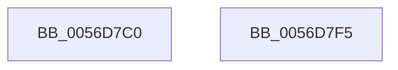

# Amd64PauseProfiling

- RVA: `0x0056D7C0`–`0x0056D7F6` (길이 `54` bytes)
- VA: `0x000000014056D7C0`
- 실행 섹션: `.text`
- PDB 이름 있음: `예`; PDB Function 태그: `아니요`
- unwind 정보 RVA: `0x0005CF00`
- 디코드: `16`개 명령, `54/54` bytes 표시
- 미해석 바이트: `0` (있으면 어셈블리에 `.byte`로 보존)

> 이 문서는 커널 이미지의 기계어와 PDB 기호를 분석해 생성했습니다. 4번과 5번은 함수 원형과 자료형을 바이너리 사용 방식에서 추정한 C 해석이며 원본 소스 복구 결과는 아닙니다.

## 1. Dependencies

- 직접 호출 지점: **3**; 고유 호출 대상: **1**
- 직접 호출자로 확인된 함수: **0**
- RIP 상대 이미지 참조: **0**

### Outgoing calls
- `0x0056D7D2` → [Amd64PauseProfilingInternal](Amd64PauseProfilingInternal_function_0056D7FC.md) (function, `0x0056D7FC`)
- `0x0056D7DE` → [Amd64PauseProfilingInternal](Amd64PauseProfilingInternal_function_0056D7FC.md) (function, `0x0056D7FC`)
- `0x0056D7EA` → [Amd64PauseProfilingInternal](Amd64PauseProfilingInternal_function_0056D7FC.md) (function, `0x0056D7FC`)

### Direct callers
- 이 함수 시작 RVA로 연결되는 직접 call은 확인되지 않았습니다. 간접 호출은 완전히 역산할 수 없습니다.

### Static image references
- 디코드된 RIP-relative 메모리 참조가 없습니다.

## 2. Other-region calls and transfers

- 다른 실행 섹션으로 향하는 call: **0**
- 별도 외부 분기/꼬리 이동을 확인하지 못했습니다.

## 3. Assembly (complete function range)

```asm
0056D7C0  40 53                           push rbx
0056D7C2  48 83 EC 20                     sub rsp, 0x20
0056D7C6  65 8B 1C 25 A4 01 00 00         mov ebx, dword ptr gs:[0x1a4]
0056D7CE  33 C9                           xor ecx, ecx
0056D7D0  8B D3                           mov edx, ebx
0056D7D2  E8 25 00 00 00                  call 0x14056d7fc
0056D7D7  8B D3                           mov edx, ebx
0056D7D9  B9 64 00 00 00                  mov ecx, 0x64
0056D7DE  E8 19 00 00 00                  call 0x14056d7fc
0056D7E3  8B D3                           mov edx, ebx
0056D7E5  B9 65 00 00 00                  mov ecx, 0x65
0056D7EA  E8 0D 00 00 00                  call 0x14056d7fc
0056D7EF  48 83 C4 20                     add rsp, 0x20
0056D7F3  5B                              pop rbx
0056D7F4  C3                              ret
0056D7F5  CC                              int3
```

## 4. C-style interpretation (structured pseudocode)

```c
__int64 __fastcall Amd64PauseProfiling(int a1)
{
    __int64 result;
    __int64 v_rsp;

    v_rsp = (v_rsp) - (32);
    a1 = 0;
    result = Amd64PauseProfilingInternal(a1, (unsigned int)((unsigned int)((unsigned int)(*(unsigned int *)(gs_base + (0 + 420))))), a3, a4);
    result = Amd64PauseProfilingInternal(100, (unsigned int)((unsigned int)((unsigned int)(*(unsigned int *)(gs_base + (0 + 420))))), a3, a4);
    result = Amd64PauseProfilingInternal(101, (unsigned int)((unsigned int)((unsigned int)(*(unsigned int *)(gs_base + (0 + 420))))), a3, a4);
    v_rsp = (v_rsp) + (32);
    return result;
}
```

## 5. (Beta) C Style

```c
int64_t Amd64PauseProfiling(int32_t Arg1)
{
    int64_t result;
    int64_t local_rsp;

    local_rsp = (local_rsp) - (32);
    Arg1 = 0;
    result = Amd64PauseProfilingInternal(Arg1, (uint32_t)((uint32_t)((uint32_t)(*(uint32_t *)(gs_base + (0 + 0x1A4))))), a3, a4);
    result = Amd64PauseProfilingInternal(100, (uint32_t)((uint32_t)((uint32_t)(*(uint32_t *)(gs_base + (0 + 0x1A4))))), a3, a4);
    result = Amd64PauseProfilingInternal(101, (uint32_t)((uint32_t)((uint32_t)(*(uint32_t *)(gs_base + (0 + 0x1A4))))), a3, a4);
    local_rsp = (local_rsp) + (32);
    return result;
}
```

## 6. Execution-region graph

[열기: 2D/3D 그래프와 함수 탐색 컨트롤 패널](../../../control-panel.html?section=text&rva=0x0056D7C0&view=graph)

- 2D 그래프는 위에서 아래로 흐르고, 3D 그래프는 빈 공간을 드래그해 회전합니다. Shift+드래그는 이동, 휠은 확대·축소, 함수 노드 선택은 대상 보고서 이동입니다.

### Static fallback


