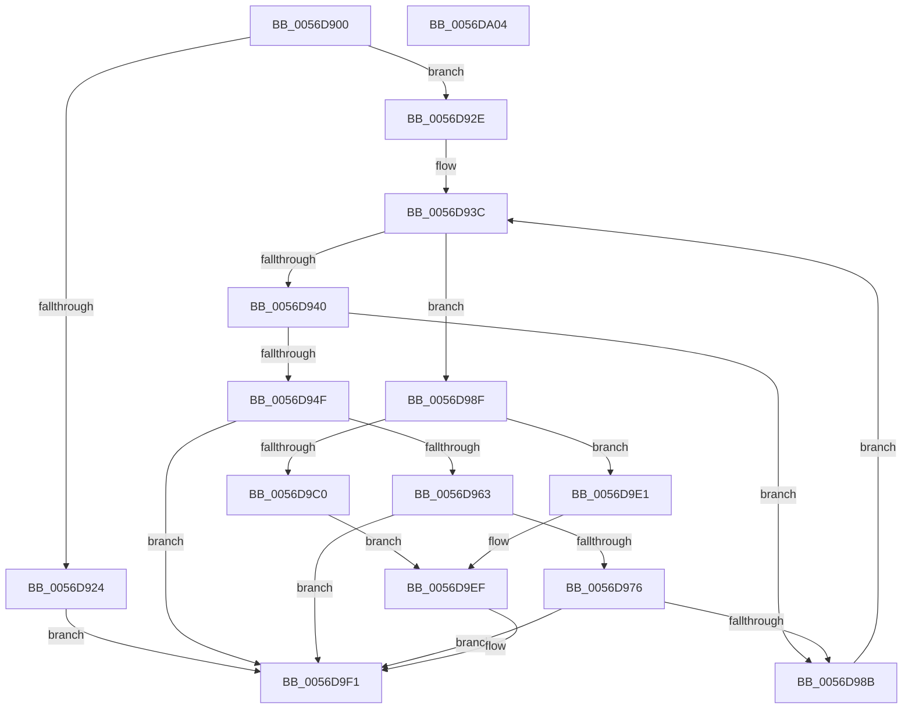

# Amd64RemoveProfileSource

- RVA: `0x0056D900`–`0x0056DA05` (길이 `261` bytes)
- VA: `0x000000014056D900`
- 실행 섹션: `.text`
- PDB 이름 있음: `예`; PDB Function 태그: `아니요`
- unwind 정보 RVA: `0x000701D4`
- 디코드: `77`개 명령, `261/261` bytes 표시
- 미해석 바이트: `0` (있으면 어셈블리에 `.byte`로 보존)

> 이 문서는 커널 이미지의 기계어와 PDB 기호를 분석해 생성했습니다. 4번과 5번은 함수 원형과 자료형을 바이너리 사용 방식에서 추정한 C 해석이며 원본 소스 복구 결과는 아닙니다.

## 1. Dependencies

- 직접 호출 지점: **10**; 고유 호출 대상: **7**
- 직접 호출자로 확인된 함수: **0**
- RIP 상대 이미지 참조: **2**

### Outgoing calls
- `0x0056D933` → [KeQueryActiveProcessorCountEx](../24/KeQueryActiveProcessorCountEx_function_00249EF0.md) (function, `0x00249EF0`)
- `0x0056D946` → [KeCheckProcessorAffinityEx](../30/KeCheckProcessorAffinityEx_function_00305150.md) (function, `0x00305150`)
- `0x0056D956` → [Amd64IsProfileBeingUsed](Amd64IsProfileBeingUsed_function_0056D28C.md) (function, `0x0056D28C`)
- `0x0056D96D` → [Amd64IsProfileBeingUsed](Amd64IsProfileBeingUsed_function_0056D28C.md) (function, `0x0056D28C`)
- `0x0056D980` → [Amd64IsProfileBeingUsed](Amd64IsProfileBeingUsed_function_0056D28C.md) (function, `0x0056D28C`)
- `0x0056D996` → [HalpAcquireHighLevelLock](../2D/HalpAcquireHighLevelLock_function_002D2390.md) (function, `0x002D2390`)
- `0x0056D9A6` → [HalpRemoveProfileSourceFromList](../54/HalpRemoveProfileSourceFromList_function_005477B8.md) (function, `0x005477B8`)
- `0x0056D9B7` → [HalpReleaseHighLevelLock](../2D/HalpReleaseHighLevelLock_function_002D1C58.md) (function, `0x002D1C58`)
- `0x0056D9CC` → [HalpMmAllocCtxFree](../3E/HalpMmAllocCtxFree_function_003E1904.md) (function, `0x003E1904`)
- `0x0056D9D4` → [HalpMmAllocCtxFree](../3E/HalpMmAllocCtxFree_function_003E1904.md) (function, `0x003E1904`)

### Direct callers
- 이 함수 시작 RVA로 연결되는 직접 call은 확인되지 않았습니다. 간접 호출은 완전히 역산할 수 없습니다.

### Static image references
- `0x0056D98F` → RVA `0x00FC2BD0` (`.data`; read)
- `0x0056D9D9` → RVA `0x00FC2C20` (`.data`; read/write)

## 2. Other-region calls and transfers

- 다른 실행 섹션으로 향하는 call: **0**
- 별도 외부 분기/꼬리 이동을 확인하지 못했습니다.

## 3. Assembly (complete function range)

```asm
0056D900  48 89 5C 24 10                  mov qword ptr [rsp + 0x10], rbx
0056D905  48 89 6C 24 18                  mov qword ptr [rsp + 0x18], rbp
0056D90A  56                              push rsi
0056D90B  57                              push rdi
0056D90C  41 56                           push r14
0056D90E  48 83 EC 20                     sub rsp, 0x20
0056D912  48 83 64 24 40 00               and qword ptr [rsp + 0x40], 0
0056D918  33 F6                           xor esi, esi
0056D91A  8B 39                           mov edi, dword ptr [rcx]
0056D91C  4C 8B F1                        mov r14, rcx
0056D91F  83 FF 21                        cmp edi, 0x21
0056D922  77 0A                           ja 0x14056d92e
0056D924  B8 BB 00 00 C0                  mov eax, 0xc00000bb
0056D929  E9 C3 00 00 00                  jmp 0x14056d9f1
0056D92E  B9 FF FF 00 00                  mov ecx, 0xffff
0056D933  E8 B8 C5 CD FF                  call 0x140249ef0
0056D938  8B E8                           mov ebp, eax
0056D93A  33 DB                           xor ebx, ebx
0056D93C  3B DD                           cmp ebx, ebp
0056D93E  73 4F                           jae 0x14056d98f
0056D940  49 8D 4E 08                     lea rcx, [r14 + 8]
0056D944  8B D3                           mov edx, ebx
0056D946  E8 05 78 D9 FF                  call 0x140305150
0056D94B  85 C0                           test eax, eax
0056D94D  74 3C                           je 0x14056d98b
0056D94F  44 8B C7                        mov r8d, edi
0056D952  8B D3                           mov edx, ebx
0056D954  33 C9                           xor ecx, ecx
0056D956  E8 31 F9 FF FF                  call 0x14056d28c
0056D95B  85 C0                           test eax, eax
0056D95D  0F 88 8E 00 00 00               js 0x14056d9f1
0056D963  44 8B C7                        mov r8d, edi
0056D966  8B D3                           mov edx, ebx
0056D968  B9 64 00 00 00                  mov ecx, 0x64
0056D96D  E8 1A F9 FF FF                  call 0x14056d28c
0056D972  85 C0                           test eax, eax
0056D974  78 7B                           js 0x14056d9f1
0056D976  44 8B C7                        mov r8d, edi
0056D979  8B D3                           mov edx, ebx
0056D97B  B9 65 00 00 00                  mov ecx, 0x65
0056D980  E8 07 F9 FF FF                  call 0x14056d28c
0056D985  8B F0                           mov esi, eax
0056D987  85 C0                           test eax, eax
0056D989  78 66                           js 0x14056d9f1
0056D98B  FF C3                           inc ebx
0056D98D  EB AD                           jmp 0x14056d93c
0056D98F  48 8D 0D 3A 52 A5 00            lea rcx, [rip + 0xa5523a]
0056D996  E8 F5 49 D6 FF                  call 0x1402d2390
0056D99B  4C 8D 44 24 40                  lea r8, [rsp + 0x40]
0056D9A0  49 8B CE                        mov rcx, r14
0056D9A3  40 8A F8                        mov dil, al
0056D9A6  E8 0D 9E FD FF                  call 0x1405477b8
0056D9AB  40 8A D7                        mov dl, dil
0056D9AE  48 8D 0D 1B 52 A5 00            lea rcx, [rip + 0xa5521b]
0056D9B5  8A D8                           mov bl, al
0056D9B7  E8 9C 42 D6 FF                  call 0x1402d1c58
0056D9BC  84 DB                           test bl, bl
0056D9BE  74 21                           je 0x14056d9e1
0056D9C0  48 8B 5C 24 40                  mov rbx, qword ptr [rsp + 0x40]
0056D9C5  48 8B 93 28 01 00 00            mov rdx, qword ptr [rbx + 0x128]
0056D9CC  E8 33 3F E7 FF                  call 0x1403e1904
0056D9D1  48 8B D3                        mov rdx, rbx
0056D9D4  E8 2B 3F E7 FF                  call 0x1403e1904
0056D9D9  FF 0D 41 52 A5 00               dec dword ptr [rip + 0xa55241]
0056D9DF  EB 0E                           jmp 0x14056d9ef
0056D9E1  48 83 7C 24 40 00               cmp qword ptr [rsp + 0x40], 0
0056D9E7  B8 01 00 00 C0                  mov eax, 0xc0000001
0056D9EC  0F 44 F0                        cmove esi, eax
0056D9EF  8B C6                           mov eax, esi
0056D9F1  48 8B 5C 24 48                  mov rbx, qword ptr [rsp + 0x48]
0056D9F6  48 8B 6C 24 50                  mov rbp, qword ptr [rsp + 0x50]
0056D9FB  48 83 C4 20                     add rsp, 0x20
0056D9FF  41 5E                           pop r14
0056DA01  5F                              pop rdi
0056DA02  5E                              pop rsi
0056DA03  C3                              ret
0056DA04  CC                              int3
```

## 4. C-style interpretation (structured pseudocode)

```c
__int64 __fastcall Amd64RemoveProfileSource(__int64 a1)
{
    __int64 result;
    __int64 v_rbx;
    __int64 v_rsi;
    __int64 v_rsp;
    unsigned __int64 v_stack_p10;
    unsigned __int64 v_stack_p18;
    unsigned __int64 v_stack_p8;

    v_stack_p10 = v_rbx;
    v_stack_p18 = v_rbp;
    v_rsp = (v_rsp) - (32);
    v_rsi = 0;
    if (((unsigned int)((unsigned int)(*(unsigned int *)(a1)))) > 33) goto loc_0056D92E;
    goto loc_0056D9F1;
loc_0056D92E:
    result = KeQueryActiveProcessorCountEx((unsigned int)(0xFFFFULL), a2, a3, a4);
    v_rbx = 0;
loc_0056D93C:
    if (0 >= ((unsigned int)((unsigned int)((unsigned int)(result))))) goto loc_0056D98F;
    result = KeCheckProcessorAffinityEx(a1 + 8, 0, a3, a4);
    if ((unsigned int)(result) == 0) goto loc_0056D98B;
    a1 = 0;
    result = Amd64IsProfileBeingUsed(a1, 0, (unsigned int)((unsigned int)((unsigned int)(*(unsigned int *)(a1)))), a4);
    if (sign_flag) goto loc_0056D9F1;
    result = Amd64IsProfileBeingUsed(100, 0, (unsigned int)((unsigned int)((unsigned int)(*(unsigned int *)(a1)))), a4);
    if (sign_flag) goto loc_0056D9F1;
    result = Amd64IsProfileBeingUsed(101, 0, (unsigned int)((unsigned int)((unsigned int)(*(unsigned int *)(a1)))), a4);
    if (sign_flag) goto loc_0056D9F1;
loc_0056D98B:
    v_rbx = (unsigned int)((v_rbx) + 1);
    goto loc_0056D93C;
loc_0056D98F:
    result = HalpAcquireHighLevelLock(v_rip + 10834490, 0, (unsigned int)((unsigned int)((unsigned int)(*(unsigned int *)(a1)))), a4);
    result = HalpRemoveProfileSourceFromList(0, 0, v_stack_p8, a4);
    result = HalpReleaseHighLevelLock(v_rip + 10834459, (unsigned __int8)((unsigned __int8)(result)), v_stack_p8, a4);
    if ((unsigned __int8)((unsigned __int8)(result)) == 0) goto loc_0056D9E1;
    result = HalpMmAllocCtxFree(v_rip + 10834459, *(unsigned __int64 *)(v_stack_p8 + 296), v_stack_p8, a4);
    result = HalpMmAllocCtxFree(v_rip + 10834459, v_stack_p8, v_stack_p8, a4);
    goto loc_0056D9EF;
loc_0056D9E1:
    v_rsi = (unsigned int)((unsigned int)(result));
    if (v_stack_p8 == 0) { v_rsi = (unsigned int)((unsigned int)(0xC0000001ULL)); }
loc_0056D9EF:
loc_0056D9F1:
    v_rsp = (v_rsp) + (32);
    return (unsigned int)((unsigned int)(v_rsi));
}
```

## 5. (Beta) C Style

```c
int64_t Amd64RemoveProfileSource(void *Arg1)
{
    uint8_t *arg1 = (uint8_t *)Arg1;

    int64_t result;
    int64_t local_rbx;
    int64_t local_rsi;
    int64_t local_rsp;
    uint64_t v_stack_p10;
    uint64_t v_stack_p18;
    uint64_t v_stack_p8;

    v_stack_p10 = local_rbx;
    v_stack_p18 = local_rbp;
    local_rsp = (local_rsp) - (32);
    local_rsi = 0;
    if (((uint32_t)((uint32_t)(*(uint32_t *)(arg1)))) > 33) goto loc_0056D92E;
    goto loc_0056D9F1;
loc_0056D92E:
    result = KeQueryActiveProcessorCountEx((uint32_t)(0xFFFFULL), a2, a3, a4);
    local_rbx = 0;
loc_0056D93C:
    if (0 >= ((uint32_t)((uint32_t)((uint32_t)(result))))) goto loc_0056D98F;
    result = KeCheckProcessorAffinityEx(Arg1 + 8, 0, a3, a4);
    if ((uint32_t)(result) == 0) goto loc_0056D98B;
    Arg1 = 0;
    result = Amd64IsProfileBeingUsed(Arg1, 0, (uint32_t)((uint32_t)((uint32_t)(*(uint32_t *)(arg1)))), a4);
    if (sign_flag) goto loc_0056D9F1;
    result = Amd64IsProfileBeingUsed(100, 0, (uint32_t)((uint32_t)((uint32_t)(*(uint32_t *)(arg1)))), a4);
    if (sign_flag) goto loc_0056D9F1;
    result = Amd64IsProfileBeingUsed(101, 0, (uint32_t)((uint32_t)((uint32_t)(*(uint32_t *)(arg1)))), a4);
    if (sign_flag) goto loc_0056D9F1;
loc_0056D98B:
    local_rbx = (uint32_t)((local_rbx) + 1);
    goto loc_0056D93C;
loc_0056D98F:
    result = HalpAcquireHighLevelLock(v_rip + 10834490, 0, (uint32_t)((uint32_t)((uint32_t)(*(uint32_t *)(arg1)))), a4);
    result = HalpRemoveProfileSourceFromList(0, 0, v_stack_p8, a4);
    result = HalpReleaseHighLevelLock(v_rip + 10834459, (uint8_t)((uint8_t)(result)), v_stack_p8, a4);
    if ((uint8_t)((uint8_t)(result)) == 0) goto loc_0056D9E1;
    result = HalpMmAllocCtxFree(v_rip + 10834459, *(uint64_t *)(v_stack_p8 + 0x128), v_stack_p8, a4);
    result = HalpMmAllocCtxFree(v_rip + 10834459, v_stack_p8, v_stack_p8, a4);
    goto loc_0056D9EF;
loc_0056D9E1:
    local_rsi = (uint32_t)((uint32_t)(result));
    if (v_stack_p8 == 0) { local_rsi = (uint32_t)((uint32_t)(0xC0000001ULL)); }
loc_0056D9EF:
loc_0056D9F1:
    local_rsp = (local_rsp) + (32);
    return (uint32_t)((uint32_t)(local_rsi));
}
```

### 관측된 메모리 오프셋

구조체 형식이 확인되지 않은 접근은 인자 기준의 오프셋으로만 기록했습니다.

| 기준 인자 | 오프셋 표현 | 폭 (bit) | 접근 |
|---|---:|---:|---|
| `Arg1` | `+ 0x0` | `32` | `R` |
| `Arg1` | `+ 0x8` | `64` | `R` |

## 6. Execution-region graph

[열기: 2D/3D 그래프와 함수 탐색 컨트롤 패널](../../../control-panel.html?section=text&rva=0x0056D900&view=graph)

- 2D 그래프는 위에서 아래로 흐르고, 3D 그래프는 빈 공간을 드래그해 회전합니다. Shift+드래그는 이동, 휠은 확대·축소, 함수 노드 선택은 대상 보고서 이동입니다.

### Static fallback


