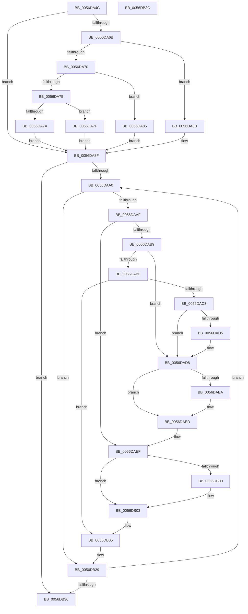

# Amd64ResumeProfilingInternal

- RVA: `0x0056DA4C`–`0x0056DB3D` (길이 `241` bytes)
- VA: `0x000000014056DA4C`
- 실행 섹션: `.text`
- PDB 이름 있음: `예`; PDB Function 태그: `아니요`
- unwind 정보 RVA: `0x00071750`
- 디코드: `69`개 명령, `241/241` bytes 표시
- 미해석 바이트: `0` (있으면 어셈블리에 `.byte`로 보존)

> 이 문서는 커널 이미지의 기계어와 PDB 기호를 분석해 생성했습니다. 4번과 5번은 함수 원형과 자료형을 바이너리 사용 방식에서 추정한 C 해석이며 원본 소스 복구 결과는 아닙니다.

## 1. Dependencies

- 직접 호출 지점: **0**; 고유 호출 대상: **0**
- 직접 호출자로 확인된 함수: **1**
- RIP 상대 이미지 참조: **1**

### Outgoing calls
- 직접 디코드된 call 명령이 없습니다.

### Direct callers
- [Amd64ResumeProfiling](Amd64ResumeProfiling_function_0056DA10.md) at `0x0056DA22`
- [Amd64ResumeProfiling](Amd64ResumeProfiling_function_0056DA10.md) at `0x0056DA2E`
- [Amd64ResumeProfiling](Amd64ResumeProfiling_function_0056DA10.md) at `0x0056DA3A`

### Static image references
- `0x0056DA54` → RVA `0x00000000` (`image boundary/outside`; read)

## 2. Other-region calls and transfers

- 다른 실행 섹션으로 향하는 call: **0**
- 별도 외부 분기/꼬리 이동을 확인하지 못했습니다.

## 3. Assembly (complete function range)

```asm
0056DA4C  48 89 5C 24 08                  mov qword ptr [rsp + 8], rbx
0056DA51  44 8B D2                        mov r10d, edx
0056DA54  48 8D 1D A5 25 A9 FF            lea rbx, [rip - 0x56da5b]
0056DA5B  4A 8B 84 D3 40 8C FC 00         mov rax, qword ptr [rbx + r10*8 + 0xfc8c40]
0056DA63  4C 8B 40 58                     mov r8, qword ptr [rax + 0x58]
0056DA67  85 C9                           test ecx, ecx
0056DA69  74 24                           je 0x14056da8f
0056DA6B  83 E9 01                        sub ecx, 1
0056DA6E  74 1B                           je 0x14056da8b
0056DA70  83 E9 63                        sub ecx, 0x63
0056DA73  74 10                           je 0x14056da85
0056DA75  83 F9 01                        cmp ecx, 1
0056DA78  74 05                           je 0x14056da7f
0056DA7A  45 33 C0                        xor r8d, r8d
0056DA7D  EB 10                           jmp 0x14056da8f
0056DA7F  49 83 C0 48                     add r8, 0x48
0056DA83  EB 0A                           jmp 0x14056da8f
0056DA85  49 83 C0 30                     add r8, 0x30
0056DA89  EB 04                           jmp 0x14056da8f
0056DA8B  49 83 C0 18                     add r8, 0x18
0056DA8F  4D 8B 58 10                     mov r11, qword ptr [r8 + 0x10]
0056DA93  45 33 C9                        xor r9d, r9d
0056DA96  45 39 48 04                     cmp dword ptr [r8 + 4], r9d
0056DA9A  0F 86 96 00 00 00               jbe 0x14056db36
0056DAA0  4B 8D 0C 49                     lea rcx, [r9 + r9*2]
0056DAA4  48 03 C9                        add rcx, rcx
0056DAA7  41 83 7C CB 18 02               cmp dword ptr [r11 + rcx*8 + 0x18], 2
0056DAAD  7D 7A                           jge 0x14056db29
0056DAAF  41 8B 08                        mov ecx, dword ptr [r8]
0056DAB2  33 D2                           xor edx, edx
0056DAB4  83 E9 01                        sub ecx, 1
0056DAB7  74 36                           je 0x14056daef
0056DAB9  83 E9 63                        sub ecx, 0x63
0056DABC  74 1A                           je 0x14056dad8
0056DABE  83 F9 01                        cmp ecx, 1
0056DAC1  75 42                           jne 0x14056db05
0056DAC3  4A 8B 84 D3 40 8C FC 00         mov rax, qword ptr [rbx + r10*8 + 0xfc8c40]
0056DACB  48 8B 50 58                     mov rdx, qword ptr [rax + 0x58]
0056DACF  48 83 C2 30                     add rdx, 0x30
0056DAD3  74 03                           je 0x14056dad8
0056DAD5  8B 52 04                        mov edx, dword ptr [rdx + 4]
0056DAD8  4A 8B 84 D3 40 8C FC 00         mov rax, qword ptr [rbx + r10*8 + 0xfc8c40]
0056DAE0  48 8B 40 58                     mov rax, qword ptr [rax + 0x58]
0056DAE4  48 83 C0 18                     add rax, 0x18
0056DAE8  74 03                           je 0x14056daed
0056DAEA  8B 40 04                        mov eax, dword ptr [rax + 4]
0056DAED  03 D0                           add edx, eax
0056DAEF  4A 8B 84 D3 40 8C FC 00         mov rax, qword ptr [rbx + r10*8 + 0xfc8c40]
0056DAF7  48 8B 40 58                     mov rax, qword ptr [rax + 0x58]
0056DAFB  48 85 C0                        test rax, rax
0056DAFE  74 03                           je 0x14056db03
0056DB00  8B 40 04                        mov eax, dword ptr [rax + 4]
0056DB03  03 D0                           add edx, eax
0056DB05  42 8D 04 0A                     lea eax, [rdx + r9]
0056DB09  8B 8C 83 40 F9 F8 00            mov ecx, dword ptr [rbx + rax*4 + 0xf8f940]
0056DB10  0F 32                           rdmsr
0056DB12  48 C1 E2 20                     shl rdx, 0x20
0056DB16  48 0B D0                        or rdx, rax
0056DB19  8B D2                           mov edx, edx
0056DB1B  48 0F BA EA 16                  bts rdx, 0x16
0056DB20  48 8B C2                        mov rax, rdx
0056DB23  48 C1 EA 20                     shr rdx, 0x20
0056DB27  0F 30                           wrmsr
0056DB29  41 FF C1                        inc r9d
0056DB2C  45 3B 48 04                     cmp r9d, dword ptr [r8 + 4]
0056DB30  0F 82 6A FF FF FF               jb 0x14056daa0
0056DB36  48 8B 5C 24 08                  mov rbx, qword ptr [rsp + 8]
0056DB3B  C3                              ret
0056DB3C  CC                              int3
```

## 4. C-style interpretation (structured pseudocode)

```c
__int64 __fastcall Amd64ResumeProfilingInternal(int a1, int a2, __int64 a3, int a4)
{
    __int64 result;
    unsigned __int64 v_stack_p8;

    v_stack_p8 = v_rbx;
    if (a1 == 0) goto loc_0056DA8F;
    a1 = (unsigned int)((a1) - (1));
    if (condition_is_equal) goto loc_0056DA8B;
    a1 = (unsigned int)((a1) - (99));
    if (condition_is_equal) goto loc_0056DA85;
    if (a1 == 1) goto loc_0056DA7F;
    a3 = 0;
    goto loc_0056DA8F;
loc_0056DA7F:
    a3 = (a3) + (72);
    goto loc_0056DA8F;
loc_0056DA85:
    a3 = (a3) + (48);
    goto loc_0056DA8F;
loc_0056DA8B:
    a3 = (a3) + (24);
loc_0056DA8F:
    a4 = 0;
    if ((*(unsigned int *)(a3 + 4)) <= 0) goto loc_0056DB36;
loc_0056DAA0:
    a1 = (a4 + a4 * 2) + (a4 + a4 * 2);
    if ((*(unsigned int *)(*(unsigned __int64 *)(a3 + 16) + a1 * 8 + 24)) >= 2) goto loc_0056DB29;
    a2 = 0;
    a1 = (unsigned int)(((unsigned int)(*(unsigned int *)(a3))) - (1));
    if (condition_is_equal) goto loc_0056DAEF;
    a1 = (unsigned int)((a1) - (99));
    if (condition_is_equal) goto loc_0056DAD8;
    if (a1 != 1) goto loc_0056DB05;
    a2 = (*(unsigned __int64 *)(*(unsigned __int64 *)(v_rip - 5691995 + (unsigned int)(a2) * 8 + 16550976) + 88)) + (48);
    if (!(condition_is_equal)) {
        a2 = *(unsigned int *)(a2 + 4);
    }
    result = (*(unsigned __int64 *)(*(unsigned __int64 *)(v_rip - 5691995 + (unsigned int)(a2) * 8 + 16550976) + 88)) + (24);
    if (!(condition_is_equal)) {
        result = *(unsigned int *)(result + 4);
    }
    a2 = (unsigned int)((a2) + ((unsigned int)(result)));
loc_0056DAEF:
    result = *(unsigned __int64 *)(*(unsigned __int64 *)(v_rip - 5691995 + (unsigned int)(a2) * 8 + 16550976) + 88);
    if (*(unsigned __int64 *)(*(unsigned __int64 *)(v_rip - 5691995 + (unsigned int)(a2) * 8 + 16550976) + 88) != 0) {
        result = *(unsigned int *)(*(unsigned __int64 *)(*(unsigned __int64 *)(v_rip - 5691995 + (unsigned int)(a2) * 8 + 16550976) + 88) + 4);
    }
    a2 = (unsigned int)((a2) + ((unsigned int)(result)));
loc_0056DB05:
    a2 = (a2) << (32);
    a2 = (a2) | (a2 + a4 * 1);
    a2 = ((unsigned int)(a2)) >> (32);
loc_0056DB29:
    a4 = (unsigned int)((a4) + 1);
    if (a4 < (*(unsigned int *)(a3 + 4))) goto loc_0056DAA0;
loc_0056DB36:
    return (unsigned int)(a2);
}
```

## 5. (Beta) C Style

```c
int64_t Amd64ResumeProfilingInternal(int32_t Arg1, int32_t Arg2, int64_t Arg3, int32_t Arg4)
{
    int64_t result;
    uint64_t v_stack_p8;

    v_stack_p8 = local_rbx;
    if (Arg1 == 0) goto loc_0056DA8F;
    Arg1 = (uint32_t)((Arg1) - (1));
    if (condition_is_equal) goto loc_0056DA8B;
    Arg1 = (uint32_t)((Arg1) - (99));
    if (condition_is_equal) goto loc_0056DA85;
    if (Arg1 == 1) goto loc_0056DA7F;
    Arg3 = 0;
    goto loc_0056DA8F;
loc_0056DA7F:
    Arg3 = (Arg3) + (72);
    goto loc_0056DA8F;
loc_0056DA85:
    Arg3 = (Arg3) + (48);
    goto loc_0056DA8F;
loc_0056DA8B:
    Arg3 = (Arg3) + (24);
loc_0056DA8F:
    Arg4 = 0;
    if ((*(uint32_t *)(Arg3 + 0x4)) <= 0) goto loc_0056DB36;
loc_0056DAA0:
    Arg1 = (Arg4 + Arg4 * 2) + (Arg4 + Arg4 * 2);
    if ((*(uint32_t *)(*(uint64_t *)(Arg3 + 0x10) + Arg1 * 8 + 0x18)) >= 2) goto loc_0056DB29;
    Arg2 = 0;
    Arg1 = (uint32_t)(((uint32_t)(*(uint32_t *)(Arg3))) - (1));
    if (condition_is_equal) goto loc_0056DAEF;
    Arg1 = (uint32_t)((Arg1) - (99));
    if (condition_is_equal) goto loc_0056DAD8;
    if (Arg1 != 1) goto loc_0056DB05;
    Arg2 = (*(uint64_t *)(*(uint64_t *)(v_rip - 0x56DA5B + (uint32_t)(Arg2) * 8 + 0xFC8C40) + 0x58)) + (48);
    if (!(condition_is_equal)) {
        Arg2 = *(uint32_t *)(Arg2 + 0x4);
    }
    result = (*(uint64_t *)(*(uint64_t *)(v_rip - 0x56DA5B + (uint32_t)(Arg2) * 8 + 0xFC8C40) + 0x58)) + (24);
    if (!(condition_is_equal)) {
        result = *(uint32_t *)(result + 0x4);
    }
    Arg2 = (uint32_t)((Arg2) + ((uint32_t)(result)));
loc_0056DAEF:
    result = *(uint64_t *)(*(uint64_t *)(v_rip - 0x56DA5B + (uint32_t)(Arg2) * 8 + 0xFC8C40) + 0x58);
    if (*(uint64_t *)(*(uint64_t *)(v_rip - 0x56DA5B + (uint32_t)(Arg2) * 8 + 0xFC8C40) + 0x58) != 0) {
        result = *(uint32_t *)(*(uint64_t *)(*(uint64_t *)(v_rip - 0x56DA5B + (uint32_t)(Arg2) * 8 + 0xFC8C40) + 0x58) + 0x4);
    }
    Arg2 = (uint32_t)((Arg2) + ((uint32_t)(result)));
loc_0056DB05:
    Arg2 = (Arg2) << (32);
    Arg2 = (Arg2) | (Arg2 + Arg4 * 1);
    Arg2 = ((uint32_t)(Arg2)) >> (32);
loc_0056DB29:
    Arg4 = (uint32_t)((Arg4) + 1);
    if (Arg4 < (*(uint32_t *)(Arg3 + 0x4))) goto loc_0056DAA0;
loc_0056DB36:
    return (uint32_t)(Arg2);
}
```

## 6. Execution-region graph

[열기: 2D/3D 그래프와 함수 탐색 컨트롤 패널](../../../control-panel.html?section=text&rva=0x0056DA4C&view=graph)

- 2D 그래프는 위에서 아래로 흐르고, 3D 그래프는 빈 공간을 드래그해 회전합니다. Shift+드래그는 이동, 휠은 확대·축소, 함수 노드 선택은 대상 보고서 이동입니다.

### Static fallback


