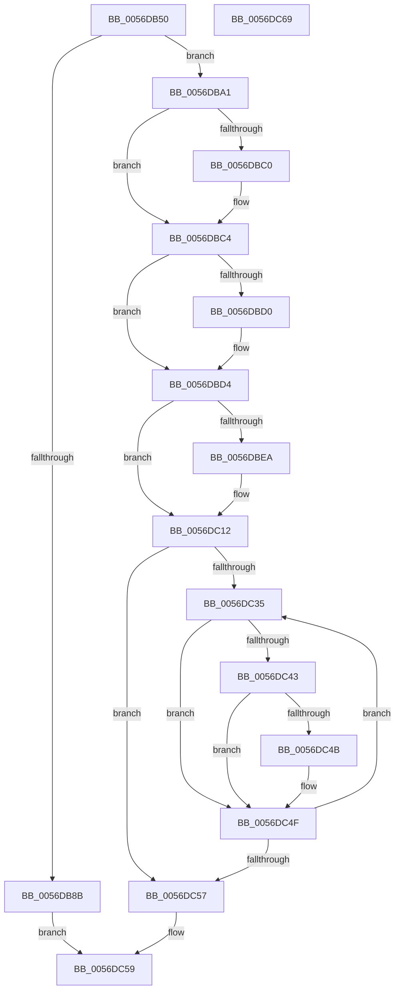

# Amd64SetInterval

- RVA: `0x0056DB50`–`0x0056DC6A` (길이 `282` bytes)
- VA: `0x000000014056DB50`
- 실행 섹션: `.text`
- PDB 이름 있음: `예`; PDB Function 태그: `아니요`
- unwind 정보 RVA: `0x00060BC4`
- 디코드: `74`개 명령, `282/282` bytes 표시
- 미해석 바이트: `0` (있으면 어셈블리에 `.byte`로 보존)

> 이 문서는 커널 이미지의 기계어와 PDB 기호를 분석해 생성했습니다. 4번과 5번은 함수 원형과 자료형을 바이너리 사용 방식에서 추정한 C 해석이며 원본 소스 복구 결과는 아닙니다.

## 1. Dependencies

- 직접 호출 지점: **5**; 고유 호출 대상: **4**
- 직접 호출자로 확인된 함수: **0**
- RIP 상대 이미지 참조: **2**

### Outgoing calls
- `0x0056DB71` → [HalpAcquireHighLevelLock](../2D/HalpAcquireHighLevelLock_function_002D2390.md) (function, `0x002D2390`)
- `0x0056DB80` → [HalpGetProfileDescriptor](../4B/HalpGetProfileDescriptor_function_004BB170.md) (function, `0x004BB170`)
- `0x0056DB95` → [HalpReleaseHighLevelLock](../2D/HalpReleaseHighLevelLock_function_002D1C58.md) (function, `0x002D1C58`)
- `0x0056DBE1` → [HalpReleaseHighLevelLock](../2D/HalpReleaseHighLevelLock_function_002D1C58.md) (function, `0x002D1C58`)
- `0x0056DC0D` → [HalpTimerSetProfilingTarget](../4C/HalpTimerSetProfilingTarget_function_004CAE84.md) (function, `0x004CAE84`)

### Direct callers
- 이 함수 시작 RVA로 연결되는 직접 call은 확인되지 않았습니다. 간접 호출은 완전히 역산할 수 없습니다.

### Static image references
- `0x0056DB67` → RVA `0x00FC2BD0` (`.data`; read)
- `0x0056DBA6` → RVA `0x00000000` (`image boundary/outside`; read)

## 2. Other-region calls and transfers

- 다른 실행 섹션으로 향하는 call: **0**
- 별도 외부 분기/꼬리 이동을 확인하지 못했습니다.

## 3. Assembly (complete function range)

```asm
0056DB50  48 89 5C 24 08                  mov qword ptr [rsp + 8], rbx
0056DB55  48 89 74 24 10                  mov qword ptr [rsp + 0x10], rsi
0056DB5A  57                              push rdi
0056DB5B  48 83 EC 20                     sub rsp, 0x20
0056DB5F  48 83 64 24 40 00               and qword ptr [rsp + 0x40], 0
0056DB65  8B F1                           mov esi, ecx
0056DB67  48 8D 0D 62 50 A5 00            lea rcx, [rip + 0xa55062]
0056DB6E  48 8B DA                        mov rbx, rdx
0056DB71  E8 1A 48 D6 FF                  call 0x1402d2390
0056DB76  4C 8D 44 24 40                  lea r8, [rsp + 0x40]
0056DB7B  8B CE                           mov ecx, esi
0056DB7D  44 8A C8                        mov r9b, al
0056DB80  E8 EB D5 F4 FF                  call 0x1404bb170
0056DB85  8B F8                           mov edi, eax
0056DB87  85 C0                           test eax, eax
0056DB89  79 16                           jns 0x14056dba1
0056DB8B  41 8A D1                        mov dl, r9b
0056DB8E  48 8D 0D 3B 50 A5 00            lea rcx, [rip + 0xa5503b]
0056DB95  E8 BE 40 D6 FF                  call 0x1402d1c58
0056DB9A  8B C7                           mov eax, edi
0056DB9C  E9 B8 00 00 00                  jmp 0x14056dc59
0056DBA1  48 8B 54 24 40                  mov rdx, qword ptr [rsp + 0x40]
0056DBA6  48 8D 3D 53 24 A9 FF            lea rdi, [rip - 0x56dbad]
0056DBAD  8B 03                           mov eax, dword ptr [rbx]
0056DBAF  44 0F B6 42 1C                  movzx r8d, byte ptr [rdx + 0x1c]
0056DBB4  42 8B 8C C7 DC 60 02 00         mov ecx, dword ptr [rdi + r8*8 + 0x260dc]
0056DBBC  3B C1                           cmp eax, ecx
0056DBBE  73 04                           jae 0x14056dbc4
0056DBC0  89 0B                           mov dword ptr [rbx], ecx
0056DBC2  8B C1                           mov eax, ecx
0056DBC4  42 8B 8C C7 D8 60 02 00         mov ecx, dword ptr [rdi + r8*8 + 0x260d8]
0056DBCC  3B C1                           cmp eax, ecx
0056DBCE  76 04                           jbe 0x14056dbd4
0056DBD0  89 0B                           mov dword ptr [rbx], ecx
0056DBD2  8B C1                           mov eax, ecx
0056DBD4  89 42 18                        mov dword ptr [rdx + 0x18], eax
0056DBD7  48 8D 0D F2 4F A5 00            lea rcx, [rip + 0xa54ff2]
0056DBDE  41 8A D1                        mov dl, r9b
0056DBE1  E8 72 40 D6 FF                  call 0x1402d1c58
0056DBE6  85 F6                           test esi, esi
0056DBE8  75 28                           jne 0x14056dc12
0056DBEA  65 48 8B 04 25 20 00 00 00      mov rax, qword ptr gs:[0x20]
0056DBF3  8B 0B                           mov ecx, dword ptr [rbx]
0056DBF5  8B 50 44                        mov edx, dword ptr [rax + 0x44]
0056DBF8  48 B8 CD CC CC CC CC CC CC CC   movabs rax, 0xcccccccccccccccd
0056DC02  48 0F AF D1                     imul rdx, rcx
0056DC06  48 F7 E2                        mul rdx
0056DC09  48 C1 EA 03                     shr rdx, 3
0056DC0D  E8 72 D2 F5 FF                  call 0x1404cae84
0056DC12  65 8B 04 25 A4 01 00 00         mov eax, dword ptr gs:[0x1a4]
0056DC1A  33 D2                           xor edx, edx
0056DC1C  44 8B 13                        mov r10d, dword ptr [rbx]
0056DC1F  48 8B 84 C7 40 8C FC 00         mov rax, qword ptr [rdi + rax*8 + 0xfc8c40]
0056DC27  4C 8B 48 58                     mov r9, qword ptr [rax + 0x58]
0056DC2B  4D 8B 41 10                     mov r8, qword ptr [r9 + 0x10]
0056DC2F  41 39 51 04                     cmp dword ptr [r9 + 4], edx
0056DC33  76 22                           jbe 0x14056dc57
0056DC35  48 8D 0C 52                     lea rcx, [rdx + rdx*2]
0056DC39  48 03 C9                        add rcx, rcx
0056DC3C  41 39 74 C8 24                  cmp dword ptr [r8 + rcx*8 + 0x24], esi
0056DC41  75 0C                           jne 0x14056dc4f
0056DC43  41 83 7C C8 18 00               cmp dword ptr [r8 + rcx*8 + 0x18], 0
0056DC49  75 04                           jne 0x14056dc4f
0056DC4B  4D 89 14 C8                     mov qword ptr [r8 + rcx*8], r10
0056DC4F  FF C2                           inc edx
0056DC51  41 3B 51 04                     cmp edx, dword ptr [r9 + 4]
0056DC55  72 DE                           jb 0x14056dc35
0056DC57  33 C0                           xor eax, eax
0056DC59  48 8B 5C 24 30                  mov rbx, qword ptr [rsp + 0x30]
0056DC5E  48 8B 74 24 38                  mov rsi, qword ptr [rsp + 0x38]
0056DC63  48 83 C4 20                     add rsp, 0x20
0056DC67  5F                              pop rdi
0056DC68  C3                              ret
0056DC69  CC                              int3
```

## 4. C-style interpretation (structured pseudocode)

```c
__int64 __fastcall Amd64SetInterval(int a1, __int64 a2)
{
    __int64 result;
    __int64 v_rsp;
    unsigned __int64 v_stack_p10;
    unsigned __int64 v_stack_p18;
    unsigned __int64 v_stack_p8;

    v_stack_p8 = v_rbx;
    v_stack_p10 = v_rsi;
    v_rsp = (v_rsp) - (32);
    result = HalpAcquireHighLevelLock(v_rip + 10834018, a2, a3, a4);
    result = HalpGetProfileDescriptor((unsigned int)((unsigned int)((unsigned int)(a1))), a2, v_stack_p18, (unsigned __int8)(result));
    if (!sign_flag) goto loc_0056DBA1;
    result = HalpReleaseHighLevelLock(v_rip + 10833979, (unsigned __int8)((unsigned __int8)(result)), v_stack_p18, (unsigned __int8)(result));
    goto loc_0056DC59;
loc_0056DBA1:
    result = (unsigned int)(*(unsigned int *)(a2));
    if (((unsigned int)((unsigned int)(*(unsigned int *)(a2)))) < ((unsigned int)((unsigned int)(*(unsigned int *)(v_rip - 5692333 + *(unsigned __int8 *)(v_stack_p18 + 28) * 8 + 155868))))) {
        *(unsigned int *)(a2) = (unsigned int)((unsigned int)(*(unsigned int *)(v_rip - 5692333 + *(unsigned __int8 *)(v_stack_p18 + 28) * 8 + 155868)));
        result = (unsigned int)((unsigned int)(*(unsigned int *)(v_rip - 5692333 + *(unsigned __int8 *)(v_stack_p18 + 28) * 8 + 155868)));
    }
    if (((unsigned int)(result)) >= = ((unsigned int)((unsigned int)(*(unsigned int *)(v_rip - 5692333 + *(unsigned __int8 *)(v_stack_p18 + 28) * 8 + 155864))))) {
        *(unsigned int *)(a2) = (unsigned int)((unsigned int)(*(unsigned int *)(v_rip - 5692333 + *(unsigned __int8 *)(v_stack_p18 + 28) * 8 + 155864)));
        result = (unsigned int)((unsigned int)(*(unsigned int *)(v_rip - 5692333 + *(unsigned __int8 *)(v_stack_p18 + 28) * 8 + 155864)));
    }
    *(unsigned int *)(v_stack_p18 + 24) = (unsigned int)(result);
    result = HalpReleaseHighLevelLock(v_rip + 10833906, (unsigned __int8)((unsigned __int8)(result)), *(unsigned __int8 *)(v_stack_p18 + 28), (unsigned __int8)(result));
    if ((unsigned int)((unsigned int)(a1)) == 0) {
        result = *(unsigned __int64 *)(gs_base + (0 + 32));
        a1 = *(unsigned int *)(a2);
        a2 = *(unsigned int *)(result + 68);
        a2 = (a2) * (a1);
        a2 = (a2) >> (3);
        result = HalpTimerSetProfilingTarget(a1, a2, *(unsigned __int8 *)(v_stack_p18 + 28), (unsigned __int8)(result));
    }
    a2 = 0;
    if ((*(unsigned int *)(*(unsigned __int64 *)(*(unsigned __int64 *)(v_rip - 5692333 + (unsigned int)(*(unsigned int *)(gs_base + (0 + 420))) * 8 + 16550976) + 88) + 4)) <= 0) goto loc_0056DC57;
loc_0056DC35:
    a1 = (a2 + a2 * 2) + (a2 + a2 * 2);
    if ((*(unsigned int *)(*(unsigned __int64 *)(*(unsigned __int64 *)(*(unsigned __int64 *)(v_rip - 5692333 + (unsigned int)(*(unsigned int *)(gs_base + (0 + 420))) * 8 + 16550976) + 88) + 16) + a1 * 8 + 36)) != ((unsigned int)((unsigned int)(a1)))) goto loc_0056DC4F;
    if ((*(unsigned int *)(*(unsigned __int64 *)(*(unsigned __int64 *)(*(unsigned __int64 *)(v_rip - 5692333 + (unsigned int)(*(unsigned int *)(gs_base + (0 + 420))) * 8 + 16550976) + 88) + 16) + a1 * 8 + 24)) == 0) {
        *(unsigned __int64 *)(*(unsigned __int64 *)(*(unsigned __int64 *)(*(unsigned __int64 *)(v_rip - 5692333 + (unsigned int)(*(unsigned int *)(gs_base + (0 + 420))) * 8 + 16550976) + 88) + 16) + a1 * 8) = (unsigned int)(*(unsigned int *)(a2));
    }
    a2 = (unsigned int)((a2) + 1);
    if (((unsigned int)(a2)) < (*(unsigned int *)(*(unsigned __int64 *)(*(unsigned __int64 *)(v_rip - 5692333 + (unsigned int)(*(unsigned int *)(gs_base + (0 + 420))) * 8 + 16550976) + 88) + 4))) goto loc_0056DC35;
loc_0056DC57:
    result = 0;
loc_0056DC59:
    v_rsp = (v_rsp) + (32);
    return result;
}
```

## 5. (Beta) C Style

```c
int64_t Amd64SetInterval(int32_t Arg1, void *Arg2)
{
    uint8_t *arg2 = (uint8_t *)Arg2;

    int64_t result;
    int64_t local_rsp;
    uint64_t v_stack_p10;
    uint64_t v_stack_p18;
    uint64_t v_stack_p8;

    v_stack_p8 = local_rbx;
    v_stack_p10 = local_rsi;
    local_rsp = (local_rsp) - (32);
    result = HalpAcquireHighLevelLock(v_rip + 10834018, Arg2, a3, a4);
    result = HalpGetProfileDescriptor((uint32_t)((uint32_t)((uint32_t)(Arg1))), Arg2, v_stack_p18, (uint8_t)(result));
    if (!sign_flag) goto loc_0056DBA1;
    result = HalpReleaseHighLevelLock(v_rip + 10833979, (uint8_t)((uint8_t)(result)), v_stack_p18, (uint8_t)(result));
    goto loc_0056DC59;
loc_0056DBA1:
    result = (uint32_t)(*(uint32_t *)(arg2));
    if (((uint32_t)((uint32_t)(*(uint32_t *)(arg2)))) < ((uint32_t)((uint32_t)(*(uint32_t *)(v_rip - 0x56DBAD + *(uint8_t *)(v_stack_p18 + 0x1C) * 8 + 0x260DC))))) {
        *(uint32_t *)(arg2) = (uint32_t)((uint32_t)(*(uint32_t *)(v_rip - 0x56DBAD + *(uint8_t *)(v_stack_p18 + 0x1C) * 8 + 0x260DC)));
        result = (uint32_t)((uint32_t)(*(uint32_t *)(v_rip - 0x56DBAD + *(uint8_t *)(v_stack_p18 + 0x1C) * 8 + 0x260DC)));
    }
    if (((uint32_t)(result)) >= = ((uint32_t)((uint32_t)(*(uint32_t *)(v_rip - 0x56DBAD + *(uint8_t *)(v_stack_p18 + 0x1C) * 8 + 0x260D8))))) {
        *(uint32_t *)(arg2) = (uint32_t)((uint32_t)(*(uint32_t *)(v_rip - 0x56DBAD + *(uint8_t *)(v_stack_p18 + 0x1C) * 8 + 0x260D8)));
        result = (uint32_t)((uint32_t)(*(uint32_t *)(v_rip - 0x56DBAD + *(uint8_t *)(v_stack_p18 + 0x1C) * 8 + 0x260D8)));
    }
    *(uint32_t *)(v_stack_p18 + 0x18) = (uint32_t)(result);
    result = HalpReleaseHighLevelLock(v_rip + 10833906, (uint8_t)((uint8_t)(result)), *(uint8_t *)(v_stack_p18 + 0x1C), (uint8_t)(result));
    if ((uint32_t)((uint32_t)(Arg1)) == 0) {
        result = *(uint64_t *)(gs_base + (0 + 0x20));
        Arg1 = *(uint32_t *)(arg2);
        Arg2 = *(uint32_t *)(result + 0x44);
        Arg2 = (Arg2) * (Arg1);
        Arg2 = (Arg2) >> (3);
        result = HalpTimerSetProfilingTarget(Arg1, Arg2, *(uint8_t *)(v_stack_p18 + 0x1C), (uint8_t)(result));
    }
    Arg2 = 0;
    if ((*(uint32_t *)(*(uint64_t *)(*(uint64_t *)(v_rip - 0x56DBAD + (uint32_t)(*(uint32_t *)(gs_base + (0 + 0x1A4))) * 8 + 0xFC8C40) + 0x58) + 0x4)) <= 0) goto loc_0056DC57;
loc_0056DC35:
    Arg1 = (Arg2 + Arg2 * 2) + (Arg2 + Arg2 * 2);
    if ((*(uint32_t *)(*(uint64_t *)(*(uint64_t *)(*(uint64_t *)(v_rip - 0x56DBAD + (uint32_t)(*(uint32_t *)(gs_base + (0 + 0x1A4))) * 8 + 0xFC8C40) + 0x58) + 0x10) + Arg1 * 8 + 0x24)) != ((uint32_t)((uint32_t)(Arg1)))) goto loc_0056DC4F;
    if ((*(uint32_t *)(*(uint64_t *)(*(uint64_t *)(*(uint64_t *)(v_rip - 0x56DBAD + (uint32_t)(*(uint32_t *)(gs_base + (0 + 0x1A4))) * 8 + 0xFC8C40) + 0x58) + 0x10) + Arg1 * 8 + 0x18)) == 0) {
        *(uint64_t *)(*(uint64_t *)(*(uint64_t *)(*(uint64_t *)(v_rip - 0x56DBAD + (uint32_t)(*(uint32_t *)(gs_base + (0 + 0x1A4))) * 8 + 0xFC8C40) + 0x58) + 0x10) + Arg1 * 8) = (uint32_t)(*(uint32_t *)(arg2));
    }
    Arg2 = (uint32_t)((Arg2) + 1);
    if (((uint32_t)(Arg2)) < (*(uint32_t *)(*(uint64_t *)(*(uint64_t *)(v_rip - 0x56DBAD + (uint32_t)(*(uint32_t *)(gs_base + (0 + 0x1A4))) * 8 + 0xFC8C40) + 0x58) + 0x4))) goto loc_0056DC35;
loc_0056DC57:
    result = 0;
loc_0056DC59:
    local_rsp = (local_rsp) + (32);
    return result;
}
```

### 관측된 메모리 오프셋

구조체 형식이 확인되지 않은 접근은 인자 기준의 오프셋으로만 기록했습니다.

| 기준 인자 | 오프셋 표현 | 폭 (bit) | 접근 |
|---|---:|---:|---|
| `Arg2` | `+ 0x0` | `32` | `R` |
| `Arg2` | `+ 0x0` | `32` | `W` |

## 6. Execution-region graph

[열기: 2D/3D 그래프와 함수 탐색 컨트롤 패널](../../../control-panel.html?section=text&rva=0x0056DB50&view=graph)

- 2D 그래프는 위에서 아래로 흐르고, 3D 그래프는 빈 공간을 드래그해 회전합니다. Shift+드래그는 이동, 휠은 확대·축소, 함수 노드 선택은 대상 보고서 이동입니다.

### Static fallback


