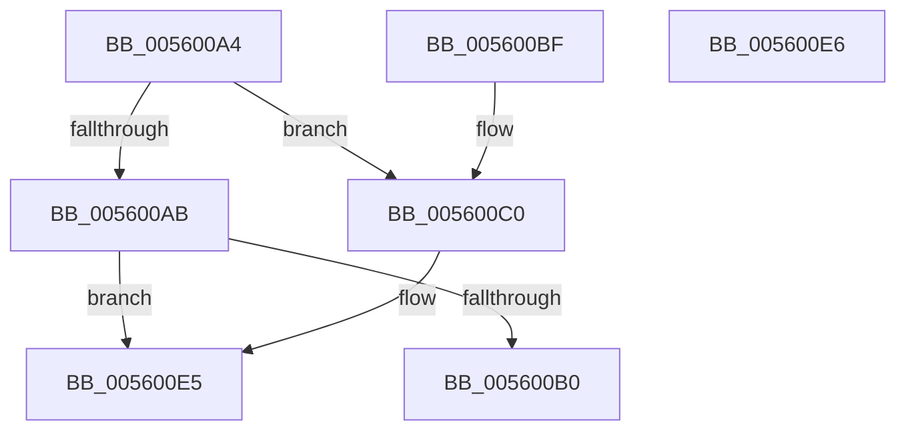

# EmonWriteCounter

- RVA: `0x005600A4`–`0x005600E7` (길이 `67` bytes)
- VA: `0x00000001405600A4`
- 실행 섹션: `.text`
- PDB 이름 있음: `예`; PDB Function 태그: `아니요`
- unwind 정보 RVA: `0x000DB714`
- 디코드: `23`개 명령, `67/67` bytes 표시
- 미해석 바이트: `0` (있으면 어셈블리에 `.byte`로 보존)

> 이 문서는 커널 이미지의 기계어와 PDB 기호를 분석해 생성했습니다. 4번과 5번은 함수 원형과 자료형을 바이너리 사용 방식에서 추정한 C 해석이며 원본 소스 복구 결과는 아닙니다.

## 1. Dependencies

- 직접 호출 지점: **0**; 고유 호출 대상: **0**
- 직접 호출자로 확인된 함수: **2**
- RIP 상대 이미지 참조: **0**

### Outgoing calls
- 직접 디코드된 call 명령이 없습니다.

### Direct callers
- [EmonRestartProfilingInternalEnhanced](../55/EmonRestartProfilingInternalEnhanced_function_0055F760.md) at `0x0055F82D`
- [EmonRestartProfilingInternalOriginal](../55/EmonRestartProfilingInternalOriginal_function_0055F87C.md) at `0x0055F90F`

### Static image references
- 디코드된 RIP-relative 메모리 참조가 없습니다.

## 2. Other-region calls and transfers

- 다른 실행 섹션으로 향하는 call: **0**
- 별도 외부 분기/꼬리 이동을 확인하지 못했습니다.

## 3. Assembly (complete function range)

```asm
005600A4  44 8B D1                        mov r10d, ecx
005600A7  85 D2                           test edx, edx
005600A9  74 15                           je 0x1405600c0
005600AB  83 FA 01                        cmp edx, 1
005600AE  75 35                           jne 0x1405600e5
005600B0  B9 8D 03 00 00                  mov ecx, 0x38d
005600B5  0F 32                           rdmsr
005600B7  48 C1 E2 20                     shl rdx, 0x20
005600BB  48 0B C2                        or rax, rdx
005600BE  C3                              ret
005600BF  CC                              int3
005600C0  81 C1 C1 00 00 00               add ecx, 0xc1
005600C6  49 8B D0                        mov rdx, r8
005600C9  48 C1 EA 20                     shr rdx, 0x20
005600CD  49 8B C0                        mov rax, r8
005600D0  0F 30                           wrmsr
005600D2  41 8B D1                        mov edx, r9d
005600D5  41 8D 8A 86 01 00 00            lea ecx, [r10 + 0x186]
005600DC  48 C1 EA 20                     shr rdx, 0x20
005600E0  41 8B C1                        mov eax, r9d
005600E3  0F 30                           wrmsr
005600E5  C3                              ret
005600E6  CC                              int3
```

## 4. C-style interpretation (structured pseudocode)

```c
__int64 __fastcall EmonWriteCounter(int a1, __int64 a2, __int64 a3, int a4)
{
    __int64 result;

    if ((unsigned int)(a2) == 0) goto loc_005600C0;
    if (((unsigned int)(a2)) != 1) goto loc_005600E5;
    a2 = (a2) << (32);
    result = (result) | (a2);
    return result;
loc_005600C0:
    a1 = (unsigned int)((909) + (193));
    a2 = (a3) >> (32);
    a2 = ((unsigned int)(a4)) >> (32);
loc_005600E5:
    return (unsigned int)(a4);
}
```

## 5. (Beta) C Style

```c
int64_t EmonWriteCounter(void *Arg1, int64_t Arg2, int64_t Arg3, int32_t Arg4)
{
    uint8_t *arg1 = (uint8_t *)Arg1;

    int64_t result;

    if ((uint32_t)(Arg2) == 0) goto loc_005600C0;
    if (((uint32_t)(Arg2)) != 1) goto loc_005600E5;
    Arg2 = (Arg2) << (32);
    result = (result) | (Arg2);
    return result;
loc_005600C0:
    Arg1 = (uint32_t)((909) + (193));
    Arg2 = (Arg3) >> (32);
    Arg2 = ((uint32_t)(Arg4)) >> (32);
loc_005600E5:
    return (uint32_t)(Arg4);
}
```

### 관측된 메모리 오프셋

구조체 형식이 확인되지 않은 접근은 인자 기준의 오프셋으로만 기록했습니다.

| 기준 인자 | 오프셋 표현 | 폭 (bit) | 접근 |
|---|---:|---:|---|
| `Arg1` | `+ 0x186` | `32` | `R` |

## 6. Execution-region graph

[열기: 2D/3D 그래프와 함수 탐색 컨트롤 패널](../../../control-panel.html?section=text&rva=0x005600A4&view=graph)

- 2D 그래프는 위에서 아래로 흐르고, 3D 그래프는 빈 공간을 드래그해 회전합니다. Shift+드래그는 이동, 휠은 확대·축소, 함수 노드 선택은 대상 보고서 이동입니다.

### Static fallback


