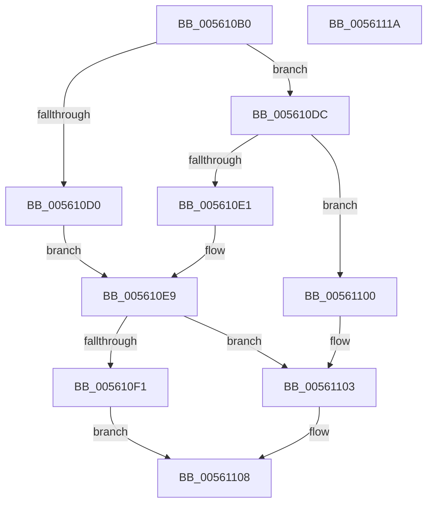

# ExtEnvAllocateMemory

- RVA: `0x005610B0`–`0x0056111B` (길이 `107` bytes)
- VA: `0x00000001405610B0`
- 실행 섹션: `.text`
- PDB 이름 있음: `예`; PDB Function 태그: `아니요`
- unwind 정보 RVA: `0x00060BC4`
- 디코드: `35`개 명령, `107/107` bytes 표시
- 미해석 바이트: `0` (있으면 어셈블리에 `.byte`로 보존)

> 이 문서는 커널 이미지의 기계어와 PDB 기호를 분석해 생성했습니다. 4번과 5번은 함수 원형과 자료형을 바이너리 사용 방식에서 추정한 C 해석이며 원본 소스 복구 결과는 아닙니다.

## 1. Dependencies

- 직접 호출 지점: **3**; 고유 호출 대상: **3**
- 직접 호출자로 확인된 함수: **22**
- RIP 상대 이미지 참조: **1**

### Outgoing calls
- `0x005610D5` → [HalpMmAllocateMemoryInternal](../54/HalpMmAllocateMemoryInternal_function_00544990.md) (function, `0x00544990`)
- `0x005610E4` → [HalpMmAllocCtxAlloc](../3E/HalpMmAllocCtxAlloc_function_003E10B8.md) (function, `0x003E10B8`)
- `0x005610F9` → [memset](../6C/memset_function_006C6C40.md) (function, `0x006C6C40`)

### Direct callers
- [HalpDmaAlwaysReserveLogicalAddressRangeInternal](../55/HalpDmaAlwaysReserveLogicalAddressRangeInternal_function_00551F14.md) at `0x00551F77`
- [IvtAllocateScalableModePasidTables](IvtAllocateScalableModePasidTables_function_0056E8DC.md) at `0x0056E9C6`
- [IvtLegacyAllocateScalableModePasidTables](../57/IvtLegacyAllocateScalableModePasidTables_function_00570B20.md) at `0x00570C02`
- [HalpHsaCreateReservedDevice](../57/HalpHsaCreateReservedDevice_function_00572AA8.md) at `0x00572ADB`
- [HalpHsaCreateReservedDevice](../57/HalpHsaCreateReservedDevice_function_00572AA8.md) at `0x00572B2B`
- [HalpIommuProcessDeviceEntries](../57/HalpIommuProcessDeviceEntries_function_00572C58.md) at `0x00572E4A`
- [HalpIommuProcessDeviceEntries](../57/HalpIommuProcessDeviceEntries_function_00572C58.md) at `0x00572E6C`
- [HalpIommuProcessIvhdEntry](../57/HalpIommuProcessIvhdEntry_function_00572F38.md) at `0x00573141`
- [HalpIommuProcessIvhdEntry](../57/HalpIommuProcessIvhdEntry_function_00572F38.md) at `0x005731CD`
- [HalpIommuProcessIvhdEntry](../57/HalpIommuProcessIvhdEntry_function_00572F38.md) at `0x005734F1`
- [HalpIommuProcessIvhdEntry](../57/HalpIommuProcessIvhdEntry_function_00572F38.md) at `0x00573550`
- [HsaAllocatePasidTables](../57/HsaAllocatePasidTables_function_005735DC.md) at `0x0057364E`
- [HsaAllocatePasidTables](../57/HsaAllocatePasidTables_function_005735DC.md) at `0x00573669`
- [HsaAllocatePasidTables](../57/HsaAllocatePasidTables_function_005735DC.md) at `0x0057375E`
- [HsaAllocateRemappingTableEntry](../57/HsaAllocateRemappingTableEntry_function_00573820.md) at `0x00573988`
- [HsaAllocateRemappingTableEntry](../57/HsaAllocateRemappingTableEntry_function_00573820.md) at `0x00573A00`
- [HsaCreateDevice](../57/HsaCreateDevice_function_00573B50.md) at `0x00573BE7`
- [HsaCreateDevice](../57/HsaCreateDevice_function_00573B50.md) at `0x00573C03`
- [HsaProcessIvmd](../57/HsaProcessIvmd_function_00574900.md) at `0x0057493A`
- [IvmdFindDeviceEntry](../57/IvmdFindDeviceEntry_function_005752FC.md) at `0x0057533D`
- [IvmdProcessRange](../57/IvmdProcessRange_function_0057539C.md) at `0x0057541B`
- [HalpIvtLegacyProcessDrhdEntry](../57/HalpIvtLegacyProcessDrhdEntry_function_00578C58.md) at `0x00578D5B`
- [HalpIvtProcessDrhdEntry](../57/HalpIvtProcessDrhdEntry_function_005794B4.md) at `0x005795CF`
- [IvtAllocateDevice](../57/IvtAllocateDevice_function_00579D24.md) at `0x00579D57`
- [IvtAllocateDevice](../57/IvtAllocateDevice_function_00579D24.md) at `0x00579D73`
- [HalpIvtAllocateReservedDomainList](../57/HalpIvtAllocateReservedDomainList_function_00579FB0.md) at `0x00579FD7`
- [HalpIvtCreateReservedDevice](../57/HalpIvtCreateReservedDevice_function_0057A024.md) at `0x0057A069`
- [DmrConvertDeviceScope](../57/DmrConvertDeviceScope_function_0057A834.md) at `0x0057A870`
- [DmrEnumerateSatcDevices](../57/DmrEnumerateSatcDevices_function_0057A8D0.md) at `0x0057A999`
- [DmrpRmrrTreeAddNewScope](../57/DmrpRmrrTreeAddNewScope_function_0057AD9C.md) at `0x0057ADCA`
- [DmrpRmrrTreeAddRegionToDevice](../57/DmrpRmrrTreeAddRegionToDevice_function_0057AE3C.md) at `0x0057AE87`
- [HsaInitializeInterruptRemapping](../../pagelk/B6/HsaInitializeInterruptRemapping_function_00B62FA8.md) at `0x00B6307C`
- [HsaInitializeInterruptRemapping](../../pagelk/B6/HsaInitializeInterruptRemapping_function_00B62FA8.md) at `0x00B630C9`

### Static image references
- `0x005610BF` → RVA `0x00E103D8` (`.data`; read)

## 2. Other-region calls and transfers

- 다른 실행 섹션으로 향하는 call: **0**
- 별도 외부 분기/꼬리 이동을 확인하지 못했습니다.

## 3. Assembly (complete function range)

```asm
005610B0  48 89 5C 24 08                  mov qword ptr [rsp + 8], rbx
005610B5  48 89 74 24 10                  mov qword ptr [rsp + 0x10], rsi
005610BA  57                              push rdi
005610BB  48 83 EC 20                     sub rsp, 0x20
005610BF  8B 05 13 F3 8A 00               mov eax, dword ptr [rip + 0x8af313]
005610C5  33 DB                           xor ebx, ebx
005610C7  8B F2                           mov esi, edx
005610C9  49 8B F8                        mov rdi, r8
005610CC  85 C0                           test eax, eax
005610CE  75 0C                           jne 0x1405610dc
005610D0  8D 53 01                        lea edx, [rbx + 1]
005610D3  8B CE                           mov ecx, esi
005610D5  E8 B6 38 FE FF                  call 0x140544990
005610DA  EB 0D                           jmp 0x1405610e9
005610DC  83 F8 01                        cmp eax, 1
005610DF  75 1F                           jne 0x140561100
005610E1  48 8B D6                        mov rdx, rsi
005610E4  E8 CF FF E7 FF                  call 0x1403e10b8
005610E9  48 89 07                        mov qword ptr [rdi], rax
005610EC  48 85 C0                        test rax, rax
005610EF  74 12                           je 0x140561103
005610F1  4C 8B C6                        mov r8, rsi
005610F4  33 D2                           xor edx, edx
005610F6  48 8B C8                        mov rcx, rax
005610F9  E8 42 5B 16 00                  call 0x1406c6c40
005610FE  EB 08                           jmp 0x140561108
00561100  49 89 18                        mov qword ptr [r8], rbx
00561103  BB 9A 00 00 C0                  mov ebx, 0xc000009a
00561108  48 8B 74 24 38                  mov rsi, qword ptr [rsp + 0x38]
0056110D  8B C3                           mov eax, ebx
0056110F  48 8B 5C 24 30                  mov rbx, qword ptr [rsp + 0x30]
00561114  48 83 C4 20                     add rsp, 0x20
00561118  5F                              pop rdi
00561119  C3                              ret
0056111A  CC                              int3
```

## 4. C-style interpretation (structured pseudocode)

```c
__int64 __fastcall ExtEnvAllocateMemory(__int64 a1, int a2, __int64 a3)
{
    __int64 result;
    __int64 v_rbx;
    __int64 v_rsp;
    unsigned __int64 v_stack_p10;
    unsigned __int64 v_stack_p8;

    v_stack_p8 = v_rbx;
    v_stack_p10 = v_rsi;
    v_rsp = (v_rsp) - (32);
    v_rbx = 0;
    if ((unsigned int)((unsigned int)(*(unsigned int *)(v_rip + 9106195))) != 0) goto loc_005610DC;
    result = HalpMmAllocateMemoryInternal((unsigned int)((unsigned int)((unsigned int)(a2))), v_rbx + 1, a3, a4);
    goto loc_005610E9;
loc_005610DC:
    if (((unsigned int)(result)) != 1) goto loc_00561100;
    result = HalpMmAllocCtxAlloc((unsigned int)((unsigned int)((unsigned int)(a2))), (unsigned int)(a2), a3, a4);
loc_005610E9:
    *(unsigned __int64 *)(a3) = result;
    if (result == 0) goto loc_00561103;
    a2 = 0;
    result = memset(result, a2, (unsigned int)(a2), a4);
    goto loc_00561108;
loc_00561100:
    *(unsigned __int64 *)((unsigned int)(a2)) = 0;
loc_00561103:
loc_00561108:
    v_rsp = (v_rsp) + (32);
    return (unsigned int)((unsigned int)((unsigned int)(0xC000009AULL)));
}
```

## 5. (Beta) C Style

```c
int64_t ExtEnvAllocateMemory(int64_t Arg1, int32_t Arg2, void *Arg3)
{
    uint8_t *arg3 = (uint8_t *)Arg3;

    int64_t result;
    int64_t local_rbx;
    int64_t local_rsp;
    uint64_t v_stack_p10;
    uint64_t v_stack_p8;

    v_stack_p8 = local_rbx;
    v_stack_p10 = local_rsi;
    local_rsp = (local_rsp) - (32);
    local_rbx = 0;
    if ((uint32_t)((uint32_t)(*(uint32_t *)(v_rip + 0x8AF313))) != 0) goto loc_005610DC;
    result = HalpMmAllocateMemoryInternal((uint32_t)((uint32_t)((uint32_t)(Arg2))), local_rbx + 1, Arg3, a4);
    goto loc_005610E9;
loc_005610DC:
    if (((uint32_t)(result)) != 1) goto loc_00561100;
    result = HalpMmAllocCtxAlloc((uint32_t)((uint32_t)((uint32_t)(Arg2))), (uint32_t)(Arg2), Arg3, a4);
loc_005610E9:
    *(uint64_t *)(arg3) = result;
    if (result == 0) goto loc_00561103;
    Arg2 = 0;
    result = memset(result, Arg2, (uint32_t)(Arg2), a4);
    goto loc_00561108;
loc_00561100:
    *(uint64_t *)((uint32_t)(Arg2)) = 0;
loc_00561103:
loc_00561108:
    local_rsp = (local_rsp) + (32);
    return (uint32_t)((uint32_t)((uint32_t)(0xC000009AULL)));
}
```

### 관측된 메모리 오프셋

구조체 형식이 확인되지 않은 접근은 인자 기준의 오프셋으로만 기록했습니다.

| 기준 인자 | 오프셋 표현 | 폭 (bit) | 접근 |
|---|---:|---:|---|
| `Arg3` | `+ 0x0` | `64` | `W` |

## 6. Execution-region graph

[열기: 2D/3D 그래프와 함수 탐색 컨트롤 패널](../../../control-panel.html?section=text&rva=0x005610B0&view=graph)

- 2D 그래프는 위에서 아래로 흐르고, 3D 그래프는 빈 공간을 드래그해 회전합니다. Shift+드래그는 이동, 휠은 확대·축소, 함수 노드 선택은 대상 보고서 이동입니다.

### Static fallback


