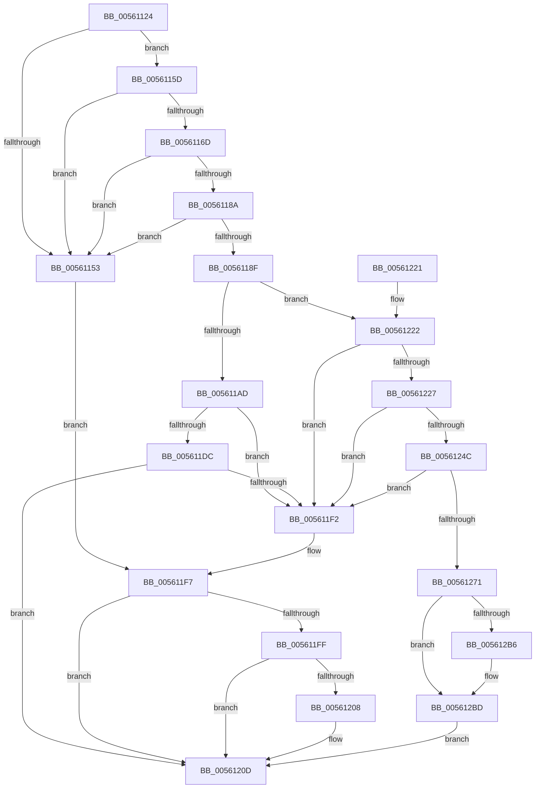

# ExtEnvAllocatePhysicalMemory

- RVA: `0x00561124`–`0x005612E1` (길이 `445` bytes)
- VA: `0x0000000140561124`
- 실행 섹션: `.text`
- PDB 이름 있음: `예`; PDB Function 태그: `아니요`
- unwind 정보 RVA: `0x000C4AA8`
- 디코드: `123`개 명령, `445/445` bytes 표시
- 미해석 바이트: `0` (있으면 어셈블리에 `.byte`로 보존)

> 이 문서는 커널 이미지의 기계어와 PDB 기호를 분석해 생성했습니다. 4번과 5번은 함수 원형과 자료형을 바이너리 사용 방식에서 추정한 C 해석이며 원본 소스 복구 결과는 아닙니다.

## 1. Dependencies

- 직접 호출 지점: **8**; 고유 호출 대상: **8**
- 직접 호출자로 확인된 함수: **6**
- RIP 상대 이미지 참조: **6**

### Outgoing calls
- `0x005611C7` → [HalpAllocPhysicalMemoryEx](../../init/C7/HalpAllocPhysicalMemoryEx_function_00C771DC.md) (function, `0x00C771DC`)
- `0x005611E5` → [HalMapIoSpace](../4F/HalMapIoSpace_function_004FCD40.md) (function, `0x004FCD40`)
- `0x00561208` → [MmFreeContiguousMemory](../3F/MmFreeContiguousMemory_function_003F6F60.md) (function, `0x003F6F60`)
- `0x0056123F` → [MmAllocateContiguousMemorySpecifyCacheNode](../3E/MmAllocateContiguousMemorySpecifyCacheNode_function_003E9D30.md) (function, `0x003E9D30`)
- `0x0056124F` → [MmGetPhysicalAddress](../23/MmGetPhysicalAddress_function_0023A500.md) (function, `0x0023A500`)
- `0x00561264` → [HalpMmAllocCtxAlloc](../3E/HalpMmAllocCtxAlloc_function_003E10B8.md) (function, `0x003E10B8`)
- `0x0056129E` → [KeAcquireSpinLockRaiseToDpc](../20/KeAcquireSpinLockRaiseToDpc_function_00208470.md) (function, `0x00208470`)
- `0x005612D7` → [KeReleaseSpinLock](../39/KeReleaseSpinLock_function_00392BA0.md) (function, `0x00392BA0`)

### Direct callers
- [IvtAllocateContextTable](../4D/IvtAllocateContextTable_function_004DE0D4.md) at `0x004DE185`
- [IvtAllocateScalableModePasidTables](IvtAllocateScalableModePasidTables_function_0056E8DC.md) at `0x0056EA5A`
- [IvtExtendScalableModePasidTables](IvtExtendScalableModePasidTables_function_0056F6C8.md) at `0x0056F74C`
- [IvtLegacyAllocateScalableModePasidTables](../57/IvtLegacyAllocateScalableModePasidTables_function_00570B20.md) at `0x00570C90`
- [IvtLegacyExtendScalableModePasidTables](../57/IvtLegacyExtendScalableModePasidTables_function_0057134C.md) at `0x005713CE`
- [HsaAllocateRemappingTableEntry](../57/HsaAllocateRemappingTableEntry_function_00573820.md) at `0x005739CC`

### Static image references
- `0x0056118F` → RVA `0x00E103D8` (`.data`; read)
- `0x005611AD` → RVA `0x00FC1A20` (`.data`; read)
- `0x00561274` → RVA `0x00F8FC40` (`.data`; read)
- `0x005612A3` → RVA `0x00F8FC38` (`.data`; read)
- `0x005612AA` → RVA `0x00F8FC30` (`.data`; read)
- `0x005612D0` → RVA `0x00F8FC38` (`.data`; write)

## 2. Other-region calls and transfers

- 다른 실행 섹션으로 향하는 call: **1**
  - `0x005611C7` → [HalpAllocPhysicalMemoryEx](../../init/C7/HalpAllocPhysicalMemoryEx_function_00C771DC.md) (`.text` → `INIT`)
- 별도 외부 분기/꼬리 이동을 확인하지 못했습니다.

## 3. Assembly (complete function range)

```asm
00561124  48 89 6C 24 18                  mov qword ptr [rsp + 0x18], rbp
00561129  48 89 4C 24 08                  mov qword ptr [rsp + 8], rcx
0056112E  56                              push rsi
0056112F  57                              push rdi
00561130  41 54                           push r12
00561132  41 56                           push r14
00561134  41 57                           push r15
00561136  48 83 EC 30                     sub rsp, 0x30
0056113A  4C 8B B4 24 88 00 00 00         mov r14, qword ptr [rsp + 0x88]
00561142  41 8B E9                        mov ebp, r9d
00561145  45 8B D0                        mov r10d, r8d
00561148  44 8B FA                        mov r15d, edx
0056114B  49 83 26 00                     and qword ptr [r14], 0
0056114F  85 D2                           test edx, edx
00561151  75 0A                           jne 0x14056115d
00561153  BF BB 00 00 C0                  mov edi, 0xc00000bb
00561158  E9 9A 00 00 00                  jmp 0x1405611f7
0056115D  41 8B CA                        mov ecx, r10d
00561160  C1 E9 0C                        shr ecx, 0xc
00561163  8B C1                           mov eax, ecx
00561165  C1 E0 0C                        shl eax, 0xc
00561168  41 3B C2                        cmp eax, r10d
0056116B  75 E6                           jne 0x140561153
0056116D  48 0F BD C1                     bsr rax, rcx
00561171  41 B8 FF FF FF FF               mov r8d, 0xffffffff
00561177  41 8B D0                        mov edx, r8d
0056117A  0F 45 D0                        cmovne edx, eax
0056117D  48 0F BC C1                     bsf rax, rcx
00561181  44 0F 45 C0                     cmovne r8d, eax
00561185  41 3A D0                        cmp dl, r8b
00561188  75 C9                           jne 0x140561153
0056118A  83 FD 01                        cmp ebp, 1
0056118D  77 C4                           ja 0x140561153
0056118F  8B 05 43 F2 8A 00               mov eax, dword ptr [rip + 0x8af243]
00561195  45 8D 87 FF 0F 00 00            lea r8d, [r15 + 0xfff]
0056119C  41 C1 E8 0C                     shr r8d, 0xc
005611A0  33 FF                           xor edi, edi
005611A2  45 8B E0                        mov r12d, r8d
005611A5  41 C1 E4 0C                     shl r12d, 0xc
005611A9  85 C0                           test eax, eax
005611AB  75 75                           jne 0x140561222
005611AD  48 8B 0D 6C 08 A6 00            mov rcx, qword ptr [rip + 0xa6086c]
005611B4  48 8D 54 24 60                  lea rdx, [rsp + 0x60]
005611B9  48 83 4C 24 60 FF               or qword ptr [rsp + 0x60], 0xffffffffffffffff
005611BF  45 8B CA                        mov r9d, r10d
005611C2  48 21 7C 24 20                  and qword ptr [rsp + 0x20], rdi
005611C7  E8 10 60 71 00                  call 0x140c771dc
005611CC  48 8B 8C 24 80 00 00 00         mov rcx, qword ptr [rsp + 0x80]
005611D4  48 89 01                        mov qword ptr [rcx], rax
005611D7  48 85 C0                        test rax, rax
005611DA  74 16                           je 0x1405611f2
005611DC  44 8B C5                        mov r8d, ebp
005611DF  41 8B D4                        mov edx, r12d
005611E2  48 8B C8                        mov rcx, rax
005611E5  E8 56 BB F9 FF                  call 0x1404fcd40
005611EA  49 89 06                        mov qword ptr [r14], rax
005611ED  48 85 C0                        test rax, rax
005611F0  75 1B                           jne 0x14056120d
005611F2  BF 9A 00 00 C0                  mov edi, 0xc000009a
005611F7  49 8B 0E                        mov rcx, qword ptr [r14]
005611FA  48 85 C9                        test rcx, rcx
005611FD  74 0E                           je 0x14056120d
005611FF  83 3D D2 F1 8A 00 01            cmp dword ptr [rip + 0x8af1d2], 1
00561206  75 05                           jne 0x14056120d
00561208  E8 53 5D E9 FF                  call 0x1403f6f60
0056120D  48 8B 6C 24 70                  mov rbp, qword ptr [rsp + 0x70]
00561212  8B C7                           mov eax, edi
00561214  48 83 C4 30                     add rsp, 0x30
00561218  41 5F                           pop r15
0056121A  41 5E                           pop r14
0056121C  41 5C                           pop r12
0056121E  5F                              pop rdi
0056121F  5E                              pop rsi
00561220  C3                              ret
00561221  CC                              int3
00561222  83 F8 01                        cmp eax, 1
00561225  75 CB                           jne 0x1405611f2
00561227  4D 8B CA                        mov r9, r10
0056122A  C7 44 24 28 00 00 00 80         mov dword ptr [rsp + 0x28], 0x80000000
00561232  49 83 C8 FF                     or r8, 0xffffffffffffffff
00561236  89 6C 24 20                     mov dword ptr [rsp + 0x20], ebp
0056123A  33 D2                           xor edx, edx
0056123C  49 8B CC                        mov rcx, r12
0056123F  E8 EC 8A E8 FF                  call 0x1403e9d30
00561244  49 89 06                        mov qword ptr [r14], rax
00561247  48 85 C0                        test rax, rax
0056124A  74 A6                           je 0x1405611f2
0056124C  48 8B C8                        mov rcx, rax
0056124F  E8 AC 92 CD FF                  call 0x14023a500
00561254  48 8B 8C 24 80 00 00 00         mov rcx, qword ptr [rsp + 0x80]
0056125C  BA 38 00 00 00                  mov edx, 0x38
00561261  48 89 01                        mov qword ptr [rcx], rax
00561264  E8 4F FE E7 FF                  call 0x1403e10b8
00561269  48 8B F0                        mov rsi, rax
0056126C  48 85 C0                        test rax, rax
0056126F  74 81                           je 0x1405611f2
00561271  0F 57 C0                        xorps xmm0, xmm0
00561274  48 8D 0D C5 E9 A2 00            lea rcx, [rip + 0xa2e9c5]
0056127B  0F 11 06                        movups xmmword ptr [rsi], xmm0
0056127E  33 C0                           xor eax, eax
00561280  0F 11 46 10                     movups xmmword ptr [rsi + 0x10], xmm0
00561284  0F 11 46 20                     movups xmmword ptr [rsi + 0x20], xmm0
00561288  48 89 46 30                     mov qword ptr [rsi + 0x30], rax
0056128C  49 8B 06                        mov rax, qword ptr [r14]
0056128F  48 89 46 10                     mov qword ptr [rsi + 0x10], rax
00561293  4C 89 7E 20                     mov qword ptr [rsi + 0x20], r15
00561297  4C 89 66 28                     mov qword ptr [rsi + 0x28], r12
0056129B  89 6E 30                        mov dword ptr [rsi + 0x30], ebp
0056129E  E8 CD 71 CA FF                  call 0x140208470
005612A3  48 8B 0D 8E E9 A2 00            mov rcx, qword ptr [rip + 0xa2e98e]
005612AA  48 8D 15 7F E9 A2 00            lea rdx, [rip + 0xa2e97f]
005612B1  48 39 11                        cmp qword ptr [rcx], rdx
005612B4  74 07                           je 0x1405612bd
005612B6  B9 03 00 00 00                  mov ecx, 3
005612BB  CD 29                           int 0x29
005612BD  48 89 16                        mov qword ptr [rsi], rdx
005612C0  8A D0                           mov dl, al
005612C2  48 89 4E 08                     mov qword ptr [rsi + 8], rcx
005612C6  48 89 31                        mov qword ptr [rcx], rsi
005612C9  48 8D 0D 70 E9 A2 00            lea rcx, [rip + 0xa2e970]
005612D0  48 89 35 61 E9 A2 00            mov qword ptr [rip + 0xa2e961], rsi
005612D7  E8 C4 18 E3 FF                  call 0x140392ba0
005612DC  E9 2C FF FF FF                  jmp 0x14056120d
```

## 4. C-style interpretation (structured pseudocode)

```c
__int64 __fastcall ExtEnvAllocatePhysicalMemory(__int64 a1, int a2, int a3, int a4, __int64 a5, __int64 a6)
{
    __int64 result;
    __int64 v_r12;
    __int64 v_rdi;
    __int64 v_rsp;
    unsigned __int64 v_stack_m38;
    unsigned __int64 v_stack_p18;
    unsigned int v_stack_p20;
    unsigned int v_stack_p28;
    unsigned __int64 v_stack_p8;

    v_stack_p18 = v_rbp;
    v_stack_p8 = a1;
    v_rsp = (v_rsp) - (48);
    if (a2 != 0) goto loc_0056115D;
loc_00561153:
    goto loc_005611F7;
loc_0056115D:
    a1 = (unsigned int)(((unsigned int)((unsigned int)((unsigned int)(a3)))) >> (12));
    result = (unsigned int)(((unsigned int)((unsigned int)(a1))) << (12));
    if (((unsigned int)(result)) != ((unsigned int)((unsigned int)(a3)))) goto loc_00561153;
    a2 = (unsigned int)((unsigned int)((unsigned int)(0xFFFFFFFFULL)));
    if (((unsigned int)(result)) != ((unsigned int)((unsigned int)(a3)))) { a2 = (unsigned int)(result); }
    a3 = (unsigned int)(0xFFFFFFFFULL);
    if (((unsigned int)(result)) != ((unsigned int)((unsigned int)(a3)))) { a3 = (unsigned int)(result); }
    if (((unsigned __int8)(a2)) != ((unsigned __int8)(a3))) goto loc_00561153;
    if (((unsigned int)((unsigned int)(a4))) > 1) goto loc_00561153;
    a3 = (unsigned int)(((unsigned int)(a2) + 4095) >> (12));
    v_rdi = 0;
    v_r12 = (unsigned int)(((unsigned int)(a3)) << (12));
    if ((unsigned int)((unsigned int)(*(unsigned int *)(v_rip + 9105987))) != 0) goto loc_00561222;
    result = HalpAllocPhysicalMemoryEx(*(unsigned __int64 *)(v_rip + 10881132), v_stack_p8, a3, (unsigned int)((unsigned int)((unsigned int)(a3))));
    *(unsigned __int64 *)(a5) = result;
    if (result == 0) goto loc_005611F2;
    result = HalMapIoSpace(result, (unsigned int)((unsigned int)(v_r12)), (unsigned int)((unsigned int)((unsigned int)(a4))), (unsigned int)((unsigned int)((unsigned int)(a3))));
    *(unsigned __int64 *)(a6) = result;
    if (result != 0) goto loc_0056120D;
loc_005611F2:
loc_005611F7:
    if (*(unsigned __int64 *)(a6) == 0) goto loc_0056120D;
    if ((*(unsigned int *)(v_rip + 9105874)) == 1) {
        result = MmFreeContiguousMemory(*(unsigned __int64 *)(a6), (unsigned int)((unsigned int)(v_r12)), (unsigned int)((unsigned int)((unsigned int)(a4))), (unsigned int)((unsigned int)((unsigned int)(a3))));
    }
    v_rsp = (v_rsp) + (48);
    return (unsigned int)((unsigned int)((unsigned int)(0xC000009AULL)));
loc_00561222:
    if (((unsigned int)((unsigned int)((unsigned int)((unsigned int)(0xC000009AULL))))) != 1) goto loc_005611F2;
    v_stack_p28 = 0x80000000ULL;
    a3 = ((unsigned int)((unsigned int)((unsigned int)(a4)))) | (-1);
    v_stack_p20 = (unsigned int)(v_stack_p18);
    a2 = 0;
    result = MmAllocateContiguousMemorySpecifyCacheNode(v_r12, a2, a3, (unsigned int)(a3));
    *(unsigned __int64 *)(a6) = result;
    if (result == 0) goto loc_005611F2;
    result = MmGetPhysicalAddress(result, a2, a3, (unsigned int)(a3));
    *(unsigned __int64 *)(a5) = result;
    result = HalpMmAllocCtxAlloc(a5, 56, a3, (unsigned int)(a3));
    if (result == 0) goto loc_005611F2;
    *(unsigned __int64 *)(result) = v_xmm0;
    result = 0;
    *(unsigned __int64 *)(result + 16) = v_xmm0;
    *(unsigned __int64 *)(result + 32) = v_xmm0;
    *(unsigned __int64 *)(result + 48) = 0;
    *(unsigned __int64 *)(result + 16) = *(unsigned __int64 *)(a6);
    *(unsigned __int64 *)(result + 32) = (unsigned int)(a2);
    *(unsigned __int64 *)(result + 40) = v_r12;
    *(unsigned int *)(result + 48) = (unsigned int)(v_stack_p18);
    result = KeAcquireSpinLockRaiseToDpc(v_rip + 10676677, 56, a3, (unsigned int)(a3));
    if ((*(unsigned __int64 *)(*(unsigned __int64 *)(v_rip + 10676622))) != (v_rip + 10676607)) {
        a1 = 3;
    }
    *(unsigned __int64 *)(result) = v_rip + 10676607;
    *(unsigned __int64 *)(result + 8) = a1;
    *(unsigned __int64 *)(a1) = result;
    *(unsigned __int64 *)(v_rip + 10676577) = result;
    result = KeReleaseSpinLock(v_rip + 10676592, (unsigned __int8)(result), a3, (unsigned int)(a3));
    goto loc_0056120D;
}
```

## 5. (Beta) C Style

```c
int64_t ExtEnvAllocatePhysicalMemory(int64_t Arg1, void *Arg2, int32_t Arg3, int32_t Arg4, void *Arg5, void *Arg6)
{
    uint8_t *arg2 = (uint8_t *)Arg2;
    uint8_t *arg5 = (uint8_t *)Arg5;
    uint8_t *arg6 = (uint8_t *)Arg6;

    int64_t result;
    int64_t local_r12;
    int64_t local_rdi;
    int64_t local_rsp;
    uint64_t v_stack_m38;
    uint64_t v_stack_p18;
    uint32_t v_stack_p20;
    uint32_t v_stack_p28;
    uint64_t v_stack_p8;

    v_stack_p18 = local_rbp;
    v_stack_p8 = Arg1;
    local_rsp = (local_rsp) - (48);
    if (Arg2 != NULL) goto loc_0056115D;
loc_00561153:
    goto loc_005611F7;
loc_0056115D:
    Arg1 = (uint32_t)(((uint32_t)((uint32_t)((uint32_t)(Arg3)))) >> (12));
    result = (uint32_t)(((uint32_t)((uint32_t)(Arg1))) << (12));
    if (((uint32_t)(result)) != ((uint32_t)((uint32_t)(Arg3)))) goto loc_00561153;
    Arg2 = (uint32_t)((uint32_t)((uint32_t)(0xFFFFFFFFULL)));
    if (((uint32_t)(result)) != ((uint32_t)((uint32_t)(Arg3)))) { Arg2 = (uint32_t)(result); }
    Arg3 = (uint32_t)(0xFFFFFFFFULL);
    if (((uint32_t)(result)) != ((uint32_t)((uint32_t)(Arg3)))) { Arg3 = (uint32_t)(result); }
    if (((uint8_t)(Arg2)) != ((uint8_t)(Arg3))) goto loc_00561153;
    if (((uint32_t)((uint32_t)(Arg4))) > 1) goto loc_00561153;
    Arg3 = (uint32_t)(((uint32_t)(Arg2) + 4095) >> (12));
    local_rdi = 0;
    local_r12 = (uint32_t)(((uint32_t)(Arg3)) << (12));
    if ((uint32_t)((uint32_t)(*(uint32_t *)(v_rip + 0x8AF243))) != 0) goto loc_00561222;
    result = HalpAllocPhysicalMemoryEx(*(uint64_t *)(v_rip + 0xA6086C), v_stack_p8, Arg3, (uint32_t)((uint32_t)((uint32_t)(Arg3))));
    *(uint64_t *)(arg5) = result;
    if (result == 0) goto loc_005611F2;
    result = HalMapIoSpace(result, (uint32_t)((uint32_t)(local_r12)), (uint32_t)((uint32_t)((uint32_t)(Arg4))), (uint32_t)((uint32_t)((uint32_t)(Arg3))));
    *(uint64_t *)(arg6) = result;
    if (result != 0) goto loc_0056120D;
loc_005611F2:
loc_005611F7:
    if (*(uint64_t *)(arg6) == 0) goto loc_0056120D;
    if ((*(uint32_t *)(v_rip + 0x8AF1D2)) == 1) {
        result = MmFreeContiguousMemory(*(uint64_t *)(arg6), (uint32_t)((uint32_t)(local_r12)), (uint32_t)((uint32_t)((uint32_t)(Arg4))), (uint32_t)((uint32_t)((uint32_t)(Arg3))));
    }
    local_rsp = (local_rsp) + (48);
    return (uint32_t)((uint32_t)((uint32_t)(0xC000009AULL)));
loc_00561222:
    if (((uint32_t)((uint32_t)((uint32_t)((uint32_t)(0xC000009AULL))))) != 1) goto loc_005611F2;
    v_stack_p28 = 0x80000000ULL;
    Arg3 = ((uint32_t)((uint32_t)((uint32_t)(Arg4)))) | (-1);
    v_stack_p20 = (uint32_t)(v_stack_p18);
    Arg2 = 0;
    result = MmAllocateContiguousMemorySpecifyCacheNode(local_r12, Arg2, Arg3, (uint32_t)(Arg3));
    *(uint64_t *)(arg6) = result;
    if (result == 0) goto loc_005611F2;
    result = MmGetPhysicalAddress(result, Arg2, Arg3, (uint32_t)(Arg3));
    *(uint64_t *)(arg5) = result;
    result = HalpMmAllocCtxAlloc(Arg5, 56, Arg3, (uint32_t)(Arg3));
    if (result == 0) goto loc_005611F2;
    *(uint64_t *)(result) = v_xmm0;
    result = 0;
    *(uint64_t *)(result + 0x10) = v_xmm0;
    *(uint64_t *)(result + 0x20) = v_xmm0;
    *(uint64_t *)(result + 0x30) = 0;
    *(uint64_t *)(result + 0x10) = *(uint64_t *)(arg6);
    *(uint64_t *)(result + 0x20) = (uint32_t)(Arg2);
    *(uint64_t *)(result + 0x28) = local_r12;
    *(uint32_t *)(result + 0x30) = (uint32_t)(v_stack_p18);
    result = KeAcquireSpinLockRaiseToDpc(v_rip + 10676677, 56, Arg3, (uint32_t)(Arg3));
    if ((*(uint64_t *)(*(uint64_t *)(v_rip + 0xA2E98E))) != (v_rip + 10676607)) {
        Arg1 = 3;
    }
    *(uint64_t *)(result) = v_rip + 10676607;
    *(uint64_t *)(result + 0x8) = Arg1;
    *(uint64_t *)(Arg1) = result;
    *(uint64_t *)(v_rip + 0xA2E961) = result;
    result = KeReleaseSpinLock(v_rip + 10676592, (uint8_t)(result), Arg3, (uint32_t)(Arg3));
    goto loc_0056120D;
}
```

### 관측된 메모리 오프셋

구조체 형식이 확인되지 않은 접근은 인자 기준의 오프셋으로만 기록했습니다.

| 기준 인자 | 오프셋 표현 | 폭 (bit) | 접근 |
|---|---:|---:|---|
| `Arg2` | `+ 0xFFF` | `32` | `R` |
| `Arg5` | `+ 0x0` | `64` | `W` |
| `Arg6` | `+ 0x0` | `64` | `R` |
| `Arg6` | `+ 0x0` | `64` | `R/W` |
| `Arg6` | `+ 0x0` | `64` | `W` |

## 6. Execution-region graph

[열기: 2D/3D 그래프와 함수 탐색 컨트롤 패널](../../../control-panel.html?section=text&rva=0x00561124&view=graph)

- 2D 그래프는 위에서 아래로 흐르고, 3D 그래프는 빈 공간을 드래그해 회전합니다. Shift+드래그는 이동, 휠은 확대·축소, 함수 노드 선택은 대상 보고서 이동입니다.

### Static fallback


