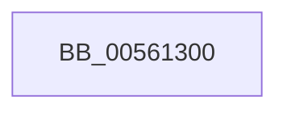

# ExtEnvCriticalFailure

- RVA: `0x00561300`–`0x00561319` (길이 `25` bytes)
- VA: `0x0000000140561300`
- 실행 섹션: `.text`
- PDB 이름 있음: `예`; PDB Function 태그: `아니요`
- unwind 정보 RVA: `0x000622F0`
- 디코드: `6`개 명령, `25/25` bytes 표시
- 미해석 바이트: `0` (있으면 어셈블리에 `.byte`로 보존)

> 이 문서는 커널 이미지의 기계어와 PDB 기호를 분석해 생성했습니다. 4번과 5번은 함수 원형과 자료형을 바이너리 사용 방식에서 추정한 C 해석이며 원본 소스 복구 결과는 아닙니다.

## 1. Dependencies

- 직접 호출 지점: **1**; 고유 호출 대상: **1**
- 직접 호출자로 확인된 함수: **6**
- RIP 상대 이미지 참조: **0**

### Outgoing calls
- `0x00561313` → [KeBugCheckEx](../4F/KeBugCheckEx_function_004FD660.md) (function, `0x004FD660`)

### Direct callers
- [HalpVpptUpdatePhysicalTimer](../2D/HalpVpptUpdatePhysicalTimer_function_002D23D8.md) at `0x002D24E2`
- [HalpVpptUpdatePhysicalTimer](../2D/HalpVpptUpdatePhysicalTimer_function_002D23D8.md) at `0x002D24FE`
- [HalpVpptInitializePhysicalTimer](../54/HalpVpptInitializePhysicalTimer_function_0054A2F4.md) at `0x0054A32E`
- [IvtFreeDomain](IvtFreeDomain_function_0056F8E0.md) at `0x0056F918`
- [HsaFreeRemappingTableEntry](../57/HsaFreeRemappingTableEntry_function_00574140.md) at `0x0057423F`
- [HsaGetDeviceAperture](../57/HsaGetDeviceAperture_function_00574288.md) at `0x005742A5`
- [HsaUpdateRemappingTableEntry](../57/HsaUpdateRemappingTableEntry_function_00575000.md) at `0x0057505A`

### Static image references
- 디코드된 RIP-relative 메모리 참조가 없습니다.

## 2. Other-region calls and transfers

- 다른 실행 섹션으로 향하는 call: **0**
- 별도 외부 분기/꼬리 이동을 확인하지 못했습니다.

## 3. Assembly (complete function range)

```asm
00561300  48 83 EC 38                     sub rsp, 0x38
00561304  48 8B 44 24 60                  mov rax, qword ptr [rsp + 0x60]
00561309  B9 5C 00 00 00                  mov ecx, 0x5c
0056130E  48 89 44 24 20                  mov qword ptr [rsp + 0x20], rax
00561313  E8 48 C3 F9 FF                  call 0x1404fd660
00561318  CC                              int3
```

## 4. C-style interpretation (structured pseudocode)

```c
__int64 __fastcall ExtEnvCriticalFailure(__int64 a1, __int64 a2, __int64 a3, __int64 a4, __int64 a5)
{
    __int64 result;
    __int64 v_rsp;
    unsigned __int64 v_stack_m18;

    v_rsp = (v_rsp) - (56);
    v_stack_m18 = a5;
    result = KeBugCheckEx(92, a2, a3, a4);
    return result;
}
```

## 5. (Beta) C Style

```c
int64_t ExtEnvCriticalFailure(int64_t Arg1, int64_t Arg2, int64_t Arg3, int64_t Arg4, int64_t Arg5)
{
    int64_t result;
    int64_t local_rsp;
    uint64_t v_stack_m18;

    local_rsp = (local_rsp) - (56);
    v_stack_m18 = Arg5;
    result = KeBugCheckEx(92, Arg2, Arg3, Arg4);
    return result;
}
```

## 6. Execution-region graph

[열기: 2D/3D 그래프와 함수 탐색 컨트롤 패널](../../../control-panel.html?section=text&rva=0x00561300&view=graph)

- 2D 그래프는 위에서 아래로 흐르고, 3D 그래프는 빈 공간을 드래그해 회전합니다. Shift+드래그는 이동, 휠은 확대·축소, 함수 노드 선택은 대상 보고서 이동입니다.

### Static fallback


