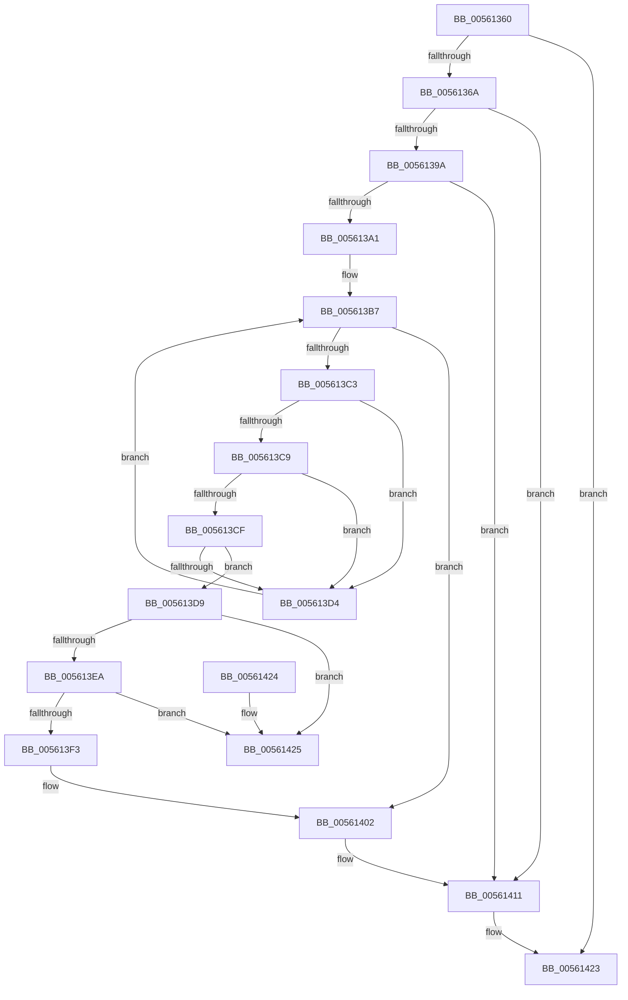

# ExtEnvFreePhysicalMemory

- RVA: `0x00561360`–`0x0056142C` (길이 `204` bytes)
- VA: `0x0000000140561360`
- 실행 섹션: `.text`
- PDB 이름 있음: `예`; PDB Function 태그: `아니요`
- unwind 정보 RVA: `0x000C4A90`
- 디코드: `60`개 명령, `204/204` bytes 표시
- 미해석 바이트: `0` (있으면 어셈블리에 `.byte`로 보존)

> 이 문서는 커널 이미지의 기계어와 PDB 기호를 분석해 생성했습니다. 4번과 5번은 함수 원형과 자료형을 바이너리 사용 방식에서 추정한 C 해석이며 원본 소스 복구 결과는 아닙니다.

## 1. Dependencies

- 직접 호출 지점: **5**; 고유 호출 대상: **5**
- 직접 호출자로 확인된 함수: **4**
- RIP 상대 이미지 참조: **2**

### Outgoing calls
- `0x00561391` → [HalpMmIsInsideHalVa](../54/HalpMmIsInsideHalVa_function_00544BE0.md) (function, `0x00544BE0`)
- `0x005613A8` → [KeAcquireSpinLockRaiseToDpc](../20/KeAcquireSpinLockRaiseToDpc_function_00208470.md) (function, `0x00208470`)
- `0x005613DC` → [MmFreeContiguousMemory](../3F/MmFreeContiguousMemory_function_003F6F60.md) (function, `0x003F6F60`)
- `0x005613FD` → [HalpMmAllocCtxFree](../3E/HalpMmAllocCtxFree_function_003E1904.md) (function, `0x003E1904`)
- `0x0056140C` → [KeReleaseSpinLock](../39/KeReleaseSpinLock_function_00392BA0.md) (function, `0x00392BA0`)

### Direct callers
- [IvtAllocateContextTable](../4D/IvtAllocateContextTable_function_004DE0D4.md) at `0x004DE20F`
- [IvtFreeScalableModePasidTables](IvtFreeScalableModePasidTables_function_0056F980.md) at `0x0056FA69`
- [IvtFreeScalableModePasidTables](IvtFreeScalableModePasidTables_function_0056F980.md) at `0x0056FAA6`
- [HsaAllocateRemappingTableEntry](../57/HsaAllocateRemappingTableEntry_function_00573820.md) at `0x00573AD3`
- [HsaFreeRemappingTableEntry](../57/HsaFreeRemappingTableEntry_function_00574140.md) at `0x00574250`

### Static image references
- `0x005613A1` → RVA `0x00F8FC40` (`.data`; read)
- `0x005613AD` → RVA `0x00F8FC30` (`.data`; read)

## 2. Other-region calls and transfers

- 다른 실행 섹션으로 향하는 call: **0**
- 별도 외부 분기/꼬리 이동을 확인하지 못했습니다.

## 3. Assembly (complete function range)

```asm
00561360  41 83 F9 01                     cmp r9d, 1
00561364  0F 87 B9 00 00 00               ja 0x140561423
0056136A  48 8B C4                        mov rax, rsp
0056136D  48 89 58 08                     mov qword ptr [rax + 8], rbx
00561371  48 89 68 10                     mov qword ptr [rax + 0x10], rbp
00561375  56                              push rsi
00561376  57                              push rdi
00561377  41 56                           push r14
00561379  48 83 EC 20                     sub rsp, 0x20
0056137D  48 8B FA                        mov rdi, rdx
00561380  45 8B F0                        mov r14d, r8d
00561383  48 8B CF                        mov rcx, rdi
00561386  C6 40 20 00                     mov byte ptr [rax + 0x20], 0
0056138A  48 8D 50 20                     lea rdx, [rax + 0x20]
0056138E  41 8B F1                        mov esi, r9d
00561391  E8 4A 38 FE FF                  call 0x140544be0
00561396  85 C0                           test eax, eax
00561398  78 77                           js 0x140561411
0056139A  80 7C 24 58 00                  cmp byte ptr [rsp + 0x58], 0
0056139F  75 70                           jne 0x140561411
005613A1  48 8D 0D 98 E8 A2 00            lea rcx, [rip + 0xa2e898]
005613A8  E8 C3 70 CA FF                  call 0x140208470
005613AD  48 8B 1D 7C E8 A2 00            mov rbx, qword ptr [rip + 0xa2e87c]
005613B4  40 8A E8                        mov bpl, al
005613B7  48 8D 05 72 E8 A2 00            lea rax, [rip + 0xa2e872]
005613BE  48 3B D8                        cmp rbx, rax
005613C1  74 3F                           je 0x140561402
005613C3  48 39 7B 10                     cmp qword ptr [rbx + 0x10], rdi
005613C7  75 0B                           jne 0x1405613d4
005613C9  4C 39 73 20                     cmp qword ptr [rbx + 0x20], r14
005613CD  75 05                           jne 0x1405613d4
005613CF  39 73 30                        cmp dword ptr [rbx + 0x30], esi
005613D2  74 05                           je 0x1405613d9
005613D4  48 8B 1B                        mov rbx, qword ptr [rbx]
005613D7  EB DE                           jmp 0x1405613b7
005613D9  48 8B CF                        mov rcx, rdi
005613DC  E8 7F 5B E9 FF                  call 0x1403f6f60
005613E1  48 8B 0B                        mov rcx, qword ptr [rbx]
005613E4  48 39 59 08                     cmp qword ptr [rcx + 8], rbx
005613E8  75 3B                           jne 0x140561425
005613EA  48 8B 43 08                     mov rax, qword ptr [rbx + 8]
005613EE  48 39 18                        cmp qword ptr [rax], rbx
005613F1  75 32                           jne 0x140561425
005613F3  48 89 08                        mov qword ptr [rax], rcx
005613F6  48 8B D3                        mov rdx, rbx
005613F9  48 89 41 08                     mov qword ptr [rcx + 8], rax
005613FD  E8 02 05 E8 FF                  call 0x1403e1904
00561402  40 8A D5                        mov dl, bpl
00561405  48 8D 0D 34 E8 A2 00            lea rcx, [rip + 0xa2e834]
0056140C  E8 8F 17 E3 FF                  call 0x140392ba0
00561411  48 8B 5C 24 40                  mov rbx, qword ptr [rsp + 0x40]
00561416  48 8B 6C 24 48                  mov rbp, qword ptr [rsp + 0x48]
0056141B  48 83 C4 20                     add rsp, 0x20
0056141F  41 5E                           pop r14
00561421  5F                              pop rdi
00561422  5E                              pop rsi
00561423  C3                              ret
00561424  CC                              int3
00561425  B9 03 00 00 00                  mov ecx, 3
0056142A  CD 29                           int 0x29
```

## 4. C-style interpretation (structured pseudocode)

```c
__int64 __fastcall ExtEnvFreePhysicalMemory(__int64 a1, __int64 a2, int a3, int a4)
{
    __int64 result;
    __int64 v_rsp;
    unsigned __int64 v_stack_p10;
    unsigned __int8 v_stack_p20;
    unsigned __int64 v_stack_p8;

    if (a4 > 1) goto loc_00561423;
    *(unsigned __int64 *)(v_rsp + 8) = v_rbx;
    *(unsigned __int64 *)(v_rsp + 16) = v_rbp;
    v_rsp = (v_rsp) - (32);
    *(unsigned __int8 *)(v_rsp + 32) = 0;
    result = HalpMmIsInsideHalVa(a2, v_rsp + 32, a3, a4);
    if (sign_flag) goto loc_00561411;
    if (v_stack_p20 != 0) goto loc_00561411;
    result = KeAcquireSpinLockRaiseToDpc(v_rip + 10676376, v_rsp + 32, a3, a4);
loc_005613B7:
    if ((*(unsigned __int64 *)(v_rip + 10676348)) == (v_rip + 10676338)) goto loc_00561402;
    if ((*(unsigned __int64 *)(*(unsigned __int64 *)(v_rip + 10676348) + 16)) != a2) goto loc_005613D4;
    if ((*(unsigned __int64 *)(*(unsigned __int64 *)(v_rip + 10676348) + 32)) != ((unsigned int)(a3))) goto loc_005613D4;
    if ((*(unsigned int *)(*(unsigned __int64 *)(v_rip + 10676348) + 48)) == ((unsigned int)((unsigned int)(a4)))) goto loc_005613D9;
loc_005613D4:
    goto loc_005613B7;
loc_005613D9:
    result = MmFreeContiguousMemory(a2, v_rsp + 32, a3, a4);
    if ((*(unsigned __int64 *)(*(unsigned __int64 *)(*(unsigned __int64 *)(*(unsigned __int64 *)(v_rip + 10676348))) + 8)) != (*(unsigned __int64 *)(*(unsigned __int64 *)(v_rip + 10676348)))) goto loc_00561425;
    if ((*(unsigned __int64 *)(*(unsigned __int64 *)(*(unsigned __int64 *)(*(unsigned __int64 *)(v_rip + 10676348)) + 8))) != (*(unsigned __int64 *)(*(unsigned __int64 *)(v_rip + 10676348)))) goto loc_00561425;
    *(unsigned __int64 *)(*(unsigned __int64 *)(*(unsigned __int64 *)(*(unsigned __int64 *)(v_rip + 10676348)) + 8)) = *(unsigned __int64 *)(*(unsigned __int64 *)(*(unsigned __int64 *)(v_rip + 10676348)));
    *(unsigned __int64 *)(*(unsigned __int64 *)(*(unsigned __int64 *)(*(unsigned __int64 *)(v_rip + 10676348))) + 8) = *(unsigned __int64 *)(*(unsigned __int64 *)(*(unsigned __int64 *)(v_rip + 10676348)) + 8);
    result = HalpMmAllocCtxFree(*(unsigned __int64 *)(*(unsigned __int64 *)(*(unsigned __int64 *)(v_rip + 10676348))), *(unsigned __int64 *)(*(unsigned __int64 *)(v_rip + 10676348)), a3, a4);
loc_00561402:
    result = KeReleaseSpinLock(v_rip + 10676276, (unsigned __int8)((unsigned __int8)(result)), a3, a4);
loc_00561411:
    v_rsp = (v_rsp) + (32);
loc_00561423:
    return result;
loc_00561425:
    return result;
}
```

## 5. (Beta) C Style

```c
int64_t ExtEnvFreePhysicalMemory(int64_t Arg1, int64_t Arg2, int32_t Arg3, int32_t Arg4)
{
    int64_t result;
    int64_t local_rsp;
    uint64_t v_stack_p10;
    uint8_t v_stack_p20;
    uint64_t v_stack_p8;

    if (Arg4 > 1) goto loc_00561423;
    *(uint64_t *)(local_rsp + 0x8) = local_rbx;
    *(uint64_t *)(local_rsp + 0x10) = local_rbp;
    local_rsp = (local_rsp) - (32);
    *(uint8_t *)(local_rsp + 0x20) = 0;
    result = HalpMmIsInsideHalVa(Arg2, local_rsp + 32, Arg3, Arg4);
    if (sign_flag) goto loc_00561411;
    if (v_stack_p20 != 0) goto loc_00561411;
    result = KeAcquireSpinLockRaiseToDpc(v_rip + 10676376, local_rsp + 32, Arg3, Arg4);
loc_005613B7:
    if ((*(uint64_t *)(v_rip + 0xA2E87C)) == (v_rip + 10676338)) goto loc_00561402;
    if ((*(uint64_t *)(*(uint64_t *)(v_rip + 0xA2E87C) + 0x10)) != Arg2) goto loc_005613D4;
    if ((*(uint64_t *)(*(uint64_t *)(v_rip + 0xA2E87C) + 0x20)) != ((uint32_t)(Arg3))) goto loc_005613D4;
    if ((*(uint32_t *)(*(uint64_t *)(v_rip + 0xA2E87C) + 0x30)) == ((uint32_t)((uint32_t)(Arg4)))) goto loc_005613D9;
loc_005613D4:
    goto loc_005613B7;
loc_005613D9:
    result = MmFreeContiguousMemory(Arg2, local_rsp + 32, Arg3, Arg4);
    if ((*(uint64_t *)(*(uint64_t *)(*(uint64_t *)(*(uint64_t *)(v_rip + 0xA2E87C))) + 0x8)) != (*(uint64_t *)(*(uint64_t *)(v_rip + 0xA2E87C)))) goto loc_00561425;
    if ((*(uint64_t *)(*(uint64_t *)(*(uint64_t *)(*(uint64_t *)(v_rip + 0xA2E87C)) + 0x8))) != (*(uint64_t *)(*(uint64_t *)(v_rip + 0xA2E87C)))) goto loc_00561425;
    *(uint64_t *)(*(uint64_t *)(*(uint64_t *)(*(uint64_t *)(v_rip + 0xA2E87C)) + 0x8)) = *(uint64_t *)(*(uint64_t *)(*(uint64_t *)(v_rip + 0xA2E87C)));
    *(uint64_t *)(*(uint64_t *)(*(uint64_t *)(*(uint64_t *)(v_rip + 0xA2E87C))) + 0x8) = *(uint64_t *)(*(uint64_t *)(*(uint64_t *)(v_rip + 0xA2E87C)) + 0x8);
    result = HalpMmAllocCtxFree(*(uint64_t *)(*(uint64_t *)(*(uint64_t *)(v_rip + 0xA2E87C))), *(uint64_t *)(*(uint64_t *)(v_rip + 0xA2E87C)), Arg3, Arg4);
loc_00561402:
    result = KeReleaseSpinLock(v_rip + 10676276, (uint8_t)((uint8_t)(result)), Arg3, Arg4);
loc_00561411:
    local_rsp = (local_rsp) + (32);
loc_00561423:
    return result;
loc_00561425:
    return result;
}
```

## 6. Execution-region graph

[열기: 2D/3D 그래프와 함수 탐색 컨트롤 패널](../../../control-panel.html?section=text&rva=0x00561360&view=graph)

- 2D 그래프는 위에서 아래로 흐르고, 3D 그래프는 빈 공간을 드래그해 회전합니다. Shift+드래그는 이동, 휠은 확대·축소, 함수 노드 선택은 대상 보고서 이동입니다.

### Static fallback


