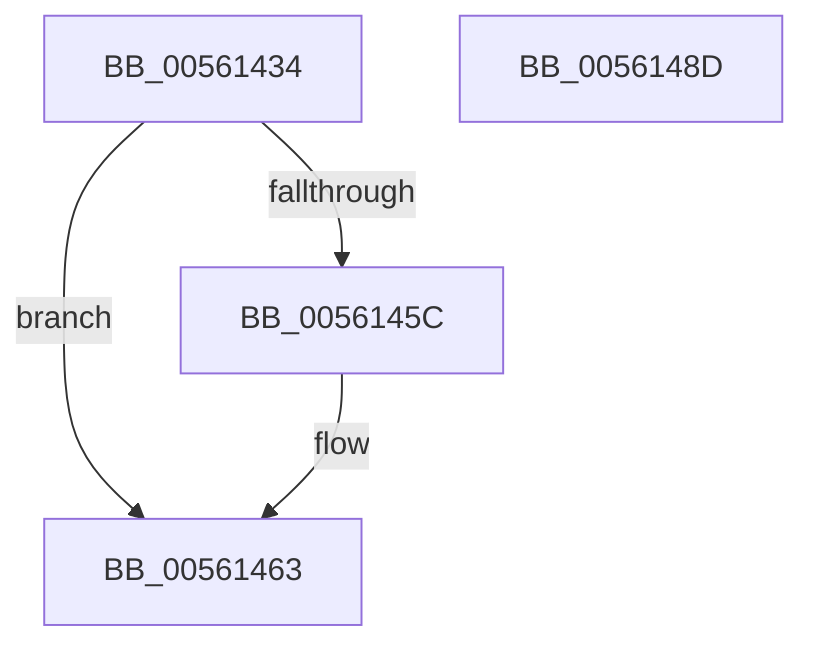

# ExtEnvInitializeSpinLock

- RVA: `0x00561434`–`0x0056148E` (길이 `90` bytes)
- VA: `0x0000000140561434`
- 실행 섹션: `.text`
- PDB 이름 있음: `예`; PDB Function 태그: `아니요`
- unwind 정보 RVA: `0x0005CF00`
- 디코드: `23`개 명령, `90/90` bytes 표시
- 미해석 바이트: `0` (있으면 어셈블리에 `.byte`로 보존)

> 이 문서는 커널 이미지의 기계어와 PDB 기호를 분석해 생성했습니다. 4번과 5번은 함수 원형과 자료형을 바이너리 사용 방식에서 추정한 C 해석이며 원본 소스 복구 결과는 아닙니다.

## 1. Dependencies

- 직접 호출 지점: **2**; 고유 호출 대상: **2**
- 직접 호출자로 확인된 함수: **3**
- RIP 상대 이미지 참조: **4**

### Outgoing calls
- `0x00561444` → [KeAcquireSpinLockRaiseToDpc](../20/KeAcquireSpinLockRaiseToDpc_function_00208470.md) (function, `0x00208470`)
- `0x0056147D` → [KeReleaseSpinLock](../39/KeReleaseSpinLock_function_00392BA0.md) (function, `0x00392BA0`)

### Direct callers
- [HalpVpptTimerRegister](../54/HalpVpptTimerRegister_function_0054A42C.md) at `0x0054A4B3`
- [IvtAllocateDomain](IvtAllocateDomain_function_0056E8B0.md) at `0x0056E8BD`
- [HsaInitializeInterruptRemapping](../../pagelk/B6/HsaInitializeInterruptRemapping_function_00B62FA8.md) at `0x00B630DB`

### Static image references
- `0x0056143D` → RVA `0x00F8FC40` (`.data`; read)
- `0x00561449` → RVA `0x00F8FC28` (`.data`; read)
- `0x00561450` → RVA `0x00F8FC20` (`.data`; read)
- `0x00561476` → RVA `0x00F8FC28` (`.data`; write)

## 2. Other-region calls and transfers

- 다른 실행 섹션으로 향하는 call: **0**
- 별도 외부 분기/꼬리 이동을 확인하지 못했습니다.

## 3. Assembly (complete function range)

```asm
00561434  40 53                           push rbx
00561436  48 83 EC 20                     sub rsp, 0x20
0056143A  48 8B D9                        mov rbx, rcx
0056143D  48 8D 0D FC E7 A2 00            lea rcx, [rip + 0xa2e7fc]
00561444  E8 27 70 CA FF                  call 0x140208470
00561449  48 8B 0D D8 E7 A2 00            mov rcx, qword ptr [rip + 0xa2e7d8]
00561450  48 8D 15 C9 E7 A2 00            lea rdx, [rip + 0xa2e7c9]
00561457  48 39 11                        cmp qword ptr [rcx], rdx
0056145A  74 07                           je 0x140561463
0056145C  B9 03 00 00 00                  mov ecx, 3
00561461  CD 29                           int 0x29
00561463  48 89 13                        mov qword ptr [rbx], rdx
00561466  8A D0                           mov dl, al
00561468  48 89 4B 08                     mov qword ptr [rbx + 8], rcx
0056146C  48 89 19                        mov qword ptr [rcx], rbx
0056146F  48 8D 0D CA E7 A2 00            lea rcx, [rip + 0xa2e7ca]
00561476  48 89 1D AB E7 A2 00            mov qword ptr [rip + 0xa2e7ab], rbx
0056147D  E8 1E 17 E3 FF                  call 0x140392ba0
00561482  48 83 63 10 00                  and qword ptr [rbx + 0x10], 0
00561487  48 83 C4 20                     add rsp, 0x20
0056148B  5B                              pop rbx
0056148C  C3                              ret
0056148D  CC                              int3
```

## 4. C-style interpretation (structured pseudocode)

```c
__int64 __fastcall ExtEnvInitializeSpinLock(__int64 a1)
{
    __int64 result;
    __int64 v_rsp;

    v_rsp = (v_rsp) - (32);
    result = KeAcquireSpinLockRaiseToDpc(v_rip + 10676220, a2, a3, a4);
    if ((*(unsigned __int64 *)(*(unsigned __int64 *)(v_rip + 10676184))) != (v_rip + 10676169)) {
        a1 = 3;
    }
    *(unsigned __int64 *)(a1) = v_rip + 10676169;
    *(unsigned __int64 *)(a1 + 8) = a1;
    *(unsigned __int64 *)(a1) = a1;
    *(unsigned __int64 *)(v_rip + 10676139) = a1;
    result = KeReleaseSpinLock(v_rip + 10676170, (unsigned __int8)(result), a3, a4);
    v_rsp = (v_rsp) + (32);
    return result;
}
```

## 5. (Beta) C Style

```c
int64_t ExtEnvInitializeSpinLock(void *Arg1)
{
    uint8_t *arg1 = (uint8_t *)Arg1;

    int64_t result;
    int64_t local_rsp;

    local_rsp = (local_rsp) - (32);
    result = KeAcquireSpinLockRaiseToDpc(v_rip + 10676220, a2, a3, a4);
    if ((*(uint64_t *)(*(uint64_t *)(v_rip + 0xA2E7D8))) != (v_rip + 10676169)) {
        Arg1 = 3;
    }
    *(uint64_t *)(arg1) = v_rip + 10676169;
    *(void **)(arg1 + 0x8) = Arg1;
    *(void **)(arg1) = Arg1;
    *(void **)(v_rip + 0xA2E7AB) = Arg1;
    result = KeReleaseSpinLock(v_rip + 10676170, (uint8_t)(result), a3, a4);
    local_rsp = (local_rsp) + (32);
    return result;
}
```

### 관측된 메모리 오프셋

구조체 형식이 확인되지 않은 접근은 인자 기준의 오프셋으로만 기록했습니다.

| 기준 인자 | 오프셋 표현 | 폭 (bit) | 접근 |
|---|---:|---:|---|
| `Arg1` | `+ 0x0` | `64` | `W` |
| `Arg1` | `+ 0x8` | `64` | `W` |
| `Arg1` | `+ 0x10` | `64` | `R/W` |

## 6. Execution-region graph

[열기: 2D/3D 그래프와 함수 탐색 컨트롤 패널](../../../control-panel.html?section=text&rva=0x00561434&view=graph)

- 2D 그래프는 위에서 아래로 흐르고, 3D 그래프는 빈 공간을 드래그해 회전합니다. Shift+드래그는 이동, 휠은 확대·축소, 함수 노드 선택은 대상 보고서 이동입니다.

### Static fallback


