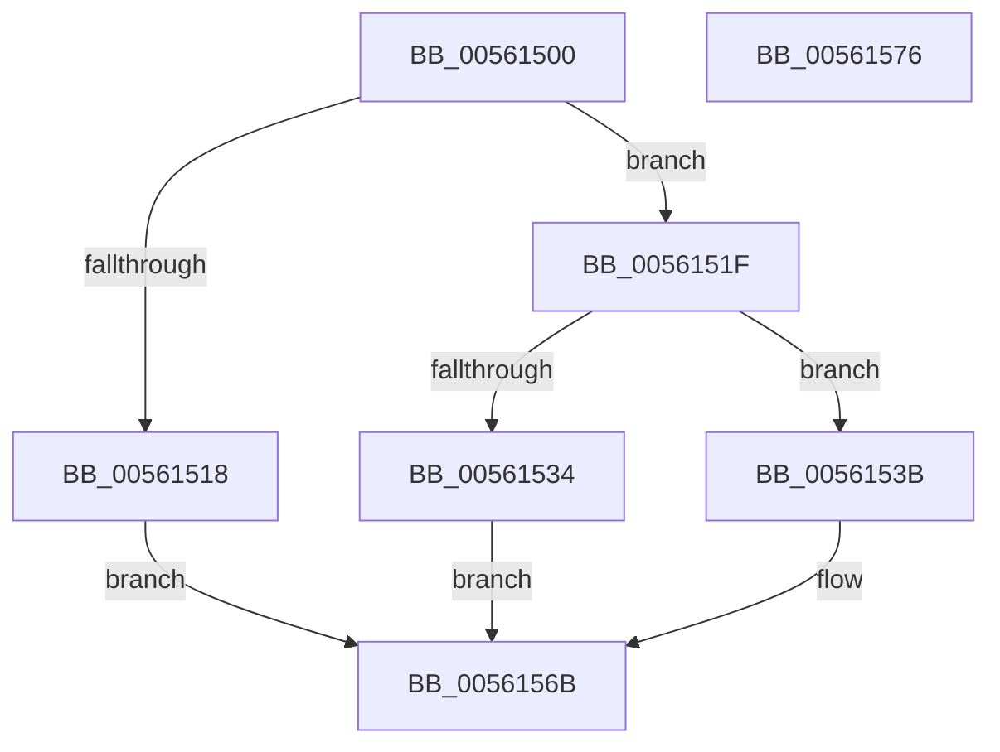

# HalRegisterPermanentAddressUsage

- RVA: `0x00561500`–`0x00561577` (길이 `119` bytes)
- VA: `0x0000000140561500`
- 실행 섹션: `.text`
- PDB 이름 있음: `예`; PDB Function 태그: `아니요`
- unwind 정보 RVA: `0x0005CAAC`
- 디코드: `32`개 명령, `119/119` bytes 표시
- 미해석 바이트: `0` (있으면 어셈블리에 `.byte`로 보존)

> 이 문서는 커널 이미지의 기계어와 PDB 기호를 분석해 생성했습니다. 4번과 5번은 함수 원형과 자료형을 바이너리 사용 방식에서 추정한 C 해석이며 원본 소스 복구 결과는 아닙니다.

## 1. Dependencies

- 직접 호출 지점: **1**; 고유 호출 대상: **1**
- 직접 호출자로 확인된 함수: **6**
- RIP 상대 이미지 참조: **3**

### Outgoing calls
- `0x00561527` → [HalpMmAllocateMemoryInternal](../54/HalpMmAllocateMemoryInternal_function_00544990.md) (function, `0x00544990`)

### Direct callers
- [HalpHpetDiscover](HalpHpetDiscover_function_00561E98.md) at `0x00561F68`
- [HalpApicDiscover](HalpApicDiscover_function_005699E4.md) at `0x00569A2C`
- [HalpApicRegisterIoUnit](HalpApicRegisterIoUnit_function_0056A298.md) at `0x0056A4D9`
- [HalpIommuProcessIvhdEntry](../57/HalpIommuProcessIvhdEntry_function_00572F38.md) at `0x00573232`
- [HalpIvtLegacyProcessDrhdEntry](../57/HalpIvtLegacyProcessDrhdEntry_function_00578C58.md) at `0x00578DD9`
- [HalpIvtProcessDrhdEntry](../57/HalpIvtProcessDrhdEntry_function_005794B4.md) at `0x0057964D`

### Static image references
- `0x0056150A` → RVA `0x00E0A758` (`.data`; read)
- `0x00561558` → RVA `0x010086A8` (`INITDATA`; read)
- `0x00561564` → RVA `0x010086A8` (`INITDATA`; write)

## 2. Other-region calls and transfers

- 다른 실행 섹션으로 향하는 call: **0**
- 별도 외부 분기/꼬리 이동을 확인하지 못했습니다.

## 3. Assembly (complete function range)

```asm
00561500  48 89 5C 24 08                  mov qword ptr [rsp + 8], rbx
00561505  57                              push rdi
00561506  48 83 EC 20                     sub rsp, 0x20
0056150A  80 3D 47 92 8A 00 00            cmp byte ptr [rip + 0x8a9247], 0
00561511  48 8B D9                        mov rbx, rcx
00561514  8B FA                           mov edi, edx
00561516  75 07                           jne 0x14056151f
00561518  B8 89 01 00 C0                  mov eax, 0xc0000189
0056151D  EB 4C                           jmp 0x14056156b
0056151F  BA 01 00 00 00                  mov edx, 1
00561524  8D 4A 2C                        lea ecx, [rdx + 0x2c]
00561527  E8 64 34 FE FF                  call 0x140544990
0056152C  48 8B C8                        mov rcx, rax
0056152F  48 85 C0                        test rax, rax
00561532  75 07                           jne 0x14056153b
00561534  B8 17 00 00 C0                  mov eax, 0xc0000017
00561539  EB 30                           jmp 0x14056156b
0056153B  48 83 60 1D 00                  and qword ptr [rax + 0x1d], 0
00561540  48 83 60 25 00                  and qword ptr [rax + 0x25], 0
00561545  C7 40 08 03 00 00 00            mov dword ptr [rax + 8], 3
0056154C  C6 40 0C 21                     mov byte ptr [rax + 0xc], 0x21
00561550  48 89 58 0D                     mov qword ptr [rax + 0xd], rbx
00561554  48 89 78 15                     mov qword ptr [rax + 0x15], rdi
00561558  48 8B 05 49 71 AA 00            mov rax, qword ptr [rip + 0xaa7149]
0056155F  48 89 01                        mov qword ptr [rcx], rax
00561562  33 C0                           xor eax, eax
00561564  48 89 0D 3D 71 AA 00            mov qword ptr [rip + 0xaa713d], rcx
0056156B  48 8B 5C 24 30                  mov rbx, qword ptr [rsp + 0x30]
00561570  48 83 C4 20                     add rsp, 0x20
00561574  5F                              pop rdi
00561575  C3                              ret
00561576  CC                              int3
```

## 4. C-style interpretation (structured pseudocode)

```c
__int64 __fastcall HalRegisterPermanentAddressUsage(__int64 a1, int a2)
{
    __int64 result;
    __int64 v_rsp;
    unsigned __int64 v_stack_p8;

    v_stack_p8 = v_rbx;
    v_rsp = (v_rsp) - (32);
    if ((*(unsigned __int8 *)(v_rip + 9081415)) != 0) goto loc_0056151F;
    goto loc_0056156B;
loc_0056151F:
    result = HalpMmAllocateMemoryInternal(1 + 44, 1, a3, a4);
    if (result != 0) goto loc_0056153B;
    goto loc_0056156B;
loc_0056153B:
    *(unsigned int *)((unsigned int)(0xC0000017ULL) + 8) = 3;
    *(unsigned __int8 *)((unsigned int)(0xC0000017ULL) + 12) = 33;
    *(unsigned __int64 *)((unsigned int)(0xC0000017ULL) + 13) = a1;
    *(unsigned __int64 *)((unsigned int)(0xC0000017ULL) + 21) = (unsigned int)(a2);
    *(unsigned __int64 *)(result) = *(unsigned __int64 *)(v_rip + 11170121);
    result = 0;
    *(unsigned __int64 *)(v_rip + 11170109) = 0;
loc_0056156B:
    v_rsp = (v_rsp) + (32);
    return result;
}
```

## 5. (Beta) C Style

```c
int64_t HalRegisterPermanentAddressUsage(int64_t Arg1, int32_t Arg2)
{
    int64_t result;
    int64_t local_rsp;
    uint64_t v_stack_p8;

    v_stack_p8 = local_rbx;
    local_rsp = (local_rsp) - (32);
    if ((*(uint8_t *)(v_rip + 0x8A9247)) != 0) goto loc_0056151F;
    goto loc_0056156B;
loc_0056151F:
    result = HalpMmAllocateMemoryInternal(1 + 44, 1, a3, a4);
    if (result != 0) goto loc_0056153B;
    goto loc_0056156B;
loc_0056153B:
    *(uint32_t *)((uint32_t)(0xC0000017ULL) + 0x8) = 3;
    *(uint8_t *)((uint32_t)(0xC0000017ULL) + 0xC) = 33;
    *(uint64_t *)((uint32_t)(0xC0000017ULL) + 0xD) = Arg1;
    *(uint64_t *)((uint32_t)(0xC0000017ULL) + 0x15) = (uint32_t)(Arg2);
    *(uint64_t *)(result) = *(uint64_t *)(v_rip + 0xAA7149);
    result = 0;
    *(uint64_t *)(v_rip + 0xAA713D) = 0;
loc_0056156B:
    local_rsp = (local_rsp) + (32);
    return result;
}
```

## 6. Execution-region graph

[열기: 2D/3D 그래프와 함수 탐색 컨트롤 패널](../../../control-panel.html?section=text&rva=0x00561500&view=graph)

- 2D 그래프는 위에서 아래로 흐르고, 3D 그래프는 빈 공간을 드래그해 회전합니다. Shift+드래그는 이동, 휠은 확대·축소, 함수 노드 선택은 대상 보고서 이동입니다.

### Static fallback


