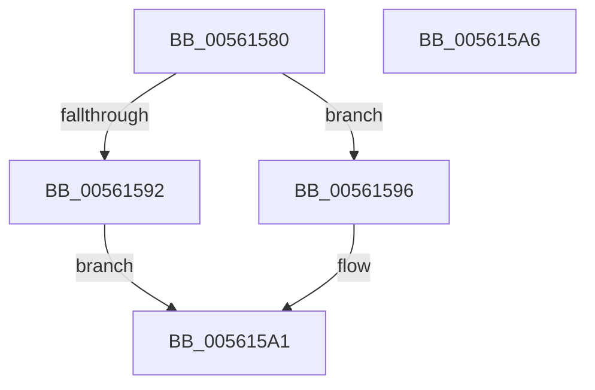

# HalSocGetAcpiTable

- RVA: `0x00561580`–`0x005615A7` (길이 `39` bytes)
- VA: `0x0000000140561580`
- 실행 섹션: `.text`
- PDB 이름 있음: `예`; PDB Function 태그: `아니요`
- unwind 정보 RVA: `0x0005C788`
- 디코드: `13`개 명령, `39/39` bytes 표시
- 미해석 바이트: `0` (있으면 어셈블리에 `.byte`로 보존)

> 이 문서는 커널 이미지의 기계어와 PDB 기호를 분석해 생성했습니다. 4번과 5번은 함수 원형과 자료형을 바이너리 사용 방식에서 추정한 C 해석이며 원본 소스 복구 결과는 아닙니다.

## 1. Dependencies

- 직접 호출 지점: **1**; 고유 호출 대상: **1**
- 직접 호출자로 확인된 함수: **9**
- RIP 상대 이미지 참조: **1**

### Outgoing calls
- `0x0056159C` → [HalpAcpiGetTable](../3F/HalpAcpiGetTable_function_003F6BF8.md) (function, `0x003F6BF8`)

### Direct callers
- [HalpWdatDiscover](HalpWdatDiscover_function_005609A8.md) at `0x00560A4B`
- [HalpWdatDiscover](HalpWdatDiscover_function_005609A8.md) at `0x00560A58`
- [HalpWdatInitialize](HalpWdatInitialize_function_00560DB0.md) at `0x00560DD0`
- [HalpWdatInitialize](HalpWdatInitialize_function_00560DB0.md) at `0x00560DDD`
- [HalpPmTimerDiscover](HalpPmTimerDiscover_function_00561AD0.md) at `0x00561AFA`
- [HalpHpetDiscover](HalpHpetDiscover_function_00561E98.md) at `0x00561EEB`
- [HalpApicTimerDiscover](HalpApicTimerDiscover_function_005623D0.md) at `0x005623FC`
- [HalpIommuRegisterBuiltinPlugins](HalpIommuRegisterBuiltinPlugins_function_005689EC.md) at `0x00568A36`
- [HalpApicDiscover](HalpApicDiscover_function_005699E4.md) at `0x00569A00`
- [HalpPicDiscover](HalpPicDiscover_function_0056A7C4.md) at `0x0056A7E8`
- [HalpPciGetHpetInterruptSource](../../init/C2/HalpPciGetHpetInterruptSource_function_00C25940.md) at `0x00C2596E`
- [HalpPciGetHpetInterruptSource](../../init/C2/HalpPciGetHpetInterruptSource_function_00C25940.md) at `0x00C25996`

### Static image references
- `0x00561586` → RVA `0x00FC4058` (`.data`; read)

## 2. Other-region calls and transfers

- 다른 실행 섹션으로 향하는 call: **0**
- 별도 외부 분기/꼬리 이동을 확인하지 못했습니다.

## 3. Assembly (complete function range)

```asm
00561580  48 83 EC 28                     sub rsp, 0x28
00561584  8B D1                           mov edx, ecx
00561586  48 8B 0D CB 2A A6 00            mov rcx, qword ptr [rip + 0xa62acb]
0056158D  48 85 C9                        test rcx, rcx
00561590  75 04                           jne 0x140561596
00561592  33 C0                           xor eax, eax
00561594  EB 0B                           jmp 0x1405615a1
00561596  45 33 C9                        xor r9d, r9d
00561599  45 33 C0                        xor r8d, r8d
0056159C  E8 57 56 E9 FF                  call 0x1403f6bf8
005615A1  48 83 C4 28                     add rsp, 0x28
005615A5  C3                              ret
005615A6  CC                              int3
```

## 4. C-style interpretation (structured pseudocode)

```c
__int64 __fastcall HalSocGetAcpiTable(int a1, __int64 a2, int a3, int a4)
{
    __int64 result;
    __int64 v_rsp;

    v_rsp = (v_rsp) - (40);
    if (*(unsigned __int64 *)(v_rip + 10889931) != 0) goto loc_00561596;
    result = 0;
    goto loc_005615A1;
loc_00561596:
    a4 = 0;
    a3 = 0;
    result = HalpAcpiGetTable(*(unsigned __int64 *)(v_rip + 10889931), (unsigned int)(a1), a3, a4);
loc_005615A1:
    v_rsp = (v_rsp) + (40);
    return result;
}
```

## 5. (Beta) C Style

```c
int64_t HalSocGetAcpiTable(int32_t Arg1, int64_t Arg2, int32_t Arg3, int32_t Arg4)
{
    int64_t result;
    int64_t local_rsp;

    local_rsp = (local_rsp) - (40);
    if (*(uint64_t *)(v_rip + 0xA62ACB) != 0) goto loc_00561596;
    result = 0;
    goto loc_005615A1;
loc_00561596:
    Arg4 = 0;
    Arg3 = 0;
    result = HalpAcpiGetTable(*(uint64_t *)(v_rip + 0xA62ACB), (uint32_t)(Arg1), Arg3, Arg4);
loc_005615A1:
    local_rsp = (local_rsp) + (40);
    return result;
}
```

## 6. Execution-region graph

[열기: 2D/3D 그래프와 함수 탐색 컨트롤 패널](../../../control-panel.html?section=text&rva=0x00561580&view=graph)

- 2D 그래프는 위에서 아래로 흐르고, 3D 그래프는 빈 공간을 드래그해 회전합니다. Shift+드래그는 이동, 휠은 확대·축소, 함수 노드 선택은 대상 보고서 이동입니다.

### Static fallback


