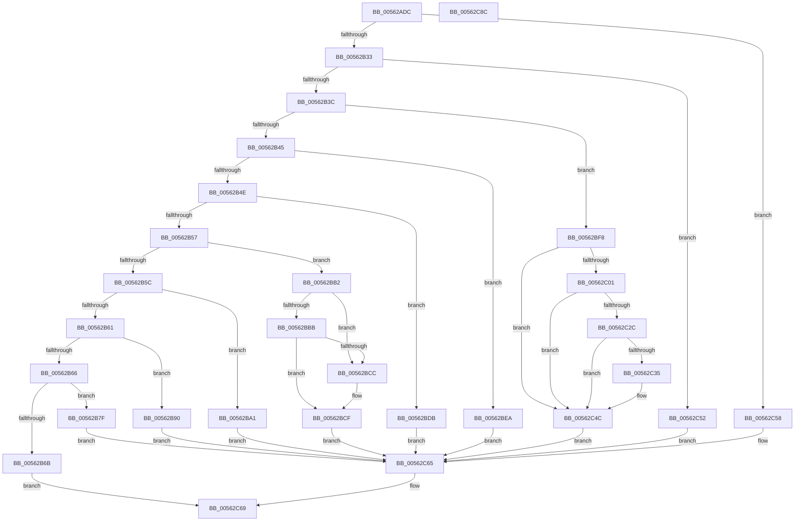

# HalSocRequestConfigurationData

- RVA: `0x00562ADC`–`0x00562C8D` (길이 `433` bytes)
- VA: `0x0000000140562ADC`
- 실행 섹션: `.text`
- PDB 이름 있음: `예`; PDB Function 태그: `아니요`
- unwind 정보 RVA: `0x000C4B54`
- 디코드: `120`개 명령, `433/433` bytes 표시
- 미해석 바이트: `0` (있으면 어셈블리에 `.byte`로 보존)

> 이 문서는 커널 이미지의 기계어와 PDB 기호를 분석해 생성했습니다. 4번과 5번은 함수 원형과 자료형을 바이너리 사용 방식에서 추정한 C 해석이며 원본 소스 복구 결과는 아닙니다.

## 1. Dependencies

- 직접 호출 지점: **8**; 고유 호출 대상: **5**
- 직접 호출자로 확인된 함수: **4**
- RIP 상대 이미지 참조: **4**

### Outgoing calls
- `0x00562B7F` → [HalpIsPartitionCpuManager](../4F/HalpIsPartitionCpuManager_function_004F8DEC.md) (function, `0x004F8DEC`)
- `0x00562B90` → [HalpIsHvPresent](../4A/HalpIsHvPresent_function_004AFA10.md) (function, `0x004AFA10`)
- `0x00562BA1` → [HalpIsMicrosoftCompatibleHvLoaded](../4A/HalpIsMicrosoftCompatibleHvLoaded_function_004AFAAC.md) (function, `0x004AFAAC`)
- `0x00562BB2` → [HalpIsMicrosoftCompatibleHvLoaded](../4A/HalpIsMicrosoftCompatibleHvLoaded_function_004AFAAC.md) (function, `0x004AFAAC`)
- `0x00562BEA` → [HalpInterruptGetX2ApicPolicy](../54/HalpInterruptGetX2ApicPolicy_function_005440B4.md) (function, `0x005440B4`)
- `0x00562BF8` → [HalpIsMicrosoftCompatibleHvLoaded](../4A/HalpIsMicrosoftCompatibleHvLoaded_function_004AFAAC.md) (function, `0x004AFAAC`)
- `0x00562C2C` → [HalpIsPartitionCpuManager](../4F/HalpIsPartitionCpuManager_function_004F8DEC.md) (function, `0x004F8DEC`)
- `0x00562C72` → [_security_check_cookie](../6A/_security_check_cookie_function_006AC640.md) (function, `0x006AC640`)

### Direct callers
- [HalpApicSetupRegisterAccess](../55/HalpApicSetupRegisterAccess_function_005589F8.md) at `0x00558A48`
- [HalpApicSetupRegisterAccess](../55/HalpApicSetupRegisterAccess_function_005589F8.md) at `0x00558A54`
- [HalpApicSetupRegisterAccess](../55/HalpApicSetupRegisterAccess_function_005589F8.md) at `0x00558B08`
- [HalpApicSetupRegisterAccess](../55/HalpApicSetupRegisterAccess_function_005589F8.md) at `0x00558BD4`
- [HalpApicSetupRegisterAccess](../55/HalpApicSetupRegisterAccess_function_005589F8.md) at `0x00558BE2`
- [HalpApicSetupRegisterAccess](../55/HalpApicSetupRegisterAccess_function_005589F8.md) at `0x00558C02`
- [HalpHvDiscover](HalpHvDiscover_function_005606A0.md) at `0x00560740`
- [HalpHpetDiscover](HalpHpetDiscover_function_00561E98.md) at `0x00561F12`
- [HalpHpetDiscover](HalpHpetDiscover_function_00561E98.md) at `0x00562140`
- [HalpTscGetAttributes](HalpTscGetAttributes_function_00562870.md) at `0x005629B0`

### Static image references
- `0x00562AF3` → RVA `0x00E0A740` (`.data`; read)
- `0x00562B70` → RVA `0x00E10358` (`.data`; write)
- `0x00562BDB` → RVA `0x00E0A80C` (`.data`; read)
- `0x00562C58` → RVA `0x00FC4050` (`.data`; read)

## 2. Other-region calls and transfers

- 다른 실행 섹션으로 향하는 call: **0**
- 별도 외부 분기/꼬리 이동을 확인하지 못했습니다.

## 3. Assembly (complete function range)

```asm
00562ADC  48 89 5C 24 08                  mov qword ptr [rsp + 8], rbx
00562AE1  48 89 74 24 10                  mov qword ptr [rsp + 0x10], rsi
00562AE6  48 89 7C 24 20                  mov qword ptr [rsp + 0x20], rdi
00562AEB  55                              push rbp
00562AEC  48 8B EC                        mov rbp, rsp
00562AEF  48 83 EC 50                     sub rsp, 0x50
00562AF3  48 8B 05 46 7C 8A 00            mov rax, qword ptr [rip + 0x8a7c46]
00562AFA  48 33 C4                        xor rax, rsp
00562AFD  48 89 45 F0                     mov qword ptr [rbp - 0x10], rax
00562B01  33 FF                           xor edi, edi
00562B03  49 8B F0                        mov rsi, r8
00562B06  40 88 7D D1                     mov byte ptr [rbp - 0x2f], dil
00562B0A  40 88 7D D7                     mov byte ptr [rbp - 0x29], dil
00562B0E  40 88 7D D2                     mov byte ptr [rbp - 0x2e], dil
00562B12  40 88 7D D3                     mov byte ptr [rbp - 0x2d], dil
00562B16  40 88 7D D8                     mov byte ptr [rbp - 0x28], dil
00562B1A  40 88 7D D0                     mov byte ptr [rbp - 0x30], dil
00562B1E  40 88 7D D4                     mov byte ptr [rbp - 0x2c], dil
00562B22  40 88 7D D6                     mov byte ptr [rbp - 0x2a], dil
00562B26  40 88 7D D5                     mov byte ptr [rbp - 0x2b], dil
00562B2A  83 E9 01                        sub ecx, 1
00562B2D  0F 84 25 01 00 00               je 0x140562c58
00562B33  83 E9 01                        sub ecx, 1
00562B36  0F 84 16 01 00 00               je 0x140562c52
00562B3C  83 E9 01                        sub ecx, 1
00562B3F  0F 84 B3 00 00 00               je 0x140562bf8
00562B45  83 E9 01                        sub ecx, 1
00562B48  0F 84 9C 00 00 00               je 0x140562bea
00562B4E  83 E9 01                        sub ecx, 1
00562B51  0F 84 84 00 00 00               je 0x140562bdb
00562B57  83 E9 01                        sub ecx, 1
00562B5A  74 56                           je 0x140562bb2
00562B5C  83 E9 01                        sub ecx, 1
00562B5F  74 40                           je 0x140562ba1
00562B61  83 E9 01                        sub ecx, 1
00562B64  74 2A                           je 0x140562b90
00562B66  83 F9 01                        cmp ecx, 1
00562B69  74 14                           je 0x140562b7f
00562B6B  BF 0D 00 00 C0                  mov edi, 0xc000000d
00562B70  C7 05 DE D7 8A 00 1E 00 00 00   mov dword ptr [rip + 0x8ad7de], 0x1e
00562B7A  E9 EA 00 00 00                  jmp 0x140562c69
00562B7F  E8 68 62 F9 FF                  call 0x1404f8dec
00562B84  88 45 D1                        mov byte ptr [rbp - 0x2f], al
00562B87  48 8D 4D D1                     lea rcx, [rbp - 0x2f]
00562B8B  E9 D5 00 00 00                  jmp 0x140562c65
00562B90  E8 7B CE F4 FF                  call 0x1404afa10
00562B95  88 45 D2                        mov byte ptr [rbp - 0x2e], al
00562B98  48 8D 4D D2                     lea rcx, [rbp - 0x2e]
00562B9C  E9 C4 00 00 00                  jmp 0x140562c65
00562BA1  E8 06 CF F4 FF                  call 0x1404afaac
00562BA6  88 45 D3                        mov byte ptr [rbp - 0x2d], al
00562BA9  48 8D 4D D3                     lea rcx, [rbp - 0x2d]
00562BAD  E9 B3 00 00 00                  jmp 0x140562c65
00562BB2  E8 F5 CE F4 FF                  call 0x1404afaac
00562BB7  84 C0                           test al, al
00562BB9  74 11                           je 0x140562bcc
00562BBB  33 C9                           xor ecx, ecx
00562BBD  B8 04 00 00 40                  mov eax, 0x40000004
00562BC2  0F A2                           cpuid
00562BC4  0F BA E0 08                     bt eax, 8
00562BC8  B0 01                           mov al, 1
00562BCA  72 03                           jb 0x140562bcf
00562BCC  40 8A C7                        mov al, dil
00562BCF  88 45 D4                        mov byte ptr [rbp - 0x2c], al
00562BD2  48 8D 4D D4                     lea rcx, [rbp - 0x2c]
00562BD6  E9 8A 00 00 00                  jmp 0x140562c65
00562BDB  8A 05 2B 7C 8A 00               mov al, byte ptr [rip + 0x8a7c2b]
00562BE1  48 8D 4D D5                     lea rcx, [rbp - 0x2b]
00562BE5  88 45 D5                        mov byte ptr [rbp - 0x2b], al
00562BE8  EB 7B                           jmp 0x140562c65
00562BEA  E8 C5 14 FE FF                  call 0x1405440b4
00562BEF  88 45 D6                        mov byte ptr [rbp - 0x2a], al
00562BF2  48 8D 4D D6                     lea rcx, [rbp - 0x2a]
00562BF6  EB 6D                           jmp 0x140562c65
00562BF8  E8 AF CE F4 FF                  call 0x1404afaac
00562BFD  84 C0                           test al, al
00562BFF  74 4B                           je 0x140562c4c
00562C01  B8 03 00 00 40                  mov eax, 0x40000003
00562C06  33 C9                           xor ecx, ecx
00562C08  0F A2                           cpuid
00562C0A  0F 57 C0                        xorps xmm0, xmm0
00562C0D  0F 11 45 E0                     movups xmmword ptr [rbp - 0x20], xmm0
00562C11  89 45 E0                        mov dword ptr [rbp - 0x20], eax
00562C14  89 5D E4                        mov dword ptr [rbp - 0x1c], ebx
00562C17  48 8B 45 E0                     mov rax, qword ptr [rbp - 0x20]
00562C1B  83 E0 0E                        and eax, 0xe
00562C1E  48 83 F8 0E                     cmp rax, 0xe
00562C22  41 0F 94 C3                     sete r11b
00562C26  44 88 5D D0                     mov byte ptr [rbp - 0x30], r11b
00562C2A  75 20                           jne 0x140562c4c
00562C2C  E8 BB 61 F9 FF                  call 0x1404f8dec
00562C31  84 C0                           test al, al
00562C33  74 17                           je 0x140562c4c
00562C35  33 C9                           xor ecx, ecx
00562C37  B8 06 00 00 40                  mov eax, 0x40000006
00562C3C  0F A2                           cpuid
00562C3E  0F BA E0 09                     bt eax, 9
00562C42  41 0F B6 C3                     movzx eax, r11b
00562C46  0F 42 C7                        cmovb eax, edi
00562C49  88 45 D0                        mov byte ptr [rbp - 0x30], al
00562C4C  48 8D 4D D0                     lea rcx, [rbp - 0x30]
00562C50  EB 13                           jmp 0x140562c65
00562C52  48 8D 4D D8                     lea rcx, [rbp - 0x28]
00562C56  EB 0D                           jmp 0x140562c65
00562C58  8A 0D F2 13 A6 00               mov cl, byte ptr [rip + 0xa613f2]
00562C5E  88 4D D7                        mov byte ptr [rbp - 0x29], cl
00562C61  48 8D 4D D7                     lea rcx, [rbp - 0x29]
00562C65  8A 09                           mov cl, byte ptr [rcx]
00562C67  88 0E                           mov byte ptr [rsi], cl
00562C69  8B C7                           mov eax, edi
00562C6B  48 8B 4D F0                     mov rcx, qword ptr [rbp - 0x10]
00562C6F  48 33 CC                        xor rcx, rsp
00562C72  E8 C9 99 14 00                  call 0x1406ac640
00562C77  48 8B 5C 24 60                  mov rbx, qword ptr [rsp + 0x60]
00562C7C  48 8B 74 24 68                  mov rsi, qword ptr [rsp + 0x68]
00562C81  48 8B 7C 24 78                  mov rdi, qword ptr [rsp + 0x78]
00562C86  48 83 C4 50                     add rsp, 0x50
00562C8A  5D                              pop rbp
00562C8B  C3                              ret
00562C8C  CC                              int3
```

## 4. C-style interpretation (structured pseudocode)

```c
__int64 __fastcall HalSocRequestConfigurationData(int a1, __int64 a2, __int64 a3)
{
    __int64 result;
    __int64 v_r11;
    __int64 v_rdi;
    __int64 v_rsp;
    unsigned __int64 v_stack_m18;
    unsigned int v_stack_m24;
    unsigned __int64 v_stack_m28;
    unsigned __int8 v_stack_m30;
    unsigned __int8 v_stack_m31;
    unsigned __int8 v_stack_m32;
    unsigned __int8 v_stack_m33;
    unsigned __int8 v_stack_m34;
    unsigned __int8 v_stack_m35;
    unsigned __int8 v_stack_m36;
    unsigned __int8 v_stack_m37;
    unsigned __int8 v_stack_m38;
    unsigned __int64 v_stack_p10;
    unsigned __int64 v_stack_p20;
    unsigned __int64 v_stack_p8;

    v_stack_p8 = v_rbx;
    v_stack_p10 = v_rsi;
    v_stack_p20 = v_rdi;
    v_rsp = (v_rsp) - (80);
    result = (*(unsigned __int64 *)(v_rip + 9075782)) ^ (v_rsp);
    v_stack_m18 = result;
    v_rdi = 0;
    v_stack_m37 = 0;
    v_stack_m31 = 0;
    v_stack_m36 = 0;
    v_stack_m35 = 0;
    v_stack_m30 = 0;
    v_stack_m38 = 0;
    v_stack_m34 = 0;
    v_stack_m32 = 0;
    v_stack_m33 = 0;
    a1 = (unsigned int)((a1) - (1));
    if (condition_is_equal) goto loc_00562C58;
    a1 = (unsigned int)((a1) - (1));
    if (condition_is_equal) goto loc_00562C52;
    a1 = (unsigned int)((a1) - (1));
    if (condition_is_equal) goto loc_00562BF8;
    a1 = (unsigned int)((a1) - (1));
    if (condition_is_equal) goto loc_00562BEA;
    a1 = (unsigned int)((a1) - (1));
    if (condition_is_equal) goto loc_00562BDB;
    a1 = (unsigned int)((a1) - (1));
    if (condition_is_equal) goto loc_00562BB2;
    a1 = (unsigned int)((a1) - (1));
    if (condition_is_equal) goto loc_00562BA1;
    a1 = (unsigned int)((a1) - (1));
    if (condition_is_equal) goto loc_00562B90;
    if (a1 == 1) goto loc_00562B7F;
    *(unsigned int *)(v_rip + 9099230) = 30;
    goto loc_00562C69;
loc_00562B7F:
    result = HalpIsPartitionCpuManager(a1, a2, a3, a4);
    v_stack_m37 = (unsigned __int8)(result);
    goto loc_00562C65;
loc_00562B90:
    result = HalpIsHvPresent(v_stack_m37, a2, a3, a4);
    v_stack_m36 = (unsigned __int8)(result);
    goto loc_00562C65;
loc_00562BA1:
    result = HalpIsMicrosoftCompatibleHvLoaded(v_stack_m36, a2, a3, a4);
    v_stack_m35 = (unsigned __int8)(result);
    goto loc_00562C65;
loc_00562BB2:
    result = HalpIsMicrosoftCompatibleHvLoaded(v_stack_m35, a2, a3, a4);
    if ((unsigned __int8)(result) == 0) goto loc_00562BCC;
    a1 = 0;
    result = 1;
    if (!(condition_is_below)) {
        result = (unsigned __int8)((unsigned int)(0xC000000DULL));
    }
    v_stack_m34 = (unsigned __int8)(result);
    goto loc_00562C65;
loc_00562BDB:
    v_stack_m33 = (unsigned __int8)(*(unsigned __int8 *)(v_rip + 9075755));
    goto loc_00562C65;
loc_00562BEA:
    result = HalpInterruptGetX2ApicPolicy(v_stack_m33, a2, a3, a4);
    v_stack_m32 = (unsigned __int8)(result);
    goto loc_00562C65;
loc_00562BF8:
    result = HalpIsMicrosoftCompatibleHvLoaded(v_stack_m32, a2, a3, a4);
    if ((unsigned __int8)(result) == 0) goto loc_00562C4C;
    a1 = 0;
    v_stack_m28 = v_xmm0;
    v_stack_m28 = (unsigned int)((unsigned int)(0x40000003ULL));
    v_stack_m24 = (unsigned int)(v_rbx);
    result = (unsigned int)((v_stack_m28) & (14));
    v_r11 = (result == 14) ? 1 : 0;
    v_stack_m38 = (unsigned __int8)(v_r11);
    if (result != 14) goto loc_00562C4C;
    result = HalpIsPartitionCpuManager(a1, a2, a3, a4);
    if ((unsigned __int8)(result) != 0) {
        a1 = 0;
        result = 0x40000006ULL;
        result = (unsigned __int8)(v_r11);
        if (condition_is_below) { result = (unsigned int)((unsigned int)(0xC000000DULL)); }
        v_stack_m38 = (unsigned __int8)(result);
    }
    goto loc_00562C65;
loc_00562C52:
    goto loc_00562C65;
loc_00562C58:
    v_stack_m31 = (unsigned __int8)(*(unsigned __int8 *)(v_rip + 10884082));
loc_00562C65:
    *(unsigned __int8 *)(a3) = (unsigned __int8)(*(unsigned __int8 *)(v_stack_m31));
loc_00562C69:
    a1 = (v_stack_m18) ^ (v_rsp);
    result = _security_check_cookie(a1, a2, a3, a4);
    v_rsp = (v_rsp) + (80);
    return result;
}
```

## 5. (Beta) C Style

```c
int64_t HalSocRequestConfigurationData(int32_t Arg1, int64_t Arg2, void *Arg3)
{
    uint8_t *arg3 = (uint8_t *)Arg3;

    int64_t result;
    int64_t local_r11;
    int64_t local_rdi;
    int64_t local_rsp;
    uint64_t v_stack_m18;
    uint32_t v_stack_m24;
    uint64_t v_stack_m28;
    uint8_t v_stack_m30;
    uint8_t v_stack_m31;
    uint8_t v_stack_m32;
    uint8_t v_stack_m33;
    uint8_t v_stack_m34;
    uint8_t v_stack_m35;
    uint8_t v_stack_m36;
    uint8_t v_stack_m37;
    uint8_t v_stack_m38;
    uint64_t v_stack_p10;
    uint64_t v_stack_p20;
    uint64_t v_stack_p8;

    v_stack_p8 = local_rbx;
    v_stack_p10 = local_rsi;
    v_stack_p20 = local_rdi;
    local_rsp = (local_rsp) - (80);
    result = (*(uint64_t *)(v_rip + 0x8A7C46)) ^ (local_rsp);
    v_stack_m18 = result;
    local_rdi = 0;
    v_stack_m37 = 0;
    v_stack_m31 = 0;
    v_stack_m36 = 0;
    v_stack_m35 = 0;
    v_stack_m30 = 0;
    v_stack_m38 = 0;
    v_stack_m34 = 0;
    v_stack_m32 = 0;
    v_stack_m33 = 0;
    Arg1 = (uint32_t)((Arg1) - (1));
    if (condition_is_equal) goto loc_00562C58;
    Arg1 = (uint32_t)((Arg1) - (1));
    if (condition_is_equal) goto loc_00562C52;
    Arg1 = (uint32_t)((Arg1) - (1));
    if (condition_is_equal) goto loc_00562BF8;
    Arg1 = (uint32_t)((Arg1) - (1));
    if (condition_is_equal) goto loc_00562BEA;
    Arg1 = (uint32_t)((Arg1) - (1));
    if (condition_is_equal) goto loc_00562BDB;
    Arg1 = (uint32_t)((Arg1) - (1));
    if (condition_is_equal) goto loc_00562BB2;
    Arg1 = (uint32_t)((Arg1) - (1));
    if (condition_is_equal) goto loc_00562BA1;
    Arg1 = (uint32_t)((Arg1) - (1));
    if (condition_is_equal) goto loc_00562B90;
    if (Arg1 == 1) goto loc_00562B7F;
    *(uint32_t *)(v_rip + 0x8AD7DE) = 30;
    goto loc_00562C69;
loc_00562B7F:
    result = HalpIsPartitionCpuManager(Arg1, Arg2, Arg3, a4);
    v_stack_m37 = (uint8_t)(result);
    goto loc_00562C65;
loc_00562B90:
    result = HalpIsHvPresent(v_stack_m37, Arg2, Arg3, a4);
    v_stack_m36 = (uint8_t)(result);
    goto loc_00562C65;
loc_00562BA1:
    result = HalpIsMicrosoftCompatibleHvLoaded(v_stack_m36, Arg2, Arg3, a4);
    v_stack_m35 = (uint8_t)(result);
    goto loc_00562C65;
loc_00562BB2:
    result = HalpIsMicrosoftCompatibleHvLoaded(v_stack_m35, Arg2, Arg3, a4);
    if ((uint8_t)(result) == 0) goto loc_00562BCC;
    Arg1 = 0;
    result = 1;
    if (!(condition_is_below)) {
        result = (uint8_t)((uint32_t)(0xC000000DULL));
    }
    v_stack_m34 = (uint8_t)(result);
    goto loc_00562C65;
loc_00562BDB:
    v_stack_m33 = (uint8_t)(*(uint8_t *)(v_rip + 0x8A7C2B));
    goto loc_00562C65;
loc_00562BEA:
    result = HalpInterruptGetX2ApicPolicy(v_stack_m33, Arg2, Arg3, a4);
    v_stack_m32 = (uint8_t)(result);
    goto loc_00562C65;
loc_00562BF8:
    result = HalpIsMicrosoftCompatibleHvLoaded(v_stack_m32, Arg2, Arg3, a4);
    if ((uint8_t)(result) == 0) goto loc_00562C4C;
    Arg1 = 0;
    v_stack_m28 = v_xmm0;
    v_stack_m28 = (uint32_t)((uint32_t)(0x40000003ULL));
    v_stack_m24 = (uint32_t)(local_rbx);
    result = (uint32_t)((v_stack_m28) & (14));
    local_r11 = (result == 14) ? 1 : 0;
    v_stack_m38 = (uint8_t)(local_r11);
    if (result != 14) goto loc_00562C4C;
    result = HalpIsPartitionCpuManager(Arg1, Arg2, Arg3, a4);
    if ((uint8_t)(result) != 0) {
        Arg1 = 0;
        result = 0x40000006ULL;
        result = (uint8_t)(local_r11);
        if (condition_is_below) { result = (uint32_t)((uint32_t)(0xC000000DULL)); }
        v_stack_m38 = (uint8_t)(result);
    }
    goto loc_00562C65;
loc_00562C52:
    goto loc_00562C65;
loc_00562C58:
    v_stack_m31 = (uint8_t)(*(uint8_t *)(v_rip + 0xA613F2));
loc_00562C65:
    *(uint8_t *)(arg3) = (uint8_t)(*(uint8_t *)(v_stack_m31));
loc_00562C69:
    Arg1 = (v_stack_m18) ^ (local_rsp);
    result = _security_check_cookie(Arg1, Arg2, Arg3, a4);
    local_rsp = (local_rsp) + (80);
    return result;
}
```

### 관측된 메모리 오프셋

구조체 형식이 확인되지 않은 접근은 인자 기준의 오프셋으로만 기록했습니다.

| 기준 인자 | 오프셋 표현 | 폭 (bit) | 접근 |
|---|---:|---:|---|
| `Arg3` | `+ 0x0` | `8` | `W` |

## 6. Execution-region graph

[열기: 2D/3D 그래프와 함수 탐색 컨트롤 패널](../../../control-panel.html?section=text&rva=0x00562ADC&view=graph)

- 2D 그래프는 위에서 아래로 흐르고, 3D 그래프는 빈 공간을 드래그해 회전합니다. Shift+드래그는 이동, 휠은 확대·축소, 함수 노드 선택은 대상 보고서 이동입니다.

### Static fallback


