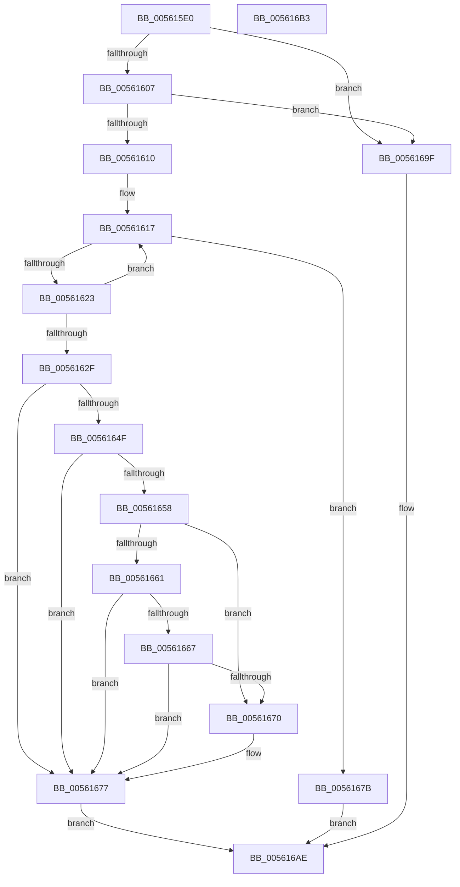

# HalUpdateTimerCapabilities

- RVA: `0x005615E0`–`0x005616B4` (길이 `212` bytes)
- VA: `0x00000001405615E0`
- 실행 섹션: `.text`
- PDB 이름 있음: `예`; PDB Function 태그: `아니요`
- unwind 정보 RVA: `0x0005D2F4`
- 디코드: `54`개 명령, `212/212` bytes 표시
- 미해석 바이트: `0` (있으면 어셈블리에 `.byte`로 보존)

> 이 문서는 커널 이미지의 기계어와 PDB 기호를 분석해 생성했습니다. 4번과 5번은 함수 원형과 자료형을 바이너리 사용 방식에서 추정한 C 해석이며 원본 소스 복구 결과는 아닙니다.

## 1. Dependencies

- 직접 호출 지점: **1**; 고유 호출 대상: **1**
- 직접 호출자로 확인된 함수: **2**
- RIP 상대 이미지 참조: **6**

### Outgoing calls
- `0x00561693` → [HalpTimerSetProblemEx](../4F/HalpTimerSetProblemEx_function_004FAEC4.md) (function, `0x004FAEC4`)

### Direct callers
- [HalpArtInitialize](../4A/HalpArtInitialize_function_004AF7E0.md) at `0x004AF862`
- [HalpTscInitialize](HalpTscInitialize_function_00562A20.md) at `0x00562A95`

### Static image references
- `0x00561610` → RVA `0x00FC4120` (`.data`; read)
- `0x00561640` → RVA `0x00FC3FD0` (`.data`; read)
- `0x00561667` → RVA `0x00FC3FA4` (`.data`; read)
- `0x00561670` → RVA `0x00FC2230` (`.data`; write)
- `0x00561686` → RVA `0x00025E38` (`.rdata`; read)
- `0x0056169F` → RVA `0x00E10358` (`.data`; write)

## 2. Other-region calls and transfers

- 다른 실행 섹션으로 향하는 call: **0**
- 별도 외부 분기/꼬리 이동을 확인하지 못했습니다.

## 3. Assembly (complete function range)

```asm
005615E0  48 83 EC 38                     sub rsp, 0x38
005615E4  8B C2                           mov eax, edx
005615E6  44 8B DA                        mov r11d, edx
005615E9  41 0B C0                        or eax, r8d
005615EC  4C 8B D1                        mov r10, rcx
005615EF  A9 FF 9F FF FF                  test eax, 0xffff9fff
005615F4  41 0F 94 C1                     sete r9b
005615F8  41 85 D0                        test r8d, edx
005615FB  0F 94 C0                        sete al
005615FE  44 84 C8                        test al, r9b
00561601  0F 84 98 00 00 00               je 0x14056169f
00561607  48 85 C9                        test rcx, rcx
0056160A  0F 84 8F 00 00 00               je 0x14056169f
00561610  48 8B 05 09 2B A6 00            mov rax, qword ptr [rip + 0xa62b09]
00561617  48 8D 0D 02 2B A6 00            lea rcx, [rip + 0xa62b02]
0056161E  48 3B C1                        cmp rax, rcx
00561621  74 58                           je 0x14056167b
00561623  48 8B C8                        mov rcx, rax
00561626  48 8B 00                        mov rax, qword ptr [rax]
00561629  4C 39 51 48                     cmp qword ptr [rcx + 0x48], r10
0056162D  75 E8                           jne 0x140561617
0056162F  8B 91 E0 00 00 00               mov edx, dword ptr [rcx + 0xe0]
00561635  41 F7 D0                        not r8d
00561638  8B C2                           mov eax, edx
0056163A  41 0B C3                        or eax, r11d
0056163D  41 23 C0                        and eax, r8d
00561640  48 3B 0D 89 29 A6 00            cmp rcx, qword ptr [rip + 0xa62989]
00561647  89 81 E0 00 00 00               mov dword ptr [rcx + 0xe0], eax
0056164D  75 28                           jne 0x140561677
0056164F  83 B9 E4 00 00 00 05            cmp dword ptr [rcx + 0xe4], 5
00561656  75 1F                           jne 0x140561677
00561658  41 33 D3                        xor edx, r11d
0056165B  0F BA E2 0D                     bt edx, 0xd
0056165F  72 0F                           jb 0x140561670
00561661  0F BA E0 0E                     bt eax, 0xe
00561665  73 10                           jae 0x140561677
00561667  80 3D 36 29 A6 00 01            cmp byte ptr [rip + 0xa62936], 1
0056166E  76 07                           jbe 0x140561677
00561670  C6 05 B9 0B A6 00 01            mov byte ptr [rip + 0xa60bb9], 1
00561677  33 C0                           xor eax, eax
00561679  EB 33                           jmp 0x1405616ae
0056167B  45 33 C0                        xor r8d, r8d
0056167E  C7 44 24 20 80 00 00 00         mov dword ptr [rsp + 0x20], 0x80
00561686  4C 8D 0D AB 47 AC FF            lea r9, [rip - 0x53b855]
0056168D  33 C9                           xor ecx, ecx
0056168F  41 8D 50 0D                     lea edx, [r8 + 0xd]
00561693  E8 2C 98 F9 FF                  call 0x1404faec4
00561698  B8 25 02 00 C0                  mov eax, 0xc0000225
0056169D  EB 0F                           jmp 0x1405616ae
0056169F  C7 05 AF EC 8A 00 0C 00 00 00   mov dword ptr [rip + 0x8aecaf], 0xc
005616A9  B8 0D 00 00 C0                  mov eax, 0xc000000d
005616AE  48 83 C4 38                     add rsp, 0x38
005616B2  C3                              ret
005616B3  CC                              int3
```

## 4. C-style interpretation (structured pseudocode)

```c
__int64 __fastcall HalUpdateTimerCapabilities(__int64 a1, int a2, int a3)
{
    __int64 result;
    __int64 v_rsp;
    unsigned int v_stack_m18;

    v_rsp = (v_rsp) - (56);
    result = (unsigned int)(((unsigned int)(a2)) | (a3));
    a4 = ((((unsigned int)(result)) & (0xFFFF9FFFULL)) == 0) ? 1 : 0;
    result = (((a3) & (a2)) == 0) ? 1 : 0;
    if ((((unsigned __int8)(result)) & ((unsigned __int8)(a4))) == 0) goto loc_0056169F;
    if (a1 == 0) goto loc_0056169F;
loc_00561617:
    if ((*(unsigned __int64 *)(v_rip + 10889993)) == (v_rip + 10889986)) goto loc_0056167B;
    if ((*(unsigned __int64 *)(*(unsigned __int64 *)(v_rip + 10889993) + 72)) != a1) goto loc_00561617;
    a3 = (unsigned int)(~(a3));
    result = (unsigned int)(((unsigned int)((unsigned int)((unsigned int)(*(unsigned int *)(*(unsigned __int64 *)(v_rip + 10889993) + 224))))) | ((unsigned int)((unsigned int)(a2))));
    result = (unsigned int)((result) & (a3));
    *(unsigned int *)(*(unsigned __int64 *)(v_rip + 10889993) + 224) = (unsigned int)(result);
    if ((*(unsigned __int64 *)(v_rip + 10889993)) != (*(unsigned __int64 *)(v_rip + 10889609))) goto loc_00561677;
    if ((*(unsigned int *)(*(unsigned __int64 *)(v_rip + 10889993) + 228)) != 5) goto loc_00561677;
    a2 = (unsigned int)(((unsigned int)(*(unsigned int *)(*(unsigned __int64 *)(v_rip + 10889993) + 224))) ^ ((unsigned int)((unsigned int)(a2))));
    if (condition_is_below) goto loc_00561670;
    if (condition_is_above_or_equal) goto loc_00561677;
    if ((*(unsigned __int8 *)(v_rip + 10889526)) >= = 1) {
        *(unsigned __int8 *)(v_rip + 10881977) = 1;
    }
    result = 0;
    goto loc_005616AE;
loc_0056167B:
    a3 = 0;
    v_stack_m18 = 128;
    a1 = 0;
    result = HalpTimerSetProblemEx(a1, a3 + 13, a3, v_rip - 5486677);
    goto loc_005616AE;
loc_0056169F:
    *(unsigned int *)(v_rip + 9104559) = 12;
loc_005616AE:
    v_rsp = (v_rsp) + (56);
    return (unsigned int)(0xC000000DULL);
}
```

## 5. (Beta) C Style

```c
int64_t HalUpdateTimerCapabilities(int64_t Arg1, int32_t Arg2, int32_t Arg3)
{
    int64_t result;
    int64_t local_rsp;
    uint32_t v_stack_m18;

    local_rsp = (local_rsp) - (56);
    result = (uint32_t)(((uint32_t)(Arg2)) | (Arg3));
    a4 = ((((uint32_t)(result)) & (0xFFFF9FFFULL)) == 0) ? 1 : 0;
    result = (((Arg3) & (Arg2)) == 0) ? 1 : 0;
    if ((((uint8_t)(result)) & ((uint8_t)(a4))) == 0) goto loc_0056169F;
    if (Arg1 == 0) goto loc_0056169F;
loc_00561617:
    if ((*(uint64_t *)(v_rip + 0xA62B09)) == (v_rip + 10889986)) goto loc_0056167B;
    if ((*(uint64_t *)(*(uint64_t *)(v_rip + 0xA62B09) + 0x48)) != Arg1) goto loc_00561617;
    Arg3 = (uint32_t)(~(Arg3));
    result = (uint32_t)(((uint32_t)((uint32_t)((uint32_t)(*(uint32_t *)(*(uint64_t *)(v_rip + 0xA62B09) + 0xE0))))) | ((uint32_t)((uint32_t)(Arg2))));
    result = (uint32_t)((result) & (Arg3));
    *(uint32_t *)(*(uint64_t *)(v_rip + 0xA62B09) + 0xE0) = (uint32_t)(result);
    if ((*(uint64_t *)(v_rip + 0xA62B09)) != (*(uint64_t *)(v_rip + 0xA62989))) goto loc_00561677;
    if ((*(uint32_t *)(*(uint64_t *)(v_rip + 0xA62B09) + 0xE4)) != 5) goto loc_00561677;
    Arg2 = (uint32_t)(((uint32_t)(*(uint32_t *)(*(uint64_t *)(v_rip + 0xA62B09) + 0xE0))) ^ ((uint32_t)((uint32_t)(Arg2))));
    if (condition_is_below) goto loc_00561670;
    if (condition_is_above_or_equal) goto loc_00561677;
    if ((*(uint8_t *)(v_rip + 0xA62936)) >= = 1) {
        *(uint8_t *)(v_rip + 0xA60BB9) = 1;
    }
    result = 0;
    goto loc_005616AE;
loc_0056167B:
    Arg3 = 0;
    v_stack_m18 = 128;
    Arg1 = 0;
    result = HalpTimerSetProblemEx(Arg1, Arg3 + 13, Arg3, v_rip - 5486677);
    goto loc_005616AE;
loc_0056169F:
    *(uint32_t *)(v_rip + 0x8AECAF) = 12;
loc_005616AE:
    local_rsp = (local_rsp) + (56);
    return (uint32_t)(0xC000000DULL);
}
```

## 6. Execution-region graph

[열기: 2D/3D 그래프와 함수 탐색 컨트롤 패널](../../../control-panel.html?section=text&rva=0x005615E0&view=graph)

- 2D 그래프는 위에서 아래로 흐르고, 3D 그래프는 빈 공간을 드래그해 회전합니다. Shift+드래그는 이동, 휠은 확대·축소, 함수 노드 선택은 대상 보고서 이동입니다.

### Static fallback


