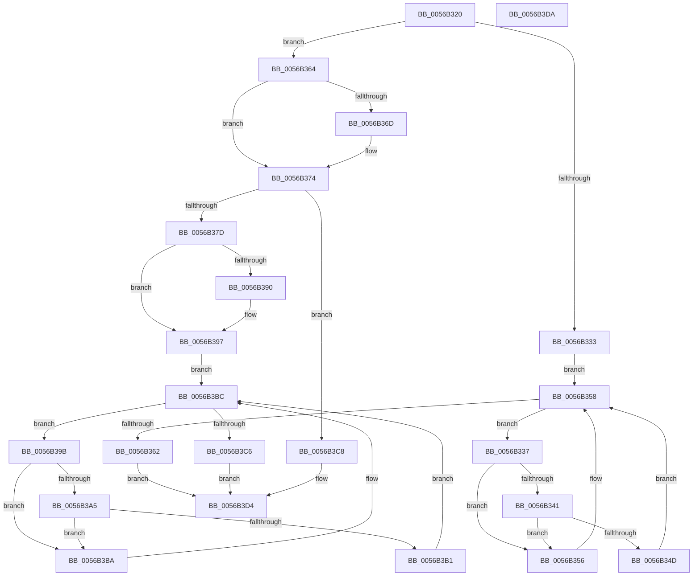

# HaliCompleteAcpiAPSleep

- RVA: `0x0056B320`–`0x0056B3DB` (길이 `187` bytes)
- VA: `0x000000014056B320`
- 실행 섹션: `.text`
- PDB 이름 있음: `예`; PDB Function 태그: `아니요`
- unwind 정보 RVA: `0x0005CF00`
- 디코드: `55`개 명령, `187/187` bytes 표시
- 미해석 바이트: `0` (있으면 어셈블리에 `.byte`로 보존)

> 이 문서는 커널 이미지의 기계어와 PDB 기호를 분석해 생성했습니다. 4번과 5번은 함수 원형과 자료형을 바이너리 사용 방식에서 추정한 C 해석이며 원본 소스 복구 결과는 아닙니다.

## 1. Dependencies

- 직접 호출 지점: **5**; 고유 호출 대상: **4**
- 직접 호출자로 확인된 함수: **1**
- RIP 상대 이미지 참조: **4**

### Outgoing calls
- `0x0056B34F` → [guard_dispatch_icall](../6B/guard_dispatch_icall_function_006BAAD0.md) (function, `0x006BAAD0`)
- `0x0056B36F` → [KeWriteProtectPAT](../../pagelk/B6/KeWriteProtectPAT_function_00B6ABD0.md) (function, `0x00B6ABD0`)
- `0x0056B374` → [HalpIsMicrosoftCompatibleHvLoaded](../4A/HalpIsMicrosoftCompatibleHvLoaded_function_004AFAAC.md) (function, `0x004AFAAC`)
- `0x0056B3B3` → [guard_dispatch_icall](../6B/guard_dispatch_icall_function_006BAAD0.md) (function, `0x006BAAD0`)
- `0x0056B3CF` → [HalpFlushAndWait](../6A/HalpFlushAndWait_function_006ACC30.md) (function, `0x006ACC30`)

### Direct callers
- [HaliSaveProcessorContextAndSleep](../6A/HaliSaveProcessorContextAndSleep_function_006ACE10.md) at `0x006ACE8B`

### Static image references
- `0x0056B339` → RVA `0x00FC1C7C` (`.data`; reference)
- `0x0056B341` → RVA `0x00FC1C80` (`.data`; read)
- `0x0056B358` → RVA `0x00F8F9B0` (`.data`; read)
- `0x0056B37D` → RVA `0x00F8F9B0` (`.data`; read/write)

## 2. Other-region calls and transfers

- 다른 실행 섹션으로 향하는 call: **1**
  - `0x0056B36F` → [KeWriteProtectPAT](../../pagelk/B6/KeWriteProtectPAT_function_00B6ABD0.md) (`.text` → `PAGELK`)
- 별도 외부 분기/꼬리 이동을 확인하지 못했습니다.

## 3. Assembly (complete function range)

```asm
0056B320  40 53                           push rbx
0056B322  48 83 EC 20                     sub rsp, 0x20
0056B326  65 48 8B 1C 25 20 00 00 00      mov rbx, qword ptr gs:[0x20]
0056B32F  84 C9                           test cl, cl
0056B331  74 31                           je 0x14056b364
0056B333  33 DB                           xor ebx, ebx
0056B335  EB 21                           jmp 0x14056b358
0056B337  FF C3                           inc ebx
0056B339  85 1D 3D 69 A5 00               test dword ptr [rip + 0xa5693d], ebx
0056B33F  75 15                           jne 0x14056b356
0056B341  48 8B 05 38 69 A5 00            mov rax, qword ptr [rip + 0xa56938]
0056B348  48 85 C0                        test rax, rax
0056B34B  74 09                           je 0x14056b356
0056B34D  8B CB                           mov ecx, ebx
0056B34F  E8 7C F7 14 00                  call 0x1406baad0
0056B354  EB 02                           jmp 0x14056b358
0056B356  F3 90                           pause
0056B358  8B 05 52 46 A2 00               mov eax, dword ptr [rip + 0xa24652]
0056B35E  85 C0                           test eax, eax
0056B360  75 D5                           jne 0x14056b337
0056B362  EB 70                           jmp 0x14056b3d4
0056B364  80 BB 8D 00 00 00 01            cmp byte ptr [rbx + 0x8d], 1
0056B36B  75 07                           jne 0x14056b374
0056B36D  B1 01                           mov cl, 1
0056B36F  E8 5C F8 5F 00                  call 0x140b6abd0
0056B374  E8 33 47 F4 FF                  call 0x1404afaac
0056B379  84 C0                           test al, al
0056B37B  74 4B                           je 0x14056b3c8
0056B37D  F0 FF 05 2C 46 A2 00            lock inc dword ptr [rip + 0xa2462c]
0056B384  48 8B 83 B8 8E 00 00            mov rax, qword ptr [rbx + 0x8eb8]
0056B38B  48 85 C0                        test rax, rax
0056B38E  74 07                           je 0x14056b397
0056B390  F0 81 08 00 00 02 00            lock or dword ptr [rax], 0x20000
0056B397  33 DB                           xor ebx, ebx
0056B399  EB 21                           jmp 0x14056b3bc
0056B39B  FF C3                           inc ebx
0056B39D  85 1D D9 68 A5 00               test dword ptr [rip + 0xa568d9], ebx
0056B3A3  75 15                           jne 0x14056b3ba
0056B3A5  48 8B 05 D4 68 A5 00            mov rax, qword ptr [rip + 0xa568d4]
0056B3AC  48 85 C0                        test rax, rax
0056B3AF  74 09                           je 0x14056b3ba
0056B3B1  8B CB                           mov ecx, ebx
0056B3B3  E8 18 F7 14 00                  call 0x1406baad0
0056B3B8  EB 02                           jmp 0x14056b3bc
0056B3BA  F3 90                           pause
0056B3BC  8B 05 EE 45 A2 00               mov eax, dword ptr [rip + 0xa245ee]
0056B3C2  85 C0                           test eax, eax
0056B3C4  75 D5                           jne 0x14056b39b
0056B3C6  EB 0C                           jmp 0x14056b3d4
0056B3C8  48 8D 0D E1 45 A2 00            lea rcx, [rip + 0xa245e1]
0056B3CF  E8 5C 18 14 00                  call 0x1406acc30
0056B3D4  48 83 C4 20                     add rsp, 0x20
0056B3D8  5B                              pop rbx
0056B3D9  C3                              ret
0056B3DA  CC                              int3
```

## 4. C-style interpretation (structured pseudocode)

```c
__int64 __fastcall HaliCompleteAcpiAPSleep(unsigned __int8 a1)
{
    __int64 result;
    __int64 v_rbx;
    __int64 v_rsp;

    v_rsp = (v_rsp) - (32);
    if (a1 == 0) goto loc_0056B364;
    v_rbx = 0;
    goto loc_0056B358;
loc_0056B337:
    v_rbx = (unsigned int)((v_rbx) + 1);
    if (((*(unsigned int *)(v_rip + 10840381)) & ((unsigned int)(v_rbx))) != 0) goto loc_0056B356;
    if (*(unsigned __int64 *)(v_rip + 10840376) == 0) goto loc_0056B356;
    result = guard_dispatch_icall((unsigned int)((unsigned int)(v_rbx)), a2, a3, a4);
    goto loc_0056B358;
loc_0056B356:
loc_0056B358:
    if ((unsigned int)((unsigned int)(*(unsigned int *)(v_rip + 10634834))) != 0) goto loc_0056B337;
    goto loc_0056B3D4;
loc_0056B364:
    result = (unsigned int)(*(unsigned int *)(v_rip + 10634834));
    if ((*(unsigned __int8 *)(v_rbx + 141)) == 1) {
        a1 = 1;
        result = KeWriteProtectPAT(a1, a2, a3, a4);
    }
    result = HalpIsMicrosoftCompatibleHvLoaded(a1, a2, a3, a4);
    if ((unsigned __int8)(result) == 0) goto loc_0056B3C8;
    if (*(unsigned __int64 *)(v_rbx + 36536) != 0) {
    }
    v_rbx = 0;
    goto loc_0056B3BC;
loc_0056B39B:
    v_rbx = (unsigned int)((v_rbx) + 1);
    if (((*(unsigned int *)(v_rip + 10840281)) & ((unsigned int)(v_rbx))) != 0) goto loc_0056B3BA;
    if (*(unsigned __int64 *)(v_rip + 10840276) == 0) goto loc_0056B3BA;
    result = guard_dispatch_icall((unsigned int)((unsigned int)(v_rbx)), a2, a3, a4);
    goto loc_0056B3BC;
loc_0056B3BA:
loc_0056B3BC:
    if ((unsigned int)((unsigned int)(*(unsigned int *)(v_rip + 10634734))) != 0) goto loc_0056B39B;
    goto loc_0056B3D4;
loc_0056B3C8:
    result = HalpFlushAndWait(v_rip + 10634721, a2, a3, a4);
loc_0056B3D4:
    v_rsp = (v_rsp) + (32);
    return result;
}
```

## 5. (Beta) C Style

```c
int64_t HaliCompleteAcpiAPSleep(uint8_t Arg1)
{
    int64_t result;
    int64_t local_rbx;
    int64_t local_rsp;

    local_rsp = (local_rsp) - (32);
    if (Arg1 == 0) goto loc_0056B364;
    local_rbx = 0;
    goto loc_0056B358;
loc_0056B337:
    local_rbx = (uint32_t)((local_rbx) + 1);
    if (((*(uint32_t *)(v_rip + 0xA5693D)) & ((uint32_t)(local_rbx))) != 0) goto loc_0056B356;
    if (*(uint64_t *)(v_rip + 0xA56938) == 0) goto loc_0056B356;
    result = guard_dispatch_icall((uint32_t)((uint32_t)(local_rbx)), a2, a3, a4);
    goto loc_0056B358;
loc_0056B356:
loc_0056B358:
    if ((uint32_t)((uint32_t)(*(uint32_t *)(v_rip + 0xA24652))) != 0) goto loc_0056B337;
    goto loc_0056B3D4;
loc_0056B364:
    result = (uint32_t)(*(uint32_t *)(v_rip + 0xA24652));
    if ((*(uint8_t *)(local_rbx + 0x8D)) == 1) {
        Arg1 = 1;
        result = KeWriteProtectPAT(Arg1, a2, a3, a4);
    }
    result = HalpIsMicrosoftCompatibleHvLoaded(Arg1, a2, a3, a4);
    if ((uint8_t)(result) == 0) goto loc_0056B3C8;
    if (*(uint64_t *)(local_rbx + 0x8EB8) != 0) {
    }
    local_rbx = 0;
    goto loc_0056B3BC;
loc_0056B39B:
    local_rbx = (uint32_t)((local_rbx) + 1);
    if (((*(uint32_t *)(v_rip + 0xA568D9)) & ((uint32_t)(local_rbx))) != 0) goto loc_0056B3BA;
    if (*(uint64_t *)(v_rip + 0xA568D4) == 0) goto loc_0056B3BA;
    result = guard_dispatch_icall((uint32_t)((uint32_t)(local_rbx)), a2, a3, a4);
    goto loc_0056B3BC;
loc_0056B3BA:
loc_0056B3BC:
    if ((uint32_t)((uint32_t)(*(uint32_t *)(v_rip + 0xA245EE))) != 0) goto loc_0056B39B;
    goto loc_0056B3D4;
loc_0056B3C8:
    result = HalpFlushAndWait(v_rip + 10634721, a2, a3, a4);
loc_0056B3D4:
    local_rsp = (local_rsp) + (32);
    return result;
}
```

## 6. Execution-region graph

[열기: 2D/3D 그래프와 함수 탐색 컨트롤 패널](../../../control-panel.html?section=text&rva=0x0056B320&view=graph)

- 2D 그래프는 위에서 아래로 흐르고, 3D 그래프는 빈 공간을 드래그해 회전합니다. Shift+드래그는 이동, 휠은 확대·축소, 함수 노드 선택은 대상 보고서 이동입니다.

### Static fallback


