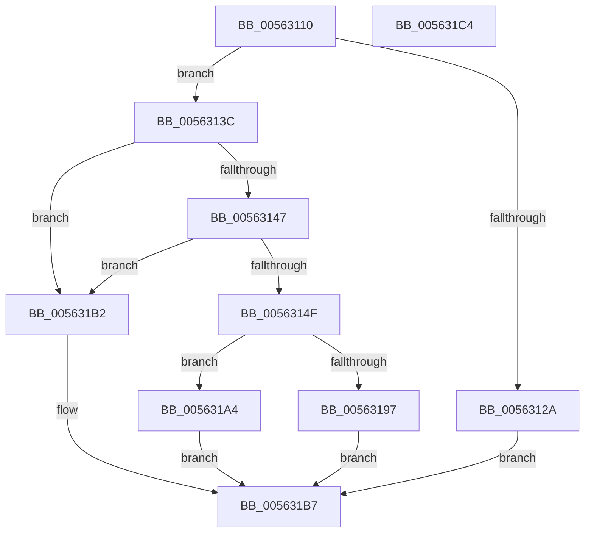

# HaliHandlePCIConfigSpaceAccess

- RVA: `0x00563110`–`0x005631C5` (길이 `181` bytes)
- VA: `0x0000000140563110`
- 실행 섹션: `.text`
- PDB 이름 있음: `예`; PDB Function 태그: `아니요`
- unwind 정보 RVA: `0x0006E5F8`
- 디코드: `48`개 명령, `181/181` bytes 표시
- 미해석 바이트: `0` (있으면 어셈블리에 `.byte`로 보존)

> 이 문서는 커널 이미지의 기계어와 PDB 기호를 분석해 생성했습니다. 4번과 5번은 함수 원형과 자료형을 바이너리 사용 방식에서 추정한 C 해석이며 원본 소스 복구 결과는 아닙니다.

## 1. Dependencies

- 직접 호출 지점: **2**; 고유 호출 대상: **2**
- 직접 호출자로 확인된 함수: **0**
- RIP 상대 이미지 참조: **5**

### Outgoing calls
- `0x0056319D` → [HaliPciInterfaceReadConfig](../43/HaliPciInterfaceReadConfig_function_004391A0.md) (function, `0x004391A0`)
- `0x005631AB` → [HaliPciInterfaceWriteConfig](../47/HaliPciInterfaceWriteConfig_function_00474830.md) (function, `0x00474830`)

### Direct callers
- 이 함수 시작 RVA로 연결되는 직접 call은 확인되지 않았습니다. 간접 호출은 완전히 역산할 수 없습니다.

### Static image references
- `0x0056312D` → RVA `0x00E11790` (`.data`; write)
- `0x00563133` → RVA `0x00E11794` (`.data`; write)
- `0x00563147` → RVA `0x00E11794` (`.data`; read)
- `0x0056314F` → RVA `0x00E11790` (`.data`; read)
- `0x005631A4` → RVA `0x00E11792` (`.data`; read)

## 2. Other-region calls and transfers

- 다른 실행 섹션으로 향하는 call: **0**
- 별도 외부 분기/꼬리 이동을 확인하지 못했습니다.

## 3. Assembly (complete function range)

```asm
00563110  48 89 5C 24 08                  mov qword ptr [rsp + 8], rbx
00563115  57                              push rdi
00563116  48 83 EC 30                     sub rsp, 0x30
0056311A  33 DB                           xor ebx, ebx
0056311C  45 8B D0                        mov r10d, r8d
0056311F  40 8A F9                        mov dil, cl
00563122  81 FA F8 0C 00 00               cmp edx, 0xcf8
00563128  75 12                           jne 0x14056313c
0056312A  41 8B 01                        mov eax, dword ptr [r9]
0056312D  89 05 5D E6 8A 00               mov dword ptr [rip + 0x8ae65d], eax
00563133  C6 05 5A E6 8A 00 01            mov byte ptr [rip + 0x8ae65a], 1
0056313A  EB 7B                           jmp 0x1405631b7
0056313C  8D 82 04 F3 FF FF               lea eax, [rdx - 0xcfc]
00563142  83 F8 03                        cmp eax, 3
00563145  77 6B                           ja 0x1405631b2
00563147  38 1D 47 E6 8A 00               cmp byte ptr [rip + 0x8ae647], bl
0056314D  74 63                           je 0x1405631b2
0056314F  8B 05 3B E6 8A 00               mov eax, dword ptr [rip + 0x8ae63b]
00563155  44 8B D8                        mov r11d, eax
00563158  41 81 E3 FC 00 00 00            and r11d, 0xfc
0056315F  44 89 54 24 28                  mov dword ptr [rsp + 0x28], r10d
00563164  8B C8                           mov ecx, eax
00563166  41 81 C3 04 F3 FF FF            add r11d, 0xfffff304
0056316D  81 E1 00 07 00 00               and ecx, 0x700
00563173  44 03 DA                        add r11d, edx
00563176  44 8B C0                        mov r8d, eax
00563179  44 89 5C 24 20                  mov dword ptr [rsp + 0x20], r11d
0056317E  41 C1 E8 08                     shr r8d, 8
00563182  41 81 E0 F8 00 00 00            and r8d, 0xf8
00563189  44 0B C1                        or r8d, ecx
0056318C  33 C9                           xor ecx, ecx
0056318E  41 C1 E8 03                     shr r8d, 3
00563192  40 84 FF                        test dil, dil
00563195  74 0D                           je 0x1405631a4
00563197  C1 E8 10                        shr eax, 0x10
0056319A  0F B6 D0                        movzx edx, al
0056319D  E8 FE 5F ED FF                  call 0x1404391a0
005631A2  EB 13                           jmp 0x1405631b7
005631A4  0F B6 15 E7 E5 8A 00            movzx edx, byte ptr [rip + 0x8ae5e7]
005631AB  E8 80 16 F1 FF                  call 0x140474830
005631B0  EB 05                           jmp 0x1405631b7
005631B2  BB 01 00 00 C0                  mov ebx, 0xc0000001
005631B7  8B C3                           mov eax, ebx
005631B9  48 8B 5C 24 40                  mov rbx, qword ptr [rsp + 0x40]
005631BE  48 83 C4 30                     add rsp, 0x30
005631C2  5F                              pop rdi
005631C3  C3                              ret
005631C4  CC                              int3
```

## 4. C-style interpretation (structured pseudocode)

```c
__int64 __fastcall HaliHandlePCIConfigSpaceAccess(unsigned __int8 a1, __int64 a2, int a3, __int64 a4)
{
    __int64 result;
    __int64 v_r11;
    __int64 v_rbx;
    __int64 v_rsp;
    unsigned int v_stack_m10;
    unsigned int v_stack_m18;
    unsigned __int64 v_stack_p8;

    v_stack_p8 = v_rbx;
    v_rsp = (v_rsp) - (48);
    v_rbx = 0;
    if (((unsigned int)(a2)) != 0xCF8ULL) goto loc_0056313C;
    *(unsigned int *)(v_rip + 9102941) = (unsigned int)((unsigned int)(*(unsigned int *)(a4)));
    *(unsigned __int8 *)(v_rip + 9102938) = 1;
    goto loc_005631B7;
loc_0056313C:
    if (((unsigned int)(a2 - 3324)) > 3) goto loc_005631B2;
    if ((*(unsigned __int8 *)(v_rip + 9102919)) == 0) goto loc_005631B2;
    v_r11 = (unsigned int)(((unsigned int)((unsigned int)((unsigned int)(*(unsigned int *)(v_rip + 9102907))))) & (252));
    v_stack_m10 = (unsigned int)((unsigned int)(a3));
    v_r11 = (unsigned int)((v_r11) + (0xFFFFF304ULL));
    a1 = (unsigned int)(((unsigned int)((unsigned int)((unsigned int)(*(unsigned int *)(v_rip + 9102907))))) & (0x700ULL));
    v_r11 = (unsigned int)((v_r11) + ((unsigned int)(a2)));
    v_stack_m18 = (unsigned int)(v_r11);
    a3 = (unsigned int)(((unsigned int)((unsigned int)((unsigned int)(*(unsigned int *)(v_rip + 9102907))))) >> (8));
    a3 = (unsigned int)((a3) & (248));
    a3 = (unsigned int)((a3) | (a1));
    a1 = 0;
    a3 = (unsigned int)((a3) >> (3));
    if (0 == 0) goto loc_005631A4;
    result = (unsigned int)(((unsigned int)(*(unsigned int *)(v_rip + 9102907))) >> (16));
    result = HaliPciInterfaceReadConfig(a1, (unsigned __int8)(result), a3, a4);
    goto loc_005631B7;
loc_005631A4:
    result = HaliPciInterfaceWriteConfig(a1, *(unsigned __int8 *)(v_rip + 9102823), a3, a4);
    goto loc_005631B7;
loc_005631B2:
loc_005631B7:
    v_rsp = (v_rsp) + (48);
    return (unsigned int)((unsigned int)((unsigned int)(0xC0000001ULL)));
}
```

## 5. (Beta) C Style

```c
int64_t HaliHandlePCIConfigSpaceAccess(uint8_t Arg1, int64_t Arg2, int32_t Arg3, void *Arg4)
{
    uint8_t *arg4 = (uint8_t *)Arg4;

    int64_t result;
    int64_t local_r11;
    int64_t local_rbx;
    int64_t local_rsp;
    uint32_t v_stack_m10;
    uint32_t v_stack_m18;
    uint64_t v_stack_p8;

    v_stack_p8 = local_rbx;
    local_rsp = (local_rsp) - (48);
    local_rbx = 0;
    if (((uint32_t)(Arg2)) != 0xCF8ULL) goto loc_0056313C;
    *(uint32_t *)(v_rip + 0x8AE65D) = (uint32_t)((uint32_t)(*(uint32_t *)(arg4)));
    *(uint8_t *)(v_rip + 0x8AE65A) = 1;
    goto loc_005631B7;
loc_0056313C:
    if (((uint32_t)(Arg2 - 3324)) > 3) goto loc_005631B2;
    if ((*(uint8_t *)(v_rip + 0x8AE647)) == 0) goto loc_005631B2;
    local_r11 = (uint32_t)(((uint32_t)((uint32_t)((uint32_t)(*(uint32_t *)(v_rip + 0x8AE63B))))) & (252));
    v_stack_m10 = (uint32_t)((uint32_t)(Arg3));
    local_r11 = (uint32_t)((local_r11) + (0xFFFFF304ULL));
    Arg1 = (uint32_t)(((uint32_t)((uint32_t)((uint32_t)(*(uint32_t *)(v_rip + 0x8AE63B))))) & (0x700ULL));
    local_r11 = (uint32_t)((local_r11) + ((uint32_t)(Arg2)));
    v_stack_m18 = (uint32_t)(local_r11);
    Arg3 = (uint32_t)(((uint32_t)((uint32_t)((uint32_t)(*(uint32_t *)(v_rip + 0x8AE63B))))) >> (8));
    Arg3 = (uint32_t)((Arg3) & (248));
    Arg3 = (uint32_t)((Arg3) | (Arg1));
    Arg1 = 0;
    Arg3 = (uint32_t)((Arg3) >> (3));
    if (0 == 0) goto loc_005631A4;
    result = (uint32_t)(((uint32_t)(*(uint32_t *)(v_rip + 0x8AE63B))) >> (16));
    result = HaliPciInterfaceReadConfig(Arg1, (uint8_t)(result), Arg3, Arg4);
    goto loc_005631B7;
loc_005631A4:
    result = HaliPciInterfaceWriteConfig(Arg1, *(uint8_t *)(v_rip + 0x8AE5E7), Arg3, Arg4);
    goto loc_005631B7;
loc_005631B2:
loc_005631B7:
    local_rsp = (local_rsp) + (48);
    return (uint32_t)((uint32_t)((uint32_t)(0xC0000001ULL)));
}
```

### 관측된 메모리 오프셋

구조체 형식이 확인되지 않은 접근은 인자 기준의 오프셋으로만 기록했습니다.

| 기준 인자 | 오프셋 표현 | 폭 (bit) | 접근 |
|---|---:|---:|---|
| `Arg4` | `+ 0x0` | `32` | `R` |

## 6. Execution-region graph

[열기: 2D/3D 그래프와 함수 탐색 컨트롤 패널](../../../control-panel.html?section=text&rva=0x00563110&view=graph)

- 2D 그래프는 위에서 아래로 흐르고, 3D 그래프는 빈 공간을 드래그해 회전합니다. Shift+드래그는 이동, 휠은 확대·축소, 함수 노드 선택은 대상 보고서 이동입니다.

### Static fallback


