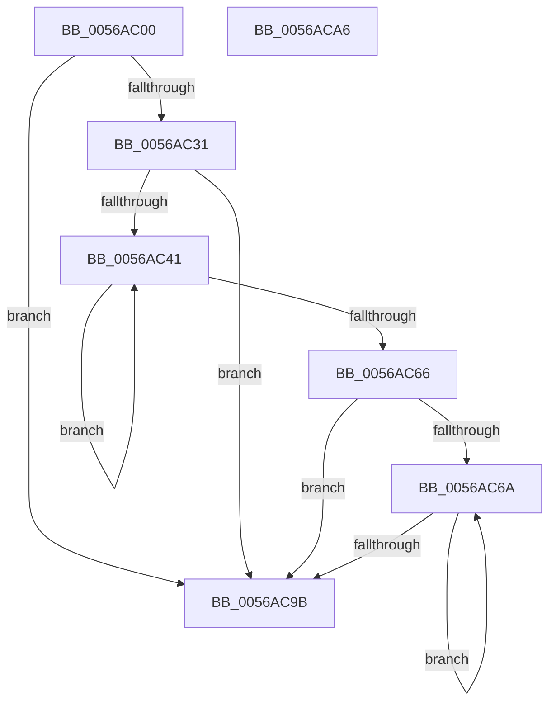

# HaliInitializePlatformDebugTriggers

- RVA: `0x0056AC00`–`0x0056ACA7` (길이 `167` bytes)
- VA: `0x000000014056AC00`
- 실행 섹션: `.text`
- PDB 이름 있음: `예`; PDB Function 태그: `아니요`
- unwind 정보 RVA: `0x0006E5F8`
- 디코드: `47`개 명령, `167/167` bytes 표시
- 미해석 바이트: `0` (있으면 어셈블리에 `.byte`로 보존)

> 이 문서는 커널 이미지의 기계어와 PDB 기호를 분석해 생성했습니다. 4번과 5번은 함수 원형과 자료형을 바이너리 사용 방식에서 추정한 C 해석이며 원본 소스 복구 결과는 아닙니다.

## 1. Dependencies

- 직접 호출 지점: **2**; 고유 호출 대상: **2**
- 직접 호출자로 확인된 함수: **0**
- RIP 상대 이미지 참조: **3**

### Outgoing calls
- `0x0056AC1E` → [RtlInitUnicodeString](../42/RtlInitUnicodeString_function_0042A780.md) (function, `0x0042A780`)
- `0x0056AC8C` → [HalpAcquirePccInterface](../../page/70/HalpAcquirePccInterface_function_0070D524.md) (function, `0x0070D524`)

### Direct callers
- 이 함수 시작 RVA로 연결되는 직접 call은 확인되지 않았습니다. 간접 호출은 완전히 역산할 수 없습니다.

### Static image references
- `0x0056AC0D` → RVA `0x00026038` (`.rdata`; read)
- `0x0056AC23` → RVA `0x00E11800` (`.data`; read)
- `0x0056AC4E` → RVA `0x00E11808` (`.data`; read)

## 2. Other-region calls and transfers

- 다른 실행 섹션으로 향하는 call: **1**
  - `0x0056AC8C` → [HalpAcquirePccInterface](../../page/70/HalpAcquirePccInterface_function_0070D524.md) (`.text` → `PAGE`)
- 별도 외부 분기/꼬리 이동을 확인하지 못했습니다.

## 3. Assembly (complete function range)

```asm
0056AC00  48 89 5C 24 08                  mov qword ptr [rsp + 8], rbx
0056AC05  57                              push rdi
0056AC06  48 83 EC 30                     sub rsp, 0x30
0056AC0A  0F 57 C0                        xorps xmm0, xmm0
0056AC0D  48 8D 15 24 B4 AB FF            lea rdx, [rip - 0x544bdc]
0056AC14  48 8D 4C 24 20                  lea rcx, [rsp + 0x20]
0056AC19  0F 11 44 24 20                  movups xmmword ptr [rsp + 0x20], xmm0
0056AC1E  E8 5D FB EB FF                  call 0x14042a780
0056AC23  48 8B 3D D6 6B 8A 00            mov rdi, qword ptr [rip + 0x8a6bd6]
0056AC2A  33 DB                           xor ebx, ebx
0056AC2C  48 85 FF                        test rdi, rdi
0056AC2F  74 6A                           je 0x14056ac9b
0056AC31  8B 57 28                        mov edx, dword ptr [rdi + 0x28]
0056AC34  44 8B C3                        mov r8d, ebx
0056AC37  8A 47 24                        mov al, byte ptr [rdi + 0x24]
0056AC3A  48 03 D7                        add rdx, rdi
0056AC3D  84 C0                           test al, al
0056AC3F  74 5A                           je 0x14056ac9b
0056AC41  41 8B C0                        mov eax, r8d
0056AC44  41 FF C0                        inc r8d
0056AC47  48 69 C8 88 00 00 00            imul rcx, rax, 0x88
0056AC4E  48 8B 05 B3 6B 8A 00            mov rax, qword ptr [rip + 0x8a6bb3]
0056AC55  48 89 14 01                     mov qword ptr [rcx + rax], rdx
0056AC59  48 83 C2 02                     add rdx, 2
0056AC5D  0F B6 47 24                     movzx eax, byte ptr [rdi + 0x24]
0056AC61  44 3B C0                        cmp r8d, eax
0056AC64  72 DB                           jb 0x14056ac41
0056AC66  84 C0                           test al, al
0056AC68  74 31                           je 0x14056ac9b
0056AC6A  48 8B 0D 97 6B 8A 00            mov rcx, qword ptr [rip + 0x8a6b97]
0056AC71  8B C3                           mov eax, ebx
0056AC73  48 69 D0 88 00 00 00            imul rdx, rax, 0x88
0056AC7A  4C 8D 41 08                     lea r8, [rcx + 8]
0056AC7E  4C 03 C2                        add r8, rdx
0056AC81  48 8B 0C 0A                     mov rcx, qword ptr [rdx + rcx]
0056AC85  48 8D 54 24 20                  lea rdx, [rsp + 0x20]
0056AC8A  8A 09                           mov cl, byte ptr [rcx]
0056AC8C  E8 93 28 1A 00                  call 0x14070d524
0056AC91  0F B6 47 24                     movzx eax, byte ptr [rdi + 0x24]
0056AC95  FF C3                           inc ebx
0056AC97  3B D8                           cmp ebx, eax
0056AC99  72 CF                           jb 0x14056ac6a
0056AC9B  48 8B 5C 24 40                  mov rbx, qword ptr [rsp + 0x40]
0056ACA0  48 83 C4 30                     add rsp, 0x30
0056ACA4  5F                              pop rdi
0056ACA5  C3                              ret
0056ACA6  CC                              int3
```

## 4. C-style interpretation (structured pseudocode)

```c
__int64 __fastcall HaliInitializePlatformDebugTriggers(void)
{
    __int64 result;
    __int64 v_rbx;
    __int64 v_rsp;
    unsigned __int64 v_stack_m18;
    unsigned __int64 v_stack_p8;

    v_stack_p8 = v_rbx;
    v_rsp = (v_rsp) - (48);
    v_stack_m18 = v_xmm0;
    result = RtlInitUnicodeString(v_stack_m18, v_rip - 5524444, a3, a4);
    v_rbx = 0;
    if (*(unsigned __int64 *)(v_rip + 9071574) == 0) goto loc_0056AC9B;
    a2 = ((unsigned int)(*(unsigned int *)(*(unsigned __int64 *)(v_rip + 9071574) + 40))) + (*(unsigned __int64 *)(v_rip + 9071574));
    if ((unsigned __int8)(*(unsigned __int8 *)(*(unsigned __int64 *)(v_rip + 9071574) + 36)) == 0) goto loc_0056AC9B;
loc_0056AC41:
    a3 = (unsigned int)((0) + 1);
    a1 = (v_stack_m18) * (0);
    *(unsigned __int64 *)(a1 + *(unsigned __int64 *)(v_rip + 9071539) * 1) = a2;
    a2 = (a2) + (2);
    if (((unsigned int)(a3)) < ((unsigned int)(*(unsigned __int8 *)(*(unsigned __int64 *)(v_rip + 9071574) + 36)))) goto loc_0056AC41;
    if ((unsigned __int8)(*(unsigned __int8 *)(*(unsigned __int64 *)(v_rip + 9071574) + 36)) == 0) goto loc_0056AC9B;
loc_0056AC6A:
    a2 = (a2) * (0);
    a3 = (*(unsigned __int64 *)(v_rip + 9071511) + 8) + (a2);
    result = HalpAcquirePccInterface(*(unsigned __int8 *)(*(unsigned __int64 *)(a2 + *(unsigned __int64 *)(v_rip + 9071511) * 1)), v_stack_m18, a3, a4);
    v_rbx = (unsigned int)((v_rbx) + 1);
    if (((unsigned int)(v_rbx)) < ((unsigned int)(*(unsigned __int8 *)(*(unsigned __int64 *)(v_rip + 9071574) + 36)))) goto loc_0056AC6A;
loc_0056AC9B:
    v_rsp = (v_rsp) + (48);
    return *(unsigned __int8 *)(*(unsigned __int64 *)(v_rip + 9071574) + 36);
}
```

## 5. (Beta) C Style

```c
void HaliInitializePlatformDebugTriggers(void)
{
    int64_t result;
    int64_t local_rbx;
    int64_t local_rsp;
    uint64_t v_stack_m18;
    uint64_t v_stack_p8;

    v_stack_p8 = local_rbx;
    local_rsp = (local_rsp) - (48);
    v_stack_m18 = v_xmm0;
    result = RtlInitUnicodeString(v_stack_m18, v_rip - 5524444, a3, a4);
    local_rbx = 0;
    if (*(uint64_t *)(v_rip + 0x8A6BD6) == 0) goto loc_0056AC9B;
    a2 = ((uint32_t)(*(uint32_t *)(*(uint64_t *)(v_rip + 0x8A6BD6) + 0x28))) + (*(uint64_t *)(v_rip + 0x8A6BD6));
    if ((uint8_t)(*(uint8_t *)(*(uint64_t *)(v_rip + 0x8A6BD6) + 0x24)) == 0) goto loc_0056AC9B;
loc_0056AC41:
    a3 = (uint32_t)((0) + 1);
    a1 = (v_stack_m18) * (0);
    *(uint64_t *)(a1 + *(uint64_t *)(v_rip + 0x8A6BB3) * 1) = a2;
    a2 = (a2) + (2);
    if (((uint32_t)(a3)) < ((uint32_t)(*(uint8_t *)(*(uint64_t *)(v_rip + 0x8A6BD6) + 0x24)))) goto loc_0056AC41;
    if ((uint8_t)(*(uint8_t *)(*(uint64_t *)(v_rip + 0x8A6BD6) + 0x24)) == 0) goto loc_0056AC9B;
loc_0056AC6A:
    a2 = (a2) * (0);
    a3 = (*(uint64_t *)(v_rip + 0x8A6B97) + 8) + (a2);
    result = HalpAcquirePccInterface(*(uint8_t *)(*(uint64_t *)(a2 + *(uint64_t *)(v_rip + 0x8A6B97) * 1)), v_stack_m18, a3, a4);
    local_rbx = (uint32_t)((local_rbx) + 1);
    if (((uint32_t)(local_rbx)) < ((uint32_t)(*(uint8_t *)(*(uint64_t *)(v_rip + 0x8A6BD6) + 0x24)))) goto loc_0056AC6A;
loc_0056AC9B:
    local_rsp = (local_rsp) + (48);
    return *(uint8_t *)(*(uint64_t *)(v_rip + 0x8A6BD6) + 0x24);
}
```

## 6. Execution-region graph

[열기: 2D/3D 그래프와 함수 탐색 컨트롤 패널](../../../control-panel.html?section=text&rva=0x0056AC00&view=graph)

- 2D 그래프는 위에서 아래로 흐르고, 3D 그래프는 빈 공간을 드래그해 회전합니다. Shift+드래그는 이동, 휠은 확대·축소, 함수 노드 선택은 대상 보고서 이동입니다.

### Static fallback


