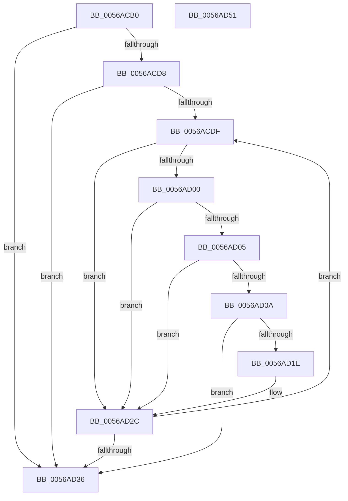

# HaliRunPlatformDebugTriggers

- RVA: `0x0056ACB0`–`0x0056AD52` (길이 `162` bytes)
- VA: `0x000000014056ACB0`
- 실행 섹션: `.text`
- PDB 이름 있음: `예`; PDB Function 태그: `아니요`
- unwind 정보 RVA: `0x0005E6B4`
- 디코드: `48`개 명령, `162/162` bytes 표시
- 미해석 바이트: `0` (있으면 어셈블리에 `.byte`로 보존)

> 이 문서는 커널 이미지의 기계어와 PDB 기호를 분석해 생성했습니다. 4번과 5번은 함수 원형과 자료형을 바이너리 사용 방식에서 추정한 C 해석이며 원본 소스 복구 결과는 아닙니다.

## 1. Dependencies

- 직접 호출 지점: **2**; 고유 호출 대상: **1**
- 직접 호출자로 확인된 함수: **0**
- RIP 상대 이미지 참조: **2**

### Outgoing calls
- `0x0056AD15` → [guard_dispatch_icall](../6B/guard_dispatch_icall_function_006BAAD0.md) (function, `0x006BAAD0`)
- `0x0056AD27` → [guard_dispatch_icall](../6B/guard_dispatch_icall_function_006BAAD0.md) (function, `0x006BAAD0`)

### Direct callers
- 이 함수 시작 RVA로 연결되는 직접 call은 확인되지 않았습니다. 간접 호출은 완전히 역산할 수 없습니다.

### Static image references
- `0x0056ACC9` → RVA `0x00E11800` (`.data`; read)
- `0x0056ACE8` → RVA `0x00E11808` (`.data`; read)

## 2. Other-region calls and transfers

- 다른 실행 섹션으로 향하는 call: **0**
- 별도 외부 분기/꼬리 이동을 확인하지 못했습니다.

## 3. Assembly (complete function range)

```asm
0056ACB0  48 8B C4                        mov rax, rsp
0056ACB3  48 89 58 08                     mov qword ptr [rax + 8], rbx
0056ACB7  48 89 68 10                     mov qword ptr [rax + 0x10], rbp
0056ACBB  48 89 70 18                     mov qword ptr [rax + 0x18], rsi
0056ACBF  48 89 78 20                     mov qword ptr [rax + 0x20], rdi
0056ACC3  41 56                           push r14
0056ACC5  48 83 EC 20                     sub rsp, 0x20
0056ACC9  48 8B 3D 30 6B 8A 00            mov rdi, qword ptr [rip + 0x8a6b30]
0056ACD0  40 8A E9                        mov bpl, cl
0056ACD3  48 85 FF                        test rdi, rdi
0056ACD6  74 5E                           je 0x14056ad36
0056ACD8  33 DB                           xor ebx, ebx
0056ACDA  38 5F 24                        cmp byte ptr [rdi + 0x24], bl
0056ACDD  76 57                           jbe 0x14056ad36
0056ACDF  8B C3                           mov eax, ebx
0056ACE1  48 69 C8 88 00 00 00            imul rcx, rax, 0x88
0056ACE8  48 8B 05 19 6B 8A 00            mov rax, qword ptr [rip + 0x8a6b19]
0056ACEF  48 8D 70 08                     lea rsi, [rax + 8]
0056ACF3  48 8B 04 01                     mov rax, qword ptr [rcx + rax]
0056ACF7  48 03 F1                        add rsi, rcx
0056ACFA  F6 40 01 01                     test byte ptr [rax + 1], 1
0056ACFE  74 2C                           je 0x14056ad2c
0056AD00  40 84 ED                        test bpl, bpl
0056AD03  75 27                           jne 0x14056ad2c
0056AD05  48 85 F6                        test rsi, rsi
0056AD08  74 22                           je 0x14056ad2c
0056AD0A  4C 8B 76 38                     mov r14, qword ptr [rsi + 0x38]
0056AD0E  48 8B 46 58                     mov rax, qword ptr [rsi + 0x58]
0056AD12  49 8B CE                        mov rcx, r14
0056AD15  E8 B6 FD 14 00                  call 0x1406baad0
0056AD1A  85 C0                           test eax, eax
0056AD1C  78 18                           js 0x14056ad36
0056AD1E  48 8B 46 68                     mov rax, qword ptr [rsi + 0x68]
0056AD22  33 D2                           xor edx, edx
0056AD24  49 8B CE                        mov rcx, r14
0056AD27  E8 A4 FD 14 00                  call 0x1406baad0
0056AD2C  0F B6 47 24                     movzx eax, byte ptr [rdi + 0x24]
0056AD30  FF C3                           inc ebx
0056AD32  3B D8                           cmp ebx, eax
0056AD34  72 A9                           jb 0x14056acdf
0056AD36  48 8B 5C 24 30                  mov rbx, qword ptr [rsp + 0x30]
0056AD3B  48 8B 6C 24 38                  mov rbp, qword ptr [rsp + 0x38]
0056AD40  48 8B 74 24 40                  mov rsi, qword ptr [rsp + 0x40]
0056AD45  48 8B 7C 24 48                  mov rdi, qword ptr [rsp + 0x48]
0056AD4A  48 83 C4 20                     add rsp, 0x20
0056AD4E  41 5E                           pop r14
0056AD50  C3                              ret
0056AD51  CC                              int3
```

## 4. C-style interpretation (structured pseudocode)

```c
__int64 __fastcall HaliRunPlatformDebugTriggers(unsigned __int8 a1, int a2)
{
    __int64 result;
    __int64 v_rbx;
    __int64 v_rsi;
    __int64 v_rsp;
    unsigned __int64 v_stack_p10;
    unsigned __int64 v_stack_p18;
    unsigned __int64 v_stack_p20;
    unsigned __int64 v_stack_p8;

    *(unsigned __int64 *)(v_rsp + 8) = v_rbx;
    *(unsigned __int64 *)(v_rsp + 16) = v_rbp;
    *(unsigned __int64 *)(v_rsp + 24) = v_rsi;
    *(unsigned __int64 *)(v_rsp + 32) = v_rdi;
    v_rsp = (v_rsp) - (32);
    if (*(unsigned __int64 *)(v_rip + 9071408) == 0) goto loc_0056AD36;
    v_rbx = 0;
    if ((*(unsigned __int8 *)(*(unsigned __int64 *)(v_rip + 9071408) + 36)) <= 0) goto loc_0056AD36;
loc_0056ACDF:
    a1 = (a1) * (0);
    v_rsi = (*(unsigned __int64 *)(v_rip + 9071385) + 8) + (a1);
    if (((*(unsigned __int8 *)(*(unsigned __int64 *)(a1 + *(unsigned __int64 *)(v_rip + 9071385) * 1) + 1)) & (1)) == 0) goto loc_0056AD2C;
    if (a1 != 0) goto loc_0056AD2C;
    if (v_rsi == 0) goto loc_0056AD2C;
    result = guard_dispatch_icall(*(unsigned __int64 *)(v_rsi + 56), a2, a3, a4);
    if (sign_flag) goto loc_0056AD36;
    a2 = 0;
    result = guard_dispatch_icall(*(unsigned __int64 *)(v_rsi + 56), a2, a3, a4);
loc_0056AD2C:
    v_rbx = (unsigned int)((v_rbx) + 1);
    if (((unsigned int)(v_rbx)) < ((unsigned int)(*(unsigned __int8 *)(*(unsigned __int64 *)(v_rip + 9071408) + 36)))) goto loc_0056ACDF;
loc_0056AD36:
    v_rsp = (v_rsp) + (32);
    return *(unsigned __int8 *)(*(unsigned __int64 *)(v_rip + 9071408) + 36);
}
```

## 5. (Beta) C Style

```c
int64_t HaliRunPlatformDebugTriggers(uint8_t Arg1, int32_t Arg2)
{
    int64_t result;
    int64_t local_rbx;
    int64_t local_rsi;
    int64_t local_rsp;
    uint64_t v_stack_p10;
    uint64_t v_stack_p18;
    uint64_t v_stack_p20;
    uint64_t v_stack_p8;

    *(uint64_t *)(local_rsp + 0x8) = local_rbx;
    *(uint64_t *)(local_rsp + 0x10) = local_rbp;
    *(uint64_t *)(local_rsp + 0x18) = local_rsi;
    *(uint64_t *)(local_rsp + 0x20) = local_rdi;
    local_rsp = (local_rsp) - (32);
    if (*(uint64_t *)(v_rip + 0x8A6B30) == 0) goto loc_0056AD36;
    local_rbx = 0;
    if ((*(uint8_t *)(*(uint64_t *)(v_rip + 0x8A6B30) + 0x24)) <= 0) goto loc_0056AD36;
loc_0056ACDF:
    Arg1 = (Arg1) * (0);
    local_rsi = (*(uint64_t *)(v_rip + 0x8A6B19) + 8) + (Arg1);
    if (((*(uint8_t *)(*(uint64_t *)(Arg1 + *(uint64_t *)(v_rip + 0x8A6B19) * 1) + 0x1)) & (1)) == 0) goto loc_0056AD2C;
    if (Arg1 != 0) goto loc_0056AD2C;
    if (local_rsi == 0) goto loc_0056AD2C;
    result = guard_dispatch_icall(*(uint64_t *)(local_rsi + 0x38), Arg2, a3, a4);
    if (sign_flag) goto loc_0056AD36;
    Arg2 = 0;
    result = guard_dispatch_icall(*(uint64_t *)(local_rsi + 0x38), Arg2, a3, a4);
loc_0056AD2C:
    local_rbx = (uint32_t)((local_rbx) + 1);
    if (((uint32_t)(local_rbx)) < ((uint32_t)(*(uint8_t *)(*(uint64_t *)(v_rip + 0x8A6B30) + 0x24)))) goto loc_0056ACDF;
loc_0056AD36:
    local_rsp = (local_rsp) + (32);
    return *(uint8_t *)(*(uint64_t *)(v_rip + 0x8A6B30) + 0x24);
}
```

## 6. Execution-region graph

[열기: 2D/3D 그래프와 함수 탐색 컨트롤 패널](../../../control-panel.html?section=text&rva=0x0056ACB0&view=graph)

- 2D 그래프는 위에서 아래로 흐르고, 3D 그래프는 빈 공간을 드래그해 회전합니다. Shift+드래그는 이동, 휠은 확대·축소, 함수 노드 선택은 대상 보고서 이동입니다.

### Static fallback


