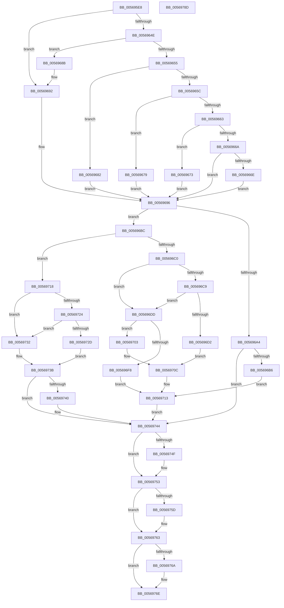

# HalpApicConvertFromRte

- RVA: `0x005695E8`–`0x0056978E` (길이 `422` bytes)
- VA: `0x00000001405695E8`
- 실행 섹션: `.text`
- PDB 이름 있음: `예`; PDB Function 태그: `아니요`
- unwind 정보 RVA: `0x000C4FC0`
- 디코드: `118`개 명령, `422/422` bytes 표시
- 미해석 바이트: `0` (있으면 어셈블리에 `.byte`로 보존)

> 이 문서는 커널 이미지의 기계어와 PDB 기호를 분석해 생성했습니다. 4번과 5번은 함수 원형과 자료형을 바이너리 사용 방식에서 추정한 C 해석이며 원본 소스 복구 결과는 아닙니다.

## 1. Dependencies

- 직접 호출 지점: **1**; 고유 호출 대상: **1**
- 직접 호출자로 확인된 함수: **1**
- RIP 상대 이미지 참조: **3**

### Outgoing calls
- `0x005696EE` → [guard_dispatch_icall](../6B/guard_dispatch_icall_function_006BAAD0.md) (function, `0x006BAAD0`)

### Direct callers
- [HalpApicInitializeIoUnit](HalpApicInitializeIoUnit_function_00569CE0.md) at `0x00569E0D`

### Static image references
- `0x005696C0` → RVA `0x00E10452` (`.data`; read)
- `0x005696C9` → RVA `0x00E10460` (`.data`; read)
- `0x005696DD` → RVA `0x00E10438` (`.data`; read)

## 2. Other-region calls and transfers

- 다른 실행 섹션으로 향하는 call: **0**
- 별도 외부 분기/꼬리 이동을 확인하지 못했습니다.

## 3. Assembly (complete function range)

```asm
005695E8  48 8B C4                        mov rax, rsp
005695EB  48 89 58 08                     mov qword ptr [rax + 8], rbx
005695EF  48 89 68 10                     mov qword ptr [rax + 0x10], rbp
005695F3  48 89 78 18                     mov qword ptr [rax + 0x18], rdi
005695F7  4C 89 70 20                     mov qword ptr [rax + 0x20], r14
005695FB  41 57                           push r15
005695FD  48 83 EC 20                     sub rsp, 0x20
00569601  33 C0                           xor eax, eax
00569603  0F 57 C0                        xorps xmm0, xmm0
00569606  41 0F 11 00                     movups xmmword ptr [r8], xmm0
0056960A  41 83 C9 FF                     or r9d, 0xffffffff
0056960E  8B FA                           mov edi, edx
00569610  41 0F 11 40 10                  movups xmmword ptr [r8 + 0x10], xmm0
00569615  BA 04 00 00 00                  mov edx, 4
0056961A  44 8B F1                        mov r14d, ecx
0056961D  41 0F 11 40 20                  movups xmmword ptr [r8 + 0x20], xmm0
00569622  49 89 40 30                     mov qword ptr [r8 + 0x30], rax
00569626  49 8B D8                        mov rbx, r8
00569629  0F B6 C1                        movzx eax, cl
0056962C  41 89 40 30                     mov dword ptr [r8 + 0x30], eax
00569630  44 8D 7A FD                     lea r15d, [rdx - 3]
00569634  C1 E8 04                        shr eax, 4
00569637  41 89 40 34                     mov dword ptr [r8 + 0x34], eax
0056963B  8B C1                           mov eax, ecx
0056963D  B9 00 07 00 00                  mov ecx, 0x700
00569642  45 89 48 10                     mov dword ptr [r8 + 0x10], r9d
00569646  44 8D 42 03                     lea r8d, [rdx + 3]
0056964A  23 C1                           and eax, ecx
0056964C  74 44                           je 0x140569692
0056964E  3D 00 01 00 00                  cmp eax, 0x100
00569653  74 36                           je 0x14056968b
00569655  3D 00 02 00 00                  cmp eax, 0x200
0056965A  74 26                           je 0x140569682
0056965C  3D 00 04 00 00                  cmp eax, 0x400
00569661  74 16                           je 0x140569679
00569663  3D 00 05 00 00                  cmp eax, 0x500
00569668  74 09                           je 0x140569673
0056966A  3B C1                           cmp eax, ecx
0056966C  75 28                           jne 0x140569696
0056966E  89 53 14                        mov dword ptr [rbx + 0x14], edx
00569671  EB 23                           jmp 0x140569696
00569673  44 89 43 14                     mov dword ptr [rbx + 0x14], r8d
00569677  EB 1D                           jmp 0x140569696
00569679  C7 43 14 02 00 00 00            mov dword ptr [rbx + 0x14], 2
00569680  EB 14                           jmp 0x140569696
00569682  C7 43 14 03 00 00 00            mov dword ptr [rbx + 0x14], 3
00569689  EB 0B                           jmp 0x140569696
0056968B  C7 43 0C 02 00 00 00            mov dword ptr [rbx + 0xc], 2
00569692  44 89 7B 14                     mov dword ptr [rbx + 0x14], r15d
00569696  41 8B C6                        mov eax, r14d
00569699  25 00 08 00 00                  and eax, 0x800
0056969E  0F BA E7 10                     bt edi, 0x10
005696A2  73 18                           jae 0x1405696bc
005696A4  C1 EF 11                        shr edi, 0x11
005696A7  44 89 43 18                     mov dword ptr [rbx + 0x18], r8d
005696AB  89 7B 20                        mov dword ptr [rbx + 0x20], edi
005696AE  85 C0                           test eax, eax
005696B0  0F 84 8E 00 00 00               je 0x140569744
005696B6  0F BA EF 0F                     bts edi, 0xf
005696BA  EB 57                           jmp 0x140569713
005696BC  85 C0                           test eax, eax
005696BE  74 58                           je 0x140569718
005696C0  80 3D 8B 6D 8A 00 00            cmp byte ptr [rip + 0x8a6d8b], 0
005696C7  74 14                           je 0x1405696dd
005696C9  80 3D 90 6D 8A 00 00            cmp byte ptr [rip + 0x8a6d90], 0
005696D0  75 0B                           jne 0x1405696dd
005696D2  0F B7 C7                        movzx eax, di
005696D5  89 43 24                        mov dword ptr [rbx + 0x24], eax
005696D8  C1 EF 10                        shr edi, 0x10
005696DB  EB 2F                           jmp 0x14056970c
005696DD  48 8B 05 54 6D 8A 00            mov rax, qword ptr [rip + 0x8a6d54]
005696E4  8B EF                           mov ebp, edi
005696E6  B9 E0 00 00 00                  mov ecx, 0xe0
005696EB  C1 ED 18                        shr ebp, 0x18
005696EE  E8 DD 13 15 00                  call 0x1406baad0
005696F3  83 F8 FF                        cmp eax, -1
005696F6  75 0B                           jne 0x140569703
005696F8  C7 43 18 05 00 00 00            mov dword ptr [rbx + 0x18], 5
005696FF  8B FD                           mov edi, ebp
00569701  EB 10                           jmp 0x140569713
00569703  83 E5 0F                        and ebp, 0xf
00569706  89 6B 24                        mov dword ptr [rbx + 0x24], ebp
00569709  C1 EF 1C                        shr edi, 0x1c
0056970C  C7 43 18 06 00 00 00            mov dword ptr [rbx + 0x18], 6
00569713  89 7B 20                        mov dword ptr [rbx + 0x20], edi
00569716  EB 2C                           jmp 0x140569744
00569718  80 3D 33 6D 8A 00 00            cmp byte ptr [rip + 0x8a6d33], 0
0056971F  89 53 18                        mov dword ptr [rbx + 0x18], edx
00569722  74 0E                           je 0x140569732
00569724  80 3D 35 6D 8A 00 00            cmp byte ptr [rip + 0x8a6d35], 0
0056972B  75 05                           jne 0x140569732
0056972D  41 3B F9                        cmp edi, r9d
00569730  EB 09                           jmp 0x14056973b
00569732  C1 EF 18                        shr edi, 0x18
00569735  81 FF FF 00 00 00               cmp edi, 0xff
0056973B  89 7B 20                        mov dword ptr [rbx + 0x20], edi
0056973E  75 04                           jne 0x140569744
00569740  44 89 7B 18                     mov dword ptr [rbx + 0x18], r15d
00569744  44 89 7B 08                     mov dword ptr [rbx + 8], r15d
00569748  41 0F BA E6 0F                  bt r14d, 0xf
0056974D  73 04                           jae 0x140569753
0056974F  83 63 08 00                     and dword ptr [rbx + 8], 0
00569753  44 89 3B                        mov dword ptr [rbx], r15d
00569756  41 0F BA E6 0D                  bt r14d, 0xd
0056975B  73 06                           jae 0x140569763
0056975D  C7 03 02 00 00 00               mov dword ptr [rbx], 2
00569763  41 0F BA E6 10                  bt r14d, 0x10
00569768  72 04                           jb 0x14056976e
0056976A  83 4B 0C 10                     or dword ptr [rbx + 0xc], 0x10
0056976E  48 8B 6C 24 38                  mov rbp, qword ptr [rsp + 0x38]
00569773  48 8B 7C 24 40                  mov rdi, qword ptr [rsp + 0x40]
00569778  4C 8B 74 24 48                  mov r14, qword ptr [rsp + 0x48]
0056977D  C6 43 04 00                     mov byte ptr [rbx + 4], 0
00569781  48 8B 5C 24 30                  mov rbx, qword ptr [rsp + 0x30]
00569786  48 83 C4 20                     add rsp, 0x20
0056978A  41 5F                           pop r15
0056978C  C3                              ret
0056978D  CC                              int3
```

## 4. C-style interpretation (structured pseudocode)

```c
__int64 __fastcall HalpApicConvertFromRte(int a1, int a2, __int64 a3, int a4)
{
    __int64 result;
    __int64 v_rbp;
    __int64 v_rdi;
    __int64 v_rsp;
    unsigned __int64 v_stack_p10;
    unsigned __int64 v_stack_p18;
    unsigned __int64 v_stack_p20;
    unsigned __int64 v_stack_p8;

    *(unsigned __int64 *)(v_rsp + 8) = v_rbx;
    *(unsigned __int64 *)(v_rsp + 16) = v_rbp;
    *(unsigned __int64 *)(v_rsp + 24) = v_rdi;
    *(unsigned __int64 *)(v_rsp + 32) = v_r14;
    v_rsp = (v_rsp) - (32);
    result = 0;
    *(unsigned __int64 *)(a3) = v_xmm0;
    a4 = (unsigned int)((a4) | (0xFFFFFFFFULL));
    *(unsigned __int64 *)(a3 + 16) = v_xmm0;
    *(unsigned __int64 *)(a3 + 32) = v_xmm0;
    *(unsigned __int64 *)(a3 + 48) = 0;
    *(unsigned int *)(a3 + 48) = (unsigned int)((unsigned __int8)(a1));
    result = (unsigned int)(((unsigned __int8)(a1)) >> (4));
    *(unsigned int *)(a3 + 52) = (unsigned int)(result);
    *(unsigned int *)(a3 + 16) = a4;
    result = (unsigned int)(((unsigned int)(a1)) & ((unsigned int)((unsigned int)(0x700ULL))));
    if (condition_is_equal) goto loc_00569692;
    if (((unsigned int)(result)) == 256) goto loc_0056968B;
    if (((unsigned int)(result)) == 512) goto loc_00569682;
    if (((unsigned int)(result)) == 0x400ULL) goto loc_00569679;
    if (((unsigned int)(result)) == 0x500ULL) goto loc_00569673;
    if (((unsigned int)(result)) != ((unsigned int)((unsigned int)(0x700ULL)))) goto loc_00569696;
    *(unsigned int *)(a3 + 20) = 4;
    goto loc_00569696;
loc_00569673:
    *(unsigned int *)(a3 + 20) = (unsigned int)(4 + 3);
    goto loc_00569696;
loc_00569679:
    *(unsigned int *)(a3 + 20) = 2;
    goto loc_00569696;
loc_00569682:
    *(unsigned int *)(a3 + 20) = 3;
    goto loc_00569696;
loc_0056968B:
    *(unsigned int *)(a3 + 12) = 2;
loc_00569692:
    *(unsigned int *)(a3 + 20) = (unsigned int)(4 - 3);
loc_00569696:
    result = (unsigned int)(((unsigned int)((unsigned int)((unsigned int)(a1)))) & (0x800ULL));
    if (condition_is_above_or_equal) goto loc_005696BC;
    v_rdi = (unsigned int)(((unsigned int)(a2)) >> (17));
    *(unsigned int *)(a3 + 24) = (unsigned int)(4 + 3);
    *(unsigned int *)(a3 + 32) = (unsigned int)(v_rdi);
    if ((unsigned int)(result) == 0) goto loc_00569744;
    goto loc_00569713;
loc_005696BC:
    if ((unsigned int)(result) == 0) goto loc_00569718;
    if ((*(unsigned __int8 *)(v_rip + 9072011)) == 0) goto loc_005696DD;
    if ((*(unsigned __int8 *)(v_rip + 9072016)) != 0) goto loc_005696DD;
    *(unsigned int *)(a3 + 36) = (unsigned int)((unsigned __int16)(v_rdi));
    v_rdi = (unsigned int)((v_rdi) >> (16));
    goto loc_0056970C;
loc_005696DD:
    v_rbp = (unsigned int)(((unsigned int)((unsigned int)(v_rdi))) >> (24));
    result = guard_dispatch_icall(224, 4, 4 + 3, a4);
    if (((unsigned int)(result)) != -1) goto loc_00569703;
    *(unsigned int *)(a3 + 24) = 5;
    goto loc_00569713;
loc_00569703:
    v_rbp = (unsigned int)((v_rbp) & (15));
    *(unsigned int *)(a3 + 36) = (unsigned int)(v_rbp);
    v_rdi = (unsigned int)(((unsigned int)((unsigned int)(v_rbp))) >> (28));
loc_0056970C:
    *(unsigned int *)(a3 + 24) = 6;
loc_00569713:
    *(unsigned int *)(a3 + 32) = (unsigned int)(v_rdi);
    goto loc_00569744;
loc_00569718:
    *(unsigned int *)(a3 + 24) = 4;
    if ((*(unsigned __int8 *)(v_rip + 9071923)) == 0) goto loc_00569732;
    if ((*(unsigned __int8 *)(v_rip + 9071925)) != 0) goto loc_00569732;
    goto loc_0056973B;
loc_00569732:
    v_rdi = (unsigned int)((v_rdi) >> (24));
loc_0056973B:
    *(unsigned int *)(a3 + 32) = (unsigned int)(v_rdi);
    if (((unsigned int)(v_rdi)) == 255) {
        *(unsigned int *)(a3 + 24) = (unsigned int)(4 - 3);
    }
    *(unsigned int *)(a3 + 8) = (unsigned int)(4 - 3);
    if (((unsigned int)(v_rdi)) < 255) {
    }
    *(unsigned int *)(a3) = (unsigned int)(4 - 3);
    if (((unsigned int)(v_rdi)) < 255) {
        *(unsigned int *)(a3) = 2;
    }
    if (((unsigned int)(v_rdi)) >= 255) {
    }
    *(unsigned __int8 *)(a3 + 4) = 0;
    v_rsp = (v_rsp) + (32);
    return result;
}
```

## 5. (Beta) C Style

```c
int64_t HalpApicConvertFromRte(int32_t Arg1, int32_t Arg2, void *Arg3, int32_t Arg4)
{
    uint8_t *arg3 = (uint8_t *)Arg3;

    int64_t result;
    int64_t local_rbp;
    int64_t local_rdi;
    int64_t local_rsp;
    uint64_t v_stack_p10;
    uint64_t v_stack_p18;
    uint64_t v_stack_p20;
    uint64_t v_stack_p8;

    *(uint64_t *)(local_rsp + 0x8) = local_rbx;
    *(uint64_t *)(local_rsp + 0x10) = local_rbp;
    *(uint64_t *)(local_rsp + 0x18) = local_rdi;
    *(uint64_t *)(local_rsp + 0x20) = local_r14;
    local_rsp = (local_rsp) - (32);
    result = 0;
    *(uint64_t *)(arg3) = v_xmm0;
    Arg4 = (uint32_t)((Arg4) | (0xFFFFFFFFULL));
    *(uint64_t *)(arg3 + 0x10) = v_xmm0;
    *(uint64_t *)(arg3 + 0x20) = v_xmm0;
    *(uint64_t *)(arg3 + 0x30) = 0;
    *(uint32_t *)(arg3 + 0x30) = (uint32_t)((uint8_t)(Arg1));
    result = (uint32_t)(((uint8_t)(Arg1)) >> (4));
    *(uint32_t *)(arg3 + 0x34) = (uint32_t)(result);
    *(uint32_t *)(arg3 + 0x10) = Arg4;
    result = (uint32_t)(((uint32_t)(Arg1)) & ((uint32_t)((uint32_t)(0x700ULL))));
    if (condition_is_equal) goto loc_00569692;
    if (((uint32_t)(result)) == 256) goto loc_0056968B;
    if (((uint32_t)(result)) == 512) goto loc_00569682;
    if (((uint32_t)(result)) == 0x400ULL) goto loc_00569679;
    if (((uint32_t)(result)) == 0x500ULL) goto loc_00569673;
    if (((uint32_t)(result)) != ((uint32_t)((uint32_t)(0x700ULL)))) goto loc_00569696;
    *(uint32_t *)(arg3 + 0x14) = 4;
    goto loc_00569696;
loc_00569673:
    *(uint32_t *)(arg3 + 0x14) = (uint32_t)(4 + 3);
    goto loc_00569696;
loc_00569679:
    *(uint32_t *)(arg3 + 0x14) = 2;
    goto loc_00569696;
loc_00569682:
    *(uint32_t *)(arg3 + 0x14) = 3;
    goto loc_00569696;
loc_0056968B:
    *(uint32_t *)(arg3 + 0xC) = 2;
loc_00569692:
    *(uint32_t *)(arg3 + 0x14) = (uint32_t)(4 - 3);
loc_00569696:
    result = (uint32_t)(((uint32_t)((uint32_t)((uint32_t)(Arg1)))) & (0x800ULL));
    if (condition_is_above_or_equal) goto loc_005696BC;
    local_rdi = (uint32_t)(((uint32_t)(Arg2)) >> (17));
    *(uint32_t *)(arg3 + 0x18) = (uint32_t)(4 + 3);
    *(uint32_t *)(arg3 + 0x20) = (uint32_t)(local_rdi);
    if ((uint32_t)(result) == 0) goto loc_00569744;
    goto loc_00569713;
loc_005696BC:
    if ((uint32_t)(result) == 0) goto loc_00569718;
    if ((*(uint8_t *)(v_rip + 0x8A6D8B)) == 0) goto loc_005696DD;
    if ((*(uint8_t *)(v_rip + 0x8A6D90)) != 0) goto loc_005696DD;
    *(uint32_t *)(arg3 + 0x24) = (uint32_t)((uint16_t)(local_rdi));
    local_rdi = (uint32_t)((local_rdi) >> (16));
    goto loc_0056970C;
loc_005696DD:
    local_rbp = (uint32_t)(((uint32_t)((uint32_t)(local_rdi))) >> (24));
    result = guard_dispatch_icall(224, 4, 4 + 3, Arg4);
    if (((uint32_t)(result)) != -1) goto loc_00569703;
    *(uint32_t *)(arg3 + 0x18) = 5;
    goto loc_00569713;
loc_00569703:
    local_rbp = (uint32_t)((local_rbp) & (15));
    *(uint32_t *)(arg3 + 0x24) = (uint32_t)(local_rbp);
    local_rdi = (uint32_t)(((uint32_t)((uint32_t)(local_rbp))) >> (28));
loc_0056970C:
    *(uint32_t *)(arg3 + 0x18) = 6;
loc_00569713:
    *(uint32_t *)(arg3 + 0x20) = (uint32_t)(local_rdi);
    goto loc_00569744;
loc_00569718:
    *(uint32_t *)(arg3 + 0x18) = 4;
    if ((*(uint8_t *)(v_rip + 0x8A6D33)) == 0) goto loc_00569732;
    if ((*(uint8_t *)(v_rip + 0x8A6D35)) != 0) goto loc_00569732;
    goto loc_0056973B;
loc_00569732:
    local_rdi = (uint32_t)((local_rdi) >> (24));
loc_0056973B:
    *(uint32_t *)(arg3 + 0x20) = (uint32_t)(local_rdi);
    if (((uint32_t)(local_rdi)) == 255) {
        *(uint32_t *)(arg3 + 0x18) = (uint32_t)(4 - 3);
    }
    *(uint32_t *)(arg3 + 0x8) = (uint32_t)(4 - 3);
    if (((uint32_t)(local_rdi)) < 255) {
    }
    *(uint32_t *)(arg3) = (uint32_t)(4 - 3);
    if (((uint32_t)(local_rdi)) < 255) {
        *(uint32_t *)(arg3) = 2;
    }
    if (((uint32_t)(local_rdi)) >= 255) {
    }
    *(uint8_t *)(arg3 + 0x4) = 0;
    local_rsp = (local_rsp) + (32);
    return result;
}
```

### 관측된 메모리 오프셋

구조체 형식이 확인되지 않은 접근은 인자 기준의 오프셋으로만 기록했습니다.

| 기준 인자 | 오프셋 표현 | 폭 (bit) | 접근 |
|---|---:|---:|---|
| `Arg3` | `+ 0x0` | `32` | `W` |
| `Arg3` | `+ 0x0` | `128` | `R` |
| `Arg3` | `+ 0x4` | `8` | `W` |
| `Arg3` | `+ 0x8` | `32` | `R/W` |
| `Arg3` | `+ 0x8` | `32` | `W` |
| `Arg3` | `+ 0xC` | `32` | `R/W` |
| `Arg3` | `+ 0xC` | `32` | `W` |
| `Arg3` | `+ 0x10` | `32` | `W` |
| `Arg3` | `+ 0x10` | `128` | `R` |
| `Arg3` | `+ 0x14` | `32` | `W` |
| `Arg3` | `+ 0x18` | `32` | `W` |
| `Arg3` | `+ 0x20` | `32` | `W` |
| `Arg3` | `+ 0x20` | `128` | `R` |
| `Arg3` | `+ 0x24` | `32` | `W` |
| `Arg3` | `+ 0x30` | `32` | `W` |
| `Arg3` | `+ 0x30` | `64` | `W` |
| `Arg3` | `+ 0x34` | `32` | `W` |

## 6. Execution-region graph

[열기: 2D/3D 그래프와 함수 탐색 컨트롤 패널](../../../control-panel.html?section=text&rva=0x005695E8&view=graph)

- 2D 그래프는 위에서 아래로 흐르고, 3D 그래프는 빈 공간을 드래그해 회전합니다. Shift+드래그는 이동, 휠은 확대·축소, 함수 노드 선택은 대상 보고서 이동입니다.

### Static fallback


