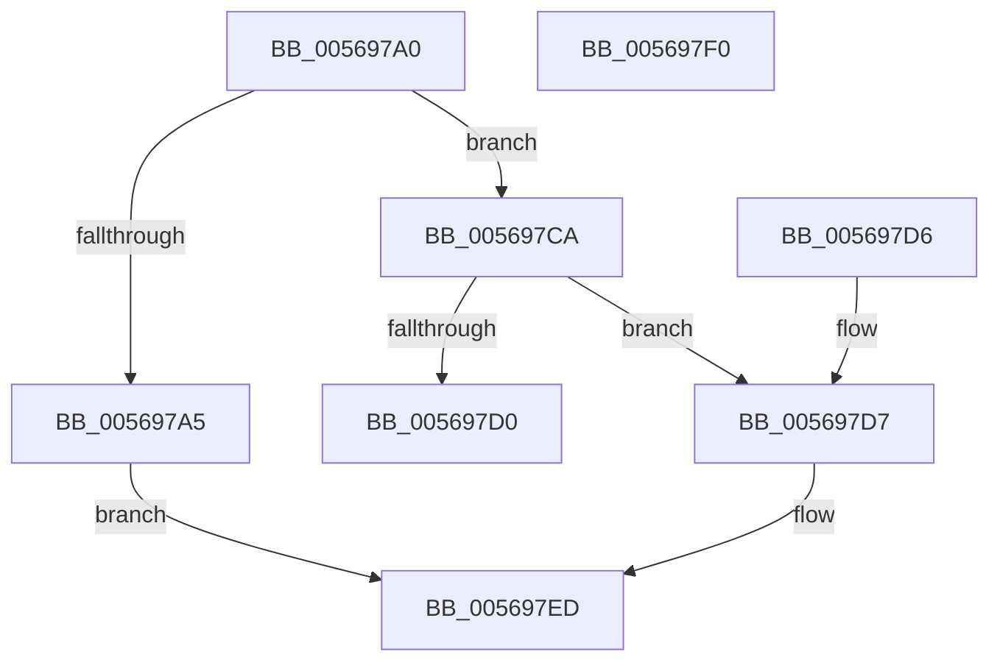

# HalpApicConvertId

- RVA: `0x005697A0`–`0x005697F1` (길이 `81` bytes)
- VA: `0x00000001405697A0`
- 실행 섹션: `.text`
- PDB 이름 있음: `예`; PDB Function 태그: `아니요`
- unwind 정보 RVA: `0x000DB714`
- 디코드: `28`개 명령, `81/81` bytes 표시
- 미해석 바이트: `0` (있으면 어셈블리에 `.byte`로 보존)

> 이 문서는 커널 이미지의 기계어와 PDB 기호를 분석해 생성했습니다. 4번과 5번은 함수 원형과 자료형을 바이너리 사용 방식에서 추정한 C 해석이며 원본 소스 복구 결과는 아닙니다.

## 1. Dependencies

- 직접 호출 지점: **0**; 고유 호출 대상: **0**
- 직접 호출자로 확인된 함수: **1**
- RIP 상대 이미지 참조: **0**

### Outgoing calls
- 직접 디코드된 call 명령이 없습니다.

### Direct callers
- [HalpApicConvertToRte](../46/HalpApicConvertToRte_function_0046F774.md) at `0x0046F935`

### Static image references
- 디코드된 RIP-relative 메모리 참조가 없습니다.

## 2. Other-region calls and transfers

- 다른 실행 섹션으로 향하는 call: **0**
- 별도 외부 분기/꼬리 이동을 확인하지 못했습니다.

## 3. Assembly (complete function range)

```asm
005697A0  45 84 C9                        test r9b, r9b
005697A3  74 25                           je 0x1405697ca
005697A5  41 C7 00 06 00 00 00            mov dword ptr [r8], 6
005697AC  8B 02                           mov eax, dword ptr [rdx]
005697AE  C1 E8 04                        shr eax, 4
005697B1  0F B7 C0                        movzx eax, ax
005697B4  41 89 40 08                     mov dword ptr [r8 + 8], eax
005697B8  8B 0A                           mov ecx, dword ptr [rdx]
005697BA  BA 01 00 00 00                  mov edx, 1
005697BF  83 E1 0F                        and ecx, 0xf
005697C2  D3 E2                           shl edx, cl
005697C4  41 89 50 0C                     mov dword ptr [r8 + 0xc], edx
005697C8  EB 23                           jmp 0x1405697ed
005697CA  41 83 38 06                     cmp dword ptr [r8], 6
005697CE  74 07                           je 0x1405697d7
005697D0  B8 BB 00 00 C0                  mov eax, 0xc00000bb
005697D5  C3                              ret
005697D6  CC                              int3
005697D7  41 8B 40 0C                     mov eax, dword ptr [r8 + 0xc]
005697DB  FF C8                           dec eax
005697DD  F3 48 0F B8 C8                  popcnt rcx, rax
005697E2  41 8B 40 08                     mov eax, dword ptr [r8 + 8]
005697E6  C1 E0 04                        shl eax, 4
005697E9  0B C8                           or ecx, eax
005697EB  89 0A                           mov dword ptr [rdx], ecx
005697ED  33 C0                           xor eax, eax
005697EF  C3                              ret
005697F0  CC                              int3
```

## 4. C-style interpretation (structured pseudocode)

```c
__int64 __fastcall HalpApicConvertId(__int64 a1, __int64 a2, __int64 a3, unsigned __int8 a4)
{
    __int64 result;

    if (a4 == 0) goto loc_005697CA;
    *(unsigned int *)(a3) = 6;
    result = (unsigned int)(((unsigned int)(*(unsigned int *)(a2))) >> (4));
    *(unsigned int *)(a3 + 8) = (unsigned int)((unsigned __int16)(result));
    a1 = (unsigned int)(((unsigned int)(*(unsigned int *)(a2))) & (15));
    a2 = (unsigned int)((1) << ((unsigned __int8)(a1)));
    *(unsigned int *)(a3 + 12) = (unsigned int)(a2);
    goto loc_005697ED;
loc_005697CA:
    if ((*(unsigned int *)(a3)) == 6) goto loc_005697D7;
    return (unsigned int)(0xC00000BBULL);
loc_005697D7:
    result = (unsigned int)(((unsigned int)(*(unsigned int *)(a3 + 12))) - 1);
    result = (unsigned int)(((unsigned int)(*(unsigned int *)(a3 + 8))) << (4));
    a1 = (unsigned int)((a1) | ((unsigned int)(result)));
    *(unsigned int *)(a2) = (unsigned int)(a1);
loc_005697ED:
    result = 0;
    return result;
}
```

## 5. (Beta) C Style

```c
int64_t HalpApicConvertId(int64_t Arg1, void *Arg2, void *Arg3, uint8_t Arg4)
{
    uint8_t *arg2 = (uint8_t *)Arg2;
    uint8_t *arg3 = (uint8_t *)Arg3;

    int64_t result;

    if (Arg4 == 0) goto loc_005697CA;
    *(uint32_t *)(arg3) = 6;
    result = (uint32_t)(((uint32_t)(*(uint32_t *)(arg2))) >> (4));
    *(uint32_t *)(arg3 + 0x8) = (uint32_t)((uint16_t)(result));
    Arg1 = (uint32_t)(((uint32_t)(*(uint32_t *)(arg2))) & (15));
    Arg2 = (uint32_t)((1) << ((uint8_t)(Arg1)));
    *(uint32_t *)(arg3 + 0xC) = (uint32_t)(Arg2);
    goto loc_005697ED;
loc_005697CA:
    if ((*(uint32_t *)(arg3)) == 6) goto loc_005697D7;
    return (uint32_t)(0xC00000BBULL);
loc_005697D7:
    result = (uint32_t)(((uint32_t)(*(uint32_t *)(arg3 + 0xC))) - 1);
    result = (uint32_t)(((uint32_t)(*(uint32_t *)(arg3 + 0x8))) << (4));
    Arg1 = (uint32_t)((Arg1) | ((uint32_t)(result)));
    *(uint32_t *)(arg2) = (uint32_t)(Arg1);
loc_005697ED:
    result = 0;
    return result;
}
```

### 관측된 메모리 오프셋

구조체 형식이 확인되지 않은 접근은 인자 기준의 오프셋으로만 기록했습니다.

| 기준 인자 | 오프셋 표현 | 폭 (bit) | 접근 |
|---|---:|---:|---|
| `Arg2` | `+ 0x0` | `32` | `R` |
| `Arg2` | `+ 0x0` | `32` | `W` |
| `Arg3` | `+ 0x0` | `32` | `R` |
| `Arg3` | `+ 0x0` | `32` | `W` |
| `Arg3` | `+ 0x8` | `32` | `R` |
| `Arg3` | `+ 0x8` | `32` | `W` |
| `Arg3` | `+ 0xC` | `32` | `R` |
| `Arg3` | `+ 0xC` | `32` | `W` |

## 6. Execution-region graph

[열기: 2D/3D 그래프와 함수 탐색 컨트롤 패널](../../../control-panel.html?section=text&rva=0x005697A0&view=graph)

- 2D 그래프는 위에서 아래로 흐르고, 3D 그래프는 빈 공간을 드래그해 회전합니다. Shift+드래그는 이동, 휠은 확대·축소, 함수 노드 선택은 대상 보고서 이동입니다.

### Static fallback


