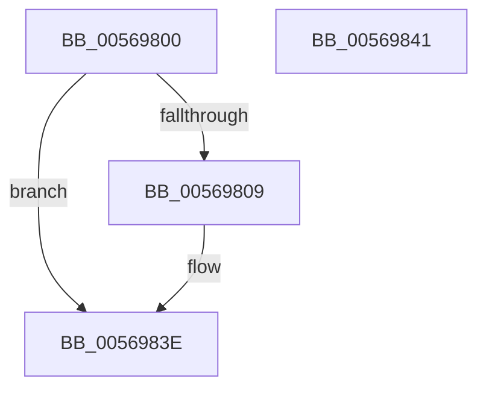

# HalpApicDeinitializeLocalUnit

- RVA: `0x00569800`–`0x00569842` (길이 `66` bytes)
- VA: `0x0000000140569800`
- 실행 섹션: `.text`
- PDB 이름 있음: `예`; PDB Function 태그: `아니요`
- unwind 정보 RVA: `0x000DB714`
- 디코드: `20`개 명령, `66/66` bytes 표시
- 미해석 바이트: `0` (있으면 어셈블리에 `.byte`로 보존)

> 이 문서는 커널 이미지의 기계어와 PDB 기호를 분석해 생성했습니다. 4번과 5번은 함수 원형과 자료형을 바이너리 사용 방식에서 추정한 C 해석이며 원본 소스 복구 결과는 아닙니다.

## 1. Dependencies

- 직접 호출 지점: **0**; 고유 호출 대상: **0**
- 직접 호출자로 확인된 함수: **0**
- RIP 상대 이미지 참조: **1**

### Outgoing calls
- 직접 디코드된 call 명령이 없습니다.

### Direct callers
- 이 함수 시작 RVA로 연결되는 직접 call은 확인되지 않았습니다. 간접 호출은 완전히 역산할 수 없습니다.

### Static image references
- `0x00569800` → RVA `0x00E10460` (`.data`; read)

## 2. Other-region calls and transfers

- 다른 실행 섹션으로 향하는 call: **0**
- 별도 외부 분기/꼬리 이동을 확인하지 못했습니다.

## 3. Assembly (complete function range)

```asm
00569800  80 3D 59 6C 8A 00 00            cmp byte ptr [rip + 0x8a6c59], 0
00569807  74 35                           je 0x14056983e
00569809  B9 1B 00 00 00                  mov ecx, 0x1b
0056980E  0F 32                           rdmsr
00569810  48 C1 E2 20                     shl rdx, 0x20
00569814  48 0B C2                        or rax, rdx
00569817  4C 8B C0                        mov r8, rax
0056981A  49 81 E0 FF F3 FF FF            and r8, 0xfffffffffffff3ff
00569821  49 8B D0                        mov rdx, r8
00569824  49 8B C0                        mov rax, r8
00569827  48 C1 EA 20                     shr rdx, 0x20
0056982B  0F 30                           wrmsr
0056982D  49 0F BA E8 0B                  bts r8, 0xb
00569832  49 8B D0                        mov rdx, r8
00569835  49 8B C0                        mov rax, r8
00569838  48 C1 EA 20                     shr rdx, 0x20
0056983C  0F 30                           wrmsr
0056983E  33 C0                           xor eax, eax
00569840  C3                              ret
00569841  CC                              int3
```

## 4. C-style interpretation (structured pseudocode)

```c
__int64 __fastcall HalpApicDeinitializeLocalUnit(__int64 a1, __int64 a2)
{
    __int64 result;

    if ((*(unsigned __int8 *)(v_rip + 9071705)) != 0) {
        a1 = 27;
        a2 = (a2) << (32);
        result = (result) | (a2);
        a3 = result;
        a3 = (a3) & (0xFFFFFFFFFFFFF3FFULL);
        a2 = a3;
        result = a3;
        a2 = (a2) >> (32);
        a2 = a3;
        result = a3;
        a2 = (a2) >> (32);
    }
    result = 0;
    return result;
}
```

## 5. (Beta) C Style

```c
int64_t HalpApicDeinitializeLocalUnit(int64_t Arg1, int64_t Arg2)
{
    int64_t result;

    if ((*(uint8_t *)(v_rip + 0x8A6C59)) != 0) {
        Arg1 = 27;
        Arg2 = (Arg2) << (32);
        result = (result) | (Arg2);
        a3 = result;
        a3 = (a3) & (0xFFFFFFFFFFFFF3FFULL);
        Arg2 = a3;
        result = a3;
        Arg2 = (Arg2) >> (32);
        Arg2 = a3;
        result = a3;
        Arg2 = (Arg2) >> (32);
    }
    result = 0;
    return result;
}
```

## 6. Execution-region graph

[열기: 2D/3D 그래프와 함수 탐색 컨트롤 패널](../../../control-panel.html?section=text&rva=0x00569800&view=graph)

- 2D 그래프는 위에서 아래로 흐르고, 3D 그래프는 빈 공간을 드래그해 회전합니다. Shift+드래그는 이동, 휠은 확대·축소, 함수 노드 선택은 대상 보고서 이동입니다.

### Static fallback


