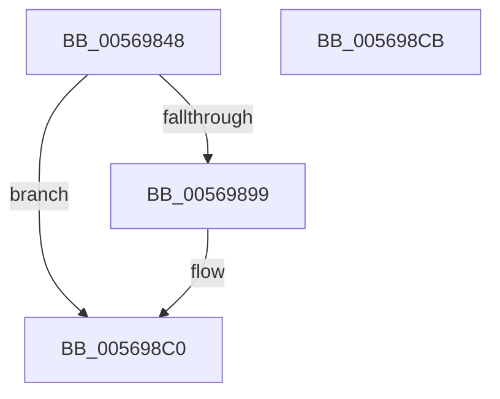

# HalpApicDescribeLines

- RVA: `0x00569848`–`0x005698CC` (길이 `132` bytes)
- VA: `0x0000000140569848`
- 실행 섹션: `.text`
- PDB 이름 있음: `예`; PDB Function 태그: `아니요`
- unwind 정보 RVA: `0x000ACCDC`
- 디코드: `36`개 명령, `132/132` bytes 표시
- 미해석 바이트: `0` (있으면 어셈블리에 `.byte`로 보존)

> 이 문서는 커널 이미지의 기계어와 PDB 기호를 분석해 생성했습니다. 4번과 5번은 함수 원형과 자료형을 바이너리 사용 방식에서 추정한 C 해석이며 원본 소스 복구 결과는 아닙니다.

## 1. Dependencies

- 직접 호출 지점: **2**; 고유 호출 대상: **1**
- 직접 호출자로 확인된 함수: **1**
- RIP 상대 이미지 참조: **0**

### Outgoing calls
- `0x00569890` → [HalpInterruptRegisterLine](HalpInterruptRegisterLine_function_005645B0.md) (function, `0x005645B0`)
- `0x005698BB` → [HalpInterruptRegisterLine](HalpInterruptRegisterLine_function_005645B0.md) (function, `0x005645B0`)

### Direct callers
- [HalpApicInitializeIoUnit](HalpApicInitializeIoUnit_function_00569CE0.md) at `0x00569DAF`

### Static image references
- 디코드된 RIP-relative 메모리 참조가 없습니다.

## 2. Other-region calls and transfers

- 다른 실행 섹션으로 향하는 call: **0**
- 별도 외부 분기/꼬리 이동을 확인하지 못했습니다.

## 3. Assembly (complete function range)

```asm
00569848  48 89 5C 24 08                  mov qword ptr [rsp + 8], rbx
0056984D  55                              push rbp
0056984E  48 8B EC                        mov rbp, rsp
00569851  48 83 EC 50                     sub rsp, 0x50
00569855  83 65 E0 00                     and dword ptr [rbp - 0x20], 0
00569859  83 C8 FF                        or eax, 0xffffffff
0056985C  83 65 FC 00                     and dword ptr [rbp - 4], 0
00569860  48 8B D9                        mov rbx, rcx
00569863  89 45 E4                        mov dword ptr [rbp - 0x1c], eax
00569866  0F 57 C0                        xorps xmm0, xmm0
00569869  89 45 E8                        mov dword ptr [rbp - 0x18], eax
0056986C  8B 41 08                        mov eax, dword ptr [rcx + 8]
0056986F  48 8D 4D D0                     lea rcx, [rbp - 0x30]
00569873  F3 0F 7F 45 EC                  movdqu xmmword ptr [rbp - 0x14], xmm0
00569878  C7 45 DC 06 00 00 00            mov dword ptr [rbp - 0x24], 6
0056987F  C7 45 D4 01 00 00 00            mov dword ptr [rbp - 0x2c], 1
00569886  C7 45 D8 07 00 00 00            mov dword ptr [rbp - 0x28], 7
0056988D  89 45 D0                        mov dword ptr [rbp - 0x30], eax
00569890  E8 1B AD FF FF                  call 0x1405645b0
00569895  85 C0                           test eax, eax
00569897  78 27                           js 0x1405698c0
00569899  0F B6 43 19                     movzx eax, byte ptr [rbx + 0x19]
0056989D  48 8D 4D D0                     lea rcx, [rbp - 0x30]
005698A1  83 65 D4 00                     and dword ptr [rbp - 0x2c], 0
005698A5  89 45 D8                        mov dword ptr [rbp - 0x28], eax
005698A8  8B 43 1C                        mov eax, dword ptr [rbx + 0x1c]
005698AB  89 45 E8                        mov dword ptr [rbp - 0x18], eax
005698AE  8B 43 08                        mov eax, dword ptr [rbx + 8]
005698B1  89 45 D0                        mov dword ptr [rbp - 0x30], eax
005698B4  C7 45 DC 02 00 00 00            mov dword ptr [rbp - 0x24], 2
005698BB  E8 F0 AC FF FF                  call 0x1405645b0
005698C0  48 8B 5C 24 60                  mov rbx, qword ptr [rsp + 0x60]
005698C5  48 83 C4 50                     add rsp, 0x50
005698C9  5D                              pop rbp
005698CA  C3                              ret
005698CB  CC                              int3
```

## 4. C-style interpretation (structured pseudocode)

```c
__int64 __fastcall HalpApicDescribeLines(__int64 a1)
{
    __int64 result;
    __int64 v_rsp;
    unsigned __int64 v_stack_m1C;
    unsigned int v_stack_m20;
    unsigned int v_stack_m24;
    unsigned int v_stack_m28;
    unsigned int v_stack_m2C;
    unsigned int v_stack_m30;
    unsigned int v_stack_m34;
    unsigned __int64 v_stack_m38;
    unsigned int v_stack_mC;
    unsigned __int64 v_stack_p8;

    v_stack_p8 = v_rbx;
    v_rsp = (v_rsp) - (80);
    result = (unsigned int)((result) | (0xFFFFFFFFULL));
    v_stack_m24 = (unsigned int)(result);
    v_stack_m20 = (unsigned int)(result);
    v_stack_m1C = v_xmm0;
    v_stack_m2C = 6;
    v_stack_m34 = 1;
    v_stack_m30 = 7;
    v_stack_m38 = (unsigned int)((unsigned int)(*(unsigned int *)(a1 + 8)));
    result = HalpInterruptRegisterLine(v_stack_m38, a2, a3, a4);
    if (!(sign_flag)) {
        result = *(unsigned __int8 *)(a1 + 25);
        a1 = v_stack_m38;
        v_stack_m30 = (unsigned int)(result);
        result = *(unsigned int *)(a1 + 28);
        v_stack_m20 = (unsigned int)(result);
        result = *(unsigned int *)(a1 + 8);
        v_stack_m38 = (unsigned int)(result);
        v_stack_m2C = 2;
        result = HalpInterruptRegisterLine(a1, a2, a3, a4);
    }
    v_rsp = (v_rsp) + (80);
    return result;
}
```

## 5. (Beta) C Style

```c
int64_t HalpApicDescribeLines(void *Arg1)
{
    uint8_t *arg1 = (uint8_t *)Arg1;

    int64_t result;
    int64_t local_rsp;
    uint64_t v_stack_m1C;
    uint32_t v_stack_m20;
    uint32_t v_stack_m24;
    uint32_t v_stack_m28;
    uint32_t v_stack_m2C;
    uint32_t v_stack_m30;
    uint32_t v_stack_m34;
    uint64_t v_stack_m38;
    uint32_t v_stack_mC;
    uint64_t v_stack_p8;

    v_stack_p8 = local_rbx;
    local_rsp = (local_rsp) - (80);
    result = (uint32_t)((result) | (0xFFFFFFFFULL));
    v_stack_m24 = (uint32_t)(result);
    v_stack_m20 = (uint32_t)(result);
    v_stack_m1C = v_xmm0;
    v_stack_m2C = 6;
    v_stack_m34 = 1;
    v_stack_m30 = 7;
    v_stack_m38 = (uint32_t)((uint32_t)(*(uint32_t *)(arg1 + 0x8)));
    result = HalpInterruptRegisterLine(v_stack_m38, a2, a3, a4);
    if (!(sign_flag)) {
        result = *(uint8_t *)(arg1 + 0x19);
        Arg1 = v_stack_m38;
        v_stack_m30 = (uint32_t)(result);
        result = *(uint32_t *)(arg1 + 0x1C);
        v_stack_m20 = (uint32_t)(result);
        result = *(uint32_t *)(arg1 + 0x8);
        v_stack_m38 = (uint32_t)(result);
        v_stack_m2C = 2;
        result = HalpInterruptRegisterLine(Arg1, a2, a3, a4);
    }
    local_rsp = (local_rsp) + (80);
    return result;
}
```

### 관측된 메모리 오프셋

구조체 형식이 확인되지 않은 접근은 인자 기준의 오프셋으로만 기록했습니다.

| 기준 인자 | 오프셋 표현 | 폭 (bit) | 접근 |
|---|---:|---:|---|
| `Arg1` | `+ 0x8` | `32` | `R` |
| `Arg1` | `+ 0x19` | `8` | `R` |
| `Arg1` | `+ 0x1C` | `32` | `R` |

## 6. Execution-region graph

[열기: 2D/3D 그래프와 함수 탐색 컨트롤 패널](../../../control-panel.html?section=text&rva=0x00569848&view=graph)

- 2D 그래프는 위에서 아래로 흐르고, 3D 그래프는 빈 공간을 드래그해 회전합니다. Shift+드래그는 이동, 휠은 확대·축소, 함수 노드 선택은 대상 보고서 이동입니다.

### Static fallback


