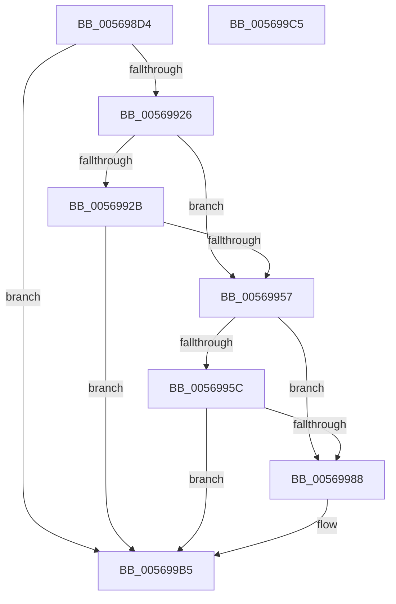

# HalpApicDescribeLocalLines

- RVA: `0x005698D4`–`0x005699C6` (길이 `242` bytes)
- VA: `0x00000001405698D4`
- 실행 섹션: `.text`
- PDB 이름 있음: `예`; PDB Function 태그: `아니요`
- unwind 정보 RVA: `0x000C47A0`
- 디코드: `61`개 명령, `242/242` bytes 표시
- 미해석 바이트: `0` (있으면 어셈블리에 `.byte`로 보존)

> 이 문서는 커널 이미지의 기계어와 PDB 기호를 분석해 생성했습니다. 4번과 5번은 함수 원형과 자료형을 바이너리 사용 방식에서 추정한 C 해석이며 원본 소스 복구 결과는 아닙니다.

## 1. Dependencies

- 직접 호출 지점: **4**; 고유 호출 대상: **1**
- 직접 호출자로 확인된 함수: **1**
- RIP 상대 이미지 참조: **0**

### Outgoing calls
- `0x00569919` → [HalpInterruptRegisterLine](HalpInterruptRegisterLine_function_005645B0.md) (function, `0x005645B0`)
- `0x0056994E` → [HalpInterruptRegisterLine](HalpInterruptRegisterLine_function_005645B0.md) (function, `0x005645B0`)
- `0x0056997F` → [HalpInterruptRegisterLine](HalpInterruptRegisterLine_function_005645B0.md) (function, `0x005645B0`)
- `0x005699AB` → [HalpInterruptRegisterLine](HalpInterruptRegisterLine_function_005645B0.md) (function, `0x005645B0`)

### Direct callers
- [HalpApicInitializeLocalUnit](HalpApicInitializeLocalUnit_function_00569EC0.md) at `0x0056A0B9`

### Static image references
- 디코드된 RIP-relative 메모리 참조가 없습니다.

## 2. Other-region calls and transfers

- 다른 실행 섹션으로 향하는 call: **0**
- 별도 외부 분기/꼬리 이동을 확인하지 못했습니다.

## 3. Assembly (complete function range)

```asm
005698D4  48 89 5C 24 08                  mov qword ptr [rsp + 8], rbx
005698D9  48 89 7C 24 10                  mov qword ptr [rsp + 0x10], rdi
005698DE  55                              push rbp
005698DF  48 8B EC                        mov rbp, rsp
005698E2  48 83 EC 50                     sub rsp, 0x50
005698E6  8B 41 08                        mov eax, dword ptr [rcx + 8]
005698E9  33 FF                           xor edi, edi
005698EB  83 4D E8 FF                     or dword ptr [rbp - 0x18], 0xffffffff
005698EF  48 8B D9                        mov rbx, rcx
005698F2  0F 57 C0                        xorps xmm0, xmm0
005698F5  48 89 7D E0                     mov qword ptr [rbp - 0x20], rdi
005698F9  48 8D 4D D0                     lea rcx, [rbp - 0x30]
005698FD  89 7D FC                        mov dword ptr [rbp - 4], edi
00569900  F3 0F 7F 45 EC                  movdqu xmmword ptr [rbp - 0x14], xmm0
00569905  89 7D D8                        mov dword ptr [rbp - 0x28], edi
00569908  C7 45 DC 03 00 00 00            mov dword ptr [rbp - 0x24], 3
0056990F  C7 45 D4 FA FF FF FF            mov dword ptr [rbp - 0x2c], 0xfffffffa
00569916  89 45 D0                        mov dword ptr [rbp - 0x30], eax
00569919  E8 92 AC FF FF                  call 0x1405645b0
0056991E  85 C0                           test eax, eax
00569920  0F 88 8F 00 00 00               js 0x1405699b5
00569926  39 7B 20                        cmp dword ptr [rbx + 0x20], edi
00569929  74 2C                           je 0x140569957
0056992B  8B 43 08                        mov eax, dword ptr [rbx + 8]
0056992E  48 8D 4D D0                     lea rcx, [rbp - 0x30]
00569932  83 4D E8 FF                     or dword ptr [rbp - 0x18], 0xffffffff
00569936  89 45 D0                        mov dword ptr [rbp - 0x30], eax
00569939  C7 45 DC 03 00 00 00            mov dword ptr [rbp - 0x24], 3
00569940  C7 45 D4 F9 FF FF FF            mov dword ptr [rbp - 0x2c], 0xfffffff9
00569947  C7 45 D8 FA FF FF FF            mov dword ptr [rbp - 0x28], 0xfffffffa
0056994E  E8 5D AC FF FF                  call 0x1405645b0
00569953  85 C0                           test eax, eax
00569955  78 5E                           js 0x1405699b5
00569957  39 7B 24                        cmp dword ptr [rbx + 0x24], edi
0056995A  74 2C                           je 0x140569988
0056995C  8B 43 08                        mov eax, dword ptr [rbx + 8]
0056995F  48 8D 4D D0                     lea rcx, [rbp - 0x30]
00569963  83 4D E8 FF                     or dword ptr [rbp - 0x18], 0xffffffff
00569967  89 45 D0                        mov dword ptr [rbp - 0x30], eax
0056996A  C7 45 DC 03 00 00 00            mov dword ptr [rbp - 0x24], 3
00569971  C7 45 D4 F8 FF FF FF            mov dword ptr [rbp - 0x2c], 0xfffffff8
00569978  C7 45 D8 F9 FF FF FF            mov dword ptr [rbp - 0x28], 0xfffffff9
0056997F  E8 2C AC FF FF                  call 0x1405645b0
00569984  85 C0                           test eax, eax
00569986  78 2D                           js 0x1405699b5
00569988  8B 43 08                        mov eax, dword ptr [rbx + 8]
0056998B  48 8D 4D D0                     lea rcx, [rbp - 0x30]
0056998F  83 4D E8 FF                     or dword ptr [rbp - 0x18], 0xffffffff
00569993  89 45 D0                        mov dword ptr [rbp - 0x30], eax
00569996  C7 45 DC 05 00 00 00            mov dword ptr [rbp - 0x24], 5
0056999D  C7 45 D4 F6 FF FF FF            mov dword ptr [rbp - 0x2c], 0xfffffff6
005699A4  C7 45 D8 F7 FF FF FF            mov dword ptr [rbp - 0x28], 0xfffffff7
005699AB  E8 00 AC FF FF                  call 0x1405645b0
005699B0  85 C0                           test eax, eax
005699B2  0F 49 C7                        cmovns eax, edi
005699B5  48 8B 5C 24 60                  mov rbx, qword ptr [rsp + 0x60]
005699BA  48 8B 7C 24 68                  mov rdi, qword ptr [rsp + 0x68]
005699BF  48 83 C4 50                     add rsp, 0x50
005699C3  5D                              pop rbp
005699C4  C3                              ret
005699C5  CC                              int3
```

## 4. C-style interpretation (structured pseudocode)

```c
__int64 __fastcall HalpApicDescribeLocalLines(__int64 a1)
{
    __int64 result;
    __int64 v_rdi;
    __int64 v_rsp;
    unsigned __int64 v_stack_m1C;
    unsigned int v_stack_m20;
    unsigned __int64 v_stack_m28;
    unsigned int v_stack_m2C;
    unsigned int v_stack_m30;
    unsigned int v_stack_m34;
    unsigned __int64 v_stack_m38;
    unsigned int v_stack_mC;
    unsigned __int64 v_stack_p10;
    unsigned __int64 v_stack_p8;

    v_stack_p8 = v_rbx;
    v_stack_p10 = v_rdi;
    v_rsp = (v_rsp) - (80);
    v_rdi = 0;
    v_stack_m28 = 0;
    v_stack_mC = 0;
    v_stack_m1C = v_xmm0;
    v_stack_m30 = 0;
    v_stack_m2C = 3;
    v_stack_m34 = 0xFFFFFFFAULL;
    v_stack_m38 = (unsigned int)((unsigned int)(*(unsigned int *)(a1 + 8)));
    result = HalpInterruptRegisterLine(v_stack_m38, a2, a3, a4);
    if (sign_flag) goto loc_005699B5;
    if ((*(unsigned int *)(a1 + 32)) == 0) goto loc_00569957;
    v_stack_m38 = (unsigned int)((unsigned int)(*(unsigned int *)(a1 + 8)));
    v_stack_m2C = 3;
    v_stack_m34 = 0xFFFFFFF9ULL;
    v_stack_m30 = 0xFFFFFFFAULL;
    result = HalpInterruptRegisterLine(v_stack_m38, a2, a3, a4);
    if (sign_flag) goto loc_005699B5;
loc_00569957:
    if ((*(unsigned int *)(a1 + 36)) == 0) goto loc_00569988;
    v_stack_m38 = (unsigned int)((unsigned int)(*(unsigned int *)(a1 + 8)));
    v_stack_m2C = 3;
    v_stack_m34 = 0xFFFFFFF8ULL;
    v_stack_m30 = 0xFFFFFFF9ULL;
    result = HalpInterruptRegisterLine(v_stack_m38, a2, a3, a4);
    if (!(sign_flag)) {
        result = *(unsigned int *)(a1 + 8);
        a1 = v_stack_m38;
        v_stack_m38 = (unsigned int)(result);
        v_stack_m2C = 5;
        v_stack_m34 = 0xFFFFFFF6ULL;
        v_stack_m30 = 0xFFFFFFF7ULL;
        result = HalpInterruptRegisterLine(a1, a2, a3, a4);
        if (!sign_flag) { result = 0; }
    }
    v_rsp = (v_rsp) + (80);
    return result;
}
```

## 5. (Beta) C Style

```c
int64_t HalpApicDescribeLocalLines(void *Arg1)
{
    uint8_t *arg1 = (uint8_t *)Arg1;

    int64_t result;
    int64_t local_rdi;
    int64_t local_rsp;
    uint64_t v_stack_m1C;
    uint32_t v_stack_m20;
    uint64_t v_stack_m28;
    uint32_t v_stack_m2C;
    uint32_t v_stack_m30;
    uint32_t v_stack_m34;
    uint64_t v_stack_m38;
    uint32_t v_stack_mC;
    uint64_t v_stack_p10;
    uint64_t v_stack_p8;

    v_stack_p8 = local_rbx;
    v_stack_p10 = local_rdi;
    local_rsp = (local_rsp) - (80);
    local_rdi = 0;
    v_stack_m28 = 0;
    v_stack_mC = 0;
    v_stack_m1C = v_xmm0;
    v_stack_m30 = 0;
    v_stack_m2C = 3;
    v_stack_m34 = 0xFFFFFFFAULL;
    v_stack_m38 = (uint32_t)((uint32_t)(*(uint32_t *)(arg1 + 0x8)));
    result = HalpInterruptRegisterLine(v_stack_m38, a2, a3, a4);
    if (sign_flag) goto loc_005699B5;
    if ((*(uint32_t *)(arg1 + 0x20)) == 0) goto loc_00569957;
    v_stack_m38 = (uint32_t)((uint32_t)(*(uint32_t *)(arg1 + 0x8)));
    v_stack_m2C = 3;
    v_stack_m34 = 0xFFFFFFF9ULL;
    v_stack_m30 = 0xFFFFFFFAULL;
    result = HalpInterruptRegisterLine(v_stack_m38, a2, a3, a4);
    if (sign_flag) goto loc_005699B5;
loc_00569957:
    if ((*(uint32_t *)(arg1 + 0x24)) == 0) goto loc_00569988;
    v_stack_m38 = (uint32_t)((uint32_t)(*(uint32_t *)(arg1 + 0x8)));
    v_stack_m2C = 3;
    v_stack_m34 = 0xFFFFFFF8ULL;
    v_stack_m30 = 0xFFFFFFF9ULL;
    result = HalpInterruptRegisterLine(v_stack_m38, a2, a3, a4);
    if (!(sign_flag)) {
        result = *(uint32_t *)(arg1 + 0x8);
        Arg1 = v_stack_m38;
        v_stack_m38 = (uint32_t)(result);
        v_stack_m2C = 5;
        v_stack_m34 = 0xFFFFFFF6ULL;
        v_stack_m30 = 0xFFFFFFF7ULL;
        result = HalpInterruptRegisterLine(Arg1, a2, a3, a4);
        if (!sign_flag) { result = 0; }
    }
    local_rsp = (local_rsp) + (80);
    return result;
}
```

### 관측된 메모리 오프셋

구조체 형식이 확인되지 않은 접근은 인자 기준의 오프셋으로만 기록했습니다.

| 기준 인자 | 오프셋 표현 | 폭 (bit) | 접근 |
|---|---:|---:|---|
| `Arg1` | `+ 0x8` | `32` | `R` |
| `Arg1` | `+ 0x20` | `32` | `R` |
| `Arg1` | `+ 0x24` | `32` | `R` |

## 6. Execution-region graph

[열기: 2D/3D 그래프와 함수 탐색 컨트롤 패널](../../../control-panel.html?section=text&rva=0x005698D4&view=graph)

- 2D 그래프는 위에서 아래로 흐르고, 3D 그래프는 빈 공간을 드래그해 회전합니다. Shift+드래그는 이동, 휠은 확대·축소, 함수 노드 선택은 대상 보고서 이동입니다.

### Static fallback


