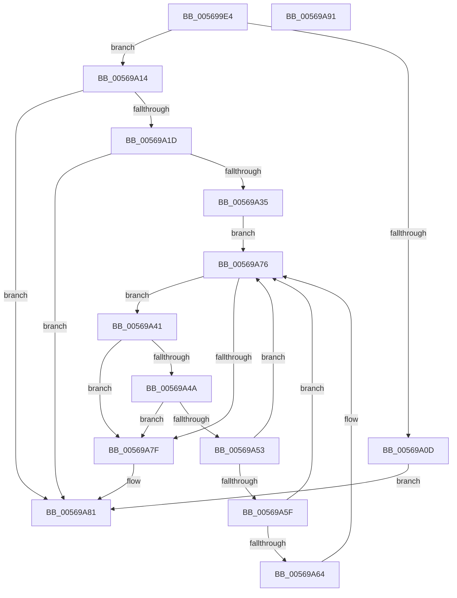

# HalpApicDiscover

- RVA: `0x005699E4`–`0x00569A92` (길이 `174` bytes)
- VA: `0x00000001405699E4`
- 실행 섹션: `.text`
- PDB 이름 있음: `예`; PDB Function 태그: `아니요`
- unwind 정보 RVA: `0x00060BC4`
- 디코드: `51`개 명령, `174/174` bytes 표시
- 미해석 바이트: `0` (있으면 어셈블리에 `.byte`로 보존)

> 이 문서는 커널 이미지의 기계어와 PDB 기호를 분석해 생성했습니다. 4번과 5번은 함수 원형과 자료형을 바이너리 사용 방식에서 추정한 C 해석이며 원본 소스 복구 결과는 아닙니다.

## 1. Dependencies

- 직접 호출 지점: **4**; 고유 호출 대상: **4**
- 직접 호출자로 확인된 함수: **1**
- RIP 상대 이미지 참조: **2**

### Outgoing calls
- `0x00569A00` → [HalSocGetAcpiTable](HalSocGetAcpiTable_function_00561580.md) (function, `0x00561580`)
- `0x00569A14` → [HalpApicSetupRegisterAccess](../55/HalpApicSetupRegisterAccess_function_005589F8.md) (function, `0x005589F8`)
- `0x00569A2C` → [HalRegisterPermanentAddressUsage](HalRegisterPermanentAddressUsage_function_00561500.md) (function, `0x00561500`)
- `0x00569A71` → [HalpApicRegisterIoUnit](HalpApicRegisterIoUnit_function_0056A298.md) (function, `0x0056A298`)

### Direct callers
- [HalpInitializeInterrupts](../../init/C1/HalpInitializeInterrupts_function_00C1E4F8.md) at `0x00C1E6D0`

### Static image references
- `0x005699F3` → RVA `0x00F90678` (`.data`; read/write)
- `0x00569A25` → RVA `0x00F90678` (`.data`; write)

## 2. Other-region calls and transfers

- 다른 실행 섹션으로 향하는 call: **0**
- 별도 외부 분기/꼬리 이동을 확인하지 못했습니다.

## 3. Assembly (complete function range)

```asm
005699E4  48 89 5C 24 08                  mov qword ptr [rsp + 8], rbx
005699E9  48 89 74 24 10                  mov qword ptr [rsp + 0x10], rsi
005699EE  57                              push rdi
005699EF  48 83 EC 20                     sub rsp, 0x20
005699F3  48 83 25 7D 6C A2 00 00         and qword ptr [rip + 0xa26c7d], 0
005699FB  B9 41 50 49 43                  mov ecx, 0x43495041
00569A00  E8 7B 7B FF FF                  call 0x140561580
00569A05  48 8B D8                        mov rbx, rax
00569A08  48 85 C0                        test rax, rax
00569A0B  75 07                           jne 0x140569a14
00569A0D  B8 82 01 00 C0                  mov eax, 0xc0000182
00569A12  EB 6D                           jmp 0x140569a81
00569A14  E8 DF EF FE FF                  call 0x1405589f8
00569A19  85 C0                           test eax, eax
00569A1B  78 64                           js 0x140569a81
00569A1D  8B 4B 24                        mov ecx, dword ptr [rbx + 0x24]
00569A20  BA 00 04 00 00                  mov edx, 0x400
00569A25  48 89 0D 4C 6C A2 00            mov qword ptr [rip + 0xa26c4c], rcx
00569A2C  E8 CF 7A FF FF                  call 0x140561500
00569A31  85 C0                           test eax, eax
00569A33  78 4C                           js 0x140569a81
00569A35  8B 73 04                        mov esi, dword ptr [rbx + 4]
00569A38  48 8D 7B 2C                     lea rdi, [rbx + 0x2c]
00569A3C  48 03 F3                        add rsi, rbx
00569A3F  EB 35                           jmp 0x140569a76
00569A41  0F B6 4F 01                     movzx ecx, byte ptr [rdi + 1]
00569A45  80 F9 02                        cmp cl, 2
00569A48  72 35                           jb 0x140569a7f
00569A4A  48 8D 14 0F                     lea rdx, [rdi + rcx]
00569A4E  48 3B D6                        cmp rdx, rsi
00569A51  77 2C                           ja 0x140569a7f
00569A53  4C 8B C7                        mov r8, rdi
00569A56  48 8B FA                        mov rdi, rdx
00569A59  41 80 38 01                     cmp byte ptr [r8], 1
00569A5D  75 17                           jne 0x140569a76
00569A5F  80 F9 0C                        cmp cl, 0xc
00569A62  75 12                           jne 0x140569a76
00569A64  41 0F B6 50 02                  movzx edx, byte ptr [r8 + 2]
00569A69  41 8B 48 04                     mov ecx, dword ptr [r8 + 4]
00569A6D  45 8B 40 08                     mov r8d, dword ptr [r8 + 8]
00569A71  E8 22 08 00 00                  call 0x14056a298
00569A76  48 8D 47 02                     lea rax, [rdi + 2]
00569A7A  48 3B C6                        cmp rax, rsi
00569A7D  76 C2                           jbe 0x140569a41
00569A7F  33 C0                           xor eax, eax
00569A81  48 8B 5C 24 30                  mov rbx, qword ptr [rsp + 0x30]
00569A86  48 8B 74 24 38                  mov rsi, qword ptr [rsp + 0x38]
00569A8B  48 83 C4 20                     add rsp, 0x20
00569A8F  5F                              pop rdi
00569A90  C3                              ret
00569A91  CC                              int3
```

## 4. C-style interpretation (structured pseudocode)

```c
__int64 __fastcall HalpApicDiscover(void)
{
    __int64 result;
    __int64 v_rsi;
    __int64 v_rsp;
    unsigned __int64 v_stack_p10;
    unsigned __int64 v_stack_p8;

    v_stack_p8 = v_rbx;
    v_stack_p10 = v_rsi;
    v_rsp = (v_rsp) - (32);
    result = HalSocGetAcpiTable((unsigned int)(0x43495041ULL), a2, a3, a4);
    if (result != 0) goto loc_00569A14;
    goto loc_00569A81;
loc_00569A14:
    result = HalpApicSetupRegisterAccess((unsigned int)(0x43495041ULL), a2, a3, a4);
    if (sign_flag) goto loc_00569A81;
    *(unsigned __int64 *)(v_rip + 10644556) = (unsigned int)(*(unsigned int *)(result + 36));
    result = HalRegisterPermanentAddressUsage((unsigned int)(*(unsigned int *)(result + 36)), (unsigned int)(0x400ULL), a3, a4);
    if (sign_flag) goto loc_00569A81;
    v_rsi = ((unsigned int)(*(unsigned int *)(result + 4))) + (result);
    goto loc_00569A76;
loc_00569A41:
    if (((unsigned __int8)(*(unsigned __int8 *)(result + 44 + 1))) < 2) goto loc_00569A7F;
    if ((result + 44 + *(unsigned __int8 *)(result + 44 + 1) * 1) > v_rsi) goto loc_00569A7F;
    if ((*(unsigned __int8 *)(result + 44)) != 1) goto loc_00569A76;
    if (((unsigned __int8)(*(unsigned __int8 *)(result + 44 + 1))) == 12) {
        a2 = *(unsigned __int8 *)(result + 44 + 2);
        a1 = *(unsigned int *)(result + 44 + 4);
        a3 = *(unsigned int *)(result + 44 + 8);
        result = HalpApicRegisterIoUnit(a1, a2, a3, a4);
    }
    if ((result + 44 + *(unsigned __int8 *)(result + 44 + 1) * 1 + 2) <= v_rsi) goto loc_00569A41;
loc_00569A7F:
    result = 0;
loc_00569A81:
    v_rsp = (v_rsp) + (32);
    return result;
}
```

## 5. (Beta) C Style

```c
void HalpApicDiscover(void)
{
    int64_t result;
    int64_t local_rsi;
    int64_t local_rsp;
    uint64_t v_stack_p10;
    uint64_t v_stack_p8;

    v_stack_p8 = local_rbx;
    v_stack_p10 = local_rsi;
    local_rsp = (local_rsp) - (32);
    result = HalSocGetAcpiTable((uint32_t)(0x43495041ULL), a2, a3, a4);
    if (result != 0) goto loc_00569A14;
    goto loc_00569A81;
loc_00569A14:
    result = HalpApicSetupRegisterAccess((uint32_t)(0x43495041ULL), a2, a3, a4);
    if (sign_flag) goto loc_00569A81;
    *(uint64_t *)(v_rip + 0xA26C4C) = (uint32_t)(*(uint32_t *)(result + 0x24));
    result = HalRegisterPermanentAddressUsage((uint32_t)(*(uint32_t *)(result + 0x24)), (uint32_t)(0x400ULL), a3, a4);
    if (sign_flag) goto loc_00569A81;
    local_rsi = ((uint32_t)(*(uint32_t *)(result + 0x4))) + (result);
    goto loc_00569A76;
loc_00569A41:
    if (((uint8_t)(*(uint8_t *)(result + 0x2C + 0x1))) < 2) goto loc_00569A7F;
    if ((result + 44 + *(uint8_t *)(result + 0x2C + 0x1) * 1) > local_rsi) goto loc_00569A7F;
    if ((*(uint8_t *)(result + 0x2C)) != 1) goto loc_00569A76;
    if (((uint8_t)(*(uint8_t *)(result + 0x2C + 0x1))) == 12) {
        a2 = *(uint8_t *)(result + 0x2C + 0x2);
        a1 = *(uint32_t *)(result + 0x2C + 0x4);
        a3 = *(uint32_t *)(result + 0x2C + 0x8);
        result = HalpApicRegisterIoUnit(a1, a2, a3, a4);
    }
    if ((result + 44 + *(uint8_t *)(result + 0x2C + 0x1) * 1 + 2) <= local_rsi) goto loc_00569A41;
loc_00569A7F:
    result = 0;
loc_00569A81:
    local_rsp = (local_rsp) + (32);
    return result;
}
```

## 6. Execution-region graph

[열기: 2D/3D 그래프와 함수 탐색 컨트롤 패널](../../../control-panel.html?section=text&rva=0x005699E4&view=graph)

- 2D 그래프는 위에서 아래로 흐르고, 3D 그래프는 빈 공간을 드래그해 회전합니다. Shift+드래그는 이동, 휠은 확대·축소, 함수 노드 선택은 대상 보고서 이동입니다.

### Static fallback


