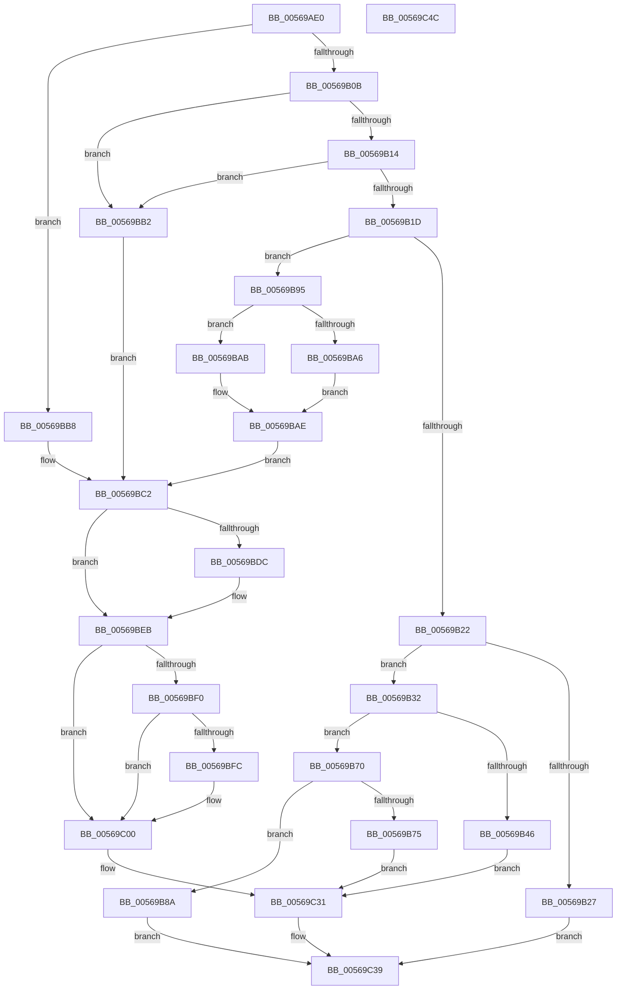

# HalpApicGenerateMessage

- RVA: `0x00569AE0`–`0x00569C4D` (길이 `365` bytes)
- VA: `0x0000000140569AE0`
- 실행 섹션: `.text`
- PDB 이름 있음: `예`; PDB Function 태그: `아니요`
- unwind 정보 RVA: `0x00069588`
- 디코드: `97`개 명령, `365/365` bytes 표시
- 미해석 바이트: `0` (있으면 어셈블리에 `.byte`로 보존)

> 이 문서는 커널 이미지의 기계어와 PDB 기호를 분석해 생성했습니다. 4번과 5번은 함수 원형과 자료형을 바이너리 사용 방식에서 추정한 C 해석이며 원본 소스 복구 결과는 아닙니다.

## 1. Dependencies

- 직접 호출 지점: **0**; 고유 호출 대상: **0**
- 직접 호출자로 확인된 함수: **0**
- RIP 상대 이미지 참조: **1**

### Outgoing calls
- 직접 디코드된 call 명령이 없습니다.

### Direct callers
- 이 함수 시작 RVA로 연결되는 직접 call은 확인되지 않았습니다. 간접 호출은 완전히 역산할 수 없습니다.

### Static image references
- `0x00569B95` → RVA `0x00E10452` (`.data`; read)

## 2. Other-region calls and transfers

- 다른 실행 섹션으로 향하는 call: **0**
- 별도 외부 분기/꼬리 이동을 확인하지 못했습니다.

## 3. Assembly (complete function range)

```asm
00569AE0  48 89 5C 24 08                  mov qword ptr [rsp + 8], rbx
00569AE5  48 89 74 24 10                  mov qword ptr [rsp + 0x10], rsi
00569AEA  48 89 7C 24 18                  mov qword ptr [rsp + 0x18], rdi
00569AEF  8B 5A 18                        mov ebx, dword ptr [rdx + 0x18]
00569AF2  45 33 D2                        xor r10d, r10d
00569AF5  8B CB                           mov ecx, ebx
00569AF7  4C 8B DA                        mov r11, rdx
00569AFA  49 8B F9                        mov rdi, r9
00569AFD  49 8B F0                        mov rsi, r8
00569B00  8B D3                           mov edx, ebx
00569B02  83 E9 01                        sub ecx, 1
00569B05  0F 84 AD 00 00 00               je 0x140569bb8
00569B0B  83 E9 03                        sub ecx, 3
00569B0E  0F 84 9E 00 00 00               je 0x140569bb2
00569B14  83 E9 01                        sub ecx, 1
00569B17  0F 84 95 00 00 00               je 0x140569bb2
00569B1D  83 E9 01                        sub ecx, 1
00569B20  74 73                           je 0x140569b95
00569B22  83 F9 01                        cmp ecx, 1
00569B25  74 0B                           je 0x140569b32
00569B27  41 BA 02 00 00 C0               mov r10d, 0xc0000002
00569B2D  E9 07 01 00 00                  jmp 0x140569c39
00569B32  65 48 8B 04 25 20 00 00 00      mov rax, qword ptr gs:[0x20]
00569B3B  8A 88 8D 00 00 00               mov cl, byte ptr [rax + 0x8d]
00569B41  80 F9 02                        cmp cl, 2
00569B44  75 2A                           jne 0x140569b70
00569B46  41 8B 43 20                     mov eax, dword ptr [r11 + 0x20]
00569B4A  41 8B D2                        mov edx, r10d
00569B4D  44 8B C8                        mov r9d, eax
00569B50  25 FF 7F 00 00                  and eax, 0x7fff
00569B55  49 C1 E9 0D                     shr r9, 0xd
00569B59  C1 E0 05                        shl eax, 5
00569B5C  41 83 E1 04                     and r9d, 4
00569B60  4C 0B C8                        or r9, rax
00569B63  B8 18 00 E0 FE                  mov eax, 0xfee00018
00569B68  4C 0B C8                        or r9, rax
00569B6B  E9 C1 00 00 00                  jmp 0x140569c31
00569B70  80 F9 01                        cmp cl, 1
00569B73  75 15                           jne 0x140569b8a
00569B75  41 8B 53 20                     mov edx, dword ptr [r11 + 0x20]
00569B79  41 B9 04 00 E0 FE               mov r9d, 0xfee00004
00569B7F  81 E2 FF 01 00 00               and edx, 0x1ff
00569B85  E9 A7 00 00 00                  jmp 0x140569c31
00569B8A  41 BA BB 00 00 C0               mov r10d, 0xc00000bb
00569B90  E9 A4 00 00 00                  jmp 0x140569c39
00569B95  44 38 15 B6 68 8A 00            cmp byte ptr [rip + 0x8a68b6], r10b
00569B9C  41 8B 43 20                     mov eax, dword ptr [r11 + 0x20]
00569BA0  41 8B 4B 24                     mov ecx, dword ptr [r11 + 0x24]
00569BA4  74 05                           je 0x140569bab
00569BA6  C1 E0 10                        shl eax, 0x10
00569BA9  EB 03                           jmp 0x140569bae
00569BAB  C1 E0 04                        shl eax, 4
00569BAE  0B C1                           or eax, ecx
00569BB0  EB 10                           jmp 0x140569bc2
00569BB2  41 8B 43 20                     mov eax, dword ptr [r11 + 0x20]
00569BB6  EB 0A                           jmp 0x140569bc2
00569BB8  BA 04 00 00 00                  mov edx, 4
00569BBD  B8 FF 00 00 00                  mov eax, 0xff
00569BC2  44 0F B6 C8                     movzx r9d, al
00569BC6  49 81 C9 00 EE 0F 00            or r9, 0xfee00
00569BCD  8B C8                           mov ecx, eax
00569BCF  49 C1 E1 0C                     shl r9, 0xc
00569BD3  44 38 15 78 68 8A 00            cmp byte ptr [rip + 0x8a6878], r10b
00569BDA  74 0F                           je 0x140569beb
00569BDC  B8 00 FF FF FF                  mov eax, 0xffffff00
00569BE1  48 23 C8                        and rcx, rax
00569BE4  48 C1 E1 18                     shl rcx, 0x18
00569BE8  4C 0B C9                        or r9, rcx
00569BEB  83 FA 04                        cmp edx, 4
00569BEE  74 10                           je 0x140569c00
00569BF0  41 8B 43 0C                     mov eax, dword ptr [r11 + 0xc]
00569BF4  49 83 C9 04                     or r9, 4
00569BF8  A8 02                           test al, 2
00569BFA  74 04                           je 0x140569c00
00569BFC  49 83 C9 08                     or r9, 8
00569C00  41 8B 4B 30                     mov ecx, dword ptr [r11 + 0x30]
00569C04  8B D1                           mov edx, ecx
00569C06  0F BA EA 0E                     bts edx, 0xe
00569C0A  41 83 7B 08 01                  cmp dword ptr [r11 + 8], 1
00569C0F  0F 45 D1                        cmovne edx, ecx
00569C12  44 8B C2                        mov r8d, edx
00569C15  41 0F BA E8 0B                  bts r8d, 0xb
00569C1A  83 FB 04                        cmp ebx, 4
00569C1D  44 0F 44 C2                     cmove r8d, edx
00569C21  41 8B D0                        mov edx, r8d
00569C24  0F BA EA 08                     bts edx, 8
00569C28  41 F6 43 0C 02                  test byte ptr [r11 + 0xc], 2
00569C2D  41 0F 44 D0                     cmove edx, r8d
00569C31  8B CA                           mov ecx, edx
00569C33  4C 89 0E                        mov qword ptr [rsi], r9
00569C36  48 89 0F                        mov qword ptr [rdi], rcx
00569C39  48 8B 5C 24 08                  mov rbx, qword ptr [rsp + 8]
00569C3E  41 8B C2                        mov eax, r10d
00569C41  48 8B 74 24 10                  mov rsi, qword ptr [rsp + 0x10]
00569C46  48 8B 7C 24 18                  mov rdi, qword ptr [rsp + 0x18]
00569C4B  C3                              ret
00569C4C  CC                              int3
```

## 4. C-style interpretation (structured pseudocode)

```c
__int64 __fastcall HalpApicGenerateMessage(__int64 a1, __int64 a2, __int64 a3, __int64 a4)
{
    __int64 result;
    __int64 v_r10;
    unsigned __int64 v_stack_p10;
    unsigned __int64 v_stack_p18;
    unsigned __int64 v_stack_p8;

    v_stack_p8 = v_rbx;
    v_stack_p10 = v_rsi;
    v_stack_p18 = v_rdi;
    v_r10 = 0;
    a1 = (unsigned int)(((unsigned int)((unsigned int)((unsigned int)(*(unsigned int *)(a2 + 24))))) - (1));
    if (condition_is_equal) goto loc_00569BB8;
    a1 = (unsigned int)((a1) - (3));
    if (condition_is_equal) goto loc_00569BB2;
    a1 = (unsigned int)((a1) - (1));
    if (condition_is_equal) goto loc_00569BB2;
    a1 = (unsigned int)((a1) - (1));
    if (condition_is_equal) goto loc_00569B95;
    if (((unsigned int)(a1)) == 1) goto loc_00569B32;
    goto loc_00569C39;
loc_00569B32:
    if (((unsigned __int8)(*(unsigned __int8 *)(*(unsigned __int64 *)(gs_base + (0 + 32)) + 141))) != 2) goto loc_00569B70;
    result = (unsigned int)(((unsigned int)(*(unsigned int *)(a2 + 32))) & (0x7FFFULL));
    a4 = ((unsigned int)((unsigned int)((unsigned int)(*(unsigned int *)(a2 + 32))))) >> (13);
    result = (unsigned int)((result) << (5));
    a4 = (unsigned int)((a4) & (4));
    a4 = (a4) | (result);
    a4 = (a4) | ((unsigned int)(0xFEE00018ULL));
    goto loc_00569C31;
loc_00569B70:
    if (((unsigned __int8)(*(unsigned __int8 *)(*(unsigned __int64 *)(gs_base + (0 + 32)) + 141))) != 1) goto loc_00569B8A;
    a2 = (unsigned int)(((unsigned int)(*(unsigned int *)(a2 + 32))) & (511));
    goto loc_00569C31;
loc_00569B8A:
    goto loc_00569C39;
loc_00569B95:
    if ((*(unsigned __int8 *)(v_rip + 9070774)) == ((unsigned __int8)((unsigned int)(0xC00000BBULL)))) goto loc_00569BAB;
    result = (unsigned int)(((unsigned int)(*(unsigned int *)(a2 + 32))) << (16));
    goto loc_00569BAE;
loc_00569BAB:
    result = (unsigned int)((result) << (4));
loc_00569BAE:
    result = (unsigned int)((result) | ((unsigned int)((unsigned int)(*(unsigned int *)(a2 + 36)))));
    goto loc_00569BC2;
loc_00569BB2:
    goto loc_00569BC2;
loc_00569BB8:
loc_00569BC2:
    a4 = (255) | (0xFEE00ULL);
    a4 = (a4) << (12);
    result = 255;
    if ((*(unsigned __int8 *)(v_rip + 9070712)) != ((unsigned __int8)((unsigned int)(0xC00000BBULL)))) {
        result = 0xFFFFFF00ULL;
        a1 = (255) & (result);
        a1 = (a1) << (24);
        a4 = (a4) | (a1);
    }
    if (4 == 4) goto loc_00569C00;
    a4 = (a4) | (4);
    if ((((unsigned __int8)((unsigned int)(*(unsigned int *)(a2 + 12)))) & (2)) != 0) {
        a4 = (a4) | (8);
    }
    a2 = (unsigned int)((unsigned int)((unsigned int)(*(unsigned int *)(a2 + 48))));
    if ((*(unsigned int *)(a2 + 8)) != 1) { a2 = (unsigned int)((unsigned int)(*(unsigned int *)(a2 + 48))); }
    a3 = (unsigned int)((unsigned int)(a2));
    if (((unsigned int)((unsigned int)(*(unsigned int *)(a2 + 24)))) == 4) { a3 = (unsigned int)(a2); }
    a2 = (unsigned int)((unsigned int)(a3));
    if (((*(unsigned __int8 *)(a2 + 12)) & (2)) == 0) { a2 = (unsigned int)(a3); }
loc_00569C31:
    *(unsigned __int64 *)(a3) = a4;
    *(unsigned __int64 *)(a4) = (unsigned int)((unsigned int)(a2));
loc_00569C39:
    return (unsigned int)((unsigned int)((unsigned int)(0xC00000BBULL)));
}
```

## 5. (Beta) C Style

```c
int64_t HalpApicGenerateMessage(int64_t Arg1, void *Arg2, void *Arg3, void *Arg4)
{
    uint8_t *arg2 = (uint8_t *)Arg2;
    uint8_t *arg3 = (uint8_t *)Arg3;
    uint8_t *arg4 = (uint8_t *)Arg4;

    int64_t result;
    int64_t local_r10;
    uint64_t v_stack_p10;
    uint64_t v_stack_p18;
    uint64_t v_stack_p8;

    v_stack_p8 = local_rbx;
    v_stack_p10 = local_rsi;
    v_stack_p18 = local_rdi;
    local_r10 = 0;
    Arg1 = (uint32_t)(((uint32_t)((uint32_t)((uint32_t)(*(uint32_t *)(arg2 + 0x18))))) - (1));
    if (condition_is_equal) goto loc_00569BB8;
    Arg1 = (uint32_t)((Arg1) - (3));
    if (condition_is_equal) goto loc_00569BB2;
    Arg1 = (uint32_t)((Arg1) - (1));
    if (condition_is_equal) goto loc_00569BB2;
    Arg1 = (uint32_t)((Arg1) - (1));
    if (condition_is_equal) goto loc_00569B95;
    if (((uint32_t)(Arg1)) == 1) goto loc_00569B32;
    goto loc_00569C39;
loc_00569B32:
    if (((uint8_t)(*(uint8_t *)(*(uint64_t *)(gs_base + (0 + 0x20)) + 0x8D))) != 2) goto loc_00569B70;
    result = (uint32_t)(((uint32_t)(*(uint32_t *)(arg2 + 0x20))) & (0x7FFFULL));
    Arg4 = ((uint32_t)((uint32_t)((uint32_t)(*(uint32_t *)(arg2 + 0x20))))) >> (13);
    result = (uint32_t)((result) << (5));
    Arg4 = (uint32_t)((Arg4) & (4));
    Arg4 = (Arg4) | (result);
    Arg4 = (Arg4) | ((uint32_t)(0xFEE00018ULL));
    goto loc_00569C31;
loc_00569B70:
    if (((uint8_t)(*(uint8_t *)(*(uint64_t *)(gs_base + (0 + 0x20)) + 0x8D))) != 1) goto loc_00569B8A;
    Arg2 = (uint32_t)(((uint32_t)(*(uint32_t *)(arg2 + 0x20))) & (511));
    goto loc_00569C31;
loc_00569B8A:
    goto loc_00569C39;
loc_00569B95:
    if ((*(uint8_t *)(v_rip + 0x8A68B6)) == ((uint8_t)((uint32_t)(0xC00000BBULL)))) goto loc_00569BAB;
    result = (uint32_t)(((uint32_t)(*(uint32_t *)(arg2 + 0x20))) << (16));
    goto loc_00569BAE;
loc_00569BAB:
    result = (uint32_t)((result) << (4));
loc_00569BAE:
    result = (uint32_t)((result) | ((uint32_t)((uint32_t)(*(uint32_t *)(arg2 + 0x24)))));
    goto loc_00569BC2;
loc_00569BB2:
    goto loc_00569BC2;
loc_00569BB8:
loc_00569BC2:
    Arg4 = (255) | (0xFEE00ULL);
    Arg4 = (Arg4) << (12);
    result = 255;
    if ((*(uint8_t *)(v_rip + 0x8A6878)) != ((uint8_t)((uint32_t)(0xC00000BBULL)))) {
        result = 0xFFFFFF00ULL;
        Arg1 = (255) & (result);
        Arg1 = (Arg1) << (24);
        Arg4 = (Arg4) | (Arg1);
    }
    if (4 == 4) goto loc_00569C00;
    Arg4 = (Arg4) | (4);
    if ((((uint8_t)((uint32_t)(*(uint32_t *)(arg2 + 0xC)))) & (2)) != 0) {
        Arg4 = (Arg4) | (8);
    }
    Arg2 = (uint32_t)((uint32_t)((uint32_t)(*(uint32_t *)(arg2 + 0x30))));
    if ((*(uint32_t *)(arg2 + 0x8)) != 1) { Arg2 = (uint32_t)((uint32_t)(*(uint32_t *)(arg2 + 0x30))); }
    Arg3 = (uint32_t)((uint32_t)(Arg2));
    if (((uint32_t)((uint32_t)(*(uint32_t *)(arg2 + 0x18)))) == 4) { Arg3 = (uint32_t)(Arg2); }
    Arg2 = (uint32_t)((uint32_t)(Arg3));
    if (((*(uint8_t *)(arg2 + 0xC)) & (2)) == 0) { Arg2 = (uint32_t)(Arg3); }
loc_00569C31:
    *(void **)(arg3) = Arg4;
    *(uint64_t *)(arg4) = (uint32_t)((uint32_t)(Arg2));
loc_00569C39:
    return (uint32_t)((uint32_t)((uint32_t)(0xC00000BBULL)));
}
```

### 관측된 메모리 오프셋

구조체 형식이 확인되지 않은 접근은 인자 기준의 오프셋으로만 기록했습니다.

| 기준 인자 | 오프셋 표현 | 폭 (bit) | 접근 |
|---|---:|---:|---|
| `Arg2` | `+ 0x8` | `32` | `R` |
| `Arg2` | `+ 0xC` | `8` | `R` |
| `Arg2` | `+ 0xC` | `32` | `R` |
| `Arg2` | `+ 0x18` | `32` | `R` |
| `Arg2` | `+ 0x20` | `32` | `R` |
| `Arg2` | `+ 0x24` | `32` | `R` |
| `Arg2` | `+ 0x30` | `32` | `R` |
| `Arg3` | `+ 0x0` | `64` | `W` |
| `Arg4` | `+ 0x0` | `64` | `W` |

## 6. Execution-region graph

[열기: 2D/3D 그래프와 함수 탐색 컨트롤 패널](../../../control-panel.html?section=text&rva=0x00569AE0&view=graph)

- 2D 그래프는 위에서 아래로 흐르고, 3D 그래프는 빈 공간을 드래그해 회전합니다. Shift+드래그는 이동, 휠은 확대·축소, 함수 노드 선택은 대상 보고서 이동입니다.

### Static fallback


