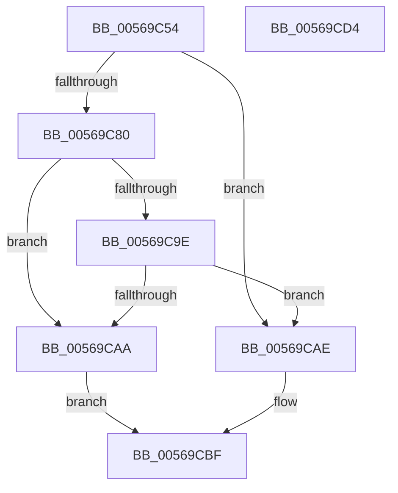

# HalpApicGetCpuInfo

- RVA: `0x00569C54`–`0x00569CD5` (길이 `129` bytes)
- VA: `0x0000000140569C54`
- 실행 섹션: `.text`
- PDB 이름 있음: `예`; PDB Function 태그: `아니요`
- unwind 정보 RVA: `0x00066400`
- 디코드: `38`개 명령, `129/129` bytes 표시
- 미해석 바이트: `0` (있으면 어셈블리에 `.byte`로 보존)

> 이 문서는 커널 이미지의 기계어와 PDB 기호를 분석해 생성했습니다. 4번과 5번은 함수 원형과 자료형을 바이너리 사용 방식에서 추정한 C 해석이며 원본 소스 복구 결과는 아닙니다.

## 1. Dependencies

- 직접 호출 지점: **2**; 고유 호출 대상: **2**
- 직접 호출자로 확인된 함수: **2**
- RIP 상대 이미지 참조: **1**

### Outgoing calls
- `0x00569C95` → [HalSocRequestApi](../4B/HalSocRequestApi_function_004B848C.md) (function, `0x004B848C`)
- `0x00569CBA` → [guard_dispatch_icall](../6B/guard_dispatch_icall_function_006BAAD0.md) (function, `0x006BAAD0`)

### Direct callers
- [HalpApicIsCmciImplemented](HalpApicIsCmciImplemented_function_0056A0E4.md) at `0x0056A10D`
- [HalpApicRegisterIoUnit](HalpApicRegisterIoUnit_function_0056A298.md) at `0x0056A373`

### Static image references
- `0x00569C68` → RVA `0x00F8F9C0` (`.data`; read)

## 2. Other-region calls and transfers

- 다른 실행 섹션으로 향하는 call: **0**
- 별도 외부 분기/꼬리 이동을 확인하지 못했습니다.

## 3. Assembly (complete function range)

```asm
00569C54  4C 8B DC                        mov r11, rsp
00569C57  49 89 5B 08                     mov qword ptr [r11 + 8], rbx
00569C5B  49 89 6B 10                     mov qword ptr [r11 + 0x10], rbp
00569C5F  49 89 73 18                     mov qword ptr [r11 + 0x18], rsi
00569C63  57                              push rdi
00569C64  48 83 EC 30                     sub rsp, 0x30
00569C68  48 8B 05 51 5D A2 00            mov rax, qword ptr [rip + 0xa25d51]
00569C6F  49 8B D9                        mov rbx, r9
00569C72  49 8B F8                        mov rdi, r8
00569C75  48 8B F2                        mov rsi, rdx
00569C78  48 8B E9                        mov rbp, rcx
00569C7B  48 85 C0                        test rax, rax
00569C7E  75 2E                           jne 0x140569cae
00569C80  33 D2                           xor edx, edx
00569C82  48 8D 05 37 5D A2 00            lea rax, [rip + 0xa25d37]
00569C89  49 89 43 E8                     mov qword ptr [r11 - 0x18], rax
00569C8D  44 8D 4A 10                     lea r9d, [rdx + 0x10]
00569C91  44 8D 42 02                     lea r8d, [rdx + 2]
00569C95  E8 F2 E7 F4 FF                  call 0x1404b848c
00569C9A  85 C0                           test eax, eax
00569C9C  78 0C                           js 0x140569caa
00569C9E  48 8B 05 1B 5D A2 00            mov rax, qword ptr [rip + 0xa25d1b]
00569CA5  48 85 C0                        test rax, rax
00569CA8  75 04                           jne 0x140569cae
00569CAA  32 C0                           xor al, al
00569CAC  EB 11                           jmp 0x140569cbf
00569CAE  4C 8B CB                        mov r9, rbx
00569CB1  4C 8B C7                        mov r8, rdi
00569CB4  48 8B D6                        mov rdx, rsi
00569CB7  48 8B CD                        mov rcx, rbp
00569CBA  E8 11 0E 15 00                  call 0x1406baad0
00569CBF  48 8B 5C 24 40                  mov rbx, qword ptr [rsp + 0x40]
00569CC4  48 8B 6C 24 48                  mov rbp, qword ptr [rsp + 0x48]
00569CC9  48 8B 74 24 50                  mov rsi, qword ptr [rsp + 0x50]
00569CCE  48 83 C4 30                     add rsp, 0x30
00569CD2  5F                              pop rdi
00569CD3  C3                              ret
00569CD4  CC                              int3
```

## 4. C-style interpretation (structured pseudocode)

```c
__int64 __fastcall HalpApicGetCpuInfo(__int64 a1, __int64 a2, __int64 a3, __int64 a4)
{
    __int64 result;
    __int64 v_rsp;
    unsigned __int64 v_stack_p10;
    unsigned __int64 v_stack_p18;
    unsigned __int64 v_stack_p8;

    *(unsigned __int64 *)(v_rsp + 8) = v_rbx;
    *(unsigned __int64 *)(v_rsp + 16) = v_rbp;
    *(unsigned __int64 *)(v_rsp + 24) = v_rsi;
    v_rsp = (v_rsp) - (48);
    if (*(unsigned __int64 *)(v_rip + 10640721) != 0) goto loc_00569CAE;
    a2 = 0;
    *(unsigned __int64 *)(v_rsp - 24) = v_rip + 10640695;
    result = HalSocRequestApi(a1, a2, a2 + 2, a2 + 16);
    if (sign_flag) goto loc_00569CAA;
    if (*(unsigned __int64 *)(v_rip + 10640667) != 0) goto loc_00569CAE;
loc_00569CAA:
    result = 0;
    goto loc_00569CBF;
loc_00569CAE:
    result = guard_dispatch_icall(a1, 0, a3, a4);
loc_00569CBF:
    v_rsp = (v_rsp) + (48);
    return result;
}
```

## 5. (Beta) C Style

```c
int64_t HalpApicGetCpuInfo(int64_t Arg1, int64_t Arg2, int64_t Arg3, int64_t Arg4)
{
    int64_t result;
    int64_t local_rsp;
    uint64_t v_stack_p10;
    uint64_t v_stack_p18;
    uint64_t v_stack_p8;

    *(uint64_t *)(local_rsp + 0x8) = local_rbx;
    *(uint64_t *)(local_rsp + 0x10) = local_rbp;
    *(uint64_t *)(local_rsp + 0x18) = local_rsi;
    local_rsp = (local_rsp) - (48);
    if (*(uint64_t *)(v_rip + 0xA25D51) != 0) goto loc_00569CAE;
    Arg2 = 0;
    *(uint64_t *)(local_rsp - 0x18) = v_rip + 10640695;
    result = HalSocRequestApi(Arg1, Arg2, Arg2 + 2, Arg2 + 16);
    if (sign_flag) goto loc_00569CAA;
    if (*(uint64_t *)(v_rip + 0xA25D1B) != 0) goto loc_00569CAE;
loc_00569CAA:
    result = 0;
    goto loc_00569CBF;
loc_00569CAE:
    result = guard_dispatch_icall(Arg1, 0, Arg3, Arg4);
loc_00569CBF:
    local_rsp = (local_rsp) + (48);
    return result;
}
```

## 6. Execution-region graph

[열기: 2D/3D 그래프와 함수 탐색 컨트롤 패널](../../../control-panel.html?section=text&rva=0x00569C54&view=graph)

- 2D 그래프는 위에서 아래로 흐르고, 3D 그래프는 빈 공간을 드래그해 회전합니다. Shift+드래그는 이동, 휠은 확대·축소, 함수 노드 선택은 대상 보고서 이동입니다.

### Static fallback


