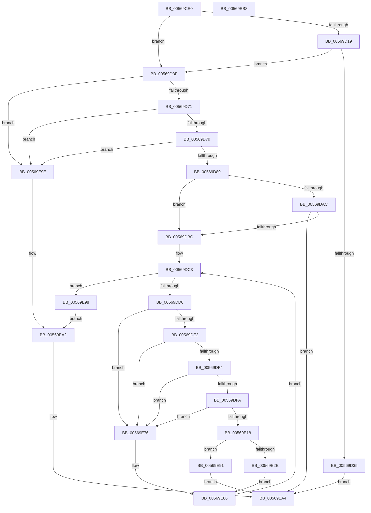

# HalpApicInitializeIoUnit

- RVA: `0x00569CE0`–`0x00569EB9` (길이 `473` bytes)
- VA: `0x0000000140569CE0`
- 실행 섹션: `.text`
- PDB 이름 있음: `예`; PDB Function 태그: `아니요`
- unwind 정보 RVA: `0x000C4FF8`
- 디코드: `132`개 명령, `473/473` bytes 표시
- 미해석 바이트: `0` (있으면 어셈블리에 `.byte`로 보존)

> 이 문서는 커널 이미지의 기계어와 PDB 기호를 분석해 생성했습니다. 4번과 5번은 함수 원형과 자료형을 바이너리 사용 방식에서 추정한 C 해석이며 원본 소스 복구 결과는 아닙니다.

## 1. Dependencies

- 직접 호출 지점: **4**; 고유 호출 대상: **4**
- 직접 호출자로 확인된 함수: **0**
- RIP 상대 이미지 참조: **1**

### Outgoing calls
- `0x00569D24` → [HalMapIoSpace](../4F/HalMapIoSpace_function_004FCD40.md) (function, `0x004FCD40`)
- `0x00569DAF` → [HalpApicDescribeLines](HalpApicDescribeLines_function_00569848.md) (function, `0x00569848`)
- `0x00569E0D` → [HalpApicConvertFromRte](HalpApicConvertFromRte_function_005695E8.md) (function, `0x005695E8`)
- `0x00569E24` → [HalpInterruptFindLines](../2D/HalpInterruptFindLines_function_002D2C88.md) (function, `0x002D2C88`)

### Direct callers
- 이 함수 시작 RVA로 연결되는 직접 call은 확인되지 않았습니다. 간접 호출은 완전히 역산할 수 없습니다.

### Static image references
- `0x00569E50` → RVA `0x00E101C8` (`.data`; read/write)

## 2. Other-region calls and transfers

- 다른 실행 섹션으로 향하는 call: **0**
- 별도 외부 분기/꼬리 이동을 확인하지 못했습니다.

## 3. Assembly (complete function range)

```asm
00569CE0  48 89 5C 24 18                  mov qword ptr [rsp + 0x18], rbx
00569CE5  55                              push rbp
00569CE6  56                              push rsi
00569CE7  57                              push rdi
00569CE8  41 54                           push r12
00569CEA  41 56                           push r14
00569CEC  48 8B EC                        mov rbp, rsp
00569CEF  48 83 EC 60                     sub rsp, 0x60
00569CF3  48 83 65 38 00                  and qword ptr [rbp + 0x38], 0
00569CF8  0F 57 C0                        xorps xmm0, xmm0
00569CFB  48 8B 59 10                     mov rbx, qword ptr [rcx + 0x10]
00569CFF  33 C0                           xor eax, eax
00569D01  48 89 45 F0                     mov qword ptr [rbp - 0x10], rax
00569D05  48 8B F9                        mov rdi, rcx
00569D08  0F 11 45 C0                     movups xmmword ptr [rbp - 0x40], xmm0
00569D0C  0F 11 45 D0                     movups xmmword ptr [rbp - 0x30], xmm0
00569D10  0F 11 45 E0                     movups xmmword ptr [rbp - 0x20], xmm0
00569D14  48 85 DB                        test rbx, rbx
00569D17  75 26                           jne 0x140569d3f
00569D19  48 8B 09                        mov rcx, qword ptr [rcx]
00569D1C  45 33 C0                        xor r8d, r8d
00569D1F  BA 00 10 00 00                  mov edx, 0x1000
00569D24  E8 17 30 F9 FF                  call 0x1404fcd40
00569D29  48 89 47 10                     mov qword ptr [rdi + 0x10], rax
00569D2D  48 8B D8                        mov rbx, rax
00569D30  48 85 C0                        test rax, rax
00569D33  75 0A                           jne 0x140569d3f
00569D35  B8 9A 00 00 C0                  mov eax, 0xc000009a
00569D3A  E9 65 01 00 00                  jmp 0x140569ea4
00569D3F  41 BC 01 00 00 00               mov r12d, 1
00569D45  44 89 23                        mov dword ptr [rbx], r12d
00569D48  C7 43 10 00 00 00 00            mov dword ptr [rbx + 0x10], 0
00569D4F  44 89 23                        mov dword ptr [rbx], r12d
00569D52  8B 4B 10                        mov ecx, dword ptr [rbx + 0x10]
00569D55  44 89 23                        mov dword ptr [rbx], r12d
00569D58  C7 43 10 00 00 00 00            mov dword ptr [rbx + 0x10], 0
00569D5F  44 89 23                        mov dword ptr [rbx], r12d
00569D62  8B 43 10                        mov eax, dword ptr [rbx + 0x10]
00569D65  8D 51 FF                        lea edx, [rcx - 1]
00569D68  83 FA FD                        cmp edx, -3
00569D6B  0F 87 2D 01 00 00               ja 0x140569e9e
00569D71  3A C8                           cmp cl, al
00569D73  0F 85 25 01 00 00               jne 0x140569e9e
00569D79  8B D1                           mov edx, ecx
00569D7B  C1 E8 10                        shr eax, 0x10
00569D7E  C1 EA 10                        shr edx, 0x10
00569D81  3A D0                           cmp dl, al
00569D83  0F 85 15 01 00 00               jne 0x140569e9e
00569D89  88 4F 18                        mov byte ptr [rdi + 0x18], cl
00569D8C  41 02 D4                        add dl, r12b
00569D8F  88 57 19                        mov byte ptr [rdi + 0x19], dl
00569D92  C7 03 00 00 00 00               mov dword ptr [rbx], 0
00569D98  8B 4B 10                        mov ecx, dword ptr [rbx + 0x10]
00569D9B  8B 47 08                        mov eax, dword ptr [rdi + 8]
00569D9E  C1 E0 18                        shl eax, 0x18
00569DA1  0B C8                           or ecx, eax
00569DA3  89 4B 10                        mov dword ptr [rbx + 0x10], ecx
00569DA6  80 7F 1A 00                     cmp byte ptr [rdi + 0x1a], 0
00569DAA  75 10                           jne 0x140569dbc
00569DAC  48 8B CF                        mov rcx, rdi
00569DAF  E8 94 FA FF FF                  call 0x140569848
00569DB4  85 C0                           test eax, eax
00569DB6  0F 88 E8 00 00 00               js 0x140569ea4
00569DBC  45 33 F6                        xor r14d, r14d
00569DBF  41 8D 76 11                     lea esi, [r14 + 0x11]
00569DC3  0F B6 47 19                     movzx eax, byte ptr [rdi + 0x19]
00569DC7  44 3B F0                        cmp r14d, eax
00569DCA  0F 83 C8 00 00 00               jae 0x140569e98
00569DD0  8D 46 FF                        lea eax, [rsi - 1]
00569DD3  89 03                           mov dword ptr [rbx], eax
00569DD5  8B 4B 10                        mov ecx, dword ptr [rbx + 0x10]
00569DD8  80 7F 1A 00                     cmp byte ptr [rdi + 0x1a], 0
00569DDC  0F 85 94 00 00 00               jne 0x140569e76
00569DE2  8B C1                           mov eax, ecx
00569DE4  25 00 07 00 00                  and eax, 0x700
00569DE9  3D 00 02 00 00                  cmp eax, 0x200
00569DEE  0F 85 82 00 00 00               jne 0x140569e76
00569DF4  0F BA E1 10                     bt ecx, 0x10
00569DF8  72 7C                           jb 0x140569e76
00569DFA  89 33                           mov dword ptr [rbx], esi
00569DFC  4C 8D 45 C0                     lea r8, [rbp - 0x40]
00569E00  8B 53 10                        mov edx, dword ptr [rbx + 0x10]
00569E03  8B 47 08                        mov eax, dword ptr [rdi + 8]
00569E06  89 45 38                        mov dword ptr [rbp + 0x38], eax
00569E09  44 89 75 3C                     mov dword ptr [rbp + 0x3c], r14d
00569E0D  E8 D6 F7 FF FF                  call 0x1405695e8
00569E12  83 7D D8 07                     cmp dword ptr [rbp - 0x28], 7
00569E16  74 5E                           je 0x140569e76
00569E18  83 65 30 00                     and dword ptr [rbp + 0x30], 0
00569E1C  48 8D 55 30                     lea rdx, [rbp + 0x30]
00569E20  48 8D 4D 38                     lea rcx, [rbp + 0x38]
00569E24  E8 5F 8E D6 FF                  call 0x1402d2c88
00569E29  48 85 C0                        test rax, rax
00569E2C  74 63                           je 0x140569e91
00569E2E  48 8B 48 30                     mov rcx, qword ptr [rax + 0x30]
00569E32  44 8B 45 30                     mov r8d, dword ptr [rbp + 0x30]
00569E36  0F 10 45 C0                     movups xmm0, xmmword ptr [rbp - 0x40]
00569E3A  41 8B D0                        mov edx, r8d
00569E3D  0F 10 4D D0                     movups xmm1, xmmword ptr [rbp - 0x30]
00569E41  48 03 D2                        add rdx, rdx
00569E44  44 88 24 D1                     mov byte ptr [rcx + rdx*8], r12b
00569E48  48 8B 40 28                     mov rax, qword ptr [rax + 0x28]
00569E4C  49 6B C8 38                     imul rcx, r8, 0x38
00569E50  44 01 25 71 63 8A 00            add dword ptr [rip + 0x8a6371], r12d
00569E57  0F 11 04 01                     movups xmmword ptr [rcx + rax], xmm0
00569E5B  0F 10 45 E0                     movups xmm0, xmmword ptr [rbp - 0x20]
00569E5F  0F 11 4C 01 10                  movups xmmword ptr [rcx + rax + 0x10], xmm1
00569E64  F2 0F 10 4D F0                  movsd xmm1, qword ptr [rbp - 0x10]
00569E69  0F 11 44 01 20                  movups xmmword ptr [rcx + rax + 0x20], xmm0
00569E6E  F2 0F 11 4C 01 30               movsd qword ptr [rcx + rax + 0x30], xmm1
00569E74  EB 10                           jmp 0x140569e86
00569E76  C7 43 10 FF 00 01 00            mov dword ptr [rbx + 0x10], 0x100ff
00569E7D  89 33                           mov dword ptr [rbx], esi
00569E7F  C7 43 10 00 00 00 00            mov dword ptr [rbx + 0x10], 0
00569E86  45 03 F4                        add r14d, r12d
00569E89  83 C6 02                        add esi, 2
00569E8C  E9 32 FF FF FF                  jmp 0x140569dc3
00569E91  B8 25 02 00 C0                  mov eax, 0xc0000225
00569E96  EB 0C                           jmp 0x140569ea4
00569E98  44 88 67 1A                     mov byte ptr [rdi + 0x1a], r12b
00569E9C  EB 04                           jmp 0x140569ea2
00569E9E  44 88 67 28                     mov byte ptr [rdi + 0x28], r12b
00569EA2  33 C0                           xor eax, eax
00569EA4  48 8B 9C 24 A0 00 00 00         mov rbx, qword ptr [rsp + 0xa0]
00569EAC  48 83 C4 60                     add rsp, 0x60
00569EB0  41 5E                           pop r14
00569EB2  41 5C                           pop r12
00569EB4  5F                              pop rdi
00569EB5  5E                              pop rsi
00569EB6  5D                              pop rbp
00569EB7  C3                              ret
00569EB8  CC                              int3
```

## 4. C-style interpretation (structured pseudocode)

```c
__int64 __fastcall HalpApicInitializeIoUnit(__int64 a1, __int64 a2, int a3)
{
    __int64 result;
    __int64 v_r14;
    __int64 v_rsi;
    __int64 v_rsp;
    unsigned __int64 v_stack_m38;
    unsigned __int64 v_stack_m48;
    unsigned int v_stack_m50;
    unsigned __int64 v_stack_m58;
    unsigned __int64 v_stack_m68;
    unsigned __int64 v_stack_p10;
    unsigned int v_stack_p14;
    unsigned __int64 v_stack_p18;
    unsigned int v_stack_p8;

    v_stack_p18 = v_rbx;
    v_rsp = (v_rsp) - (96);
    result = 0;
    v_stack_m38 = 0;
    v_stack_m68 = v_xmm0;
    v_stack_m58 = v_xmm0;
    v_stack_m48 = v_xmm0;
    if (*(unsigned __int64 *)(a1 + 16) != 0) goto loc_00569D3F;
    a3 = 0;
    result = HalMapIoSpace(*(unsigned __int64 *)(a1), (unsigned int)(0x1000ULL), a3, a4);
    *(unsigned __int64 *)(a1 + 16) = result;
    if (result != 0) goto loc_00569D3F;
    goto loc_00569EA4;
loc_00569D3F:
    *(unsigned int *)(result) = 1;
    *(unsigned int *)(result + 16) = 0;
    *(unsigned int *)(result) = 1;
    *(unsigned int *)(result) = 1;
    *(unsigned int *)(result + 16) = 0;
    *(unsigned int *)(result) = 1;
    if (((unsigned int)((unsigned int)(*(unsigned int *)(result + 16)) - 1)) > -3) goto loc_00569E9E;
    if (((unsigned __int8)((unsigned int)(*(unsigned int *)(result + 16)))) != ((unsigned __int8)((unsigned int)(*(unsigned int *)(result + 16))))) goto loc_00569E9E;
    result = (unsigned int)(((unsigned int)(*(unsigned int *)(result + 16))) >> (16));
    a2 = (unsigned int)(((unsigned int)((unsigned int)((unsigned int)(*(unsigned int *)(result + 16))))) >> (16));
    if (((unsigned __int8)(a2)) != ((unsigned __int8)(result))) goto loc_00569E9E;
    *(unsigned __int8 *)(a1 + 24) = (unsigned __int8)((unsigned int)(*(unsigned int *)(result + 16)));
    a2 = (unsigned __int8)((a2) + (1));
    *(unsigned __int8 *)(a1 + 25) = (unsigned __int8)(a2);
    *(unsigned int *)(result) = 0;
    result = (unsigned int)(((unsigned int)(*(unsigned int *)(a1 + 8))) << (24));
    a1 = (unsigned int)(((unsigned int)(*(unsigned int *)(result + 16))) | ((unsigned int)(result)));
    *(unsigned int *)(result + 16) = (unsigned int)(a1);
    if ((*(unsigned __int8 *)(a1 + 26)) != 0) goto loc_00569DBC;
    result = HalpApicDescribeLines(a1, a2, a3, a4);
    if (sign_flag) goto loc_00569EA4;
loc_00569DBC:
    v_r14 = 0;
loc_00569DC3:
    if (0 >= ((unsigned int)(*(unsigned __int8 *)(a1 + 25)))) goto loc_00569E98;
    *(unsigned int *)(result) = (unsigned int)(v_r14 + 17 - 1);
    if ((*(unsigned __int8 *)(a1 + 26)) != 0) goto loc_00569E76;
    result = (unsigned int)(((unsigned int)((unsigned int)((unsigned int)(*(unsigned int *)(result + 16))))) & (0x700ULL));
    if (((unsigned int)(result)) != 512) goto loc_00569E76;
    if (((unsigned int)(result)) < 512) goto loc_00569E76;
    *(unsigned int *)(result) = (unsigned int)(v_r14 + 17);
    v_stack_p10 = (unsigned int)((unsigned int)(*(unsigned int *)(a1 + 8)));
    v_stack_p14 = 0;
    result = HalpApicConvertFromRte((unsigned int)(*(unsigned int *)(result + 16)), (unsigned int)(*(unsigned int *)(result + 16)), v_stack_m68, a4);
    if (v_stack_m50 == 7) goto loc_00569E76;
    result = HalpInterruptFindLines(v_stack_p10, v_stack_p8, v_stack_m68, a4);
    if (result == 0) goto loc_00569E91;
    a2 = ((unsigned int)((unsigned int)((unsigned int)(v_stack_p8)))) + ((unsigned int)((unsigned int)((unsigned int)(v_stack_p8))));
    *(unsigned __int8 *)(*(unsigned __int64 *)(result + 48) + a2 * 8) = 1;
    a1 = (*(unsigned __int64 *)(result + 48)) * ((unsigned int)(v_stack_p8));
    *(unsigned __int64 *)(a1 + *(unsigned __int64 *)(result + 40) * 1) = v_xmm0;
    *(unsigned __int64 *)(a1 + *(unsigned __int64 *)(result + 40) * 1 + 16) = v_xmm1;
    *(unsigned __int64 *)(a1 + *(unsigned __int64 *)(result + 40) * 1 + 32) = v_xmm0;
    *(unsigned __int64 *)(a1 + *(unsigned __int64 *)(result + 40) * 1 + 48) = v_xmm1;
    goto loc_00569E86;
loc_00569E76:
    *(unsigned int *)(result + 16) = 0x100FFULL;
    *(unsigned int *)(result) = (unsigned int)(v_r14 + 17);
    *(unsigned int *)(result + 16) = 0;
loc_00569E86:
    v_r14 = (unsigned int)((v_r14) + (1));
    v_rsi = (unsigned int)((v_r14 + 17) + (2));
    goto loc_00569DC3;
loc_00569E91:
    goto loc_00569EA4;
loc_00569E98:
    *(unsigned __int8 *)(a1 + 26) = 1;
    goto loc_00569EA2;
loc_00569E9E:
    *(unsigned __int8 *)(a1 + 40) = 1;
loc_00569EA2:
    result = 0;
loc_00569EA4:
    v_rsp = (v_rsp) + (96);
    return result;
}
```

## 5. (Beta) C Style

```c
int64_t HalpApicInitializeIoUnit(void *Arg1, int64_t Arg2, int32_t Arg3)
{
    uint8_t *arg1 = (uint8_t *)Arg1;

    int64_t result;
    int64_t local_r14;
    int64_t local_rsi;
    int64_t local_rsp;
    uint64_t v_stack_m38;
    uint64_t v_stack_m48;
    uint32_t v_stack_m50;
    uint64_t v_stack_m58;
    uint64_t v_stack_m68;
    uint64_t v_stack_p10;
    uint32_t v_stack_p14;
    uint64_t v_stack_p18;
    uint32_t v_stack_p8;

    v_stack_p18 = local_rbx;
    local_rsp = (local_rsp) - (96);
    result = 0;
    v_stack_m38 = 0;
    v_stack_m68 = v_xmm0;
    v_stack_m58 = v_xmm0;
    v_stack_m48 = v_xmm0;
    if (*(uint64_t *)(arg1 + 0x10) != 0) goto loc_00569D3F;
    Arg3 = 0;
    result = HalMapIoSpace(*(uint64_t *)(arg1), (uint32_t)(0x1000ULL), Arg3, a4);
    *(uint64_t *)(arg1 + 0x10) = result;
    if (result != 0) goto loc_00569D3F;
    goto loc_00569EA4;
loc_00569D3F:
    *(uint32_t *)(result) = 1;
    *(uint32_t *)(result + 0x10) = 0;
    *(uint32_t *)(result) = 1;
    *(uint32_t *)(result) = 1;
    *(uint32_t *)(result + 0x10) = 0;
    *(uint32_t *)(result) = 1;
    if (((uint32_t)((uint32_t)(*(uint32_t *)(result + 0x10)) - 1)) > -3) goto loc_00569E9E;
    if (((uint8_t)((uint32_t)(*(uint32_t *)(result + 0x10)))) != ((uint8_t)((uint32_t)(*(uint32_t *)(result + 0x10))))) goto loc_00569E9E;
    result = (uint32_t)(((uint32_t)(*(uint32_t *)(result + 0x10))) >> (16));
    Arg2 = (uint32_t)(((uint32_t)((uint32_t)((uint32_t)(*(uint32_t *)(result + 0x10))))) >> (16));
    if (((uint8_t)(Arg2)) != ((uint8_t)(result))) goto loc_00569E9E;
    *(uint8_t *)(arg1 + 0x18) = (uint8_t)((uint32_t)(*(uint32_t *)(result + 0x10)));
    Arg2 = (uint8_t)((Arg2) + (1));
    *(uint8_t *)(arg1 + 0x19) = (uint8_t)(Arg2);
    *(uint32_t *)(result) = 0;
    result = (uint32_t)(((uint32_t)(*(uint32_t *)(arg1 + 0x8))) << (24));
    Arg1 = (uint32_t)(((uint32_t)(*(uint32_t *)(result + 0x10))) | ((uint32_t)(result)));
    *(uint32_t *)(result + 0x10) = (uint32_t)(Arg1);
    if ((*(uint8_t *)(arg1 + 0x1A)) != 0) goto loc_00569DBC;
    result = HalpApicDescribeLines(Arg1, Arg2, Arg3, a4);
    if (sign_flag) goto loc_00569EA4;
loc_00569DBC:
    local_r14 = 0;
loc_00569DC3:
    if (0 >= ((uint32_t)(*(uint8_t *)(arg1 + 0x19)))) goto loc_00569E98;
    *(uint32_t *)(result) = (uint32_t)(local_r14 + 17 - 1);
    if ((*(uint8_t *)(arg1 + 0x1A)) != 0) goto loc_00569E76;
    result = (uint32_t)(((uint32_t)((uint32_t)((uint32_t)(*(uint32_t *)(result + 0x10))))) & (0x700ULL));
    if (((uint32_t)(result)) != 512) goto loc_00569E76;
    if (((uint32_t)(result)) < 512) goto loc_00569E76;
    *(uint32_t *)(result) = (uint32_t)(local_r14 + 17);
    v_stack_p10 = (uint32_t)((uint32_t)(*(uint32_t *)(arg1 + 0x8)));
    v_stack_p14 = 0;
    result = HalpApicConvertFromRte((uint32_t)(*(uint32_t *)(result + 0x10)), (uint32_t)(*(uint32_t *)(result + 0x10)), v_stack_m68, a4);
    if (v_stack_m50 == 7) goto loc_00569E76;
    result = HalpInterruptFindLines(v_stack_p10, v_stack_p8, v_stack_m68, a4);
    if (result == 0) goto loc_00569E91;
    Arg2 = ((uint32_t)((uint32_t)((uint32_t)(v_stack_p8)))) + ((uint32_t)((uint32_t)((uint32_t)(v_stack_p8))));
    *(uint8_t *)(*(uint64_t *)(result + 0x30) + Arg2 * 8) = 1;
    Arg1 = (*(uint64_t *)(result + 0x30)) * ((uint32_t)(v_stack_p8));
    *(uint64_t *)(arg1 + *(uint64_t *)(result + 0x28) * 1) = v_xmm0;
    *(uint64_t *)(arg1 + *(uint64_t *)(result + 0x28) * 1 + 0x10) = v_xmm1;
    *(uint64_t *)(arg1 + *(uint64_t *)(result + 0x28) * 1 + 0x20) = v_xmm0;
    *(uint64_t *)(arg1 + *(uint64_t *)(result + 0x28) * 1 + 0x30) = v_xmm1;
    goto loc_00569E86;
loc_00569E76:
    *(uint32_t *)(result + 0x10) = 0x100FFULL;
    *(uint32_t *)(result) = (uint32_t)(local_r14 + 17);
    *(uint32_t *)(result + 0x10) = 0;
loc_00569E86:
    local_r14 = (uint32_t)((local_r14) + (1));
    local_rsi = (uint32_t)((local_r14 + 17) + (2));
    goto loc_00569DC3;
loc_00569E91:
    goto loc_00569EA4;
loc_00569E98:
    *(uint8_t *)(arg1 + 0x1A) = 1;
    goto loc_00569EA2;
loc_00569E9E:
    *(uint8_t *)(arg1 + 0x28) = 1;
loc_00569EA2:
    result = 0;
loc_00569EA4:
    local_rsp = (local_rsp) + (96);
    return result;
}
```

### 관측된 메모리 오프셋

구조체 형식이 확인되지 않은 접근은 인자 기준의 오프셋으로만 기록했습니다.

| 기준 인자 | 오프셋 표현 | 폭 (bit) | 접근 |
|---|---:|---:|---|
| `Arg1` | `+ 0x0` | `64` | `R` |
| `Arg1` | `+ 0x8` | `32` | `R` |
| `Arg1` | `+ 0x10` | `64` | `R` |
| `Arg1` | `+ 0x10` | `64` | `W` |
| `Arg1` | `+ 0x18` | `8` | `W` |
| `Arg1` | `+ 0x19` | `8` | `R` |
| `Arg1` | `+ 0x19` | `8` | `W` |
| `Arg1` | `+ 0x1A` | `8` | `R` |
| `Arg1` | `+ 0x1A` | `8` | `W` |
| `Arg1` | `+ 0x28` | `8` | `W` |

## 6. Execution-region graph

[열기: 2D/3D 그래프와 함수 탐색 컨트롤 패널](../../../control-panel.html?section=text&rva=0x00569CE0&view=graph)

- 2D 그래프는 위에서 아래로 흐르고, 3D 그래프는 빈 공간을 드래그해 회전합니다. Shift+드래그는 이동, 휠은 확대·축소, 함수 노드 선택은 대상 보고서 이동입니다.

### Static fallback


