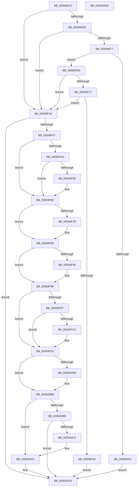

# HalpApicInitializeLocalUnit

- RVA: `0x00569EC0`–`0x0056A0DE` (길이 `542` bytes)
- VA: `0x0000000140569EC0`
- 실행 섹션: `.text`
- PDB 이름 있음: `예`; PDB Function 태그: `아니요`
- unwind 정보 RVA: `0x000A118C`
- 디코드: `133`개 명령, `542/542` bytes 표시
- 미해석 바이트: `0` (있으면 어셈블리에 `.byte`로 보존)

> 이 문서는 커널 이미지의 기계어와 PDB 기호를 분석해 생성했습니다. 4번과 5번은 함수 원형과 자료형을 바이너리 사용 방식에서 추정한 C 해석이며 원본 소스 복구 결과는 아닙니다.

## 1. Dependencies

- 직접 호출 지점: **18**; 고유 호출 대상: **6**
- 직접 호출자로 확인된 함수: **0**
- RIP 상대 이미지 참조: **8**

### Outgoing calls
- `0x00569F1F` → [HalMapIoSpace](../4F/HalMapIoSpace_function_004FCD40.md) (function, `0x004FCD40`)
- `0x00569F3A` → [HalpApicSetupRegisterAccess](../55/HalpApicSetupRegisterAccess_function_005589F8.md) (function, `0x005589F8`)
- `0x00569F57` → [HalpApicIsCmciImplemented](HalpApicIsCmciImplemented_function_0056A0E4.md) (function, `0x0056A0E4`)
- `0x00569F84` → [guard_dispatch_icall](../6B/guard_dispatch_icall_function_006BAAD0.md) (function, `0x006BAAD0`)
- `0x00569F99` → [guard_dispatch_icall](../6B/guard_dispatch_icall_function_006BAAD0.md) (function, `0x006BAAD0`)
- `0x00569FA5` → [HalpApicSetPriority](HalpApicSetPriority_function_0056A660.md) (function, `0x0056A660`)
- `0x00569FC3` → [guard_dispatch_icall](../6B/guard_dispatch_icall_function_006BAAD0.md) (function, `0x006BAAD0`)
- `0x00569FE0` → [guard_dispatch_icall](../6B/guard_dispatch_icall_function_006BAAD0.md) (function, `0x006BAAD0`)
- `0x00569FF9` → [guard_dispatch_icall](../6B/guard_dispatch_icall_function_006BAAD0.md) (function, `0x006BAAD0`)
- `0x0056A00F` → [guard_dispatch_icall](../6B/guard_dispatch_icall_function_006BAAD0.md) (function, `0x006BAAD0`)
- `0x0056A024` → [guard_dispatch_icall](../6B/guard_dispatch_icall_function_006BAAD0.md) (function, `0x006BAAD0`)
- `0x0056A037` → [guard_dispatch_icall](../6B/guard_dispatch_icall_function_006BAAD0.md) (function, `0x006BAAD0`)
- `0x0056A04A` → [guard_dispatch_icall](../6B/guard_dispatch_icall_function_006BAAD0.md) (function, `0x006BAAD0`)
- `0x0056A05E` → [guard_dispatch_icall](../6B/guard_dispatch_icall_function_006BAAD0.md) (function, `0x006BAAD0`)
- `0x0056A06E` → [guard_dispatch_icall](../6B/guard_dispatch_icall_function_006BAAD0.md) (function, `0x006BAAD0`)
- `0x0056A085` → [guard_dispatch_icall](../6B/guard_dispatch_icall_function_006BAAD0.md) (function, `0x006BAAD0`)
- `0x0056A096` → [guard_dispatch_icall](../6B/guard_dispatch_icall_function_006BAAD0.md) (function, `0x006BAAD0`)
- `0x0056A0B9` → [HalpApicDescribeLocalLines](HalpApicDescribeLocalLines_function_005698D4.md) (function, `0x005698D4`)

### Direct callers
- 이 함수 시작 RVA로 연결되는 직접 call은 확인되지 않았습니다. 간접 호출은 완전히 역산할 수 없습니다.

### Static image references
- `0x00569EE2` → RVA `0x00E10452` (`.data`; read)
- `0x00569EEE` → RVA `0x00E10451` (`.data`; read)
- `0x00569EF7` → RVA `0x00F90678` (`.data`; read)
- `0x00569F0D` → RVA `0x00E10440` (`.data`; read)
- `0x00569F24` → RVA `0x00E10440` (`.data`; write)
- `0x00569F7B` → RVA `0x00E10430` (`.data`; read)
- `0x00569FAE` → RVA `0x00F8F9D0` (`.data`; read)
- `0x00569FB7` → RVA `0x00E10438` (`.data`; read)

## 2. Other-region calls and transfers

- 다른 실행 섹션으로 향하는 call: **0**
- 별도 외부 분기/꼬리 이동을 확인하지 못했습니다.

## 3. Assembly (complete function range)

```asm
00569EC0  48 8B C4                        mov rax, rsp
00569EC3  48 89 58 10                     mov qword ptr [rax + 0x10], rbx
00569EC7  48 89 68 18                     mov qword ptr [rax + 0x18], rbp
00569ECB  48 89 70 20                     mov qword ptr [rax + 0x20], rsi
00569ECF  57                              push rdi
00569ED0  48 83 EC 30                     sub rsp, 0x30
00569ED4  83 60 08 00                     and dword ptr [rax + 8], 0
00569ED8  41 8B E9                        mov ebp, r9d
00569EDB  83 60 E8 00                     and dword ptr [rax - 0x18], 0
00569EDF  41 8B F0                        mov esi, r8d
00569EE2  80 3D 69 65 8A 00 00            cmp byte ptr [rip + 0x8a6569], 0
00569EE9  48 8B D9                        mov rbx, rcx
00569EEC  75 4C                           jne 0x140569f3a
00569EEE  80 3D 5C 65 8A 00 00            cmp byte ptr [rip + 0x8a655c], 0
00569EF5  75 43                           jne 0x140569f3a
00569EF7  48 8B 0D 7A 67 A2 00            mov rcx, qword ptr [rip + 0xa2677a]
00569EFE  48 85 C9                        test rcx, rcx
00569F01  75 0A                           jne 0x140569f0d
00569F03  B8 0E 00 00 C0                  mov eax, 0xc000000e
00569F08  E9 BB 01 00 00                  jmp 0x14056a0c8
00569F0D  48 83 3D 2B 65 8A 00 00         cmp qword ptr [rip + 0x8a652b], 0
00569F15  75 23                           jne 0x140569f3a
00569F17  45 33 C0                        xor r8d, r8d
00569F1A  BA 00 10 00 00                  mov edx, 0x1000
00569F1F  E8 1C 2E F9 FF                  call 0x1404fcd40
00569F24  48 89 05 15 65 8A 00            mov qword ptr [rip + 0x8a6515], rax
00569F2B  48 85 C0                        test rax, rax
00569F2E  75 0A                           jne 0x140569f3a
00569F30  B8 9A 00 00 C0                  mov eax, 0xc000009a
00569F35  E9 8E 01 00 00                  jmp 0x14056a0c8
00569F3A  E8 B9 EA FE FF                  call 0x1405589f8
00569F3F  85 C0                           test eax, eax
00569F41  0F 88 81 01 00 00               js 0x14056a0c8
00569F47  80 7B 1B 00                     cmp byte ptr [rbx + 0x1b], 0
00569F4B  75 21                           jne 0x140569f6e
00569F4D  48 8D 54 24 20                  lea rdx, [rsp + 0x20]
00569F52  48 8D 4C 24 40                  lea rcx, [rsp + 0x40]
00569F57  E8 88 01 00 00                  call 0x14056a0e4
00569F5C  84 C0                           test al, al
00569F5E  74 0E                           je 0x140569f6e
00569F60  8B 44 24 40                     mov eax, dword ptr [rsp + 0x40]
00569F64  89 43 20                        mov dword ptr [rbx + 0x20], eax
00569F67  8B 44 24 20                     mov eax, dword ptr [rsp + 0x20]
00569F6B  89 43 24                        mov dword ptr [rbx + 0x24], eax
00569F6E  8B 4B 20                        mov ecx, dword ptr [rbx + 0x20]
00569F71  8B FD                           mov edi, ebp
00569F73  0F BA EF 10                     bts edi, 0x10
00569F77  85 C9                           test ecx, ecx
00569F79  74 0E                           je 0x140569f89
00569F7B  48 8B 05 AE 64 8A 00            mov rax, qword ptr [rip + 0x8a64ae]
00569F82  8B D7                           mov edx, edi
00569F84  E8 47 0B 15 00                  call 0x1406baad0
00569F89  8B 4B 24                        mov ecx, dword ptr [rbx + 0x24]
00569F8C  85 C9                           test ecx, ecx
00569F8E  74 0E                           je 0x140569f9e
00569F90  48 8B 05 99 64 8A 00            mov rax, qword ptr [rip + 0x8a6499]
00569F97  8B D7                           mov edx, edi
00569F99  E8 32 0B 15 00                  call 0x1406baad0
00569F9E  BA 0F 00 00 00                  mov edx, 0xf
00569FA3  33 C9                           xor ecx, ecx
00569FA5  E8 B6 06 00 00                  call 0x14056a660
00569FAA  0F BA EE 08                     bts esi, 8
00569FAE  80 3D 1B 5A A2 00 00            cmp byte ptr [rip + 0xa25a1b], 0
00569FB5  74 1B                           je 0x140569fd2
00569FB7  48 8B 05 7A 64 8A 00            mov rax, qword ptr [rip + 0x8a647a]
00569FBE  B9 30 00 00 00                  mov ecx, 0x30
00569FC3  E8 08 0B 15 00                  call 0x1406baad0
00569FC8  0F BA E0 18                     bt eax, 0x18
00569FCC  73 04                           jae 0x140569fd2
00569FCE  0F BA EE 0C                     bts esi, 0xc
00569FD2  48 8B 05 57 64 8A 00            mov rax, qword ptr [rip + 0x8a6457]
00569FD9  8B D6                           mov edx, esi
00569FDB  B9 F0 00 00 00                  mov ecx, 0xf0
00569FE0  E8 EB 0A 15 00                  call 0x1406baad0
00569FE5  48 8B 05 44 64 8A 00            mov rax, qword ptr [rip + 0x8a6444]
00569FEC  8B D5                           mov edx, ebp
00569FEE  81 CA 00 00 03 00               or edx, 0x30000
00569FF4  B9 20 03 00 00                  mov ecx, 0x320
00569FF9  E8 D2 0A 15 00                  call 0x1406baad0
00569FFE  48 8B 05 2B 64 8A 00            mov rax, qword ptr [rip + 0x8a642b]
0056A005  BA 0B 00 00 00                  mov edx, 0xb
0056A00A  B9 E0 03 00 00                  mov ecx, 0x3e0
0056A00F  E8 BC 0A 15 00                  call 0x1406baad0
0056A014  48 8B 05 15 64 8A 00            mov rax, qword ptr [rip + 0x8a6415]
0056A01B  B9 70 03 00 00                  mov ecx, 0x370
0056A020  8B 54 24 60                     mov edx, dword ptr [rsp + 0x60]
0056A024  E8 A7 0A 15 00                  call 0x1406baad0
0056A029  48 8B 05 00 64 8A 00            mov rax, qword ptr [rip + 0x8a6400]
0056A030  8B D7                           mov edx, edi
0056A032  B9 40 03 00 00                  mov ecx, 0x340
0056A037  E8 94 0A 15 00                  call 0x1406baad0
0056A03C  48 8B 05 F5 63 8A 00            mov rax, qword ptr [rip + 0x8a63f5]
0056A043  BE 50 03 00 00                  mov esi, 0x350
0056A048  8B CE                           mov ecx, esi
0056A04A  E8 81 0A 15 00                  call 0x1406baad0
0056A04F  8B D0                           mov edx, eax
0056A051  8B CE                           mov ecx, esi
0056A053  48 8B 05 D6 63 8A 00            mov rax, qword ptr [rip + 0x8a63d6]
0056A05A  0F BA EA 10                     bts edx, 0x10
0056A05E  E8 6D 0A 15 00                  call 0x1406baad0
0056A063  48 8B 05 C6 63 8A 00            mov rax, qword ptr [rip + 0x8a63c6]
0056A06A  8B D7                           mov edx, edi
0056A06C  8B CE                           mov ecx, esi
0056A06E  E8 5D 0A 15 00                  call 0x1406baad0
0056A073  48 8B 05 B6 63 8A 00            mov rax, qword ptr [rip + 0x8a63b6]
0056A07A  8D 4E 10                        lea ecx, [rsi + 0x10]
0056A07D  81 CD 00 84 01 00               or ebp, 0x18400
0056A083  8B D5                           mov edx, ebp
0056A085  E8 46 0A 15 00                  call 0x1406baad0
0056A08A  48 8B 05 A7 63 8A 00            mov rax, qword ptr [rip + 0x8a63a7]
0056A091  B9 20 00 00 00                  mov ecx, 0x20
0056A096  E8 35 0A 15 00                  call 0x1406baad0
0056A09B  80 3D B0 63 8A 00 00            cmp byte ptr [rip + 0x8a63b0], 0
0056A0A2  48 8B 4C 24 68                  mov rcx, qword ptr [rsp + 0x68]
0056A0A7  89 01                           mov dword ptr [rcx], eax
0056A0A9  75 05                           jne 0x14056a0b0
0056A0AB  C1 E8 18                        shr eax, 0x18
0056A0AE  89 01                           mov dword ptr [rcx], eax
0056A0B0  80 7B 1B 00                     cmp byte ptr [rbx + 0x1b], 0
0056A0B4  75 10                           jne 0x14056a0c6
0056A0B6  48 8B CB                        mov rcx, rbx
0056A0B9  E8 16 F8 FF FF                  call 0x1405698d4
0056A0BE  85 C0                           test eax, eax
0056A0C0  78 06                           js 0x14056a0c8
0056A0C2  C6 43 1B 01                     mov byte ptr [rbx + 0x1b], 1
0056A0C6  33 C0                           xor eax, eax
0056A0C8  48 8B 5C 24 48                  mov rbx, qword ptr [rsp + 0x48]
0056A0CD  48 8B 6C 24 50                  mov rbp, qword ptr [rsp + 0x50]
0056A0D2  48 8B 74 24 58                  mov rsi, qword ptr [rsp + 0x58]
0056A0D7  48 83 C4 30                     add rsp, 0x30
0056A0DB  5F                              pop rdi
0056A0DC  C3                              ret
0056A0DD  CC                              int3
```

## 4. C-style interpretation (structured pseudocode)

```c
__int64 __fastcall HalpApicInitializeLocalUnit(__int64 a1, __int64 a2, int a3, int a4, unsigned int a5, __int64 a6)
{
    __int64 result;
    __int64 v_rbp;
    __int64 v_rsp;
    unsigned __int64 v_stack_m18;
    unsigned __int64 v_stack_p10;
    unsigned __int64 v_stack_p18;
    unsigned __int64 v_stack_p20;
    unsigned __int64 v_stack_p8;

    *(unsigned __int64 *)(v_rsp + 16) = v_rbx;
    *(unsigned __int64 *)(v_rsp + 24) = v_rbp;
    *(unsigned __int64 *)(v_rsp + 32) = v_rsi;
    v_rsp = (v_rsp) - (48);
    if ((*(unsigned __int8 *)(v_rip + 9069929)) != 0) goto loc_00569F3A;
    if ((*(unsigned __int8 *)(v_rip + 9069916)) != 0) goto loc_00569F3A;
    if (*(unsigned __int64 *)(v_rip + 10643322) != 0) goto loc_00569F0D;
    goto loc_0056A0C8;
loc_00569F0D:
    if ((*(unsigned __int64 *)(v_rip + 9069867)) != 0) goto loc_00569F3A;
    a3 = 0;
    result = HalMapIoSpace(*(unsigned __int64 *)(v_rip + 10643322), (unsigned int)(0x1000ULL), a3, a4);
    *(unsigned __int64 *)(v_rip + 9069845) = result;
    if (result != 0) goto loc_00569F3A;
    goto loc_0056A0C8;
loc_00569F3A:
    result = HalpApicSetupRegisterAccess(*(unsigned __int64 *)(v_rip + 10643322), (unsigned int)(0x1000ULL), a3, a4);
    if (sign_flag) goto loc_0056A0C8;
    if ((*(unsigned __int8 *)(a1 + 27)) != 0) goto loc_00569F6E;
    result = HalpApicIsCmciImplemented(v_stack_p8, v_stack_m18, a3, a4);
    if ((unsigned __int8)(result) != 0) {
        result = v_stack_p8;
        *(unsigned int *)(a1 + 32) = (unsigned int)(result);
        result = v_stack_m18;
        *(unsigned int *)(a1 + 36) = (unsigned int)(result);
    }
    if ((unsigned int)((unsigned int)(*(unsigned int *)(a1 + 32))) != 0) {
        result = *(unsigned __int64 *)(v_rip + 9069742);
        a2 = (unsigned int)((unsigned int)((unsigned int)((unsigned int)(a4))));
        result = guard_dispatch_icall((unsigned int)(*(unsigned int *)(a1 + 32)), a2, a3, a4);
    }
    if ((unsigned int)((unsigned int)(*(unsigned int *)(a1 + 36))) != 0) {
        result = *(unsigned __int64 *)(v_rip + 9069721);
        a2 = (unsigned int)((unsigned int)((unsigned int)((unsigned int)(a4))));
        result = guard_dispatch_icall((unsigned int)(*(unsigned int *)(a1 + 36)), a2, a3, a4);
    }
    a1 = 0;
    result = HalpApicSetPriority(a1, 15, a3, a4);
    if ((*(unsigned __int8 *)(v_rip + 10639899)) == 0) goto loc_00569FD2;
    result = guard_dispatch_icall(48, 15, a3, a4);
    if ((*(unsigned __int8 *)(v_rip + 10639899)) < 0) {
    }
    result = guard_dispatch_icall(240, (unsigned int)((unsigned int)((unsigned int)(a3))), a3, a4);
    a2 = (unsigned int)(((unsigned int)((unsigned int)((unsigned int)(a4)))) | (0x30000ULL));
    result = guard_dispatch_icall(800, a2, a3, a4);
    result = guard_dispatch_icall(992, 11, a3, a4);
    result = guard_dispatch_icall(880, (unsigned int)(a5), a3, a4);
    result = guard_dispatch_icall(832, (unsigned int)((unsigned int)((unsigned int)((unsigned int)((unsigned int)(a4))))), a3, a4);
    result = guard_dispatch_icall(848, (unsigned int)((unsigned int)((unsigned int)((unsigned int)((unsigned int)(a4))))), a3, a4);
    result = guard_dispatch_icall(848, (unsigned int)((unsigned int)(result)), a3, a4);
    result = guard_dispatch_icall(848, (unsigned int)((unsigned int)((unsigned int)((unsigned int)((unsigned int)(a4))))), a3, a4);
    v_rbp = (unsigned int)(((unsigned int)(a4)) | (0x18400ULL));
    result = guard_dispatch_icall(848 + 16, (unsigned int)((unsigned int)(v_rbp)), a3, a4);
    result = guard_dispatch_icall(32, (unsigned int)((unsigned int)(v_rbp)), a3, a4);
    *(unsigned int *)(a6) = (unsigned int)(result);
    if ((*(unsigned __int8 *)(v_rip + 9069488)) == 0) {
        result = (unsigned int)((result) >> (24));
        *(unsigned int *)(a6) = (unsigned int)(result);
    }
    if ((*(unsigned __int8 *)(a1 + 27)) != 0) goto loc_0056A0C6;
    result = HalpApicDescribeLocalLines(0, (unsigned int)((unsigned int)(v_rbp)), a3, a4);
    if (sign_flag) goto loc_0056A0C8;
    *(unsigned __int8 *)(a1 + 27) = 1;
loc_0056A0C6:
    result = 0;
loc_0056A0C8:
    v_rsp = (v_rsp) + (48);
    return result;
}
```

## 5. (Beta) C Style

```c
int64_t HalpApicInitializeLocalUnit(void *Arg1, int64_t Arg2, int32_t Arg3, int32_t Arg4, uint32_t Arg5, void *Arg6)
{
    uint8_t *arg1 = (uint8_t *)Arg1;
    uint8_t *arg6 = (uint8_t *)Arg6;

    int64_t result;
    int64_t local_rbp;
    int64_t local_rsp;
    uint64_t v_stack_m18;
    uint64_t v_stack_p10;
    uint64_t v_stack_p18;
    uint64_t v_stack_p20;
    uint64_t v_stack_p8;

    *(uint64_t *)(local_rsp + 0x10) = local_rbx;
    *(uint64_t *)(local_rsp + 0x18) = local_rbp;
    *(uint64_t *)(local_rsp + 0x20) = local_rsi;
    local_rsp = (local_rsp) - (48);
    if ((*(uint8_t *)(v_rip + 0x8A6569)) != 0) goto loc_00569F3A;
    if ((*(uint8_t *)(v_rip + 0x8A655C)) != 0) goto loc_00569F3A;
    if (*(uint64_t *)(v_rip + 0xA2677A) != 0) goto loc_00569F0D;
    goto loc_0056A0C8;
loc_00569F0D:
    if ((*(uint64_t *)(v_rip + 0x8A652B)) != 0) goto loc_00569F3A;
    Arg3 = 0;
    result = HalMapIoSpace(*(uint64_t *)(v_rip + 0xA2677A), (uint32_t)(0x1000ULL), Arg3, Arg4);
    *(uint64_t *)(v_rip + 0x8A6515) = result;
    if (result != 0) goto loc_00569F3A;
    goto loc_0056A0C8;
loc_00569F3A:
    result = HalpApicSetupRegisterAccess(*(uint64_t *)(v_rip + 0xA2677A), (uint32_t)(0x1000ULL), Arg3, Arg4);
    if (sign_flag) goto loc_0056A0C8;
    if ((*(uint8_t *)(arg1 + 0x1B)) != 0) goto loc_00569F6E;
    result = HalpApicIsCmciImplemented(v_stack_p8, v_stack_m18, Arg3, Arg4);
    if ((uint8_t)(result) != 0) {
        result = v_stack_p8;
        *(uint32_t *)(arg1 + 0x20) = (uint32_t)(result);
        result = v_stack_m18;
        *(uint32_t *)(arg1 + 0x24) = (uint32_t)(result);
    }
    if ((uint32_t)((uint32_t)(*(uint32_t *)(arg1 + 0x20))) != 0) {
        result = *(uint64_t *)(v_rip + 0x8A64AE);
        Arg2 = (uint32_t)((uint32_t)((uint32_t)((uint32_t)(Arg4))));
        result = guard_dispatch_icall((uint32_t)(*(uint32_t *)(arg1 + 0x20)), Arg2, Arg3, Arg4);
    }
    if ((uint32_t)((uint32_t)(*(uint32_t *)(arg1 + 0x24))) != 0) {
        result = *(uint64_t *)(v_rip + 0x8A6499);
        Arg2 = (uint32_t)((uint32_t)((uint32_t)((uint32_t)(Arg4))));
        result = guard_dispatch_icall((uint32_t)(*(uint32_t *)(arg1 + 0x24)), Arg2, Arg3, Arg4);
    }
    Arg1 = 0;
    result = HalpApicSetPriority(Arg1, 15, Arg3, Arg4);
    if ((*(uint8_t *)(v_rip + 0xA25A1B)) == 0) goto loc_00569FD2;
    result = guard_dispatch_icall(48, 15, Arg3, Arg4);
    if ((*(uint8_t *)(v_rip + 0xA25A1B)) < 0) {
    }
    result = guard_dispatch_icall(240, (uint32_t)((uint32_t)((uint32_t)(Arg3))), Arg3, Arg4);
    Arg2 = (uint32_t)(((uint32_t)((uint32_t)((uint32_t)(Arg4)))) | (0x30000ULL));
    result = guard_dispatch_icall(800, Arg2, Arg3, Arg4);
    result = guard_dispatch_icall(992, 11, Arg3, Arg4);
    result = guard_dispatch_icall(880, (uint32_t)(Arg5), Arg3, Arg4);
    result = guard_dispatch_icall(832, (uint32_t)((uint32_t)((uint32_t)((uint32_t)((uint32_t)(Arg4))))), Arg3, Arg4);
    result = guard_dispatch_icall(848, (uint32_t)((uint32_t)((uint32_t)((uint32_t)((uint32_t)(Arg4))))), Arg3, Arg4);
    result = guard_dispatch_icall(848, (uint32_t)((uint32_t)(result)), Arg3, Arg4);
    result = guard_dispatch_icall(848, (uint32_t)((uint32_t)((uint32_t)((uint32_t)((uint32_t)(Arg4))))), Arg3, Arg4);
    local_rbp = (uint32_t)(((uint32_t)(Arg4)) | (0x18400ULL));
    result = guard_dispatch_icall(848 + 16, (uint32_t)((uint32_t)(local_rbp)), Arg3, Arg4);
    result = guard_dispatch_icall(32, (uint32_t)((uint32_t)(local_rbp)), Arg3, Arg4);
    *(uint32_t *)(arg6) = (uint32_t)(result);
    if ((*(uint8_t *)(v_rip + 0x8A63B0)) == 0) {
        result = (uint32_t)((result) >> (24));
        *(uint32_t *)(arg6) = (uint32_t)(result);
    }
    if ((*(uint8_t *)(arg1 + 0x1B)) != 0) goto loc_0056A0C6;
    result = HalpApicDescribeLocalLines(0, (uint32_t)((uint32_t)(local_rbp)), Arg3, Arg4);
    if (sign_flag) goto loc_0056A0C8;
    *(uint8_t *)(arg1 + 0x1B) = 1;
loc_0056A0C6:
    result = 0;
loc_0056A0C8:
    local_rsp = (local_rsp) + (48);
    return result;
}
```

### 관측된 메모리 오프셋

구조체 형식이 확인되지 않은 접근은 인자 기준의 오프셋으로만 기록했습니다.

| 기준 인자 | 오프셋 표현 | 폭 (bit) | 접근 |
|---|---:|---:|---|
| `Arg1` | `+ 0x1B` | `8` | `R` |
| `Arg1` | `+ 0x1B` | `8` | `W` |
| `Arg1` | `+ 0x20` | `32` | `R` |
| `Arg1` | `+ 0x20` | `32` | `W` |
| `Arg1` | `+ 0x24` | `32` | `R` |
| `Arg1` | `+ 0x24` | `32` | `W` |
| `Arg6` | `+ 0x0` | `32` | `W` |

## 6. Execution-region graph

[열기: 2D/3D 그래프와 함수 탐색 컨트롤 패널](../../../control-panel.html?section=text&rva=0x00569EC0&view=graph)

- 2D 그래프는 위에서 아래로 흐르고, 3D 그래프는 빈 공간을 드래그해 회전합니다. Shift+드래그는 이동, 휠은 확대·축소, 함수 노드 선택은 대상 보고서 이동입니다.

### Static fallback


