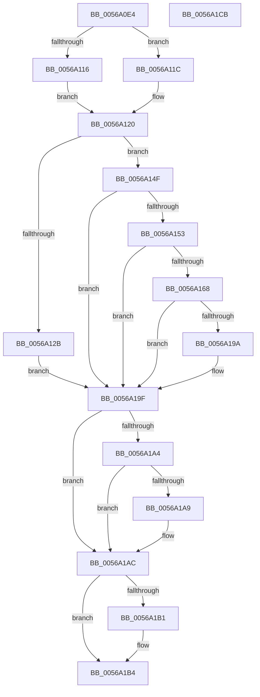

# HalpApicIsCmciImplemented

- RVA: `0x0056A0E4`–`0x0056A1CC` (길이 `232` bytes)
- VA: `0x000000014056A0E4`
- 실행 섹션: `.text`
- PDB 이름 있음: `예`; PDB Function 태그: `아니요`
- unwind 정보 RVA: `0x000C4FA8`
- 디코드: `72`개 명령, `232/232` bytes 표시
- 미해석 바이트: `0` (있으면 어셈블리에 `.byte`로 보존)

> 이 문서는 커널 이미지의 기계어와 PDB 기호를 분석해 생성했습니다. 4번과 5번은 함수 원형과 자료형을 바이너리 사용 방식에서 추정한 C 해석이며 원본 소스 복구 결과는 아닙니다.

## 1. Dependencies

- 직접 호출 지점: **3**; 고유 호출 대상: **2**
- 직접 호출자로 확인된 함수: **1**
- RIP 상대 이미지 참조: **1**

### Outgoing calls
- `0x0056A10D` → [HalpApicGetCpuInfo](HalpApicGetCpuInfo_function_00569C54.md) (function, `0x00569C54`)
- `0x0056A15F` → [guard_dispatch_icall](../6B/guard_dispatch_icall_function_006BAAD0.md) (function, `0x006BAAD0`)
- `0x0056A174` → [guard_dispatch_icall](../6B/guard_dispatch_icall_function_006BAAD0.md) (function, `0x006BAAD0`)

### Direct callers
- [HalpApicInitializeLocalUnit](HalpApicInitializeLocalUnit_function_00569EC0.md) at `0x00569F57`

### Static image references
- `0x0056A153` → RVA `0x00E10438` (`.data`; read)

## 2. Other-region calls and transfers

- 다른 실행 섹션으로 향하는 call: **0**
- 별도 외부 분기/꼬리 이동을 확인하지 못했습니다.

## 3. Assembly (complete function range)

```asm
0056A0E4  48 8B C4                        mov rax, rsp
0056A0E7  48 89 58 10                     mov qword ptr [rax + 0x10], rbx
0056A0EB  48 89 70 18                     mov qword ptr [rax + 0x18], rsi
0056A0EF  57                              push rdi
0056A0F0  41 56                           push r14
0056A0F2  41 57                           push r15
0056A0F4  48 83 EC 20                     sub rsp, 0x20
0056A0F8  4C 8B F2                        mov r14, rdx
0056A0FB  C6 40 08 00                     mov byte ptr [rax + 8], 0
0056A0FF  4C 8B F9                        mov r15, rcx
0056A102  4C 8D 48 08                     lea r9, [rax + 8]
0056A106  33 D2                           xor edx, edx
0056A108  33 C9                           xor ecx, ecx
0056A10A  45 33 C0                        xor r8d, r8d
0056A10D  E8 42 FB FF FF                  call 0x140569c54
0056A112  84 C0                           test al, al
0056A114  75 06                           jne 0x14056a11c
0056A116  88 44 24 40                     mov byte ptr [rsp + 0x40], al
0056A11A  EB 04                           jmp 0x14056a120
0056A11C  8A 44 24 40                     mov al, byte ptr [rsp + 0x40]
0056A120  33 DB                           xor ebx, ebx
0056A122  33 F6                           xor esi, esi
0056A124  40 32 FF                        xor dil, dil
0056A127  3C 02                           cmp al, 2
0056A129  75 24                           jne 0x14056a14f
0056A12B  B9 79 01 00 00                  mov ecx, 0x179
0056A130  0F 32                           rdmsr
0056A132  48 C1 E2 20                     shl rdx, 0x20
0056A136  48 0B C2                        or rax, rdx
0056A139  25 00 04 00 00                  and eax, 0x400
0056A13E  40 0F 95 C7                     setne dil
0056A142  48 F7 D8                        neg rax
0056A145  1B DB                           sbb ebx, ebx
0056A147  81 E3 F0 02 00 00               and ebx, 0x2f0
0056A14D  EB 50                           jmp 0x14056a19f
0056A14F  3C 01                           cmp al, 1
0056A151  75 4C                           jne 0x14056a19f
0056A153  48 8B 05 DE 62 8A 00            mov rax, qword ptr [rip + 0x8a62de]
0056A15A  B9 30 00 00 00                  mov ecx, 0x30
0056A15F  E8 6C 09 15 00                  call 0x1406baad0
0056A164  85 C0                           test eax, eax
0056A166  79 37                           jns 0x14056a19f
0056A168  48 8B 05 C9 62 8A 00            mov rax, qword ptr [rip + 0x8a62c9]
0056A16F  B9 00 04 00 00                  mov ecx, 0x400
0056A174  E8 57 09 15 00                  call 0x1406baad0
0056A179  25 00 00 FF 00                  and eax, 0xff0000
0056A17E  B9 00 00 01 00                  mov ecx, 0x10000
0056A183  3B C8                           cmp ecx, eax
0056A185  1B DB                           sbb ebx, ebx
0056A187  81 E3 10 05 00 00               and ebx, 0x510
0056A18D  3B C1                           cmp eax, ecx
0056A18F  40 0F 97 C7                     seta dil
0056A193  3D 00 00 02 00                  cmp eax, 0x20000
0056A198  76 05                           jbe 0x14056a19f
0056A19A  BE 20 05 00 00                  mov esi, 0x520
0056A19F  4D 85 FF                        test r15, r15
0056A1A2  74 08                           je 0x14056a1ac
0056A1A4  40 84 FF                        test dil, dil
0056A1A7  74 03                           je 0x14056a1ac
0056A1A9  41 89 1F                        mov dword ptr [r15], ebx
0056A1AC  4D 85 F6                        test r14, r14
0056A1AF  74 03                           je 0x14056a1b4
0056A1B1  41 89 36                        mov dword ptr [r14], esi
0056A1B4  48 8B 5C 24 48                  mov rbx, qword ptr [rsp + 0x48]
0056A1B9  40 8A C7                        mov al, dil
0056A1BC  48 8B 74 24 50                  mov rsi, qword ptr [rsp + 0x50]
0056A1C1  48 83 C4 20                     add rsp, 0x20
0056A1C5  41 5F                           pop r15
0056A1C7  41 5E                           pop r14
0056A1C9  5F                              pop rdi
0056A1CA  C3                              ret
0056A1CB  CC                              int3
```

## 4. C-style interpretation (structured pseudocode)

```c
__int64 __fastcall HalpApicIsCmciImplemented(__int64 a1, __int64 a2, int a3)
{
    __int64 result;
    __int64 v_rbx;
    __int64 v_rdi;
    __int64 v_rsi;
    __int64 v_rsp;
    unsigned __int64 v_stack_p10;
    unsigned __int64 v_stack_p18;
    unsigned __int8 v_stack_p8;

    *(unsigned __int64 *)(v_rsp + 16) = v_rbx;
    *(unsigned __int64 *)(v_rsp + 24) = v_rsi;
    v_rsp = (v_rsp) - (32);
    *(unsigned __int8 *)(v_rsp + 8) = 0;
    a2 = 0;
    a1 = 0;
    a3 = 0;
    result = HalpApicGetCpuInfo(a1, a2, a3, v_rsp + 8);
    if ((unsigned __int8)(result) != 0) goto loc_0056A11C;
    v_stack_p8 = (unsigned __int8)(result);
    goto loc_0056A120;
loc_0056A11C:
loc_0056A120:
    v_rbx = 0;
    v_rsi = 0;
    v_rdi = 0;
    if (((unsigned __int8)(v_stack_p8)) != 2) goto loc_0056A14F;
    a2 = (a2) << (32);
    result = (v_stack_p8) | (a2);
    result = (unsigned int)((result) & (0x400ULL));
    v_rdi = (condition_is_not_equal) ? 1 : 0;
    result = -(result);
    v_rbx = (unsigned int)((v_rbx) & (752));
    goto loc_0056A19F;
loc_0056A14F:
    if (((unsigned __int8)(result)) != 1) goto loc_0056A19F;
    result = guard_dispatch_icall(48, a2, a3, v_rsp + 8);
    if (!sign_flag) goto loc_0056A19F;
    result = guard_dispatch_icall((unsigned int)(0x400ULL), a2, a3, v_rsp + 8);
    result = (unsigned int)((result) & (0xFF0000ULL));
    v_rbx = (unsigned int)((v_rbx) & (0x510ULL));
    v_rdi = (((unsigned int)(result)) > ((unsigned int)((unsigned int)(0x10000ULL)))) ? 1 : 0;
    if (((unsigned int)(result)) >= = 0x20000ULL) {
        v_rsi = 0x520ULL;
    }
    if (0 == 0) goto loc_0056A1AC;
    if ((unsigned __int8)(v_rdi) != 0) {
        *(unsigned int *)(a1) = (unsigned int)(v_rbx);
    }
    if (a2 != 0) {
        *(unsigned int *)(a2) = (unsigned int)(v_rsi);
    }
    v_rsp = (v_rsp) + (32);
    return (unsigned __int8)(v_rdi);
}
```

## 5. (Beta) C Style

```c
int64_t HalpApicIsCmciImplemented(int64_t Arg1, int64_t Arg2, int32_t Arg3)
{
    int64_t result;
    int64_t local_rbx;
    int64_t local_rdi;
    int64_t local_rsi;
    int64_t local_rsp;
    uint64_t v_stack_p10;
    uint64_t v_stack_p18;
    uint8_t v_stack_p8;

    *(uint64_t *)(local_rsp + 0x10) = local_rbx;
    *(uint64_t *)(local_rsp + 0x18) = local_rsi;
    local_rsp = (local_rsp) - (32);
    *(uint8_t *)(local_rsp + 0x8) = 0;
    Arg2 = 0;
    Arg1 = 0;
    Arg3 = 0;
    result = HalpApicGetCpuInfo(Arg1, Arg2, Arg3, local_rsp + 8);
    if ((uint8_t)(result) != 0) goto loc_0056A11C;
    v_stack_p8 = (uint8_t)(result);
    goto loc_0056A120;
loc_0056A11C:
loc_0056A120:
    local_rbx = 0;
    local_rsi = 0;
    local_rdi = 0;
    if (((uint8_t)(v_stack_p8)) != 2) goto loc_0056A14F;
    Arg2 = (Arg2) << (32);
    result = (v_stack_p8) | (Arg2);
    result = (uint32_t)((result) & (0x400ULL));
    local_rdi = (condition_is_not_equal) ? 1 : 0;
    result = -(result);
    local_rbx = (uint32_t)((local_rbx) & (752));
    goto loc_0056A19F;
loc_0056A14F:
    if (((uint8_t)(result)) != 1) goto loc_0056A19F;
    result = guard_dispatch_icall(48, Arg2, Arg3, local_rsp + 8);
    if (!sign_flag) goto loc_0056A19F;
    result = guard_dispatch_icall((uint32_t)(0x400ULL), Arg2, Arg3, local_rsp + 8);
    result = (uint32_t)((result) & (0xFF0000ULL));
    local_rbx = (uint32_t)((local_rbx) & (0x510ULL));
    local_rdi = (((uint32_t)(result)) > ((uint32_t)((uint32_t)(0x10000ULL)))) ? 1 : 0;
    if (((uint32_t)(result)) >= = 0x20000ULL) {
        local_rsi = 0x520ULL;
    }
    if (0 == 0) goto loc_0056A1AC;
    if ((uint8_t)(local_rdi) != 0) {
        *(uint32_t *)(Arg1) = (uint32_t)(local_rbx);
    }
    if (Arg2 != 0) {
        *(uint32_t *)(Arg2) = (uint32_t)(local_rsi);
    }
    local_rsp = (local_rsp) + (32);
    return (uint8_t)(local_rdi);
}
```

## 6. Execution-region graph

[열기: 2D/3D 그래프와 함수 탐색 컨트롤 패널](../../../control-panel.html?section=text&rva=0x0056A0E4&view=graph)

- 2D 그래프는 위에서 아래로 흐르고, 3D 그래프는 빈 공간을 드래그해 회전합니다. Shift+드래그는 이동, 휠은 확대·축소, 함수 노드 선택은 대상 보고서 이동입니다.

### Static fallback


