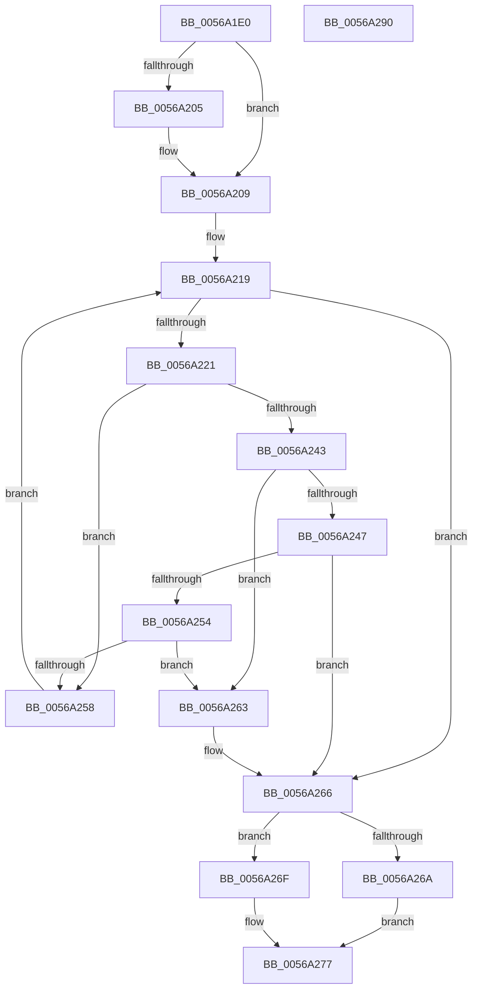

# HalpApicQueryAndGetSource

- RVA: `0x0056A1E0`–`0x0056A291` (길이 `177` bytes)
- VA: `0x000000014056A1E0`
- 실행 섹션: `.text`
- PDB 이름 있음: `예`; PDB Function 태그: `아니요`
- unwind 정보 RVA: `0x00060300`
- 디코드: `57`개 명령, `177/177` bytes 표시
- 미해석 바이트: `0` (있으면 어셈블리에 `.byte`로 보존)

> 이 문서는 커널 이미지의 기계어와 PDB 기호를 분석해 생성했습니다. 4번과 5번은 함수 원형과 자료형을 바이너리 사용 방식에서 추정한 C 해석이며 원본 소스 복구 결과는 아닙니다.

## 1. Dependencies

- 직접 호출 지점: **1**; 고유 호출 대상: **1**
- 직접 호출자로 확인된 함수: **0**
- RIP 상대 이미지 참조: **1**

### Outgoing calls
- `0x0056A22A` → [guard_dispatch_icall](../6B/guard_dispatch_icall_function_006BAAD0.md) (function, `0x006BAAD0`)

### Direct callers
- 이 함수 시작 RVA로 연결되는 직접 call은 확인되지 않았습니다. 간접 호출은 완전히 역산할 수 없습니다.

### Static image references
- `0x0056A221` → RVA `0x00E10438` (`.data`; read)

## 2. Other-region calls and transfers

- 다른 실행 섹션으로 향하는 call: **0**
- 별도 외부 분기/꼬리 이동을 확인하지 못했습니다.

## 3. Assembly (complete function range)

```asm
0056A1E0  48 89 5C 24 08                  mov qword ptr [rsp + 8], rbx
0056A1E5  48 89 6C 24 10                  mov qword ptr [rsp + 0x10], rbp
0056A1EA  48 89 74 24 18                  mov qword ptr [rsp + 0x18], rsi
0056A1EF  57                              push rdi
0056A1F0  41 56                           push r14
0056A1F2  41 57                           push r15
0056A1F4  48 83 EC 20                     sub rsp, 0x20
0056A1F8  33 DB                           xor ebx, ebx
0056A1FA  49 8B F9                        mov rdi, r9
0056A1FD  4D 8B F8                        mov r15, r8
0056A200  4D 85 C9                        test r9, r9
0056A203  74 04                           je 0x14056a209
0056A205  41 C6 01 01                     mov byte ptr [r9], 1
0056A209  BD E0 00 00 00                  mov ebp, 0xe0
0056A20E  BE 70 02 00 00                  mov esi, 0x270
0056A213  41 BE 07 00 00 00               mov r14d, 7
0056A219  81 FE 00 02 00 00               cmp esi, 0x200
0056A21F  7C 45                           jl 0x14056a266
0056A221  48 8B 05 10 62 8A 00            mov rax, qword ptr [rip + 0x8a6210]
0056A228  8B CE                           mov ecx, esi
0056A22A  E8 A1 08 15 00                  call 0x1406baad0
0056A22F  41 8B CE                        mov ecx, r14d
0056A232  F7 D9                           neg ecx
0056A234  1B D2                           sbb edx, edx
0056A236  0F B7 D2                        movzx edx, dx
0056A239  81 C2 00 00 FF FF               add edx, 0xffff0000
0056A23F  23 C2                           and eax, edx
0056A241  74 15                           je 0x14056a258
0056A243  85 DB                           test ebx, ebx
0056A245  75 1C                           jne 0x14056a263
0056A247  0F BD D8                        bsr ebx, eax
0056A24A  0F B3 D8                        btr eax, ebx
0056A24D  03 DD                           add ebx, ebp
0056A24F  48 85 FF                        test rdi, rdi
0056A252  74 12                           je 0x14056a266
0056A254  85 C0                           test eax, eax
0056A256  75 0B                           jne 0x14056a263
0056A258  41 FF CE                        dec r14d
0056A25B  83 EE 10                        sub esi, 0x10
0056A25E  83 ED 20                        sub ebp, 0x20
0056A261  EB B6                           jmp 0x14056a219
0056A263  C6 07 00                        mov byte ptr [rdi], 0
0056A266  85 DB                           test ebx, ebx
0056A268  75 05                           jne 0x14056a26f
0056A26A  8D 43 04                        lea eax, [rbx + 4]
0056A26D  EB 08                           jmp 0x14056a277
0056A26F  41 89 1F                        mov dword ptr [r15], ebx
0056A272  B8 03 00 00 00                  mov eax, 3
0056A277  48 8B 5C 24 40                  mov rbx, qword ptr [rsp + 0x40]
0056A27C  48 8B 6C 24 48                  mov rbp, qword ptr [rsp + 0x48]
0056A281  48 8B 74 24 50                  mov rsi, qword ptr [rsp + 0x50]
0056A286  48 83 C4 20                     add rsp, 0x20
0056A28A  41 5F                           pop r15
0056A28C  41 5E                           pop r14
0056A28E  5F                              pop rdi
0056A28F  C3                              ret
0056A290  CC                              int3
```

## 4. C-style interpretation (structured pseudocode)

```c
__int64 __fastcall HalpApicQueryAndGetSource(__int64 a1, int a2, __int64 a3, __int64 a4)
{
    __int64 result;
    __int64 v_r14;
    __int64 v_rbp;
    __int64 v_rbx;
    __int64 v_rsi;
    __int64 v_rsp;
    unsigned __int64 v_stack_p10;
    unsigned __int64 v_stack_p18;
    unsigned __int64 v_stack_p8;

    v_stack_p8 = v_rbx;
    v_stack_p10 = v_rbp;
    v_stack_p18 = v_rsi;
    v_rsp = (v_rsp) - (32);
    v_rbx = 0;
    if (a4 != 0) {
        *(unsigned __int8 *)(a4) = 1;
    }
loc_0056A219:
    if (624 < 512) goto loc_0056A266;
    result = guard_dispatch_icall(624, a2, a3, a4);
    a1 = (unsigned int)(-(7));
    a2 = (unsigned int)(((unsigned __int16)(a2)) + (0xFFFF0000ULL));
    result = (unsigned int)((result) & (a2));
    if (condition_is_equal) goto loc_0056A258;
    if (0 != 0) goto loc_0056A263;
    v_rbx = (unsigned int)((v_rbx) + (224));
    if (a4 == 0) goto loc_0056A266;
    if ((unsigned int)(result) != 0) goto loc_0056A263;
loc_0056A258:
    v_r14 = (unsigned int)((7) - 1);
    v_rsi = (unsigned int)((624) - (16));
    v_rbp = (unsigned int)((224) - (32));
    goto loc_0056A219;
loc_0056A263:
    *(unsigned __int8 *)(a4) = 0;
loc_0056A266:
    if ((unsigned int)(v_rbx) != 0) goto loc_0056A26F;
    goto loc_0056A277;
loc_0056A26F:
    *(unsigned int *)(a3) = (unsigned int)(v_rbx);
loc_0056A277:
    v_rsp = (v_rsp) + (32);
    return 3;
}
```

## 5. (Beta) C Style

```c
int64_t HalpApicQueryAndGetSource(int64_t Arg1, int32_t Arg2, void *Arg3, int64_t Arg4)
{
    uint8_t *arg3 = (uint8_t *)Arg3;

    int64_t result;
    int64_t local_r14;
    int64_t local_rbp;
    int64_t local_rbx;
    int64_t local_rsi;
    int64_t local_rsp;
    uint64_t v_stack_p10;
    uint64_t v_stack_p18;
    uint64_t v_stack_p8;

    v_stack_p8 = local_rbx;
    v_stack_p10 = local_rbp;
    v_stack_p18 = local_rsi;
    local_rsp = (local_rsp) - (32);
    local_rbx = 0;
    if (Arg4 != 0) {
        *(uint8_t *)(Arg4) = 1;
    }
loc_0056A219:
    if (624 < 512) goto loc_0056A266;
    result = guard_dispatch_icall(624, Arg2, Arg3, Arg4);
    Arg1 = (uint32_t)(-(7));
    Arg2 = (uint32_t)(((uint16_t)(Arg2)) + (0xFFFF0000ULL));
    result = (uint32_t)((result) & (Arg2));
    if (condition_is_equal) goto loc_0056A258;
    if (0 != 0) goto loc_0056A263;
    local_rbx = (uint32_t)((local_rbx) + (224));
    if (Arg4 == 0) goto loc_0056A266;
    if ((uint32_t)(result) != 0) goto loc_0056A263;
loc_0056A258:
    local_r14 = (uint32_t)((7) - 1);
    local_rsi = (uint32_t)((624) - (16));
    local_rbp = (uint32_t)((224) - (32));
    goto loc_0056A219;
loc_0056A263:
    *(uint8_t *)(Arg4) = 0;
loc_0056A266:
    if ((uint32_t)(local_rbx) != 0) goto loc_0056A26F;
    goto loc_0056A277;
loc_0056A26F:
    *(uint32_t *)(arg3) = (uint32_t)(local_rbx);
loc_0056A277:
    local_rsp = (local_rsp) + (32);
    return 3;
}
```

### 관측된 메모리 오프셋

구조체 형식이 확인되지 않은 접근은 인자 기준의 오프셋으로만 기록했습니다.

| 기준 인자 | 오프셋 표현 | 폭 (bit) | 접근 |
|---|---:|---:|---|
| `Arg3` | `+ 0x0` | `32` | `W` |

## 6. Execution-region graph

[열기: 2D/3D 그래프와 함수 탐색 컨트롤 패널](../../../control-panel.html?section=text&rva=0x0056A1E0&view=graph)

- 2D 그래프는 위에서 아래로 흐르고, 3D 그래프는 빈 공간을 드래그해 회전합니다. Shift+드래그는 이동, 휠은 확대·축소, 함수 노드 선택은 대상 보고서 이동입니다.

### Static fallback


