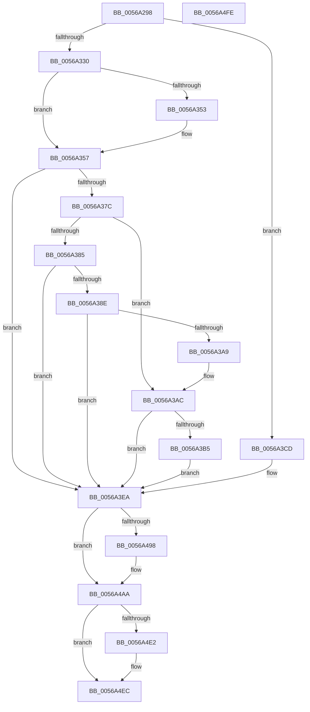

# HalpApicRegisterIoUnit

- RVA: `0x0056A298`–`0x0056A4FF` (길이 `615` bytes)
- VA: `0x000000014056A298`
- 실행 섹션: `.text`
- PDB 이름 있음: `예`; PDB Function 태그: `아니요`
- unwind 정보 RVA: `0x000C4FDC`
- 디코드: `133`개 명령, `615/615` bytes 표시
- 미해석 바이트: `0` (있으면 어셈블리에 `.byte`로 보존)

> 이 문서는 커널 이미지의 기계어와 PDB 기호를 분석해 생성했습니다. 4번과 5번은 함수 원형과 자료형을 바이너리 사용 방식에서 추정한 C 해석이며 원본 소스 복구 결과는 아닙니다.

## 1. Dependencies

- 직접 호출 지점: **4**; 고유 호출 대상: **4**
- 직접 호출자로 확인된 함수: **1**
- RIP 상대 이미지 참조: **22**

### Outgoing calls
- `0x0056A2E6` → [memset](../6C/memset_function_006C6C40.md) (function, `0x006C6C40`)
- `0x0056A373` → [HalpApicGetCpuInfo](HalpApicGetCpuInfo_function_00569C54.md) (function, `0x00569C54`)
- `0x0056A4D9` → [HalRegisterPermanentAddressUsage](HalRegisterPermanentAddressUsage_function_00561500.md) (function, `0x00561500`)
- `0x0056A4E7` → [HalpInterruptRegisterController](HalpInterruptRegisterController_function_005640F0.md) (function, `0x005640F0`)

### Direct callers
- [HalpApicDiscover](HalpApicDiscover_function_005699E4.md) at `0x00569A71`

### Static image references
- `0x0056A2EB` → RVA `0x00E10452` (`.data`; read)
- `0x0056A330` → RVA `0x00E10461` (`.data`; read)
- `0x0056A337` → RVA `0x005697A0` (`HalpApicConvertId`; read)
- `0x0056A3B5` → RVA `0x005699D0` (`HalpApicDirectedEndOfInterrupt`; read)
- `0x0056A3BC` → RVA `0x00F8F9D0` (`.data`; write)
- `0x0056A3CD` → RVA `0x0056A510` (`HalpApicSetLogicalId`; read)
- `0x0056A3F1` → RVA `0x00569EC0` (`HalpApicInitializeLocalUnit`; read)
- `0x0056A3FD` → RVA `0x00569800` (`HalpApicDeinitializeLocalUnit`; read)
- `0x0056A408` → RVA `0x00569CE0` (`HalpApicInitializeIoUnit`; read)
- `0x0056A414` → RVA `0x0056A660` (`HalpApicSetPriority`; read)
- `0x0056A420` → RVA `0x004C8E10` (`HalpApicGetLocalUnitError`; read)
- `0x0056A42C` → RVA `0x004C8030` (`HalpApicClearLocalUnitError`; read)
- `0x0056A438` → RVA `0x0056A7A0` (`HalpApicWriteEndOfInterrupt`; read)
- `0x0056A444` → RVA `0x00E10458` (`.data`; read)
- `0x0056A450` → RVA `0x0046F680` (`HalpApicSetLineState`; read)
- `0x0056A45C` → RVA `0x003E6140` (`HalpApicRequestInterrupt`; read)
- `0x0056A467` → RVA `0x0056A6B0` (`HalpApicStartProcessor`; read)
- `0x0056A472` → RVA `0x00569AE0` (`HalpApicGenerateMessage`; read)
- `0x0056A47D` → RVA `0x00576020` (`HalpApicSaveLocalInterrupts`; read)
- `0x0056A488` → RVA `0x00575F40` (`HalpApicReplayLocalInterrupts`; read)
- `0x0056A49E` → RVA `0x00569AA0` (`HalpApicEndOfInterruptReadIoApicIndex`; read)
- `0x0056A4AA` → RVA `0x0056A1E0` (`HalpApicQueryAndGetSource`; read)

## 2. Other-region calls and transfers

- 다른 실행 섹션으로 향하는 call: **0**
- 별도 외부 분기/꼬리 이동을 확인하지 못했습니다.

## 3. Assembly (complete function range)

```asm
0056A298  40 55                           push rbp
0056A29A  53                              push rbx
0056A29B  56                              push rsi
0056A29C  57                              push rdi
0056A29D  41 54                           push r12
0056A29F  41 56                           push r14
0056A2A1  41 57                           push r15
0056A2A3  48 8D 6C 24 B0                  lea rbp, [rsp - 0x50]
0056A2A8  48 81 EC 50 01 00 00            sub rsp, 0x150
0056A2AF  45 8B E0                        mov r12d, r8d
0056A2B2  C6 85 A0 00 00 00 00            mov byte ptr [rbp + 0xa0], 0
0056A2B9  44 8B FA                        mov r15d, edx
0056A2BC  C6 85 90 00 00 00 00            mov byte ptr [rbp + 0x90], 0
0056A2C3  48 8B F1                        mov rsi, rcx
0056A2C6  C6 85 A8 00 00 00 00            mov byte ptr [rbp + 0xa8], 0
0056A2CD  BB 00 01 00 00                  mov ebx, 0x100
0056A2D2  C6 85 98 00 00 00 00            mov byte ptr [rbp + 0x98], 0
0056A2D9  44 8B C3                        mov r8d, ebx
0056A2DC  48 8D 4C 24 20                  lea rcx, [rsp + 0x20]
0056A2E1  33 D2                           xor edx, edx
0056A2E3  45 32 F6                        xor r14b, r14b
0056A2E6  E8 55 C9 15 00                  call 0x1406c6c40
0056A2EB  44 38 35 60 61 8A 00            cmp byte ptr [rip + 0x8a6160], r14b
0056A2F2  48 8D 45 20                     lea rax, [rbp + 0x20]
0056A2F6  0F 57 C0                        xorps xmm0, xmm0
0056A2F9  89 5C 24 24                     mov dword ptr [rsp + 0x24], ebx
0056A2FD  8B 5D 0C                        mov ebx, dword ptr [rbp + 0xc]
0056A300  0F 11 45 20                     movups xmmword ptr [rbp + 0x20], xmm0
0056A304  48 89 45 F8                     mov qword ptr [rbp - 8], rax
0056A308  0F 11 45 30                     movups xmmword ptr [rbp + 0x30], xmm0
0056A30C  C7 44 24 20 01 00 00 00         mov dword ptr [rsp + 0x20], 1
0056A314  0F 11 45 40                     movups xmmword ptr [rbp + 0x40], xmm0
0056A318  C7 45 00 30 00 00 00            mov dword ptr [rbp], 0x30
0056A31F  C7 45 04 02 00 00 00            mov dword ptr [rbp + 4], 2
0056A326  44 89 7D 08                     mov dword ptr [rbp + 8], r15d
0056A32A  0F 84 9D 00 00 00               je 0x14056a3cd
0056A330  44 38 35 2A 61 8A 00            cmp byte ptr [rip + 0x8a612a], r14b
0056A337  48 8D 05 62 F4 FF FF            lea rax, [rip - 0xb9e]
0056A33E  BF FF FF 00 00                  mov edi, 0xffff
0056A343  48 89 45 98                     mov qword ptr [rbp - 0x68], rax
0056A347  89 7D 18                        mov dword ptr [rbp + 0x18], edi
0056A34A  C7 45 14 10 00 00 00            mov dword ptr [rbp + 0x14], 0x10
0056A351  75 04                           jne 0x14056a357
0056A353  0F BA EB 08                     bts ebx, 8
0056A357  4C 8D 8D 98 00 00 00            lea r9, [rbp + 0x98]
0056A35E  4C 8D 85 90 00 00 00            lea r8, [rbp + 0x90]
0056A365  48 8D 95 A8 00 00 00            lea rdx, [rbp + 0xa8]
0056A36C  48 8D 8D A0 00 00 00            lea rcx, [rbp + 0xa0]
0056A373  E8 DC F8 FF FF                  call 0x140569c54
0056A378  84 C0                           test al, al
0056A37A  74 6E                           je 0x14056a3ea
0056A37C  80 BD 98 00 00 00 02            cmp byte ptr [rbp + 0x98], 2
0056A383  75 27                           jne 0x14056a3ac
0056A385  80 BD A0 00 00 00 06            cmp byte ptr [rbp + 0xa0], 6
0056A38C  75 5C                           jne 0x14056a3ea
0056A38E  80 BD 90 00 00 00 2F            cmp byte ptr [rbp + 0x90], 0x2f
0056A395  B9 FF 00 00 00                  mov ecx, 0xff
0056A39A  0F 44 F9                        cmove edi, ecx
0056A39D  80 BD 90 00 00 00 D5            cmp byte ptr [rbp + 0x90], 0xd5
0056A3A4  89 7D 18                        mov dword ptr [rbp + 0x18], edi
0056A3A7  75 41                           jne 0x14056a3ea
0056A3A9  41 B6 01                        mov r14b, 1
0056A3AC  80 BD 98 00 00 00 01            cmp byte ptr [rbp + 0x98], 1
0056A3B3  75 35                           jne 0x14056a3ea
0056A3B5  48 8D 05 14 F6 FF FF            lea rax, [rip - 0x9ec]
0056A3BC  C6 05 0D 56 A2 00 01            mov byte ptr [rip + 0xa2560d], 1
0056A3C3  48 89 45 D0                     mov qword ptr [rbp - 0x30], rax
0056A3C7  0F BA EB 0A                     bts ebx, 0xa
0056A3CB  EB 1D                           jmp 0x14056a3ea
0056A3CD  48 8D 05 3C 01 00 00            lea rax, [rip + 0x13c]
0056A3D4  C7 45 14 04 00 00 00            mov dword ptr [rbp + 0x14], 4
0056A3DB  48 89 44 24 58                  mov qword ptr [rsp + 0x58], rax
0056A3E0  83 CB 04                        or ebx, 4
0056A3E3  C7 45 18 0F 00 00 00            mov dword ptr [rbp + 0x18], 0xf
0056A3EA  C7 45 1C 60 00 00 00            mov dword ptr [rbp + 0x1c], 0x60
0056A3F1  48 8D 05 C8 FA FF FF            lea rax, [rip - 0x538]
0056A3F8  48 89 44 24 28                  mov qword ptr [rsp + 0x28], rax
0056A3FD  48 8D 05 FC F3 FF FF            lea rax, [rip - 0xc04]
0056A404  48 89 45 B0                     mov qword ptr [rbp - 0x50], rax
0056A408  48 8D 05 D1 F8 FF FF            lea rax, [rip - 0x72f]
0056A40F  48 89 44 24 30                  mov qword ptr [rsp + 0x30], rax
0056A414  48 8D 05 45 02 00 00            lea rax, [rip + 0x245]
0056A41B  48 89 44 24 38                  mov qword ptr [rsp + 0x38], rax
0056A420  48 8D 05 E9 E9 F5 FF            lea rax, [rip - 0xa1617]
0056A427  48 89 44 24 40                  mov qword ptr [rsp + 0x40], rax
0056A42C  48 8D 05 FD DB F5 FF            lea rax, [rip - 0xa2403]
0056A433  48 89 44 24 48                  mov qword ptr [rsp + 0x48], rax
0056A438  48 8D 05 61 03 00 00            lea rax, [rip + 0x361]
0056A43F  48 89 44 24 68                  mov qword ptr [rsp + 0x68], rax
0056A444  48 8B 05 0D 60 8A 00            mov rax, qword ptr [rip + 0x8a600d]
0056A44B  48 89 44 24 70                  mov qword ptr [rsp + 0x70], rax
0056A450  48 8D 05 29 52 F0 FF            lea rax, [rip - 0xfadd7]
0056A457  48 89 44 24 78                  mov qword ptr [rsp + 0x78], rax
0056A45C  48 8D 05 DD BC E7 FF            lea rax, [rip - 0x184323]
0056A463  48 89 45 80                     mov qword ptr [rbp - 0x80], rax
0056A467  48 8D 05 42 02 00 00            lea rax, [rip + 0x242]
0056A46E  48 89 45 88                     mov qword ptr [rbp - 0x78], rax
0056A472  48 8D 05 67 F6 FF FF            lea rax, [rip - 0x999]
0056A479  48 89 45 90                     mov qword ptr [rbp - 0x70], rax
0056A47D  48 8D 05 9C BB 00 00            lea rax, [rip + 0xbb9c]
0056A484  48 89 45 A0                     mov qword ptr [rbp - 0x60], rax
0056A488  48 8D 05 B1 BA 00 00            lea rax, [rip + 0xbab1]
0056A48F  48 89 45 A8                     mov qword ptr [rbp - 0x58], rax
0056A493  45 84 F6                        test r14b, r14b
0056A496  74 12                           je 0x14056a4aa
0056A498  48 83 64 24 70 00               and qword ptr [rsp + 0x70], 0
0056A49E  48 8D 05 FB F5 FF FF            lea rax, [rip - 0xa05]
0056A4A5  48 89 44 24 68                  mov qword ptr [rsp + 0x68], rax
0056A4AA  48 8D 05 2F FD FF FF            lea rax, [rip - 0x2d1]
0056A4B1  C7 45 10 0F 00 00 00            mov dword ptr [rbp + 0x10], 0xf
0056A4B8  81 CB FB 00 00 00               or ebx, 0xfb
0056A4BE  48 89 45 C0                     mov qword ptr [rbp - 0x40], rax
0056A4C2  BA 00 04 00 00                  mov edx, 0x400
0056A4C7  89 5D 0C                        mov dword ptr [rbp + 0xc], ebx
0056A4CA  48 8B CE                        mov rcx, rsi
0056A4CD  48 89 75 20                     mov qword ptr [rbp + 0x20], rsi
0056A4D1  44 89 7D 28                     mov dword ptr [rbp + 0x28], r15d
0056A4D5  44 89 65 3C                     mov dword ptr [rbp + 0x3c], r12d
0056A4D9  E8 22 70 FF FF                  call 0x140561500
0056A4DE  85 C0                           test eax, eax
0056A4E0  78 0A                           js 0x14056a4ec
0056A4E2  48 8D 4C 24 20                  lea rcx, [rsp + 0x20]
0056A4E7  E8 04 9C FF FF                  call 0x1405640f0
0056A4EC  48 81 C4 50 01 00 00            add rsp, 0x150
0056A4F3  41 5F                           pop r15
0056A4F5  41 5E                           pop r14
0056A4F7  41 5C                           pop r12
0056A4F9  5F                              pop rdi
0056A4FA  5E                              pop rsi
0056A4FB  5B                              pop rbx
0056A4FC  5D                              pop rbp
0056A4FD  C3                              ret
0056A4FE  CC                              int3
```

## 4. C-style interpretation (structured pseudocode)

```c
__int64 __fastcall HalpApicRegisterIoUnit(__int64 a1, int a2, int a3)
{
    __int64 result;
    __int64 v_r14;
    __int64 v_rbx;
    __int64 v_rdi;
    __int64 v_rsp;
    unsigned __int64 v_stack_m100;
    unsigned __int64 v_stack_m108;
    unsigned __int64 v_stack_m110;
    unsigned __int64 v_stack_m118;
    unsigned __int64 v_stack_m120;
    unsigned __int64 v_stack_m130;
    unsigned __int64 v_stack_m140;
    unsigned __int64 v_stack_m148;
    unsigned __int64 v_stack_m150;
    unsigned __int64 v_stack_m158;
    unsigned __int64 v_stack_m160;
    unsigned int v_stack_m164;
    unsigned __int64 v_stack_m168;
    unsigned __int64 v_stack_m48;
    unsigned int v_stack_m4C;
    unsigned __int64 v_stack_m58;
    unsigned int v_stack_m60;
    unsigned __int64 v_stack_m68;
    unsigned int v_stack_m6C;
    unsigned int v_stack_m70;
    unsigned int v_stack_m74;
    unsigned int v_stack_m78;
    unsigned int v_stack_m7C;
    unsigned int v_stack_m80;
    unsigned int v_stack_m84;
    unsigned __int64 v_stack_m88;
    unsigned __int64 v_stack_m90;
    unsigned __int64 v_stack_mB8;
    unsigned __int64 v_stack_mC8;
    unsigned __int64 v_stack_mD8;
    unsigned __int64 v_stack_mE0;
    unsigned __int64 v_stack_mE8;
    unsigned __int64 v_stack_mF0;
    unsigned __int64 v_stack_mF8;
    unsigned __int8 v_stack_p10;
    unsigned __int8 v_stack_p18;
    unsigned __int8 v_stack_p20;
    unsigned __int8 v_stack_p8;

    v_rsp = (v_rsp) - (336);
    v_stack_p18 = 0;
    v_stack_p8 = 0;
    v_stack_p20 = 0;
    v_stack_p10 = 0;
    a2 = 0;
    v_r14 = 0;
    result = memset(v_stack_m168, a2, 256, a4);
    v_stack_m164 = 256;
    v_stack_m68 = v_xmm0;
    v_stack_m90 = v_stack_m68;
    v_stack_m58 = v_xmm0;
    v_stack_m168 = 1;
    v_stack_m48 = v_xmm0;
    v_stack_m88 = 48;
    v_stack_m84 = 2;
    v_stack_m80 = (unsigned int)((unsigned int)(a2));
    if ((*(unsigned __int8 *)(v_rip + 9068896)) == 0) goto loc_0056A3CD;
    v_stack_mF0 = v_rip - 2974;
    v_stack_m70 = (unsigned int)((unsigned int)(0xFFFFULL));
    v_stack_m74 = 16;
    if ((*(unsigned __int8 *)(v_rip + 9068842)) == 0) {
    }
    result = HalpApicGetCpuInfo(v_stack_p18, v_stack_p20, v_stack_p8, v_stack_p10);
    if ((unsigned __int8)(result) == 0) goto loc_0056A3EA;
    if (v_stack_p10 != 2) goto loc_0056A3AC;
    if (v_stack_p18 != 6) goto loc_0056A3EA;
    v_rdi = (unsigned int)(0xFFFFULL);
    if (v_stack_p8 == 47) { v_rdi = 255; }
    v_stack_m70 = (unsigned int)(v_rdi);
    if (v_stack_p8 != 213) goto loc_0056A3EA;
loc_0056A3AC:
    if (v_stack_p10 != 1) goto loc_0056A3EA;
    *(unsigned __int8 *)(v_rip + 10638861) = 1;
    v_stack_mB8 = v_rip - 2540;
    goto loc_0056A3EA;
loc_0056A3CD:
    v_stack_m74 = 4;
    v_stack_m130 = v_rip + 316;
    v_rbx = (unsigned int)(((unsigned int)(v_stack_m7C)) | (4));
    v_stack_m70 = 15;
loc_0056A3EA:
    v_stack_m6C = 96;
    v_stack_m160 = v_rip - 1336;
    v_stack_mD8 = v_rip - 3076;
    v_stack_m158 = v_rip - 1839;
    v_stack_m150 = v_rip + 581;
    v_stack_m148 = v_rip - 661015;
    v_stack_m140 = v_rip - 664579;
    v_stack_m120 = v_rip + 865;
    v_stack_m118 = *(unsigned __int64 *)(v_rip + 9068557);
    v_stack_m110 = v_rip - 1027543;
    v_stack_m108 = v_rip - 1590051;
    v_stack_m100 = v_rip + 578;
    v_stack_mF8 = v_rip - 2457;
    v_stack_mE8 = v_rip + 48028;
    v_stack_mE0 = v_rip + 47793;
    result = v_rip + 47793;
    if (1 != 0) {
        result = v_rip - 2565;
        v_stack_m120 = result;
    }
    v_stack_m78 = 15;
    v_rbx = (unsigned int)((v_rbx) | (251));
    v_stack_mC8 = v_rip - 721;
    v_stack_m7C = (unsigned int)(v_rbx);
    v_stack_m68 = a1;
    v_stack_m60 = (unsigned int)((unsigned int)(a2));
    v_stack_m4C = (unsigned int)((unsigned int)(a3));
    result = HalRegisterPermanentAddressUsage(a1, (unsigned int)(0x400ULL), v_stack_p8, v_stack_p10);
    if (!(sign_flag)) {
        a1 = v_stack_m168;
        result = HalpInterruptRegisterController(a1, (unsigned int)(0x400ULL), v_stack_p8, v_stack_p10);
    }
    v_rsp = (v_rsp) + (336);
    return result;
}
```

## 5. (Beta) C Style

```c
int64_t HalpApicRegisterIoUnit(int64_t Arg1, int32_t Arg2, int32_t Arg3)
{
    int64_t result;
    int64_t local_r14;
    int64_t local_rbx;
    int64_t local_rdi;
    int64_t local_rsp;
    uint64_t v_stack_m100;
    uint64_t v_stack_m108;
    uint64_t v_stack_m110;
    uint64_t v_stack_m118;
    uint64_t v_stack_m120;
    uint64_t v_stack_m130;
    uint64_t v_stack_m140;
    uint64_t v_stack_m148;
    uint64_t v_stack_m150;
    uint64_t v_stack_m158;
    uint64_t v_stack_m160;
    uint32_t v_stack_m164;
    uint64_t v_stack_m168;
    uint64_t v_stack_m48;
    uint32_t v_stack_m4C;
    uint64_t v_stack_m58;
    uint32_t v_stack_m60;
    uint64_t v_stack_m68;
    uint32_t v_stack_m6C;
    uint32_t v_stack_m70;
    uint32_t v_stack_m74;
    uint32_t v_stack_m78;
    uint32_t v_stack_m7C;
    uint32_t v_stack_m80;
    uint32_t v_stack_m84;
    uint64_t v_stack_m88;
    uint64_t v_stack_m90;
    uint64_t v_stack_mB8;
    uint64_t v_stack_mC8;
    uint64_t v_stack_mD8;
    uint64_t v_stack_mE0;
    uint64_t v_stack_mE8;
    uint64_t v_stack_mF0;
    uint64_t v_stack_mF8;
    uint8_t v_stack_p10;
    uint8_t v_stack_p18;
    uint8_t v_stack_p20;
    uint8_t v_stack_p8;

    local_rsp = (local_rsp) - (336);
    v_stack_p18 = 0;
    v_stack_p8 = 0;
    v_stack_p20 = 0;
    v_stack_p10 = 0;
    Arg2 = 0;
    local_r14 = 0;
    result = memset(v_stack_m168, Arg2, 256, a4);
    v_stack_m164 = 256;
    v_stack_m68 = v_xmm0;
    v_stack_m90 = v_stack_m68;
    v_stack_m58 = v_xmm0;
    v_stack_m168 = 1;
    v_stack_m48 = v_xmm0;
    v_stack_m88 = 48;
    v_stack_m84 = 2;
    v_stack_m80 = (uint32_t)((uint32_t)(Arg2));
    if ((*(uint8_t *)(v_rip + 0x8A6160)) == 0) goto loc_0056A3CD;
    v_stack_mF0 = v_rip - 2974;
    v_stack_m70 = (uint32_t)((uint32_t)(0xFFFFULL));
    v_stack_m74 = 16;
    if ((*(uint8_t *)(v_rip + 0x8A612A)) == 0) {
    }
    result = HalpApicGetCpuInfo(v_stack_p18, v_stack_p20, v_stack_p8, v_stack_p10);
    if ((uint8_t)(result) == 0) goto loc_0056A3EA;
    if (v_stack_p10 != 2) goto loc_0056A3AC;
    if (v_stack_p18 != 6) goto loc_0056A3EA;
    local_rdi = (uint32_t)(0xFFFFULL);
    if (v_stack_p8 == 47) { local_rdi = 255; }
    v_stack_m70 = (uint32_t)(local_rdi);
    if (v_stack_p8 != 213) goto loc_0056A3EA;
loc_0056A3AC:
    if (v_stack_p10 != 1) goto loc_0056A3EA;
    *(uint8_t *)(v_rip + 0xA2560D) = 1;
    v_stack_mB8 = v_rip - 2540;
    goto loc_0056A3EA;
loc_0056A3CD:
    v_stack_m74 = 4;
    v_stack_m130 = v_rip + 316;
    local_rbx = (uint32_t)(((uint32_t)(v_stack_m7C)) | (4));
    v_stack_m70 = 15;
loc_0056A3EA:
    v_stack_m6C = 96;
    v_stack_m160 = v_rip - 1336;
    v_stack_mD8 = v_rip - 3076;
    v_stack_m158 = v_rip - 1839;
    v_stack_m150 = v_rip + 581;
    v_stack_m148 = v_rip - 661015;
    v_stack_m140 = v_rip - 664579;
    v_stack_m120 = v_rip + 865;
    v_stack_m118 = *(uint64_t *)(v_rip + 0x8A600D);
    v_stack_m110 = v_rip - 1027543;
    v_stack_m108 = v_rip - 1590051;
    v_stack_m100 = v_rip + 578;
    v_stack_mF8 = v_rip - 2457;
    v_stack_mE8 = v_rip + 48028;
    v_stack_mE0 = v_rip + 47793;
    result = v_rip + 47793;
    if (1 != 0) {
        result = v_rip - 2565;
        v_stack_m120 = result;
    }
    v_stack_m78 = 15;
    local_rbx = (uint32_t)((local_rbx) | (251));
    v_stack_mC8 = v_rip - 721;
    v_stack_m7C = (uint32_t)(local_rbx);
    v_stack_m68 = Arg1;
    v_stack_m60 = (uint32_t)((uint32_t)(Arg2));
    v_stack_m4C = (uint32_t)((uint32_t)(Arg3));
    result = HalRegisterPermanentAddressUsage(Arg1, (uint32_t)(0x400ULL), v_stack_p8, v_stack_p10);
    if (!(sign_flag)) {
        Arg1 = v_stack_m168;
        result = HalpInterruptRegisterController(Arg1, (uint32_t)(0x400ULL), v_stack_p8, v_stack_p10);
    }
    local_rsp = (local_rsp) + (336);
    return result;
}
```

## 6. Execution-region graph

[열기: 2D/3D 그래프와 함수 탐색 컨트롤 패널](../../../control-panel.html?section=text&rva=0x0056A298&view=graph)

- 2D 그래프는 위에서 아래로 흐르고, 3D 그래프는 빈 공간을 드래그해 회전합니다. Shift+드래그는 이동, 휠은 확대·축소, 함수 노드 선택은 대상 보고서 이동입니다.

### Static fallback


