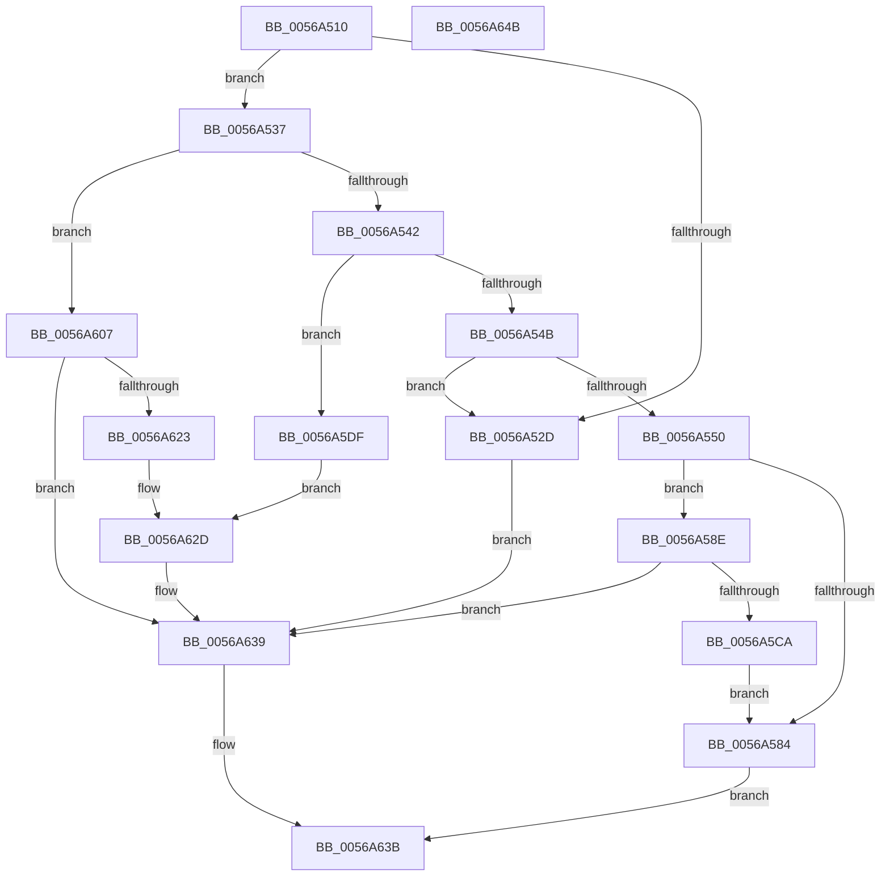

# HalpApicSetLogicalId

- RVA: `0x0056A510`–`0x0056A64C` (길이 `316` bytes)
- VA: `0x000000014056A510`
- 실행 섹션: `.text`
- PDB 이름 있음: `예`; PDB Function 태그: `아니요`
- unwind 정보 RVA: `0x00060BC4`
- 디코드: `75`개 명령, `316/316` bytes 표시
- 미해석 바이트: `0` (있으면 어셈블리에 `.byte`로 보존)

> 이 문서는 커널 이미지의 기계어와 PDB 기호를 분석해 생성했습니다. 4번과 5번은 함수 원형과 자료형을 바이너리 사용 방식에서 추정한 C 해석이며 원본 소스 복구 결과는 아닙니다.

## 1. Dependencies

- 직접 호출 지점: **8**; 고유 호출 대상: **1**
- 직접 호출자로 확인된 함수: **0**
- RIP 상대 이미지 참조: **5**

### Outgoing calls
- `0x0056A567` → [guard_dispatch_icall](../6B/guard_dispatch_icall_function_006BAAD0.md) (function, `0x006BAAD0`)
- `0x0056A578` → [guard_dispatch_icall](../6B/guard_dispatch_icall_function_006BAAD0.md) (function, `0x006BAAD0`)
- `0x0056A5B0` → [guard_dispatch_icall](../6B/guard_dispatch_icall_function_006BAAD0.md) (function, `0x006BAAD0`)
- `0x0056A5C1` → [guard_dispatch_icall](../6B/guard_dispatch_icall_function_006BAAD0.md) (function, `0x006BAAD0`)
- `0x0056A5D8` → [guard_dispatch_icall](../6B/guard_dispatch_icall_function_006BAAD0.md) (function, `0x006BAAD0`)
- `0x0056A5F5` → [guard_dispatch_icall](../6B/guard_dispatch_icall_function_006BAAD0.md) (function, `0x006BAAD0`)
- `0x0056A615` → [guard_dispatch_icall](../6B/guard_dispatch_icall_function_006BAAD0.md) (function, `0x006BAAD0`)
- `0x0056A634` → [guard_dispatch_icall](../6B/guard_dispatch_icall_function_006BAAD0.md) (function, `0x006BAAD0`)

### Direct callers
- 이 함수 시작 RVA로 연결되는 직접 call은 확인되지 않았습니다. 간접 호출은 완전히 역산할 수 없습니다.

### Static image references
- `0x0056A524` → RVA `0x00E10452` (`.data`; read)
- `0x0056A550` → RVA `0x00E10430` (`.data`; read)
- `0x0056A55C` → RVA `0x00E117F0` (`.data`; write)
- `0x0056A56C` → RVA `0x00E10438` (`.data`; read)
- `0x0056A61A` → RVA `0x00E117F0` (`.data`; read)

## 2. Other-region calls and transfers

- 다른 실행 섹션으로 향하는 call: **0**
- 별도 외부 분기/꼬리 이동을 확인하지 못했습니다.

## 3. Assembly (complete function range)

```asm
0056A510  48 89 5C 24 08                  mov qword ptr [rsp + 8], rbx
0056A515  48 89 74 24 10                  mov qword ptr [rsp + 0x10], rsi
0056A51A  57                              push rdi
0056A51B  48 83 EC 20                     sub rsp, 0x20
0056A51F  33 FF                           xor edi, edi
0056A521  48 8B F2                        mov rsi, rdx
0056A524  40 38 3D 27 5F 8A 00            cmp byte ptr [rip + 0x8a5f27], dil
0056A52B  74 0A                           je 0x14056a537
0056A52D  BF BB 00 00 C0                  mov edi, 0xc00000bb
0056A532  E9 02 01 00 00                  jmp 0x14056a639
0056A537  8B 0A                           mov ecx, dword ptr [rdx]
0056A539  83 E9 04                        sub ecx, 4
0056A53C  0F 84 C5 00 00 00               je 0x14056a607
0056A542  83 E9 01                        sub ecx, 1
0056A545  0F 84 94 00 00 00               je 0x14056a5df
0056A54B  83 F9 01                        cmp ecx, 1
0056A54E  75 DD                           jne 0x14056a52d
0056A550  48 8B 05 D9 5E 8A 00            mov rax, qword ptr [rip + 0x8a5ed9]
0056A557  BA FF FF FF 0F                  mov edx, 0xfffffff
0056A55C  88 0D 8E 72 8A 00               mov byte ptr [rip + 0x8a728e], cl
0056A562  B9 E0 00 00 00                  mov ecx, 0xe0
0056A567  E8 64 05 15 00                  call 0x1406baad0
0056A56C  48 8B 05 C5 5E 8A 00            mov rax, qword ptr [rip + 0x8a5ec5]
0056A573  B9 E0 00 00 00                  mov ecx, 0xe0
0056A578  E8 53 05 15 00                  call 0x1406baad0
0056A57D  3D FF FF FF 0F                  cmp eax, 0xfffffff
0056A582  74 0A                           je 0x14056a58e
0056A584  B8 BB 00 00 C0                  mov eax, 0xc00000bb
0056A589  E9 AD 00 00 00                  jmp 0x14056a63b
0056A58E  0F B7 46 08                     movzx eax, word ptr [rsi + 8]
0056A592  B9 D0 00 00 00                  mov ecx, 0xd0
0056A597  66 C1 E0 04                     shl ax, 4
0056A59B  0F B7 D8                        movzx ebx, ax
0056A59E  0F B7 46 0C                     movzx eax, word ptr [rsi + 0xc]
0056A5A2  0B D8                           or ebx, eax
0056A5A4  48 8B 05 85 5E 8A 00            mov rax, qword ptr [rip + 0x8a5e85]
0056A5AB  C1 E3 18                        shl ebx, 0x18
0056A5AE  8B D3                           mov edx, ebx
0056A5B0  E8 1B 05 15 00                  call 0x1406baad0
0056A5B5  48 8B 05 7C 5E 8A 00            mov rax, qword ptr [rip + 0x8a5e7c]
0056A5BC  B9 D0 00 00 00                  mov ecx, 0xd0
0056A5C1  E8 0A 05 15 00                  call 0x1406baad0
0056A5C6  3B C3                           cmp eax, ebx
0056A5C8  74 6F                           je 0x14056a639
0056A5CA  48 8B 05 5F 5E 8A 00            mov rax, qword ptr [rip + 0x8a5e5f]
0056A5D1  33 D2                           xor edx, edx
0056A5D3  B9 D0 00 00 00                  mov ecx, 0xd0
0056A5D8  E8 F3 04 15 00                  call 0x1406baad0
0056A5DD  EB A5                           jmp 0x14056a584
0056A5DF  48 8B 05 4A 5E 8A 00            mov rax, qword ptr [rip + 0x8a5e4a]
0056A5E6  83 CA FF                        or edx, 0xffffffff
0056A5E9  B9 E0 00 00 00                  mov ecx, 0xe0
0056A5EE  40 88 3D FB 71 8A 00            mov byte ptr [rip + 0x8a71fb], dil
0056A5F5  E8 D6 04 15 00                  call 0x1406baad0
0056A5FA  8B 56 08                        mov edx, dword ptr [rsi + 8]
0056A5FD  B9 D0 00 00 00                  mov ecx, 0xd0
0056A602  C1 E2 18                        shl edx, 0x18
0056A605  EB 26                           jmp 0x14056a62d
0056A607  48 8B 05 22 5E 8A 00            mov rax, qword ptr [rip + 0x8a5e22]
0056A60E  33 D2                           xor edx, edx
0056A610  B9 D0 00 00 00                  mov ecx, 0xd0
0056A615  E8 B6 04 15 00                  call 0x1406baad0
0056A61A  40 38 3D CF 71 8A 00            cmp byte ptr [rip + 0x8a71cf], dil
0056A621  74 16                           je 0x14056a639
0056A623  BA FF FF FF 0F                  mov edx, 0xfffffff
0056A628  B9 E0 00 00 00                  mov ecx, 0xe0
0056A62D  48 8B 05 FC 5D 8A 00            mov rax, qword ptr [rip + 0x8a5dfc]
0056A634  E8 97 04 15 00                  call 0x1406baad0
0056A639  8B C7                           mov eax, edi
0056A63B  48 8B 5C 24 30                  mov rbx, qword ptr [rsp + 0x30]
0056A640  48 8B 74 24 38                  mov rsi, qword ptr [rsp + 0x38]
0056A645  48 83 C4 20                     add rsp, 0x20
0056A649  5F                              pop rdi
0056A64A  C3                              ret
0056A64B  CC                              int3
```

## 4. C-style interpretation (structured pseudocode)

```c
__int64 __fastcall HalpApicSetLogicalId(__int64 a1, __int64 a2)
{
    __int64 result;
    __int64 v_rbx;
    __int64 v_rdi;
    __int64 v_rsp;
    unsigned __int64 v_stack_p10;
    unsigned __int64 v_stack_p8;

    v_stack_p8 = v_rbx;
    v_stack_p10 = v_rsi;
    v_rsp = (v_rsp) - (32);
    v_rdi = 0;
    if ((*(unsigned __int8 *)(v_rip + 9068327)) == 0) goto loc_0056A537;
loc_0056A52D:
    goto loc_0056A639;
loc_0056A537:
    a1 = (unsigned int)(((unsigned int)(*(unsigned int *)(a2))) - (4));
    if (condition_is_equal) goto loc_0056A607;
    a1 = (unsigned int)((a1) - (1));
    if (condition_is_equal) goto loc_0056A5DF;
    if (((unsigned int)(a1)) != 1) goto loc_0056A52D;
    *(unsigned __int8 *)(v_rip + 9073294) = (unsigned __int8)(a1);
    result = guard_dispatch_icall(224, (unsigned int)(0xFFFFFFFULL), a3, a4);
    result = guard_dispatch_icall(224, (unsigned int)(0xFFFFFFFULL), a3, a4);
    if (((unsigned int)(result)) == 0xFFFFFFFULL) goto loc_0056A58E;
loc_0056A584:
    goto loc_0056A63B;
loc_0056A58E:
    result = (unsigned __int16)((*(unsigned __int16 *)(a2 + 8)) << (4));
    v_rbx = (unsigned int)(((unsigned __int16)(result)) | ((unsigned int)(*(unsigned __int16 *)(a2 + 12))));
    v_rbx = (unsigned int)((v_rbx) << (24));
    result = guard_dispatch_icall(208, (unsigned int)((unsigned int)(v_rbx)), a3, a4);
    result = guard_dispatch_icall(208, (unsigned int)((unsigned int)(v_rbx)), a3, a4);
    if (((unsigned int)(result)) == ((unsigned int)(v_rbx))) goto loc_0056A639;
    a2 = 0;
    result = guard_dispatch_icall(208, a2, a3, a4);
    goto loc_0056A584;
loc_0056A5DF:
    a2 = (unsigned int)((a2) | (0xFFFFFFFFULL));
    *(unsigned __int8 *)(v_rip + 9073147) = (unsigned __int8)((unsigned int)(0xC00000BBULL));
    result = guard_dispatch_icall(224, a2, a3, a4);
    a2 = (unsigned int)(((unsigned int)(*(unsigned int *)(a2 + 8))) << (24));
    goto loc_0056A62D;
loc_0056A607:
    a2 = 0;
    result = guard_dispatch_icall(208, a2, a3, a4);
    if ((*(unsigned __int8 *)(v_rip + 9073103)) == ((unsigned __int8)((unsigned int)(0xC00000BBULL)))) goto loc_0056A639;
loc_0056A62D:
    result = guard_dispatch_icall(224, (unsigned int)(0xFFFFFFFULL), a3, a4);
loc_0056A639:
loc_0056A63B:
    v_rsp = (v_rsp) + (32);
    return (unsigned int)((unsigned int)((unsigned int)(0xC00000BBULL)));
}
```

## 5. (Beta) C Style

```c
int64_t HalpApicSetLogicalId(int64_t Arg1, void *Arg2)
{
    uint8_t *arg2 = (uint8_t *)Arg2;

    int64_t result;
    int64_t local_rbx;
    int64_t local_rdi;
    int64_t local_rsp;
    uint64_t v_stack_p10;
    uint64_t v_stack_p8;

    v_stack_p8 = local_rbx;
    v_stack_p10 = local_rsi;
    local_rsp = (local_rsp) - (32);
    local_rdi = 0;
    if ((*(uint8_t *)(v_rip + 0x8A5F27)) == 0) goto loc_0056A537;
loc_0056A52D:
    goto loc_0056A639;
loc_0056A537:
    Arg1 = (uint32_t)(((uint32_t)(*(uint32_t *)(arg2))) - (4));
    if (condition_is_equal) goto loc_0056A607;
    Arg1 = (uint32_t)((Arg1) - (1));
    if (condition_is_equal) goto loc_0056A5DF;
    if (((uint32_t)(Arg1)) != 1) goto loc_0056A52D;
    *(uint8_t *)(v_rip + 0x8A728E) = (uint8_t)(Arg1);
    result = guard_dispatch_icall(224, (uint32_t)(0xFFFFFFFULL), a3, a4);
    result = guard_dispatch_icall(224, (uint32_t)(0xFFFFFFFULL), a3, a4);
    if (((uint32_t)(result)) == 0xFFFFFFFULL) goto loc_0056A58E;
loc_0056A584:
    goto loc_0056A63B;
loc_0056A58E:
    result = (uint16_t)((*(uint16_t *)(arg2 + 0x8)) << (4));
    local_rbx = (uint32_t)(((uint16_t)(result)) | ((uint32_t)(*(uint16_t *)(arg2 + 0xC))));
    local_rbx = (uint32_t)((local_rbx) << (24));
    result = guard_dispatch_icall(208, (uint32_t)((uint32_t)(local_rbx)), a3, a4);
    result = guard_dispatch_icall(208, (uint32_t)((uint32_t)(local_rbx)), a3, a4);
    if (((uint32_t)(result)) == ((uint32_t)(local_rbx))) goto loc_0056A639;
    Arg2 = 0;
    result = guard_dispatch_icall(208, Arg2, a3, a4);
    goto loc_0056A584;
loc_0056A5DF:
    Arg2 = (uint32_t)((Arg2) | (0xFFFFFFFFULL));
    *(uint8_t *)(v_rip + 0x8A71FB) = (uint8_t)((uint32_t)(0xC00000BBULL));
    result = guard_dispatch_icall(224, Arg2, a3, a4);
    Arg2 = (uint32_t)(((uint32_t)(*(uint32_t *)(arg2 + 0x8))) << (24));
    goto loc_0056A62D;
loc_0056A607:
    Arg2 = 0;
    result = guard_dispatch_icall(208, Arg2, a3, a4);
    if ((*(uint8_t *)(v_rip + 0x8A71CF)) == ((uint8_t)((uint32_t)(0xC00000BBULL)))) goto loc_0056A639;
loc_0056A62D:
    result = guard_dispatch_icall(224, (uint32_t)(0xFFFFFFFULL), a3, a4);
loc_0056A639:
loc_0056A63B:
    local_rsp = (local_rsp) + (32);
    return (uint32_t)((uint32_t)((uint32_t)(0xC00000BBULL)));
}
```

### 관측된 메모리 오프셋

구조체 형식이 확인되지 않은 접근은 인자 기준의 오프셋으로만 기록했습니다.

| 기준 인자 | 오프셋 표현 | 폭 (bit) | 접근 |
|---|---:|---:|---|
| `Arg2` | `+ 0x0` | `32` | `R` |
| `Arg2` | `+ 0x8` | `16` | `R` |
| `Arg2` | `+ 0x8` | `32` | `R` |
| `Arg2` | `+ 0xC` | `16` | `R` |

## 6. Execution-region graph

[열기: 2D/3D 그래프와 함수 탐색 컨트롤 패널](../../../control-panel.html?section=text&rva=0x0056A510&view=graph)

- 2D 그래프는 위에서 아래로 흐르고, 3D 그래프는 빈 공간을 드래그해 회전합니다. Shift+드래그는 이동, 휠은 확대·축소, 함수 노드 선택은 대상 보고서 이동입니다.

### Static fallback


