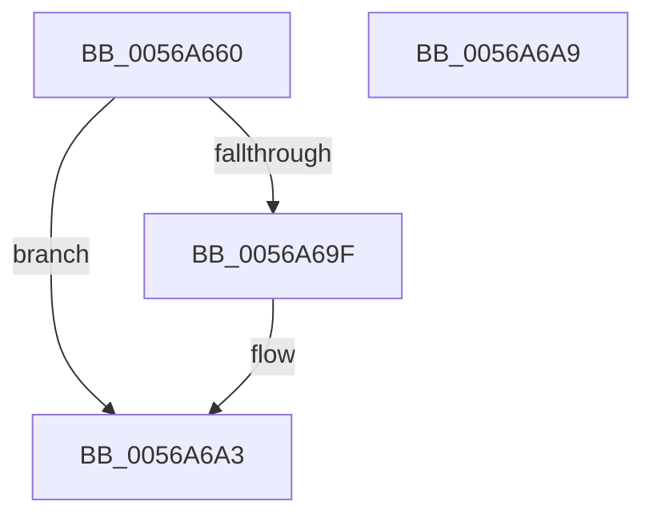

# HalpApicSetPriority

- RVA: `0x0056A660`–`0x0056A6AA` (길이 `74` bytes)
- VA: `0x000000014056A660`
- 실행 섹션: `.text`
- PDB 이름 있음: `예`; PDB Function 태그: `아니요`
- unwind 정보 RVA: `0x0005CF00`
- 디코드: `18`개 명령, `74/74` bytes 표시
- 미해석 바이트: `0` (있으면 어셈블리에 `.byte`로 보존)

> 이 문서는 커널 이미지의 기계어와 PDB 기호를 분석해 생성했습니다. 4번과 5번은 함수 원형과 자료형을 바이너리 사용 방식에서 추정한 C 해석이며 원본 소스 복구 결과는 아닙니다.

## 1. Dependencies

- 직접 호출 지점: **2**; 고유 호출 대상: **1**
- 직접 호출자로 확인된 함수: **1**
- RIP 상대 이미지 참조: **2**

### Outgoing calls
- `0x0056A677` → [guard_dispatch_icall](../6B/guard_dispatch_icall_function_006BAAD0.md) (function, `0x006BAAD0`)
- `0x0056A688` → [guard_dispatch_icall](../6B/guard_dispatch_icall_function_006BAAD0.md) (function, `0x006BAAD0`)

### Direct callers
- [HalpApicInitializeLocalUnit](HalpApicInitializeLocalUnit_function_00569EC0.md) at `0x00569FA5`

### Static image references
- `0x0056A666` → RVA `0x00E10430` (`.data`; read)
- `0x0056A67C` → RVA `0x00E10438` (`.data`; read)

## 2. Other-region calls and transfers

- 다른 실행 섹션으로 향하는 call: **0**
- 별도 외부 분기/꼬리 이동을 확인하지 못했습니다.

## 3. Assembly (complete function range)

```asm
0056A660  40 53                           push rbx
0056A662  48 83 EC 20                     sub rsp, 0x20
0056A666  48 8B 05 C3 5D 8A 00            mov rax, qword ptr [rip + 0x8a5dc3]
0056A66D  B9 80 00 00 00                  mov ecx, 0x80
0056A672  8B DA                           mov ebx, edx
0056A674  C1 E2 04                        shl edx, 4
0056A677  E8 54 04 15 00                  call 0x1406baad0
0056A67C  48 8B 05 B5 5D 8A 00            mov rax, qword ptr [rip + 0x8a5db5]
0056A683  B9 80 00 00 00                  mov ecx, 0x80
0056A688  E8 43 04 15 00                  call 0x1406baad0
0056A68D  65 48 8B 04 25 20 00 00 00      mov rax, qword ptr gs:[0x20]
0056A696  80 B8 8D 00 00 00 01            cmp byte ptr [rax + 0x8d], 1
0056A69D  75 04                           jne 0x14056a6a3
0056A69F  44 0F 22 C3                     mov cr8, rbx
0056A6A3  48 83 C4 20                     add rsp, 0x20
0056A6A7  5B                              pop rbx
0056A6A8  C3                              ret
0056A6A9  CC                              int3
```

## 4. C-style interpretation (structured pseudocode)

```c
__int64 __fastcall HalpApicSetPriority(__int64 a1, int a2)
{
    __int64 result;
    __int64 v_cr8;
    __int64 v_rsp;

    v_rsp = (v_rsp) - (32);
    a2 = (unsigned int)((a2) << (4));
    result = guard_dispatch_icall(128, a2, a3, a4);
    result = guard_dispatch_icall(128, a2, a3, a4);
    if ((*(unsigned __int8 *)(*(unsigned __int64 *)(gs_base + (0 + 32)) + 141)) == 1) {
        v_cr8 = (unsigned int)(a2);
    }
    v_rsp = (v_rsp) + (32);
    return *(unsigned __int64 *)(gs_base + (0 + 32));
}
```

## 5. (Beta) C Style

```c
int64_t HalpApicSetPriority(int64_t Arg1, int32_t Arg2)
{
    int64_t result;
    int64_t v_cr8;
    int64_t local_rsp;

    local_rsp = (local_rsp) - (32);
    Arg2 = (uint32_t)((Arg2) << (4));
    result = guard_dispatch_icall(128, Arg2, a3, a4);
    result = guard_dispatch_icall(128, Arg2, a3, a4);
    if ((*(uint8_t *)(*(uint64_t *)(gs_base + (0 + 0x20)) + 0x8D)) == 1) {
        v_cr8 = (uint32_t)(Arg2);
    }
    local_rsp = (local_rsp) + (32);
    return *(uint64_t *)(gs_base + (0 + 0x20));
}
```

## 6. Execution-region graph

[열기: 2D/3D 그래프와 함수 탐색 컨트롤 패널](../../../control-panel.html?section=text&rva=0x0056A660&view=graph)

- 2D 그래프는 위에서 아래로 흐르고, 3D 그래프는 빈 공간을 드래그해 회전합니다. Shift+드래그는 이동, 휠은 확대·축소, 함수 노드 선택은 대상 보고서 이동입니다.

### Static fallback


