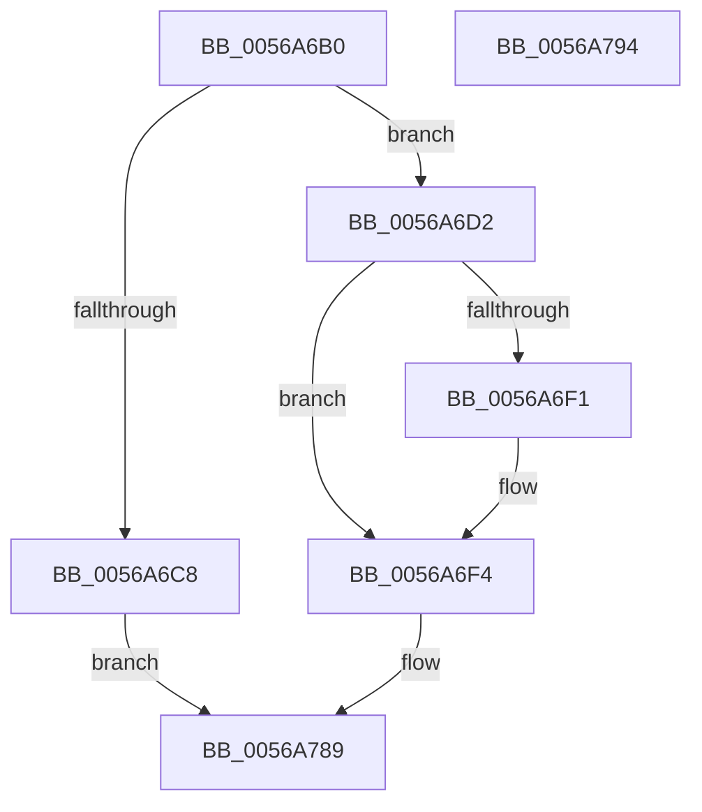

# HalpApicStartProcessor

- RVA: `0x0056A6B0`–`0x0056A795` (길이 `229` bytes)
- VA: `0x000000014056A6B0`
- 실행 섹션: `.text`
- PDB 이름 있음: `예`; PDB Function 태그: `아니요`
- unwind 정보 RVA: `0x0005CAAC`
- 디코드: `53`개 명령, `229/229` bytes 표시
- 미해석 바이트: `0` (있으면 어셈블리에 `.byte`로 보존)

> 이 문서는 커널 이미지의 기계어와 PDB 기호를 분석해 생성했습니다. 4번과 5번은 함수 원형과 자료형을 바이너리 사용 방식에서 추정한 C 해석이며 원본 소스 복구 결과는 아닙니다.

## 1. Dependencies

- 직접 호출 지점: **12**; 고유 호출 대상: **2**
- 직접 호출자로 확인된 함수: **0**
- RIP 상대 이미지 참조: **3**

### Outgoing calls
- `0x0056A6D7` → [KeStallExecutionProcessor](../44/KeStallExecutionProcessor_function_0044F620.md) (function, `0x0044F620`)
- `0x0056A6E3` → [guard_dispatch_icall](../6B/guard_dispatch_icall_function_006BAAD0.md) (function, `0x006BAAD0`)
- `0x0056A702` → [guard_dispatch_icall](../6B/guard_dispatch_icall_function_006BAAD0.md) (function, `0x006BAAD0`)
- `0x0056A70C` → [KeStallExecutionProcessor](../44/KeStallExecutionProcessor_function_0044F620.md) (function, `0x0044F620`)
- `0x0056A71F` → [guard_dispatch_icall](../6B/guard_dispatch_icall_function_006BAAD0.md) (function, `0x006BAAD0`)
- `0x0056A729` → [KeStallExecutionProcessor](../44/KeStallExecutionProcessor_function_0044F620.md) (function, `0x0044F620`)
- `0x0056A748` → [guard_dispatch_icall](../6B/guard_dispatch_icall_function_006BAAD0.md) (function, `0x006BAAD0`)
- `0x0056A752` → [KeStallExecutionProcessor](../44/KeStallExecutionProcessor_function_0044F620.md) (function, `0x0044F620`)
- `0x0056A75E` → [guard_dispatch_icall](../6B/guard_dispatch_icall_function_006BAAD0.md) (function, `0x006BAAD0`)
- `0x0056A768` → [KeStallExecutionProcessor](../44/KeStallExecutionProcessor_function_0044F620.md) (function, `0x0044F620`)
- `0x0056A778` → [guard_dispatch_icall](../6B/guard_dispatch_icall_function_006BAAD0.md) (function, `0x006BAAD0`)
- `0x0056A782` → [KeStallExecutionProcessor](../44/KeStallExecutionProcessor_function_0044F620.md) (function, `0x0044F620`)

### Direct callers
- 이 함수 시작 RVA로 연결되는 직접 call은 확인되지 않았습니다. 간접 호출은 완전히 역산할 수 없습니다.

### Static image references
- `0x0056A6DC` → RVA `0x00E10428` (`.data`; read)
- `0x0056A6E8` → RVA `0x00E10452` (`.data`; read)
- `0x0056A6F4` → RVA `0x00E10448` (`.data`; read)

## 2. Other-region calls and transfers

- 다른 실행 섹션으로 향하는 call: **0**
- 별도 외부 분기/꼬리 이동을 확인하지 못했습니다.

## 3. Assembly (complete function range)

```asm
0056A6B0  48 89 5C 24 08                  mov qword ptr [rsp + 8], rbx
0056A6B5  57                              push rdi
0056A6B6  48 83 EC 20                     sub rsp, 0x20
0056A6BA  41 8B F9                        mov edi, r9d
0056A6BD  8B DA                           mov ebx, edx
0056A6BF  41 F7 C1 FF 0F F0 FF            test r9d, 0xfff00fff
0056A6C6  74 0A                           je 0x14056a6d2
0056A6C8  B8 0D 00 00 C0                  mov eax, 0xc000000d
0056A6CD  E9 B7 00 00 00                  jmp 0x14056a789
0056A6D2  B9 C8 00 00 00                  mov ecx, 0xc8
0056A6D7  E8 44 4F EE FF                  call 0x14044f620
0056A6DC  48 8B 05 45 5D 8A 00            mov rax, qword ptr [rip + 0x8a5d45]
0056A6E3  E8 E8 03 15 00                  call 0x1406baad0
0056A6E8  80 3D 63 5D 8A 00 00            cmp byte ptr [rip + 0x8a5d63], 0
0056A6EF  75 03                           jne 0x14056a6f4
0056A6F1  C1 E3 18                        shl ebx, 0x18
0056A6F4  48 8B 05 4D 5D 8A 00            mov rax, qword ptr [rip + 0x8a5d4d]
0056A6FB  BA 00 C5 00 00                  mov edx, 0xc500
0056A700  8B CB                           mov ecx, ebx
0056A702  E8 C9 03 15 00                  call 0x1406baad0
0056A707  B9 0A 00 00 00                  mov ecx, 0xa
0056A70C  E8 0F 4F EE FF                  call 0x14044f620
0056A711  48 8B 05 30 5D 8A 00            mov rax, qword ptr [rip + 0x8a5d30]
0056A718  BA 00 85 00 00                  mov edx, 0x8500
0056A71D  8B CB                           mov ecx, ebx
0056A71F  E8 AC 03 15 00                  call 0x1406baad0
0056A724  B9 C8 00 00 00                  mov ecx, 0xc8
0056A729  E8 F2 4E EE FF                  call 0x14044f620
0056A72E  48 8B 05 13 5D 8A 00            mov rax, qword ptr [rip + 0x8a5d13]
0056A735  81 E7 00 F0 0F 00               and edi, 0xff000
0056A73B  81 CF 00 00 60 00               or edi, 0x600000
0056A741  8B CB                           mov ecx, ebx
0056A743  C1 EF 0C                        shr edi, 0xc
0056A746  8B D7                           mov edx, edi
0056A748  E8 83 03 15 00                  call 0x1406baad0
0056A74D  B9 C8 00 00 00                  mov ecx, 0xc8
0056A752  E8 C9 4E EE FF                  call 0x14044f620
0056A757  48 8B 05 CA 5C 8A 00            mov rax, qword ptr [rip + 0x8a5cca]
0056A75E  E8 6D 03 15 00                  call 0x1406baad0
0056A763  B9 64 00 00 00                  mov ecx, 0x64
0056A768  E8 B3 4E EE FF                  call 0x14044f620
0056A76D  48 8B 05 D4 5C 8A 00            mov rax, qword ptr [rip + 0x8a5cd4]
0056A774  8B D7                           mov edx, edi
0056A776  8B CB                           mov ecx, ebx
0056A778  E8 53 03 15 00                  call 0x1406baad0
0056A77D  B9 C8 00 00 00                  mov ecx, 0xc8
0056A782  E8 99 4E EE FF                  call 0x14044f620
0056A787  33 C0                           xor eax, eax
0056A789  48 8B 5C 24 30                  mov rbx, qword ptr [rsp + 0x30]
0056A78E  48 83 C4 20                     add rsp, 0x20
0056A792  5F                              pop rdi
0056A793  C3                              ret
0056A794  CC                              int3
```

## 4. C-style interpretation (structured pseudocode)

```c
__int64 __fastcall HalpApicStartProcessor(__int64 a1, int a2, __int64 a3, int a4)
{
    __int64 result;
    __int64 v_rbx;
    __int64 v_rdi;
    __int64 v_rsp;
    unsigned __int64 v_stack_p8;

    v_stack_p8 = v_rbx;
    v_rsp = (v_rsp) - (32);
    if (((a4) & (0xFFF00FFFULL)) == 0) goto loc_0056A6D2;
    goto loc_0056A789;
loc_0056A6D2:
    result = KeStallExecutionProcessor(200, a2, a3, a4);
    result = guard_dispatch_icall(200, a2, a3, a4);
    v_rbx = (unsigned int)(a2);
    if ((*(unsigned __int8 *)(v_rip + 9067875)) == 0) {
        v_rbx = (unsigned int)(((unsigned int)(a2)) << (24));
    }
    result = guard_dispatch_icall((unsigned int)((unsigned int)(v_rbx)), (unsigned int)(0xC500ULL), a3, a4);
    result = KeStallExecutionProcessor(10, (unsigned int)(0xC500ULL), a3, a4);
    result = guard_dispatch_icall((unsigned int)((unsigned int)(v_rbx)), (unsigned int)(0x8500ULL), a3, a4);
    result = KeStallExecutionProcessor(200, (unsigned int)(0x8500ULL), a3, a4);
    v_rdi = (unsigned int)(((unsigned int)(a4)) & (0xFF000ULL));
    v_rdi = (unsigned int)((v_rdi) | (0x600000ULL));
    v_rdi = (unsigned int)((v_rdi) >> (12));
    result = guard_dispatch_icall((unsigned int)((unsigned int)(v_rbx)), (unsigned int)((unsigned int)(v_rdi)), a3, a4);
    result = KeStallExecutionProcessor(200, (unsigned int)((unsigned int)(v_rdi)), a3, a4);
    result = guard_dispatch_icall(200, (unsigned int)((unsigned int)(v_rdi)), a3, a4);
    result = KeStallExecutionProcessor(100, (unsigned int)((unsigned int)(v_rdi)), a3, a4);
    result = guard_dispatch_icall((unsigned int)((unsigned int)(v_rbx)), (unsigned int)((unsigned int)(v_rdi)), a3, a4);
    result = KeStallExecutionProcessor(200, (unsigned int)((unsigned int)(v_rdi)), a3, a4);
    result = 0;
loc_0056A789:
    v_rsp = (v_rsp) + (32);
    return result;
}
```

## 5. (Beta) C Style

```c
int64_t HalpApicStartProcessor(int64_t Arg1, int32_t Arg2, int64_t Arg3, int32_t Arg4)
{
    int64_t result;
    int64_t local_rbx;
    int64_t local_rdi;
    int64_t local_rsp;
    uint64_t v_stack_p8;

    v_stack_p8 = local_rbx;
    local_rsp = (local_rsp) - (32);
    if (((Arg4) & (0xFFF00FFFULL)) == 0) goto loc_0056A6D2;
    goto loc_0056A789;
loc_0056A6D2:
    result = KeStallExecutionProcessor(200, Arg2, Arg3, Arg4);
    result = guard_dispatch_icall(200, Arg2, Arg3, Arg4);
    local_rbx = (uint32_t)(Arg2);
    if ((*(uint8_t *)(v_rip + 0x8A5D63)) == 0) {
        local_rbx = (uint32_t)(((uint32_t)(Arg2)) << (24));
    }
    result = guard_dispatch_icall((uint32_t)((uint32_t)(local_rbx)), (uint32_t)(0xC500ULL), Arg3, Arg4);
    result = KeStallExecutionProcessor(10, (uint32_t)(0xC500ULL), Arg3, Arg4);
    result = guard_dispatch_icall((uint32_t)((uint32_t)(local_rbx)), (uint32_t)(0x8500ULL), Arg3, Arg4);
    result = KeStallExecutionProcessor(200, (uint32_t)(0x8500ULL), Arg3, Arg4);
    local_rdi = (uint32_t)(((uint32_t)(Arg4)) & (0xFF000ULL));
    local_rdi = (uint32_t)((local_rdi) | (0x600000ULL));
    local_rdi = (uint32_t)((local_rdi) >> (12));
    result = guard_dispatch_icall((uint32_t)((uint32_t)(local_rbx)), (uint32_t)((uint32_t)(local_rdi)), Arg3, Arg4);
    result = KeStallExecutionProcessor(200, (uint32_t)((uint32_t)(local_rdi)), Arg3, Arg4);
    result = guard_dispatch_icall(200, (uint32_t)((uint32_t)(local_rdi)), Arg3, Arg4);
    result = KeStallExecutionProcessor(100, (uint32_t)((uint32_t)(local_rdi)), Arg3, Arg4);
    result = guard_dispatch_icall((uint32_t)((uint32_t)(local_rbx)), (uint32_t)((uint32_t)(local_rdi)), Arg3, Arg4);
    result = KeStallExecutionProcessor(200, (uint32_t)((uint32_t)(local_rdi)), Arg3, Arg4);
    result = 0;
loc_0056A789:
    local_rsp = (local_rsp) + (32);
    return result;
}
```

## 6. Execution-region graph

[열기: 2D/3D 그래프와 함수 탐색 컨트롤 패널](../../../control-panel.html?section=text&rva=0x0056A6B0&view=graph)

- 2D 그래프는 위에서 아래로 흐르고, 3D 그래프는 빈 공간을 드래그해 회전합니다. Shift+드래그는 이동, 휠은 확대·축소, 함수 노드 선택은 대상 보고서 이동입니다.

### Static fallback


