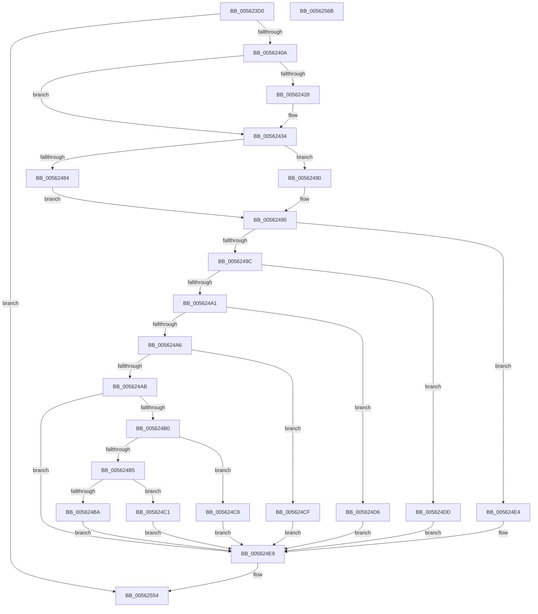

# HalpApicTimerDiscover

- RVA: `0x005623D0`–`0x0056256C` (길이 `412` bytes)
- VA: `0x00000001405623D0`
- 실행 섹션: `.text`
- PDB 이름 있음: `예`; PDB Function 태그: `아니요`
- unwind 정보 RVA: `0x000C4B14`
- 디코드: `106`개 명령, `412/412` bytes 표시
- 미해석 바이트: `0` (있으면 어셈블리에 `.byte`로 보존)

> 이 문서는 커널 이미지의 기계어와 PDB 기호를 분석해 생성했습니다. 4번과 5번은 함수 원형과 자료형을 바이너리 사용 방식에서 추정한 C 해석이며 원본 소스 복구 결과는 아닙니다.

## 1. Dependencies

- 직접 호출 지점: **6**; 고유 호출 대상: **6**
- 직접 호출자로 확인된 함수: **1**
- RIP 상대 이미지 참조: **6**

### Outgoing calls
- `0x005623FC` → [HalSocGetAcpiTable](HalSocGetAcpiTable_function_00561580.md) (function, `0x00561580`)
- `0x0056241F` → [HalSocRequestApi](../4B/HalSocRequestApi_function_004B848C.md) (function, `0x004B848C`)
- `0x0056242C` → [guard_dispatch_icall](../6B/guard_dispatch_icall_function_006BAAD0.md) (function, `0x006BAAD0`)
- `0x00562442` → [memset](../6C/memset_function_006C6C40.md) (function, `0x006C6C40`)
- `0x0056247B` → [HalpApicTimerIsInvariant](HalpApicTimerIsInvariant_function_005625DC.md) (function, `0x005625DC`)
- `0x0056254F` → [HalpTimerRegister](HalpTimerRegister_function_005616BC.md) (function, `0x005616BC`)

### Direct callers
- [HalpTimerRegisterBuiltinPluginsCommon](../54/HalpTimerRegisterBuiltinPluginsCommon_function_0054A014.md) at `0x0054A03E`

### Static image references
- `0x0056250D` → RVA `0x00562580` (`HalpApicTimerInitialize`; read)
- `0x00562518` → RVA `0x005626C0` (`HalpApicTimerQueryCounter`; read)
- `0x00562523` → RVA `0x0049E550` (`EmpCheckErrataList`; read)
- `0x0056252E` → RVA `0x00462560` (`HalpApicTimerArm`; read)
- `0x00562539` → RVA `0x005626F0` (`CsanWrite8NoCheck`; read)
- `0x00562544` → RVA `0x00562700` (`HalpApicTimerStop`; read)

## 2. Other-region calls and transfers

- 다른 실행 섹션으로 향하는 call: **0**
- 별도 외부 분기/꼬리 이동을 확인하지 못했습니다.

## 3. Assembly (complete function range)

```asm
005623D0  48 89 5C 24 10                  mov qword ptr [rsp + 0x10], rbx
005623D5  48 89 7C 24 18                  mov qword ptr [rsp + 0x18], rdi
005623DA  55                              push rbp
005623DB  48 8D 6C 24 A9                  lea rbp, [rsp - 0x57]
005623E0  48 81 EC D0 00 00 00            sub rsp, 0xd0
005623E7  33 C0                           xor eax, eax
005623E9  0F 57 C0                        xorps xmm0, xmm0
005623EC  B9 41 50 49 43                  mov ecx, 0x43495041
005623F1  66 89 45 68                     mov word ptr [rbp + 0x68], ax
005623F5  0F 11 45 B7                     movups xmmword ptr [rbp - 0x49], xmm0
005623F9  88 45 6A                        mov byte ptr [rbp + 0x6a], al
005623FC  E8 7F F1 FF FF                  call 0x140561580
00562401  48 85 C0                        test rax, rax
00562404  0F 84 4A 01 00 00               je 0x140562554
0056240A  33 FF                           xor edi, edi
0056240C  48 8D 45 B7                     lea rax, [rbp - 0x49]
00562410  33 D2                           xor edx, edx
00562412  48 89 44 24 20                  mov qword ptr [rsp + 0x20], rax
00562417  44 8D 4F 10                     lea r9d, [rdi + 0x10]
0056241B  44 8D 47 06                     lea r8d, [rdi + 6]
0056241F  E8 68 60 F5 FF                  call 0x1404b848c
00562424  85 C0                           test eax, eax
00562426  78 0C                           js 0x140562434
00562428  48 8B 45 BF                     mov rax, qword ptr [rbp - 0x41]
0056242C  E8 9F 86 15 00                  call 0x1406baad0
00562431  48 8B F8                        mov rdi, rax
00562434  BB 90 00 00 00                  mov ebx, 0x90
00562439  48 8D 4D C7                     lea rcx, [rbp - 0x39]
0056243D  44 8B C3                        mov r8d, ebx
00562440  33 D2                           xor edx, edx
00562442  E8 F9 47 16 00                  call 0x1406c6c40
00562447  48 83 65 67 00                  and qword ptr [rbp + 0x67], 0
0056244C  48 8D 45 67                     lea rax, [rbp + 0x67]
00562450  89 5D CB                        mov dword ptr [rbp - 0x35], ebx
00562453  BB 20 00 00 00                  mov ebx, 0x20
00562458  89 5D 2B                        mov dword ptr [rbp + 0x2b], ebx
0056245B  48 89 45 1F                     mov qword ptr [rbp + 0x1f], rax
0056245F  C7 45 C7 01 00 00 00            mov dword ptr [rbp - 0x39], 1
00562466  C7 45 4F 07 00 00 00            mov dword ptr [rbp + 0x4f], 7
0056246D  C7 45 27 08 00 00 00            mov dword ptr [rbp + 0x27], 8
00562474  C7 45 3B 63 08 00 00            mov dword ptr [rbp + 0x3b], 0x863
0056247B  E8 5C 01 00 00                  call 0x1405625dc
00562480  84 C0                           test al, al
00562482  75 0C                           jne 0x140562490
00562484  C7 45 3B 63 68 00 00            mov dword ptr [rbp + 0x3b], 0x6863
0056248B  8D 43 EB                        lea eax, [rbx - 0x15]
0056248E  EB 05                           jmp 0x140562495
00562490  B8 0A 00 00 00                  mov eax, 0xa
00562495  89 45 6B                        mov dword ptr [rbp + 0x6b], eax
00562498  85 C0                           test eax, eax
0056249A  74 48                           je 0x1405624e4
0056249C  83 E8 01                        sub eax, 1
0056249F  74 3C                           je 0x1405624dd
005624A1  83 E8 01                        sub eax, 1
005624A4  74 30                           je 0x1405624d6
005624A6  83 E8 01                        sub eax, 1
005624A9  74 24                           je 0x1405624cf
005624AB  83 E8 05                        sub eax, 5
005624AE  74 39                           je 0x1405624e9
005624B0  83 E8 01                        sub eax, 1
005624B3  74 13                           je 0x1405624c8
005624B5  83 F8 01                        cmp eax, 1
005624B8  74 07                           je 0x1405624c1
005624BA  BB 01 00 00 00                  mov ebx, 1
005624BF  EB 28                           jmp 0x1405624e9
005624C1  BB 80 00 00 00                  mov ebx, 0x80
005624C6  EB 21                           jmp 0x1405624e9
005624C8  BB 40 00 00 00                  mov ebx, 0x40
005624CD  EB 1A                           jmp 0x1405624e9
005624CF  BB 10 00 00 00                  mov ebx, 0x10
005624D4  EB 13                           jmp 0x1405624e9
005624D6  BB 08 00 00 00                  mov ebx, 8
005624DB  EB 0C                           jmp 0x1405624e9
005624DD  BB 04 00 00 00                  mov ebx, 4
005624E2  EB 05                           jmp 0x1405624e9
005624E4  BB 02 00 00 00                  mov ebx, 2
005624E9  33 D2                           xor edx, edx
005624EB  C7 45 4B 01 00 00 00            mov dword ptr [rbp + 0x4b], 1
005624F2  48 8B C7                        mov rax, rdi
005624F5  C7 45 47 01 00 00 00            mov dword ptr [rbp + 0x47], 1
005624FC  48 F7 F3                        div rbx
005624FF  33 D2                           xor edx, edx
00562501  C6 45 67 FF                     mov byte ptr [rbp + 0x67], 0xff
00562505  48 89 45 2F                     mov qword ptr [rbp + 0x2f], rax
00562509  48 8D 4D C7                     lea rcx, [rbp - 0x39]
0056250D  48 8D 05 6C 00 00 00            lea rax, [rip + 0x6c]
00562514  48 89 45 CF                     mov qword ptr [rbp - 0x31], rax
00562518  48 8D 05 A1 01 00 00            lea rax, [rip + 0x1a1]
0056251F  48 89 45 D7                     mov qword ptr [rbp - 0x29], rax
00562523  48 8D 05 26 C0 F3 FF            lea rax, [rip - 0xc3fda]
0056252A  48 89 45 DF                     mov qword ptr [rbp - 0x21], rax
0056252E  48 8D 05 2B 00 F0 FF            lea rax, [rip - 0xfffd5]
00562535  48 89 45 E7                     mov qword ptr [rbp - 0x19], rax
00562539  48 8D 05 B0 01 00 00            lea rax, [rip + 0x1b0]
00562540  48 89 45 0F                     mov qword ptr [rbp + 0xf], rax
00562544  48 8D 05 B5 01 00 00            lea rax, [rip + 0x1b5]
0056254B  48 89 45 EF                     mov qword ptr [rbp - 0x11], rax
0056254F  E8 68 F1 FF FF                  call 0x1405616bc
00562554  4C 8D 9C 24 D0 00 00 00         lea r11, [rsp + 0xd0]
0056255C  33 C0                           xor eax, eax
0056255E  49 8B 5B 18                     mov rbx, qword ptr [r11 + 0x18]
00562562  49 8B 7B 20                     mov rdi, qword ptr [r11 + 0x20]
00562566  49 8B E3                        mov rsp, r11
00562569  5D                              pop rbp
0056256A  C3                              ret
0056256B  CC                              int3
```

## 4. C-style interpretation (structured pseudocode)

```c
__int64 __fastcall HalpApicTimerDiscover(__int64 a1, int a2)
{
    __int64 result;
    __int64 v_rdi;
    __int64 v_rsp;
    unsigned int v_stack_m10;
    unsigned int v_stack_m14;
    unsigned int v_stack_m18;
    unsigned int v_stack_m24;
    unsigned __int64 v_stack_m30;
    unsigned int v_stack_m34;
    unsigned int v_stack_m38;
    unsigned __int64 v_stack_m40;
    unsigned __int64 v_stack_m50;
    unsigned __int64 v_stack_m5F;
    unsigned __int64 v_stack_m70;
    unsigned __int64 v_stack_m78;
    unsigned __int64 v_stack_m8;
    unsigned __int64 v_stack_m80;
    unsigned __int64 v_stack_m88;
    unsigned __int64 v_stack_m90;
    unsigned int v_stack_m94;
    unsigned __int64 v_stack_m98;
    unsigned __int64 v_stack_mA0;
    unsigned __int64 v_stack_mA8;
    unsigned __int64 v_stack_mB8;
    unsigned __int64 v_stack_p10;
    unsigned __int64 v_stack_p18;
    unsigned __int64 v_stack_p8;
    unsigned __int16 v_stack_p9;
    unsigned __int8 v_stack_pB;
    unsigned int v_stack_pC;

    v_stack_p10 = v_rbx;
    v_stack_p18 = v_rdi;
    v_rsp = (v_rsp) - (208);
    result = 0;
    v_stack_p9 = 0;
    v_stack_mA8 = v_xmm0;
    v_stack_pB = 0;
    result = HalSocGetAcpiTable((unsigned int)(0x43495041ULL), a2, a3, a4);
    if (result == 0) goto loc_00562554;
    v_rdi = 0;
    a2 = 0;
    v_stack_mB8 = v_stack_mA8;
    result = HalSocRequestApi((unsigned int)(0x43495041ULL), a2, v_rdi + 6, v_rdi + 16);
    if (!(sign_flag)) {
        result = v_stack_mA0;
        result = guard_dispatch_icall((unsigned int)(0x43495041ULL), a2, v_rdi + 6, v_rdi + 16);
        v_rdi = result;
    }
    a2 = 0;
    result = memset(v_stack_m98, a2, 144, v_rdi + 16);
    v_stack_m94 = 144;
    v_stack_m34 = 32;
    v_stack_m40 = v_stack_p8;
    v_stack_m98 = 1;
    v_stack_m10 = 7;
    v_stack_m38 = 8;
    v_stack_m24 = 0x863ULL;
    result = HalpApicTimerIsInvariant(v_stack_m98, a2, 144, v_rdi + 16);
    if ((unsigned __int8)(result) != 0) goto loc_00562490;
    v_stack_m24 = 0x6863ULL;
    goto loc_00562495;
loc_00562490:
loc_00562495:
    v_stack_pC = 10;
    if (10 == 0) goto loc_005624E4;
    result = (unsigned int)((10) - (1));
    if (condition_is_equal) goto loc_005624DD;
    result = (unsigned int)((result) - (1));
    if (condition_is_equal) goto loc_005624D6;
    result = (unsigned int)((result) - (1));
    if (condition_is_equal) goto loc_005624CF;
    result = (unsigned int)((result) - (5));
    if (condition_is_equal) goto loc_005624E9;
    result = (unsigned int)((result) - (1));
    if (condition_is_equal) goto loc_005624C8;
    if (((unsigned int)(result)) == 1) goto loc_005624C1;
    goto loc_005624E9;
loc_005624C1:
    goto loc_005624E9;
loc_005624C8:
    goto loc_005624E9;
loc_005624CF:
    goto loc_005624E9;
loc_005624D6:
    goto loc_005624E9;
loc_005624DD:
    goto loc_005624E9;
loc_005624E4:
loc_005624E9:
    a2 = 0;
    v_stack_m14 = 1;
    v_stack_m18 = 1;
    a2 = 0;
    v_stack_p8 = 255;
    v_stack_m30 = v_rdi;
    v_stack_m90 = v_rip + 108;
    v_stack_m88 = v_rip + 417;
    v_stack_m80 = v_rip - 802778;
    v_stack_m78 = v_rip - 1048533;
    v_stack_m50 = v_rip + 432;
    v_stack_m70 = v_rip + 437;
    result = HalpTimerRegister(v_stack_m98, a2, 144, v_rdi + 16);
loc_00562554:
    result = 0;
    return result;
}
```

## 5. (Beta) C Style

```c
int64_t HalpApicTimerDiscover(int64_t Arg1, int32_t Arg2)
{
    int64_t result;
    int64_t local_rdi;
    int64_t local_rsp;
    uint32_t v_stack_m10;
    uint32_t v_stack_m14;
    uint32_t v_stack_m18;
    uint32_t v_stack_m24;
    uint64_t v_stack_m30;
    uint32_t v_stack_m34;
    uint32_t v_stack_m38;
    uint64_t v_stack_m40;
    uint64_t v_stack_m50;
    uint64_t v_stack_m5F;
    uint64_t v_stack_m70;
    uint64_t v_stack_m78;
    uint64_t v_stack_m8;
    uint64_t v_stack_m80;
    uint64_t v_stack_m88;
    uint64_t v_stack_m90;
    uint32_t v_stack_m94;
    uint64_t v_stack_m98;
    uint64_t v_stack_mA0;
    uint64_t v_stack_mA8;
    uint64_t v_stack_mB8;
    uint64_t v_stack_p10;
    uint64_t v_stack_p18;
    uint64_t v_stack_p8;
    uint16_t v_stack_p9;
    uint8_t v_stack_pB;
    uint32_t v_stack_pC;

    v_stack_p10 = local_rbx;
    v_stack_p18 = local_rdi;
    local_rsp = (local_rsp) - (208);
    result = 0;
    v_stack_p9 = 0;
    v_stack_mA8 = v_xmm0;
    v_stack_pB = 0;
    result = HalSocGetAcpiTable((uint32_t)(0x43495041ULL), Arg2, a3, a4);
    if (result == 0) goto loc_00562554;
    local_rdi = 0;
    Arg2 = 0;
    v_stack_mB8 = v_stack_mA8;
    result = HalSocRequestApi((uint32_t)(0x43495041ULL), Arg2, local_rdi + 6, local_rdi + 16);
    if (!(sign_flag)) {
        result = v_stack_mA0;
        result = guard_dispatch_icall((uint32_t)(0x43495041ULL), Arg2, local_rdi + 6, local_rdi + 16);
        local_rdi = result;
    }
    Arg2 = 0;
    result = memset(v_stack_m98, Arg2, 144, local_rdi + 16);
    v_stack_m94 = 144;
    v_stack_m34 = 32;
    v_stack_m40 = v_stack_p8;
    v_stack_m98 = 1;
    v_stack_m10 = 7;
    v_stack_m38 = 8;
    v_stack_m24 = 0x863ULL;
    result = HalpApicTimerIsInvariant(v_stack_m98, Arg2, 144, local_rdi + 16);
    if ((uint8_t)(result) != 0) goto loc_00562490;
    v_stack_m24 = 0x6863ULL;
    goto loc_00562495;
loc_00562490:
loc_00562495:
    v_stack_pC = 10;
    if (10 == 0) goto loc_005624E4;
    result = (uint32_t)((10) - (1));
    if (condition_is_equal) goto loc_005624DD;
    result = (uint32_t)((result) - (1));
    if (condition_is_equal) goto loc_005624D6;
    result = (uint32_t)((result) - (1));
    if (condition_is_equal) goto loc_005624CF;
    result = (uint32_t)((result) - (5));
    if (condition_is_equal) goto loc_005624E9;
    result = (uint32_t)((result) - (1));
    if (condition_is_equal) goto loc_005624C8;
    if (((uint32_t)(result)) == 1) goto loc_005624C1;
    goto loc_005624E9;
loc_005624C1:
    goto loc_005624E9;
loc_005624C8:
    goto loc_005624E9;
loc_005624CF:
    goto loc_005624E9;
loc_005624D6:
    goto loc_005624E9;
loc_005624DD:
    goto loc_005624E9;
loc_005624E4:
loc_005624E9:
    Arg2 = 0;
    v_stack_m14 = 1;
    v_stack_m18 = 1;
    Arg2 = 0;
    v_stack_p8 = 255;
    v_stack_m30 = local_rdi;
    v_stack_m90 = v_rip + 108;
    v_stack_m88 = v_rip + 417;
    v_stack_m80 = v_rip - 802778;
    v_stack_m78 = v_rip - 1048533;
    v_stack_m50 = v_rip + 432;
    v_stack_m70 = v_rip + 437;
    result = HalpTimerRegister(v_stack_m98, Arg2, 144, local_rdi + 16);
loc_00562554:
    result = 0;
    return result;
}
```

## 6. Execution-region graph

[열기: 2D/3D 그래프와 함수 탐색 컨트롤 패널](../../../control-panel.html?section=text&rva=0x005623D0&view=graph)

- 2D 그래프는 위에서 아래로 흐르고, 3D 그래프는 빈 공간을 드래그해 회전합니다. Shift+드래그는 이동, 휠은 확대·축소, 함수 노드 선택은 대상 보고서 이동입니다.

### Static fallback


