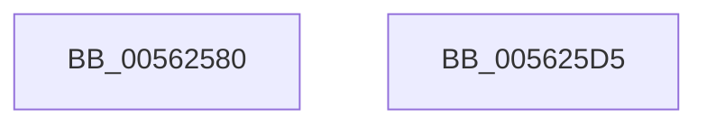

# HalpApicTimerInitialize

- RVA: `0x00562580`–`0x005625D6` (길이 `86` bytes)
- VA: `0x0000000140562580`
- 실행 섹션: `.text`
- PDB 이름 있음: `예`; PDB Function 태그: `아니요`
- unwind 정보 RVA: `0x0005CF00`
- 디코드: `22`개 명령, `86/86` bytes 표시
- 미해석 바이트: `0` (있으면 어셈블리에 `.byte`로 보존)

> 이 문서는 커널 이미지의 기계어와 PDB 기호를 분석해 생성했습니다. 4번과 5번은 함수 원형과 자료형을 바이너리 사용 방식에서 추정한 C 해석이며 원본 소스 복구 결과는 아닙니다.

## 1. Dependencies

- 직접 호출 지점: **3**; 고유 호출 대상: **1**
- 직접 호출자로 확인된 함수: **1**
- RIP 상대 이미지 참조: **1**

### Outgoing calls
- `0x00562598` → [guard_dispatch_icall](../6B/guard_dispatch_icall_function_006BAAD0.md) (function, `0x006BAAD0`)
- `0x005625B5` → [guard_dispatch_icall](../6B/guard_dispatch_icall_function_006BAAD0.md) (function, `0x006BAAD0`)
- `0x005625C8` → [guard_dispatch_icall](../6B/guard_dispatch_icall_function_006BAAD0.md) (function, `0x006BAAD0`)

### Direct callers
- [HalpApicTimerStop](HalpApicTimerStop_function_00562700.md) at `0x00562704`

### Static image references
- `0x0056258C` → RVA `0x00E10430` (`.data`; read)

## 2. Other-region calls and transfers

- 다른 실행 섹션으로 향하는 call: **0**
- 별도 외부 분기/꼬리 이동을 확인하지 못했습니다.

## 3. Assembly (complete function range)

```asm
00562580  40 53                           push rbx
00562582  48 83 EC 20                     sub rsp, 0x20
00562586  8B 51 04                        mov edx, dword ptr [rcx + 4]
00562589  48 8B D9                        mov rbx, rcx
0056258C  48 8B 05 9D DE 8A 00            mov rax, qword ptr [rip + 0x8ade9d]
00562593  B9 E0 03 00 00                  mov ecx, 0x3e0
00562598  E8 33 85 15 00                  call 0x1406baad0
0056259D  0F B6 1B                        movzx ebx, byte ptr [rbx]
005625A0  83 CA FF                        or edx, 0xffffffff
005625A3  48 8B 05 86 DE 8A 00            mov rax, qword ptr [rip + 0x8ade86]
005625AA  B9 80 03 00 00                  mov ecx, 0x380
005625AF  81 CB 00 00 03 00               or ebx, 0x30000
005625B5  E8 16 85 15 00                  call 0x1406baad0
005625BA  48 8B 05 6F DE 8A 00            mov rax, qword ptr [rip + 0x8ade6f]
005625C1  8B D3                           mov edx, ebx
005625C3  B9 20 03 00 00                  mov ecx, 0x320
005625C8  E8 03 85 15 00                  call 0x1406baad0
005625CD  33 C0                           xor eax, eax
005625CF  48 83 C4 20                     add rsp, 0x20
005625D3  5B                              pop rbx
005625D4  C3                              ret
005625D5  CC                              int3
```

## 4. C-style interpretation (structured pseudocode)

```c
__int64 __fastcall HalpApicTimerInitialize(__int64 a1)
{
    __int64 result;
    __int64 v_rbx;
    __int64 v_rsp;

    v_rsp = (v_rsp) - (32);
    result = guard_dispatch_icall(992, (unsigned int)(*(unsigned int *)(a1 + 4)), a3, a4);
    a2 = (unsigned int)(((unsigned int)(*(unsigned int *)(a1 + 4))) | (0xFFFFFFFFULL));
    v_rbx = (unsigned int)((*(unsigned __int8 *)(a1)) | (0x30000ULL));
    result = guard_dispatch_icall(896, a2, a3, a4);
    result = guard_dispatch_icall(800, (unsigned int)((unsigned int)(v_rbx)), a3, a4);
    result = 0;
    v_rsp = (v_rsp) + (32);
    return result;
}
```

## 5. (Beta) C Style

```c
int64_t HalpApicTimerInitialize(void *Arg1)
{
    uint8_t *arg1 = (uint8_t *)Arg1;

    int64_t result;
    int64_t local_rbx;
    int64_t local_rsp;

    local_rsp = (local_rsp) - (32);
    result = guard_dispatch_icall(992, (uint32_t)(*(uint32_t *)(arg1 + 0x4)), a3, a4);
    a2 = (uint32_t)(((uint32_t)(*(uint32_t *)(arg1 + 0x4))) | (0xFFFFFFFFULL));
    local_rbx = (uint32_t)((*(uint8_t *)(arg1)) | (0x30000ULL));
    result = guard_dispatch_icall(896, a2, a3, a4);
    result = guard_dispatch_icall(800, (uint32_t)((uint32_t)(local_rbx)), a3, a4);
    result = 0;
    local_rsp = (local_rsp) + (32);
    return result;
}
```

### 관측된 메모리 오프셋

구조체 형식이 확인되지 않은 접근은 인자 기준의 오프셋으로만 기록했습니다.

| 기준 인자 | 오프셋 표현 | 폭 (bit) | 접근 |
|---|---:|---:|---|
| `Arg1` | `+ 0x0` | `8` | `R` |
| `Arg1` | `+ 0x4` | `32` | `R` |

## 6. Execution-region graph

[열기: 2D/3D 그래프와 함수 탐색 컨트롤 패널](../../../control-panel.html?section=text&rva=0x00562580&view=graph)

- 2D 그래프는 위에서 아래로 흐르고, 3D 그래프는 빈 공간을 드래그해 회전합니다. Shift+드래그는 이동, 휠은 확대·축소, 함수 노드 선택은 대상 보고서 이동입니다.

### Static fallback


