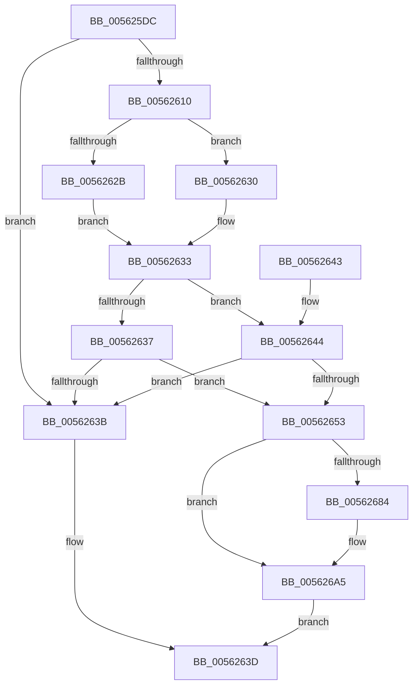

# HalpApicTimerIsInvariant

- RVA: `0x005625DC`–`0x005626AF` (길이 `211` bytes)
- VA: `0x00000001405625DC`
- 실행 섹션: `.text`
- PDB 이름 있음: `예`; PDB Function 태그: `아니요`
- unwind 정보 RVA: `0x000C4B08`
- 디코드: `60`개 명령, `211/211` bytes 표시
- 미해석 바이트: `0` (있으면 어셈블리에 `.byte`로 보존)

> 이 문서는 커널 이미지의 기계어와 PDB 기호를 분석해 생성했습니다. 4번과 5번은 함수 원형과 자료형을 바이너리 사용 방식에서 추정한 C 해석이며 원본 소스 복구 결과는 아닙니다.

## 1. Dependencies

- 직접 호출 지점: **4**; 고유 호출 대상: **2**
- 직접 호출자로 확인된 함수: **1**
- RIP 상대 이미지 참조: **2**

### Outgoing calls
- `0x00562607` → [HalSocRequestApi](../4B/HalSocRequestApi_function_004B848C.md) (function, `0x004B848C`)
- `0x00562622` → [guard_dispatch_icall](../6B/guard_dispatch_icall_function_006BAAD0.md) (function, `0x006BAAD0`)
- `0x00562675` → [guard_dispatch_icall](../6B/guard_dispatch_icall_function_006BAAD0.md) (function, `0x006BAAD0`)
- `0x005626A0` → [guard_dispatch_icall](../6B/guard_dispatch_icall_function_006BAAD0.md) (function, `0x006BAAD0`)

### Direct callers
- [HalpApicTimerDiscover](HalpApicTimerDiscover_function_005623D0.md) at `0x0056247B`

### Static image references
- `0x005625E9` → RVA `0x00E11768` (`.data`; read)
- `0x00562653` → RVA `0x00E11770` (`.data`; read)

## 2. Other-region calls and transfers

- 다른 실행 섹션으로 향하는 call: **0**
- 별도 외부 분기/꼬리 이동을 확인하지 못했습니다.

## 3. Assembly (complete function range)

```asm
005625DC  40 55                           push rbp
005625DE  48 8B EC                        mov rbp, rsp
005625E1  48 83 EC 30                     sub rsp, 0x30
005625E5  83 65 18 00                     and dword ptr [rbp + 0x18], 0
005625E9  48 8D 05 78 F1 8A 00            lea rax, [rip + 0x8af178]
005625F0  83 65 20 00                     and dword ptr [rbp + 0x20], 0
005625F4  33 D2                           xor edx, edx
005625F6  C6 45 10 00                     mov byte ptr [rbp + 0x10], 0
005625FA  48 89 44 24 20                  mov qword ptr [rsp + 0x20], rax
005625FF  44 8D 4A 10                     lea r9d, [rdx + 0x10]
00562603  44 8D 42 02                     lea r8d, [rdx + 2]
00562607  E8 80 5E F5 FF                  call 0x1404b848c
0056260C  85 C0                           test eax, eax
0056260E  78 2B                           js 0x14056263b
00562610  48 8B 05 51 F1 8A 00            mov rax, qword ptr [rip + 0x8af151]
00562617  4C 8D 4D 10                     lea r9, [rbp + 0x10]
0056261B  45 33 C0                        xor r8d, r8d
0056261E  33 D2                           xor edx, edx
00562620  33 C9                           xor ecx, ecx
00562622  E8 A9 84 15 00                  call 0x1406baad0
00562627  84 C0                           test al, al
00562629  75 05                           jne 0x140562630
0056262B  88 45 10                        mov byte ptr [rbp + 0x10], al
0056262E  EB 03                           jmp 0x140562633
00562630  8A 45 10                        mov al, byte ptr [rbp + 0x10]
00562633  3C 01                           cmp al, 1
00562635  74 0D                           je 0x140562644
00562637  3C 02                           cmp al, 2
00562639  74 18                           je 0x140562653
0056263B  32 C0                           xor al, al
0056263D  48 83 C4 30                     add rsp, 0x30
00562641  5D                              pop rbp
00562642  C3                              ret
00562643  CC                              int3
00562644  65 48 8B 04 25 20 00 00 00      mov rax, qword ptr gs:[0x20]
0056264D  80 78 40 15                     cmp byte ptr [rax + 0x40], 0x15
00562651  72 E8                           jb 0x14056263b
00562653  48 8B 05 16 F1 8A 00            mov rax, qword ptr [rip + 0x8af116]
0056265A  48 8D 4D 18                     lea rcx, [rbp + 0x18]
0056265E  83 65 28 00                     and dword ptr [rbp + 0x28], 0
00562662  4C 8D 4D 18                     lea r9, [rbp + 0x18]
00562666  48 89 4C 24 20                  mov qword ptr [rsp + 0x20], rcx
0056266B  4C 8D 45 18                     lea r8, [rbp + 0x18]
0056266F  33 C9                           xor ecx, ecx
00562671  48 8D 55 20                     lea rdx, [rbp + 0x20]
00562675  E8 56 84 15 00                  call 0x1406baad0
0056267A  B9 06 00 00 00                  mov ecx, 6
0056267F  39 4D 20                        cmp dword ptr [rbp + 0x20], ecx
00562682  72 21                           jb 0x1405626a5
00562684  48 8B 05 E5 F0 8A 00            mov rax, qword ptr [rip + 0x8af0e5]
0056268B  48 8D 55 18                     lea rdx, [rbp + 0x18]
0056268F  48 89 54 24 20                  mov qword ptr [rsp + 0x20], rdx
00562694  4C 8D 4D 18                     lea r9, [rbp + 0x18]
00562698  48 8D 55 28                     lea rdx, [rbp + 0x28]
0056269C  4C 8D 45 18                     lea r8, [rbp + 0x18]
005626A0  E8 2B 84 15 00                  call 0x1406baad0
005626A5  8B 45 28                        mov eax, dword ptr [rbp + 0x28]
005626A8  C1 E8 02                        shr eax, 2
005626AB  24 01                           and al, 1
005626AD  EB 8E                           jmp 0x14056263d
```

## 4. C-style interpretation (structured pseudocode)

```c
__int64 __fastcall HalpApicTimerIsInvariant(int a1, int a2)
{
    __int64 result;
    __int64 v_rsp;
    unsigned __int64 v_stack_m18;
    unsigned int v_stack_p10;
    unsigned int v_stack_p18;
    unsigned int v_stack_p20;
    unsigned __int8 v_stack_p8;

    v_rsp = (v_rsp) - (48);
    a2 = 0;
    v_stack_p8 = 0;
    v_stack_m18 = v_rip + 9105784;
    result = HalSocRequestApi(a1, a2, a2 + 2, a2 + 16);
    if (sign_flag) goto loc_0056263B;
    a3 = 0;
    a2 = 0;
    a1 = 0;
    result = guard_dispatch_icall(a1, a2, a3, v_stack_p8);
    if ((unsigned __int8)(result) != 0) goto loc_00562630;
    v_stack_p8 = (unsigned __int8)(result);
    goto loc_00562633;
loc_00562630:
loc_00562633:
    if (((unsigned __int8)(v_stack_p8)) == 1) goto loc_00562644;
    if (((unsigned __int8)(v_stack_p8)) == 2) goto loc_00562653;
loc_0056263B:
    result = 0;
loc_0056263D:
    v_rsp = (v_rsp) + (48);
    return result;
loc_00562644:
    if ((*(unsigned __int8 *)(*(unsigned __int64 *)(gs_base + (0 + 32)) + 64)) < 21) goto loc_0056263B;
loc_00562653:
    v_stack_p20 = v_stack_p10;
    a1 = 0;
    result = guard_dispatch_icall(a1, v_stack_p18, v_stack_p10, v_stack_p10);
    if (v_stack_p18 >= 6) {
        result = *(unsigned __int64 *)(v_rip + 9105637);
        a2 = v_stack_p10;
        v_stack_p20 = a2;
        a4 = v_stack_p10;
        a2 = v_stack_p20;
        a3 = v_stack_p10;
        result = guard_dispatch_icall(6, a2, a3, a4);
    }
    result = (unsigned int)(((unsigned int)(v_stack_p20)) >> (2));
    result = (unsigned __int8)((result) & (1));
    goto loc_0056263D;
}
```

## 5. (Beta) C Style

```c
int64_t HalpApicTimerIsInvariant(int32_t Arg1, int32_t Arg2)
{
    int64_t result;
    int64_t local_rsp;
    uint64_t v_stack_m18;
    uint32_t v_stack_p10;
    uint32_t v_stack_p18;
    uint32_t v_stack_p20;
    uint8_t v_stack_p8;

    local_rsp = (local_rsp) - (48);
    Arg2 = 0;
    v_stack_p8 = 0;
    v_stack_m18 = v_rip + 9105784;
    result = HalSocRequestApi(Arg1, Arg2, Arg2 + 2, Arg2 + 16);
    if (sign_flag) goto loc_0056263B;
    a3 = 0;
    Arg2 = 0;
    Arg1 = 0;
    result = guard_dispatch_icall(Arg1, Arg2, a3, v_stack_p8);
    if ((uint8_t)(result) != 0) goto loc_00562630;
    v_stack_p8 = (uint8_t)(result);
    goto loc_00562633;
loc_00562630:
loc_00562633:
    if (((uint8_t)(v_stack_p8)) == 1) goto loc_00562644;
    if (((uint8_t)(v_stack_p8)) == 2) goto loc_00562653;
loc_0056263B:
    result = 0;
loc_0056263D:
    local_rsp = (local_rsp) + (48);
    return result;
loc_00562644:
    if ((*(uint8_t *)(*(uint64_t *)(gs_base + (0 + 0x20)) + 0x40)) < 21) goto loc_0056263B;
loc_00562653:
    v_stack_p20 = v_stack_p10;
    Arg1 = 0;
    result = guard_dispatch_icall(Arg1, v_stack_p18, v_stack_p10, v_stack_p10);
    if (v_stack_p18 >= 6) {
        result = *(uint64_t *)(v_rip + 0x8AF0E5);
        Arg2 = v_stack_p10;
        v_stack_p20 = Arg2;
        a4 = v_stack_p10;
        Arg2 = v_stack_p20;
        a3 = v_stack_p10;
        result = guard_dispatch_icall(6, Arg2, a3, a4);
    }
    result = (uint32_t)(((uint32_t)(v_stack_p20)) >> (2));
    result = (uint8_t)((result) & (1));
    goto loc_0056263D;
}
```

## 6. Execution-region graph

[열기: 2D/3D 그래프와 함수 탐색 컨트롤 패널](../../../control-panel.html?section=text&rva=0x005625DC&view=graph)

- 2D 그래프는 위에서 아래로 흐르고, 3D 그래프는 빈 공간을 드래그해 회전합니다. Shift+드래그는 이동, 휠은 확대·축소, 함수 노드 선택은 대상 보고서 이동입니다.

### Static fallback


