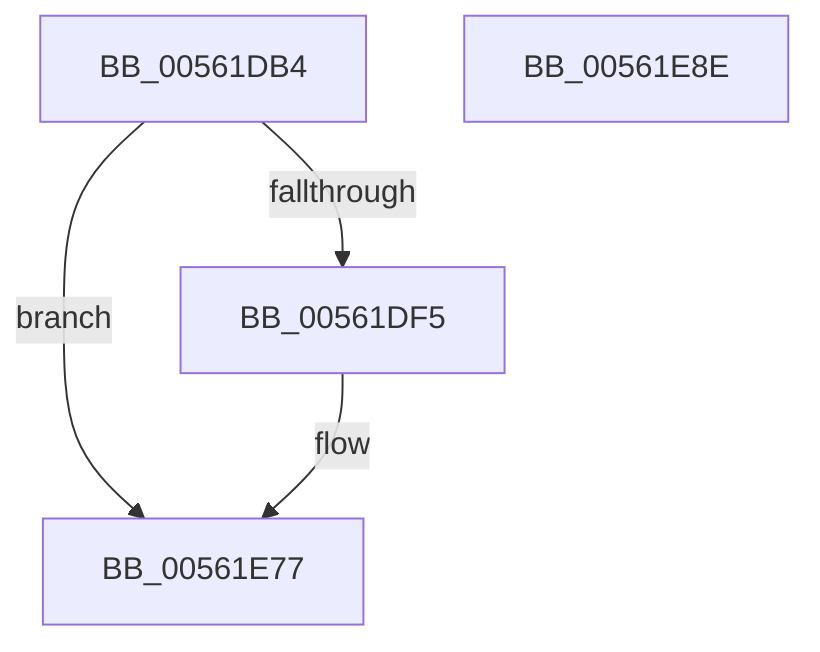

# HalpArtDiscover

- RVA: `0x00561DB4`–`0x00561E8F` (길이 `219` bytes)
- VA: `0x0000000140561DB4`
- 실행 섹션: `.text`
- PDB 이름 있음: `예`; PDB Function 태그: `아니요`
- unwind 정보 RVA: `0x000B43CC`
- 디코드: `48`개 명령, `219/219` bytes 표시
- 미해석 바이트: `0` (있으면 어셈블리에 `.byte`로 보존)

> 이 문서는 커널 이미지의 기계어와 PDB 기호를 분석해 생성했습니다. 4번과 5번은 함수 원형과 자료형을 바이너리 사용 방식에서 추정한 C 해석이며 원본 소스 복구 결과는 아닙니다.

## 1. Dependencies

- 직접 호출 지점: **5**; 고유 호출 대상: **5**
- 직접 호출자로 확인된 함수: **1**
- RIP 상대 이미지 참조: **5**

### Outgoing calls
- `0x00561DE8` → [HalpArtAvailable](../4A/HalpArtAvailable_function_004AF870.md) (function, `0x004AF870`)
- `0x00561E01` → [memset](../6C/memset_function_006C6C40.md) (function, `0x006C6C40`)
- `0x00561E5E` → [RtlInitUnicodeString](../42/RtlInitUnicodeString_function_0042A780.md) (function, `0x0042A780`)
- `0x00561E6B` → [HalpTimerRegister](HalpTimerRegister_function_005616BC.md) (function, `0x005616BC`)
- `0x00561E80` → [_security_check_cookie](../6A/_security_check_cookie_function_006AC640.md) (function, `0x006AC640`)

### Direct callers
- [HalpTimerRegisterBuiltinPluginsCommon](../54/HalpTimerRegisterBuiltinPluginsCommon_function_0054A014.md) at `0x0054A047`

### Static image references
- `0x00561DC2` → RVA `0x00E0A740` (`.data`; read)
- `0x00561E13` → RVA `0x00025E80` (`.rdata`; read)
- `0x00561E1A` → RVA `0x004AF7E0` (`HalpArtInitialize`; read)
- `0x00561E30` → RVA `0x004919B0` (`HalpArtQueryCounter`; read)
- `0x00561E70` → RVA `0x00FC40E8` (`.data`; write)

## 2. Other-region calls and transfers

- 다른 실행 섹션으로 향하는 call: **0**
- 별도 외부 분기/꼬리 이동을 확인하지 못했습니다.

## 3. Assembly (complete function range)

```asm
00561DB4  40 55                           push rbp
00561DB6  48 8D 6C 24 A9                  lea rbp, [rsp - 0x57]
00561DBB  48 81 EC E0 00 00 00            sub rsp, 0xe0
00561DC2  48 8B 05 77 89 8A 00            mov rax, qword ptr [rip + 0x8a8977]
00561DC9  48 33 C4                        xor rax, rsp
00561DCC  48 89 45 47                     mov qword ptr [rbp + 0x47], rax
00561DD0  33 C0                           xor eax, eax
00561DD2  48 8D 55 3F                     lea rdx, [rbp + 0x3f]
00561DD6  0F 57 C0                        xorps xmm0, xmm0
00561DD9  48 89 45 37                     mov qword ptr [rbp + 0x37], rax
00561DDD  48 8D 4D 37                     lea rcx, [rbp + 0x37]
00561DE1  89 45 3F                        mov dword ptr [rbp + 0x3f], eax
00561DE4  0F 11 45 97                     movups xmmword ptr [rbp - 0x69], xmm0
00561DE8  E8 83 DA F4 FF                  call 0x1404af870
00561DED  84 C0                           test al, al
00561DEF  0F 84 82 00 00 00               je 0x140561e77
00561DF5  33 D2                           xor edx, edx
00561DF7  48 8D 4D A7                     lea rcx, [rbp - 0x59]
00561DFB  41 B8 90 00 00 00               mov r8d, 0x90
00561E01  E8 3A 4E 16 00                  call 0x1406c6c40
00561E06  48 83 65 0F 00                  and qword ptr [rbp + 0xf], 0
00561E0B  48 8D 45 37                     lea rax, [rbp + 0x37]
00561E0F  48 89 45 FF                     mov qword ptr [rbp - 1], rax
00561E13  48 8D 15 66 40 AC FF            lea rdx, [rip - 0x53bf9a]
00561E1A  48 8D 05 BF D9 F4 FF            lea rax, [rip - 0xb2641]
00561E21  C7 45 A7 01 00 00 00            mov dword ptr [rbp - 0x59], 1
00561E28  48 89 45 AF                     mov qword ptr [rbp - 0x51], rax
00561E2C  48 8D 4D 97                     lea rcx, [rbp - 0x69]
00561E30  48 8D 05 79 FB F2 FF            lea rax, [rip - 0xd0487]
00561E37  C7 45 AB 90 00 00 00            mov dword ptr [rbp - 0x55], 0x90
00561E3E  48 89 45 B7                     mov qword ptr [rbp - 0x49], rax
00561E42  C7 45 0B 40 00 00 00            mov dword ptr [rbp + 0xb], 0x40
00561E49  C7 45 2F 0F 00 00 00            mov dword ptr [rbp + 0x2f], 0xf
00561E50  C7 45 1B 03 80 10 00            mov dword ptr [rbp + 0x1b], 0x108003
00561E57  C7 45 07 0C 00 00 00            mov dword ptr [rbp + 7], 0xc
00561E5E  E8 1D 89 EC FF                  call 0x14042a780
00561E63  48 8D 55 97                     lea rdx, [rbp - 0x69]
00561E67  48 8D 4D A7                     lea rcx, [rbp - 0x59]
00561E6B  E8 4C F8 FF FF                  call 0x1405616bc
00561E70  C6 05 71 22 A6 00 01            mov byte ptr [rip + 0xa62271], 1
00561E77  33 C0                           xor eax, eax
00561E79  48 8B 4D 47                     mov rcx, qword ptr [rbp + 0x47]
00561E7D  48 33 CC                        xor rcx, rsp
00561E80  E8 BB A7 14 00                  call 0x1406ac640
00561E85  48 81 C4 E0 00 00 00            add rsp, 0xe0
00561E8C  5D                              pop rbp
00561E8D  C3                              ret
00561E8E  CC                              int3
```

## 4. C-style interpretation (structured pseudocode)

```c
__int64 __fastcall HalpArtDiscover(void)
{
    __int64 result;
    __int64 v_rsp;
    unsigned __int64 v_stack_m18;
    unsigned __int64 v_stack_m20;
    unsigned __int64 v_stack_m28;
    unsigned int v_stack_m30;
    unsigned int v_stack_m44;
    unsigned __int64 v_stack_m50;
    unsigned int v_stack_m54;
    unsigned int v_stack_m58;
    unsigned __int64 v_stack_m5F;
    unsigned __int64 v_stack_m60;
    unsigned __int64 v_stack_mA8;
    unsigned __int64 v_stack_mB0;
    unsigned int v_stack_mB4;
    unsigned __int64 v_stack_mB8;
    unsigned __int64 v_stack_mC8;

    v_rsp = (v_rsp) - (224);
    result = (*(unsigned __int64 *)(v_rip + 9079159)) ^ (v_rsp);
    v_stack_m18 = result;
    result = 0;
    v_stack_m28 = 0;
    v_stack_m20 = 0;
    v_stack_mC8 = v_xmm0;
    result = HalpArtAvailable(v_stack_m28, v_stack_m20, a3, a4);
    if ((unsigned __int8)(result) != 0) {
        a2 = 0;
        a1 = v_stack_mB8;
        a3 = 144;
        result = memset(a1, a2, a3, a4);
        result = v_stack_m28;
        v_stack_m60 = result;
        a2 = v_rip - 5488538;
        result = v_rip - 730689;
        v_stack_mB8 = 1;
        v_stack_mB0 = result;
        a1 = v_stack_mC8;
        result = v_rip - 853127;
        v_stack_mB4 = 144;
        v_stack_mA8 = result;
        v_stack_m54 = 64;
        v_stack_m30 = 15;
        v_stack_m44 = 0x108003ULL;
        v_stack_m58 = 12;
        result = RtlInitUnicodeString(a1, a2, a3, a4);
        a2 = v_stack_mC8;
        a1 = v_stack_mB8;
        result = HalpTimerRegister(a1, a2, a3, a4);
        *(unsigned __int8 *)(v_rip + 10887793) = 1;
    }
    result = 0;
    a1 = (v_stack_m18) ^ (v_rsp);
    result = _security_check_cookie(a1, a2, a3, a4);
    v_rsp = (v_rsp) + (224);
    return result;
}
```

## 5. (Beta) C Style

```c
void HalpArtDiscover(void)
{
    int64_t result;
    int64_t local_rsp;
    uint64_t v_stack_m18;
    uint64_t v_stack_m20;
    uint64_t v_stack_m28;
    uint32_t v_stack_m30;
    uint32_t v_stack_m44;
    uint64_t v_stack_m50;
    uint32_t v_stack_m54;
    uint32_t v_stack_m58;
    uint64_t v_stack_m5F;
    uint64_t v_stack_m60;
    uint64_t v_stack_mA8;
    uint64_t v_stack_mB0;
    uint32_t v_stack_mB4;
    uint64_t v_stack_mB8;
    uint64_t v_stack_mC8;

    local_rsp = (local_rsp) - (224);
    result = (*(uint64_t *)(v_rip + 0x8A8977)) ^ (local_rsp);
    v_stack_m18 = result;
    result = 0;
    v_stack_m28 = 0;
    v_stack_m20 = 0;
    v_stack_mC8 = v_xmm0;
    result = HalpArtAvailable(v_stack_m28, v_stack_m20, a3, a4);
    if ((uint8_t)(result) != 0) {
        a2 = 0;
        a1 = v_stack_mB8;
        a3 = 144;
        result = memset(a1, a2, a3, a4);
        result = v_stack_m28;
        v_stack_m60 = result;
        a2 = v_rip - 5488538;
        result = v_rip - 730689;
        v_stack_mB8 = 1;
        v_stack_mB0 = result;
        a1 = v_stack_mC8;
        result = v_rip - 853127;
        v_stack_mB4 = 144;
        v_stack_mA8 = result;
        v_stack_m54 = 64;
        v_stack_m30 = 15;
        v_stack_m44 = 0x108003ULL;
        v_stack_m58 = 12;
        result = RtlInitUnicodeString(a1, a2, a3, a4);
        a2 = v_stack_mC8;
        a1 = v_stack_mB8;
        result = HalpTimerRegister(a1, a2, a3, a4);
        *(uint8_t *)(v_rip + 0xA62271) = 1;
    }
    result = 0;
    a1 = (v_stack_m18) ^ (local_rsp);
    result = _security_check_cookie(a1, a2, a3, a4);
    local_rsp = (local_rsp) + (224);
    return result;
}
```

## 6. Execution-region graph

[열기: 2D/3D 그래프와 함수 탐색 컨트롤 패널](../../../control-panel.html?section=text&rva=0x00561DB4&view=graph)

- 2D 그래프는 위에서 아래로 흐르고, 3D 그래프는 빈 공간을 드래그해 회전합니다. Shift+드래그는 이동, 휠은 확대·축소, 함수 노드 선택은 대상 보고서 이동입니다.

### Static fallback


