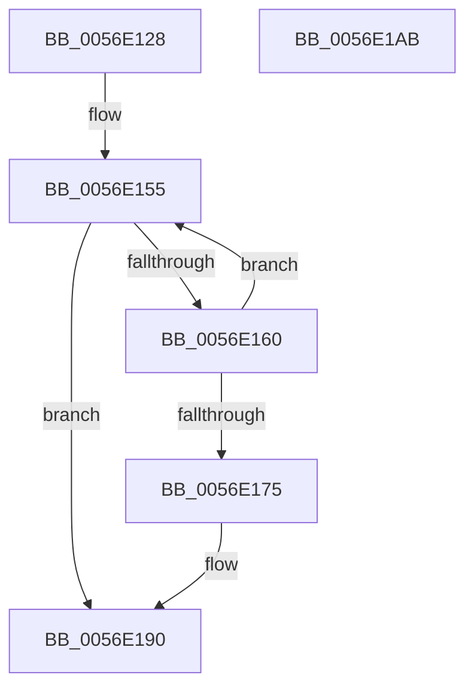

# HalpBlkPoBusyWait

- RVA: `0x0056E128`–`0x0056E1AC` (길이 `132` bytes)
- VA: `0x000000014056E128`
- 실행 섹션: `.text`
- PDB 이름 있음: `예`; PDB Function 태그: `아니요`
- unwind 정보 RVA: `0x0005D7BC`
- 디코드: `37`개 명령, `132/132` bytes 표시
- 미해석 바이트: `0` (있으면 어셈블리에 `.byte`로 보존)

> 이 문서는 커널 이미지의 기계어와 PDB 기호를 분석해 생성했습니다. 4번과 5번은 함수 원형과 자료형을 바이너리 사용 방식에서 추정한 C 해석이며 원본 소스 복구 결과는 아닙니다.

## 1. Dependencies

- 직접 호출 지점: **2**; 고유 호출 대상: **2**
- 직접 호출자로 확인된 함수: **5**
- RIP 상대 이미지 참조: **0**

### Outgoing calls
- `0x0056E162` → [HalpBlkWdFatalExceptionCheck](HalpBlkWdFatalExceptionCheck_function_0056E784.md) (function, `0x0056E784`)
- `0x0056E18A` → [KeBugCheckEx](../4F/KeBugCheckEx_function_004FD660.md) (function, `0x004FD660`)

### Direct callers
- [HalpBlkPoReadPerfIoPort](HalpBlkPoReadPerfIoPort_function_0056E2E0.md) at `0x0056E331`
- [HalpBlkPoReadPerfIoPort](HalpBlkPoReadPerfIoPort_function_0056E2E0.md) at `0x0056E3A4`
- [HalpBlkPoReadPerfMsr](HalpBlkPoReadPerfMsr_function_0056E3F0.md) at `0x0056E440`
- [HalpBlkPoReadPerfMsr](HalpBlkPoReadPerfMsr_function_0056E3F0.md) at `0x0056E4A3`
- [HalpBlkPoRegisterIdleState](HalpBlkPoRegisterIdleState_function_0056E4F0.md) at `0x0056E537`
- [HalpBlkPoWritePerfIoPort](HalpBlkPoWritePerfIoPort_function_0056E5C0.md) at `0x0056E612`
- [HalpBlkPoWritePerfMsr](HalpBlkPoWritePerfMsr_function_0056E6B0.md) at `0x0056E700`

### Static image references
- 디코드된 RIP-relative 메모리 참조가 없습니다.

## 2. Other-region calls and transfers

- 다른 실행 섹션으로 향하는 call: **0**
- 별도 외부 분기/꼬리 이동을 확인하지 못했습니다.

## 3. Assembly (complete function range)

```asm
0056E128  48 8B C4                        mov rax, rsp
0056E12B  48 89 58 08                     mov qword ptr [rax + 8], rbx
0056E12F  48 89 68 10                     mov qword ptr [rax + 0x10], rbp
0056E133  48 89 70 18                     mov qword ptr [rax + 0x18], rsi
0056E137  48 89 78 20                     mov qword ptr [rax + 0x20], rdi
0056E13B  41 56                           push r14
0056E13D  48 83 EC 30                     sub rsp, 0x30
0056E141  49 BE 08 00 00 00 80 F7 FF FF   movabs r14, 0xfffff78000000008
0056E14B  8B FA                           mov edi, edx
0056E14D  49 8B D8                        mov rbx, r8
0056E150  8B F1                           mov esi, ecx
0056E152  49 8B 2E                        mov rbp, qword ptr [r14]
0056E155  33 C9                           xor ecx, ecx
0056E157  33 C0                           xor eax, eax
0056E159  F0 0F B1 4B 08                  lock cmpxchg dword ptr [rbx + 8], ecx
0056E15E  74 30                           je 0x14056e190
0056E160  8B CF                           mov ecx, edi
0056E162  E8 1D 06 00 00                  call 0x14056e784
0056E167  49 8B 06                        mov rax, qword ptr [r14]
0056E16A  48 2B C5                        sub rax, rbp
0056E16D  48 3D 80 96 98 00               cmp rax, 0x989680
0056E173  72 E0                           jb 0x14056e155
0056E175  4C 8B CF                        mov r9, rdi
0056E178  48 89 5C 24 20                  mov qword ptr [rsp + 0x20], rbx
0056E17D  4C 8B C6                        mov r8, rsi
0056E180  BA 06 00 00 00                  mov edx, 6
0056E185  B9 DA 01 00 00                  mov ecx, 0x1da
0056E18A  E8 D1 F4 F8 FF                  call 0x1404fd660
0056E18F  CC                              int3
0056E190  48 8B 5C 24 40                  mov rbx, qword ptr [rsp + 0x40]
0056E195  48 8B 6C 24 48                  mov rbp, qword ptr [rsp + 0x48]
0056E19A  48 8B 74 24 50                  mov rsi, qword ptr [rsp + 0x50]
0056E19F  48 8B 7C 24 58                  mov rdi, qword ptr [rsp + 0x58]
0056E1A4  48 83 C4 30                     add rsp, 0x30
0056E1A8  41 5E                           pop r14
0056E1AA  C3                              ret
0056E1AB  CC                              int3
```

## 4. C-style interpretation (structured pseudocode)

```c
__int64 __fastcall HalpBlkPoBusyWait(int a1, int a2, __int64 a3)
{
    __int64 result;
    __int64 v_rsp;
    unsigned __int64 v_stack_m18;
    unsigned __int64 v_stack_p10;
    unsigned __int64 v_stack_p18;
    unsigned __int64 v_stack_p20;
    unsigned __int64 v_stack_p8;

    *(unsigned __int64 *)(v_rsp + 8) = v_rbx;
    *(unsigned __int64 *)(v_rsp + 16) = v_rbp;
    *(unsigned __int64 *)(v_rsp + 24) = v_rsi;
    *(unsigned __int64 *)(v_rsp + 32) = v_rdi;
    v_rsp = (v_rsp) - (48);
loc_0056E155:
    a1 = 0;
    result = 0;
    if (condition_is_equal) goto loc_0056E190;
    result = HalpBlkWdFatalExceptionCheck((unsigned int)((unsigned int)((unsigned int)(a2))), a2, a3, a4);
    result = (*(unsigned __int64 *)(v_r14)) - (*(unsigned __int64 *)(v_r14));
    if (result < 0x989680ULL) goto loc_0056E155;
    v_stack_m18 = a3;
    result = KeBugCheckEx(474, 6, (unsigned int)(a1), (unsigned int)(a2));
loc_0056E190:
    v_rsp = (v_rsp) + (48);
    return result;
}
```

## 5. (Beta) C Style

```c
int64_t HalpBlkPoBusyWait(int32_t Arg1, int32_t Arg2, void *Arg3)
{
    uint8_t *arg3 = (uint8_t *)Arg3;

    int64_t result;
    int64_t local_rsp;
    uint64_t v_stack_m18;
    uint64_t v_stack_p10;
    uint64_t v_stack_p18;
    uint64_t v_stack_p20;
    uint64_t v_stack_p8;

    *(uint64_t *)(local_rsp + 0x8) = local_rbx;
    *(uint64_t *)(local_rsp + 0x10) = local_rbp;
    *(uint64_t *)(local_rsp + 0x18) = local_rsi;
    *(uint64_t *)(local_rsp + 0x20) = local_rdi;
    local_rsp = (local_rsp) - (48);
loc_0056E155:
    Arg1 = 0;
    result = 0;
    if (condition_is_equal) goto loc_0056E190;
    result = HalpBlkWdFatalExceptionCheck((uint32_t)((uint32_t)((uint32_t)(Arg2))), Arg2, Arg3, a4);
    result = (*(uint64_t *)(local_r14)) - (*(uint64_t *)(local_r14));
    if (result < 0x989680ULL) goto loc_0056E155;
    v_stack_m18 = Arg3;
    result = KeBugCheckEx(474, 6, (uint32_t)(Arg1), (uint32_t)(Arg2));
loc_0056E190:
    local_rsp = (local_rsp) + (48);
    return result;
}
```

### 관측된 메모리 오프셋

구조체 형식이 확인되지 않은 접근은 인자 기준의 오프셋으로만 기록했습니다.

| 기준 인자 | 오프셋 표현 | 폭 (bit) | 접근 |
|---|---:|---:|---|
| `Arg3` | `+ 0x8` | `32` | `R` |

## 6. Execution-region graph

[열기: 2D/3D 그래프와 함수 탐색 컨트롤 패널](../../../control-panel.html?section=text&rva=0x0056E128&view=graph)

- 2D 그래프는 위에서 아래로 흐르고, 3D 그래프는 빈 공간을 드래그해 회전합니다. Shift+드래그는 이동, 휠은 확대·축소, 함수 노드 선택은 대상 보고서 이동입니다.

### Static fallback


