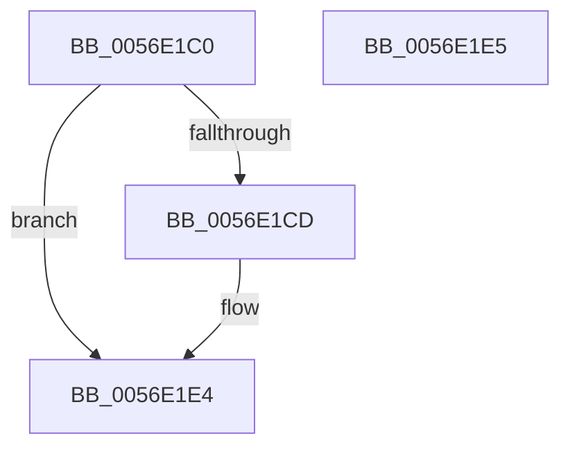

# HalpBlkPoGetApicIdByIndex

- RVA: `0x0056E1C0`–`0x0056E1E6` (길이 `38` bytes)
- VA: `0x000000014056E1C0`
- 실행 섹션: `.text`
- PDB 이름 있음: `예`; PDB Function 태그: `아니요`
- unwind 정보 RVA: `0x000DB714`
- 디코드: `12`개 명령, `38/38` bytes 표시
- 미해석 바이트: `0` (있으면 어셈블리에 `.byte`로 보존)

> 이 문서는 커널 이미지의 기계어와 PDB 기호를 분석해 생성했습니다. 4번과 5번은 함수 원형과 자료형을 바이너리 사용 방식에서 추정한 C 해석이며 원본 소스 복구 결과는 아닙니다.

## 1. Dependencies

- 직접 호출 지점: **0**; 고유 호출 대상: **0**
- 직접 호출자로 확인된 함수: **0**
- RIP 상대 이미지 참조: **2**

### Outgoing calls
- 직접 디코드된 call 명령이 없습니다.

### Direct callers
- 이 함수 시작 RVA로 연결되는 직접 call은 확인되지 않았습니다. 간접 호출은 완전히 역산할 수 없습니다.

### Static image references
- `0x0056E1C0` → RVA `0x00F8FA90` (`.data`; read)
- `0x0056E1D0` → RVA `0x00F90550` (`.data`; read)

## 2. Other-region calls and transfers

- 다른 실행 섹션으로 향하는 call: **0**
- 별도 외부 분기/꼬리 이동을 확인하지 못했습니다.

## 3. Assembly (complete function range)

```asm
0056E1C0  3B 0D CA 18 A2 00               cmp ecx, dword ptr [rip + 0xa218ca]
0056E1C6  B8 25 02 00 C0                  mov eax, 0xc0000225
0056E1CB  73 17                           jae 0x14056e1e4
0056E1CD  0F AE E8                        lfence
0056E1D0  48 8B 05 79 23 A2 00            mov rax, qword ptr [rip + 0xa22379]
0056E1D7  8B C9                           mov ecx, ecx
0056E1D9  48 8B 0C C8                     mov rcx, qword ptr [rax + rcx*8]
0056E1DD  8B 41 0C                        mov eax, dword ptr [rcx + 0xc]
0056E1E0  89 02                           mov dword ptr [rdx], eax
0056E1E2  33 C0                           xor eax, eax
0056E1E4  C3                              ret
0056E1E5  CC                              int3
```

## 4. C-style interpretation (structured pseudocode)

```c
__int64 __fastcall HalpBlkPoGetApicIdByIndex(int a1, __int64 a2)
{
    __int64 result;

    result = (unsigned int)(0xC0000225ULL);
    if (a1 < (*(unsigned int *)(v_rip + 10623178))) {
        result = *(unsigned __int64 *)(v_rip + 10625913);
        a1 = a1;
        a1 = *(unsigned __int64 *)(result + a1 * 8);
        result = *(unsigned int *)(a1 + 12);
        *(unsigned int *)(a2) = (unsigned int)(result);
        result = 0;
    }
    return result;
}
```

## 5. (Beta) C Style

```c
int64_t HalpBlkPoGetApicIdByIndex(int32_t Arg1, void *Arg2)
{
    uint8_t *arg2 = (uint8_t *)Arg2;

    int64_t result;

    result = (uint32_t)(0xC0000225ULL);
    if (Arg1 < (*(uint32_t *)(v_rip + 0xA218CA))) {
        result = *(uint64_t *)(v_rip + 0xA22379);
        Arg1 = Arg1;
        Arg1 = *(uint64_t *)(result + Arg1 * 8);
        result = *(uint32_t *)(Arg1 + 0xC);
        *(uint32_t *)(arg2) = (uint32_t)(result);
        result = 0;
    }
    return result;
}
```

### 관측된 메모리 오프셋

구조체 형식이 확인되지 않은 접근은 인자 기준의 오프셋으로만 기록했습니다.

| 기준 인자 | 오프셋 표현 | 폭 (bit) | 접근 |
|---|---:|---:|---|
| `Arg2` | `+ 0x0` | `32` | `W` |

## 6. Execution-region graph

[열기: 2D/3D 그래프와 함수 탐색 컨트롤 패널](../../../control-panel.html?section=text&rva=0x0056E1C0&view=graph)

- 2D 그래프는 위에서 아래로 흐르고, 3D 그래프는 빈 공간을 드래그해 회전합니다. Shift+드래그는 이동, 휠은 확대·축소, 함수 노드 선택은 대상 보고서 이동입니다.

### Static fallback


