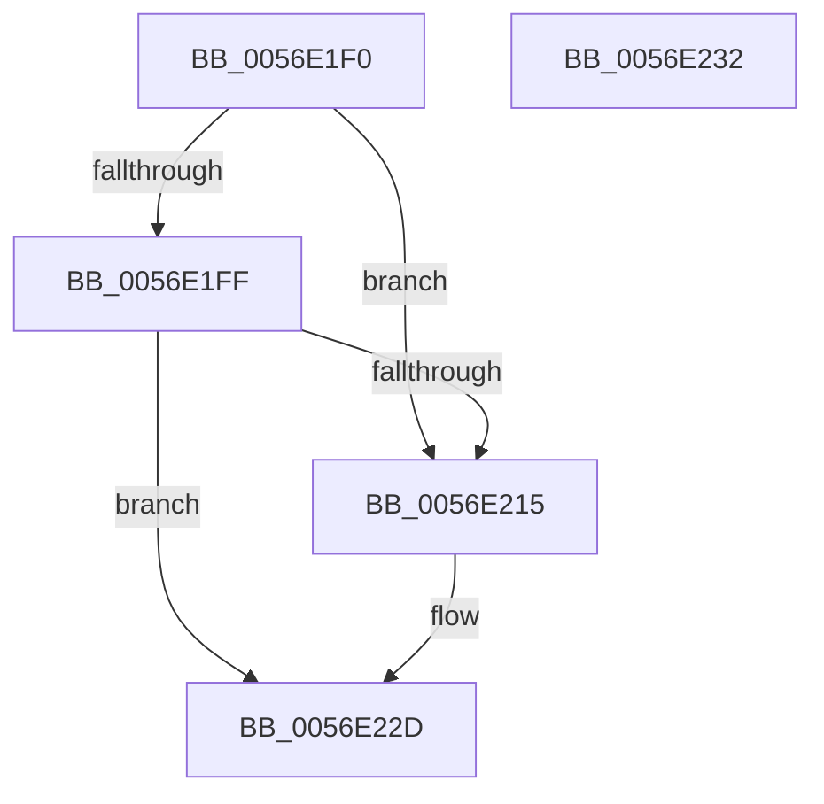

# HalpBlkPoGetPackageId

- RVA: `0x0056E1F0`–`0x0056E233` (길이 `67` bytes)
- VA: `0x000000014056E1F0`
- 실행 섹션: `.text`
- PDB 이름 있음: `예`; PDB Function 태그: `아니요`
- unwind 정보 RVA: `0x0005D2F4`
- 디코드: `19`개 명령, `67/67` bytes 표시
- 미해석 바이트: `0` (있으면 어셈블리에 `.byte`로 보존)

> 이 문서는 커널 이미지의 기계어와 PDB 기호를 분석해 생성했습니다. 4번과 5번은 함수 원형과 자료형을 바이너리 사용 방식에서 추정한 C 해석이며 원본 소스 복구 결과는 아닙니다.

## 1. Dependencies

- 직접 호출 지점: **1**; 고유 호출 대상: **1**
- 직접 호출자로 확인된 함수: **0**
- RIP 상대 이미지 참조: **2**

### Outgoing calls
- `0x0056E227` → [KeBugCheckEx](../4F/KeBugCheckEx_function_004FD660.md) (function, `0x004FD660`)

### Direct callers
- 이 함수 시작 RVA로 연결되는 직접 call은 확인되지 않았습니다. 간접 호출은 완전히 역산할 수 없습니다.

### Static image references
- `0x0056E1F4` → RVA `0x00F8FA90` (`.data`; read)
- `0x0056E202` → RVA `0x00F90550` (`.data`; read)

## 2. Other-region calls and transfers

- 다른 실행 섹션으로 향하는 call: **0**
- 별도 외부 분기/꼬리 이동을 확인하지 못했습니다.

## 3. Assembly (complete function range)

```asm
0056E1F0  48 83 EC 38                     sub rsp, 0x38
0056E1F4  3B 0D 96 18 A2 00               cmp ecx, dword ptr [rip + 0xa21896]
0056E1FA  44 8B C1                        mov r8d, ecx
0056E1FD  73 16                           jae 0x14056e215
0056E1FF  0F AE E8                        lfence
0056E202  48 8B 05 47 23 A2 00            mov rax, qword ptr [rip + 0xa22347]
0056E209  4A 8B 0C C0                     mov rcx, qword ptr [rax + r8*8]
0056E20D  8B 41 18                        mov eax, dword ptr [rcx + 0x18]
0056E210  83 F8 FF                        cmp eax, -1
0056E213  75 18                           jne 0x14056e22d
0056E215  48 83 64 24 20 00               and qword ptr [rsp + 0x20], 0
0056E21B  45 33 C9                        xor r9d, r9d
0056E21E  B9 DA 01 00 00                  mov ecx, 0x1da
0056E223  41 8D 51 03                     lea edx, [r9 + 3]
0056E227  E8 34 F4 F8 FF                  call 0x1404fd660
0056E22C  CC                              int3
0056E22D  48 83 C4 38                     add rsp, 0x38
0056E231  C3                              ret
0056E232  CC                              int3
```

## 4. C-style interpretation (structured pseudocode)

```c
__int64 __fastcall HalpBlkPoGetPackageId(int a1, __int64 a2, __int64 a3, int a4)
{
    __int64 result;
    __int64 v_rsp;
    unsigned __int64 v_stack_m18;

    v_rsp = (v_rsp) - (56);
    if (a1 >= (*(unsigned int *)(v_rip + 10623126))) goto loc_0056E215;
    result = (unsigned int)(*(unsigned int *)(*(unsigned __int64 *)(*(unsigned __int64 *)(v_rip + 10625863) + (unsigned int)(a1) * 8) + 24));
    if (((unsigned int)((unsigned int)(*(unsigned int *)(*(unsigned __int64 *)(*(unsigned __int64 *)(v_rip + 10625863) + (unsigned int)(a1) * 8) + 24)))) == -1) {
        a4 = 0;
        a1 = 474;
        a2 = a4 + 3;
        result = KeBugCheckEx(a1, a2, (unsigned int)(a1), a4);
    }
    v_rsp = (v_rsp) + (56);
    return result;
}
```

## 5. (Beta) C Style

```c
int64_t HalpBlkPoGetPackageId(int32_t Arg1, int64_t Arg2, int64_t Arg3, int32_t Arg4)
{
    int64_t result;
    int64_t local_rsp;
    uint64_t v_stack_m18;

    local_rsp = (local_rsp) - (56);
    if (Arg1 >= (*(uint32_t *)(v_rip + 0xA21896))) goto loc_0056E215;
    result = (uint32_t)(*(uint32_t *)(*(uint64_t *)(*(uint64_t *)(v_rip + 0xA22347) + (uint32_t)(Arg1) * 8) + 0x18));
    if (((uint32_t)((uint32_t)(*(uint32_t *)(*(uint64_t *)(*(uint64_t *)(v_rip + 0xA22347) + (uint32_t)(Arg1) * 8) + 0x18)))) == -1) {
        Arg4 = 0;
        Arg1 = 474;
        Arg2 = Arg4 + 3;
        result = KeBugCheckEx(Arg1, Arg2, (uint32_t)(Arg1), Arg4);
    }
    local_rsp = (local_rsp) + (56);
    return result;
}
```

## 6. Execution-region graph

[열기: 2D/3D 그래프와 함수 탐색 컨트롤 패널](../../../control-panel.html?section=text&rva=0x0056E1F0&view=graph)

- 2D 그래프는 위에서 아래로 흐르고, 3D 그래프는 빈 공간을 드래그해 회전합니다. Shift+드래그는 이동, 휠은 확대·축소, 함수 노드 선택은 대상 보고서 이동입니다.

### Static fallback


