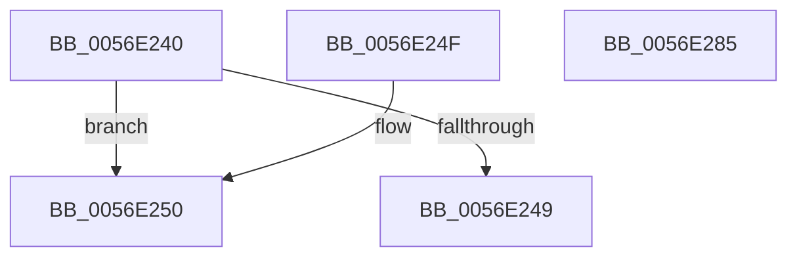

# HalpBlkPoGetPowerInterface

- RVA: `0x0056E240`–`0x0056E286` (길이 `70` bytes)
- VA: `0x000000014056E240`
- 실행 섹션: `.text`
- PDB 이름 있음: `예`; PDB Function 태그: `아니요`
- unwind 정보 RVA: `0x000DB714`
- 디코드: `17`개 명령, `70/70` bytes 표시
- 미해석 바이트: `0` (있으면 어셈블리에 `.byte`로 보존)

> 이 문서는 커널 이미지의 기계어와 PDB 기호를 분석해 생성했습니다. 4번과 5번은 함수 원형과 자료형을 바이너리 사용 방식에서 추정한 C 해석이며 원본 소스 복구 결과는 아닙니다.

## 1. Dependencies

- 직접 호출 지점: **0**; 고유 호출 대상: **0**
- 직접 호출자로 확인된 함수: **0**
- RIP 상대 이미지 참조: **5**

### Outgoing calls
- 직접 디코드된 call 명령이 없습니다.

### Direct callers
- 이 함수 시작 RVA로 연결되는 직접 call은 확인되지 않았습니다. 간접 호출은 완전히 역산할 수 없습니다.

### Static image references
- `0x0056E240` → RVA `0x00F90690` (`.data`; read)
- `0x0056E250` → RVA `0x0056E3F0` (`HalpBlkPoReadPerfMsr`; read)
- `0x0056E261` → RVA `0x0056E6B0` (`HalpBlkPoWritePerfMsr`; read)
- `0x0056E26C` → RVA `0x0056E2E0` (`HalpBlkPoReadPerfIoPort`; read)
- `0x0056E277` → RVA `0x0056E5C0` (`HalpBlkPoWritePerfIoPort`; read)

## 2. Other-region calls and transfers

- 다른 실행 섹션으로 향하는 call: **0**
- 별도 외부 분기/꼬리 이동을 확인하지 못했습니다.

## 3. Assembly (complete function range)

```asm
0056E240  83 3D 49 24 A2 00 00            cmp dword ptr [rip + 0xa22449], 0
0056E247  75 07                           jne 0x14056e250
0056E249  B8 BB 00 00 C0                  mov eax, 0xc00000bb
0056E24E  C3                              ret
0056E24F  CC                              int3
0056E250  48 8D 05 99 01 00 00            lea rax, [rip + 0x199]
0056E257  C7 01 01 00 00 00               mov dword ptr [rcx], 1
0056E25D  48 89 41 08                     mov qword ptr [rcx + 8], rax
0056E261  48 8D 05 48 04 00 00            lea rax, [rip + 0x448]
0056E268  48 89 41 10                     mov qword ptr [rcx + 0x10], rax
0056E26C  48 8D 05 6D 00 00 00            lea rax, [rip + 0x6d]
0056E273  48 89 41 18                     mov qword ptr [rcx + 0x18], rax
0056E277  48 8D 05 42 03 00 00            lea rax, [rip + 0x342]
0056E27E  48 89 41 20                     mov qword ptr [rcx + 0x20], rax
0056E282  33 C0                           xor eax, eax
0056E284  C3                              ret
0056E285  CC                              int3
```

## 4. C-style interpretation (structured pseudocode)

```c
__int64 __fastcall HalpBlkPoGetPowerInterface(__int64 a1)
{
    __int64 result;

    if ((*(unsigned int *)(v_rip + 10626121)) != 0) goto loc_0056E250;
    return (unsigned int)(0xC00000BBULL);
loc_0056E250:
    *(unsigned int *)(a1) = 1;
    *(unsigned __int64 *)(a1 + 8) = v_rip + 409;
    *(unsigned __int64 *)(a1 + 16) = v_rip + 1096;
    *(unsigned __int64 *)(a1 + 24) = v_rip + 109;
    *(unsigned __int64 *)(a1 + 32) = v_rip + 834;
    result = 0;
    return result;
}
```

## 5. (Beta) C Style

```c
int64_t HalpBlkPoGetPowerInterface(void *Arg1)
{
    uint8_t *arg1 = (uint8_t *)Arg1;

    int64_t result;

    if ((*(uint32_t *)(v_rip + 0xA22449)) != 0) goto loc_0056E250;
    return (uint32_t)(0xC00000BBULL);
loc_0056E250:
    *(uint32_t *)(arg1) = 1;
    *(uint64_t *)(arg1 + 0x8) = v_rip + 409;
    *(uint64_t *)(arg1 + 0x10) = v_rip + 1096;
    *(uint64_t *)(arg1 + 0x18) = v_rip + 109;
    *(uint64_t *)(arg1 + 0x20) = v_rip + 834;
    result = 0;
    return result;
}
```

### 관측된 메모리 오프셋

구조체 형식이 확인되지 않은 접근은 인자 기준의 오프셋으로만 기록했습니다.

| 기준 인자 | 오프셋 표현 | 폭 (bit) | 접근 |
|---|---:|---:|---|
| `Arg1` | `+ 0x0` | `32` | `W` |
| `Arg1` | `+ 0x8` | `64` | `W` |
| `Arg1` | `+ 0x10` | `64` | `W` |
| `Arg1` | `+ 0x18` | `64` | `W` |
| `Arg1` | `+ 0x20` | `64` | `W` |

## 6. Execution-region graph

[열기: 2D/3D 그래프와 함수 탐색 컨트롤 패널](../../../control-panel.html?section=text&rva=0x0056E240&view=graph)

- 2D 그래프는 위에서 아래로 흐르고, 3D 그래프는 빈 공간을 드래그해 회전합니다. Shift+드래그는 이동, 휠은 확대·축소, 함수 노드 선택은 대상 보고서 이동입니다.

### Static fallback


