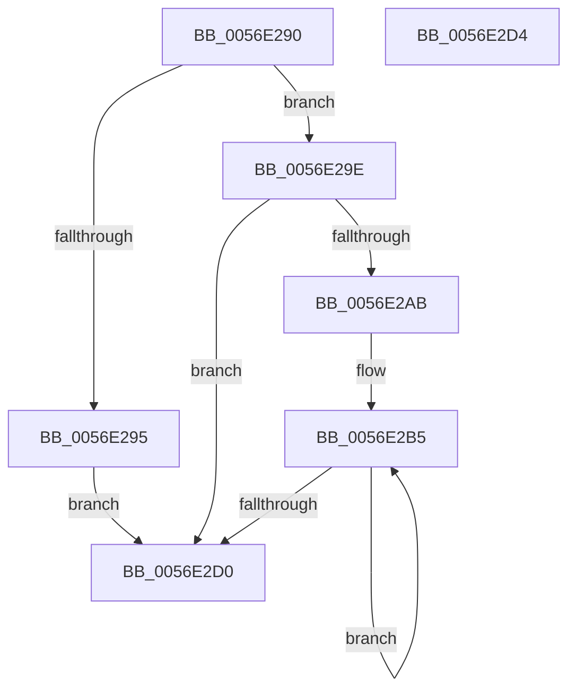

# HalpBlkPoGetProcessorCount

- RVA: `0x0056E290`–`0x0056E2D5` (길이 `69` bytes)
- VA: `0x000000014056E290`
- 실행 섹션: `.text`
- PDB 이름 있음: `예`; PDB Function 태그: `아니요`
- unwind 정보 RVA: `0x000DB714`
- 디코드: `21`개 명령, `69/69` bytes 표시
- 미해석 바이트: `0` (있으면 어셈블리에 `.byte`로 보존)

> 이 문서는 커널 이미지의 기계어와 PDB 기호를 분석해 생성했습니다. 4번과 5번은 함수 원형과 자료형을 바이너리 사용 방식에서 추정한 C 해석이며 원본 소스 복구 결과는 아닙니다.

## 1. Dependencies

- 직접 호출 지점: **0**; 고유 호출 대상: **0**
- 직접 호출자로 확인된 함수: **0**
- RIP 상대 이미지 참조: **2**

### Outgoing calls
- 직접 디코드된 call 명령이 없습니다.

### Direct callers
- 이 함수 시작 RVA로 연결되는 직접 call은 확인되지 않았습니다. 간접 호출은 완전히 역산할 수 없습니다.

### Static image references
- `0x0056E295` → RVA `0x00F8FA90` (`.data`; read)
- `0x0056E2AB` → RVA `0x00F90550` (`.data`; read)

## 2. Other-region calls and transfers

- 다른 실행 섹션으로 향하는 call: **0**
- 별도 외부 분기/꼬리 이동을 확인하지 못했습니다.

## 3. Assembly (complete function range)

```asm
0056E290  83 F9 FF                        cmp ecx, -1
0056E293  75 09                           jne 0x14056e29e
0056E295  44 8B 05 F4 17 A2 00            mov r8d, dword ptr [rip + 0xa217f4]
0056E29C  EB 32                           jmp 0x14056e2d0
0056E29E  8B 05 EC 17 A2 00               mov eax, dword ptr [rip + 0xa217ec]
0056E2A4  45 33 C0                        xor r8d, r8d
0056E2A7  85 C0                           test eax, eax
0056E2A9  74 25                           je 0x14056e2d0
0056E2AB  4C 8B 15 9E 22 A2 00            mov r10, qword ptr [rip + 0xa2229e]
0056E2B2  44 8B D8                        mov r11d, eax
0056E2B5  49 8B 02                        mov rax, qword ptr [r10]
0056E2B8  41 8D 50 01                     lea edx, [r8 + 1]
0056E2BC  4D 8D 52 08                     lea r10, [r10 + 8]
0056E2C0  3B 48 18                        cmp ecx, dword ptr [rax + 0x18]
0056E2C3  41 0F 45 D0                     cmovne edx, r8d
0056E2C7  44 8B C2                        mov r8d, edx
0056E2CA  49 83 EB 01                     sub r11, 1
0056E2CE  75 E5                           jne 0x14056e2b5
0056E2D0  41 8B C0                        mov eax, r8d
0056E2D3  C3                              ret
0056E2D4  CC                              int3
```

## 4. C-style interpretation (structured pseudocode)

```c
__int64 __fastcall HalpBlkPoGetProcessorCount(int a1)
{
    __int64 v_r11;

    if (a1 != -1) goto loc_0056E29E;
    goto loc_0056E2D0;
loc_0056E29E:
    a3 = 0;
    if ((unsigned int)((unsigned int)(*(unsigned int *)(v_rip + 10622956))) == 0) goto loc_0056E2D0;
loc_0056E2B5:
    a2 = a3 + 1;
    if (a1 != (*(unsigned int *)(*(unsigned __int64 *)(*(unsigned __int64 *)(v_rip + 10625694)) + 24))) { a2 = 0; }
    v_r11 = ((unsigned int)((unsigned int)((unsigned int)(*(unsigned int *)(v_rip + 10622956))))) - (1);
    if (condition_is_not_equal) goto loc_0056E2B5;
loc_0056E2D0:
    return (unsigned int)((unsigned int)((unsigned int)((unsigned int)(a2))));
}
```

## 5. (Beta) C Style

```c
int64_t HalpBlkPoGetProcessorCount(int32_t Arg1)
{
    int64_t local_r11;

    if (Arg1 != -1) goto loc_0056E29E;
    goto loc_0056E2D0;
loc_0056E29E:
    a3 = 0;
    if ((uint32_t)((uint32_t)(*(uint32_t *)(v_rip + 0xA217EC))) == 0) goto loc_0056E2D0;
loc_0056E2B5:
    a2 = a3 + 1;
    if (Arg1 != (*(uint32_t *)(*(uint64_t *)(*(uint64_t *)(v_rip + 0xA2229E)) + 0x18))) { a2 = 0; }
    local_r11 = ((uint32_t)((uint32_t)((uint32_t)(*(uint32_t *)(v_rip + 0xA217EC))))) - (1);
    if (condition_is_not_equal) goto loc_0056E2B5;
loc_0056E2D0:
    return (uint32_t)((uint32_t)((uint32_t)((uint32_t)(a2))));
}
```

## 6. Execution-region graph

[열기: 2D/3D 그래프와 함수 탐색 컨트롤 패널](../../../control-panel.html?section=text&rva=0x0056E290&view=graph)

- 2D 그래프는 위에서 아래로 흐르고, 3D 그래프는 빈 공간을 드래그해 회전합니다. Shift+드래그는 이동, 휠은 확대·축소, 함수 노드 선택은 대상 보고서 이동입니다.

### Static fallback


