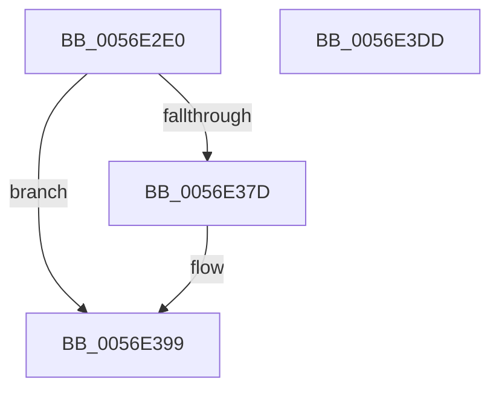

# HalpBlkPoReadPerfIoPort

- RVA: `0x0056E2E0`–`0x0056E3DE` (길이 `254` bytes)
- VA: `0x000000014056E2E0`
- 실행 섹션: `.text`
- PDB 이름 있음: `예`; PDB Function 태그: `아니요`
- unwind 정보 RVA: `0x0008C20C`
- 디코드: `64`개 명령, `254/254` bytes 표시
- 미해석 바이트: `0` (있으면 어셈블리에 `.byte`로 보존)

> 이 문서는 커널 이미지의 기계어와 PDB 기호를 분석해 생성했습니다. 4번과 5번은 함수 원형과 자료형을 바이너리 사용 방식에서 추정한 C 해석이며 원본 소스 복구 결과는 아닙니다.

## 1. Dependencies

- 직접 호출 지점: **6**; 고유 호출 대상: **5**
- 직접 호출자로 확인된 함수: **0**
- RIP 상대 이미지 참조: **1**

### Outgoing calls
- `0x0056E31E` → [KeAcquireSpinLockRaiseToDpc](../20/KeAcquireSpinLockRaiseToDpc_function_00208470.md) (function, `0x00208470`)
- `0x0056E331` → [HalpBlkPoBusyWait](HalpBlkPoBusyWait_function_0056E128.md) (function, `0x0056E128`)
- `0x0056E372` → [HalpInterruptSendIpiToPhysicalTarget](../54/HalpInterruptSendIpiToPhysicalTarget_function_005464B0.md) (function, `0x005464B0`)
- `0x0056E393` → [KeBugCheckEx](../4F/KeBugCheckEx_function_004FD660.md) (function, `0x004FD660`)
- `0x0056E3A4` → [HalpBlkPoBusyWait](HalpBlkPoBusyWait_function_0056E128.md) (function, `0x0056E128`)
- `0x0056E3B9` → [KeReleaseSpinLock](../39/KeReleaseSpinLock_function_00392BA0.md) (function, `0x00392BA0`)

### Direct callers
- 이 함수 시작 RVA로 연결되는 직접 call은 확인되지 않았습니다. 간접 호출은 완전히 역산할 수 없습니다.

### Static image references
- `0x0056E2FC` → RVA `0x00F90550` (`.data`; read)

## 2. Other-region calls and transfers

- 다른 실행 섹션으로 향하는 call: **0**
- 별도 외부 분기/꼬리 이동을 확인하지 못했습니다.

## 3. Assembly (complete function range)

```asm
0056E2E0  48 89 5C 24 08                  mov qword ptr [rsp + 8], rbx
0056E2E5  48 89 6C 24 10                  mov qword ptr [rsp + 0x10], rbp
0056E2EA  48 89 74 24 18                  mov qword ptr [rsp + 0x18], rsi
0056E2EF  57                              push rdi
0056E2F0  41 54                           push r12
0056E2F2  41 55                           push r13
0056E2F4  41 56                           push r14
0056E2F6  41 57                           push r15
0056E2F8  48 83 EC 30                     sub rsp, 0x30
0056E2FC  48 8B 05 4D 22 A2 00            mov rax, qword ptr [rip + 0xa2224d]
0056E303  4D 8B E1                        mov r12, r9
0056E306  44 8B F9                        mov r15d, ecx
0056E309  41 0F B7 F8                     movzx edi, r8w
0056E30D  0F B7 DA                        movzx ebx, dx
0056E310  4A 8B 2C F8                     mov rbp, qword ptr [rax + r15*8]
0056E314  48 8D B5 A8 08 00 00            lea rsi, [rbp + 0x8a8]
0056E31B  48 8B CE                        mov rcx, rsi
0056E31E  E8 4D A1 C9 FF                  call 0x140208470
0056E323  4C 8B C6                        mov r8, rsi
0056E326  41 8B D7                        mov edx, r15d
0056E329  B9 03 00 00 00                  mov ecx, 3
0056E32E  44 8A E8                        mov r13b, al
0056E331  E8 F2 FD FF FF                  call 0x14056e128
0056E336  48 83 A5 C0 08 00 00 00         and qword ptr [rbp + 0x8c0], 0
0056E33E  B9 01 00 00 00                  mov ecx, 1
0056E343  48 83 A5 C8 08 00 00 00         and qword ptr [rbp + 0x8c8], 0
0056E34B  89 8D B4 08 00 00               mov dword ptr [rbp + 0x8b4], ecx
0056E351  C7 85 B8 08 00 00 02 00 00 00   mov dword ptr [rbp + 0x8b8], 2
0056E35B  66 89 9D BC 08 00 00            mov word ptr [rbp + 0x8bc], bx
0056E362  66 89 BD BE 08 00 00            mov word ptr [rbp + 0x8be], di
0056E369  87 8D B0 08 00 00               xchg dword ptr [rbp + 0x8b0], ecx
0056E36F  8B 4D 14                        mov ecx, dword ptr [rbp + 0x14]
0056E372  E8 39 81 FD FF                  call 0x1405464b0
0056E377  8B D8                           mov ebx, eax
0056E379  85 C0                           test eax, eax
0056E37B  79 1C                           jns 0x14056e399
0056E37D  BA 04 00 00 00                  mov edx, 4
0056E382  48 89 74 24 20                  mov qword ptr [rsp + 0x20], rsi
0056E387  45 8B CF                        mov r9d, r15d
0056E38A  B9 DA 01 00 00                  mov ecx, 0x1da
0056E38F  44 8D 42 FF                     lea r8d, [rdx - 1]
0056E393  E8 C8 F2 F8 FF                  call 0x1404fd660
0056E398  CC                              int3
0056E399  4C 8B C6                        mov r8, rsi
0056E39C  41 8B D7                        mov edx, r15d
0056E39F  B9 03 00 00 00                  mov ecx, 3
0056E3A4  E8 7F FD FF FF                  call 0x14056e128
0056E3A9  8B 85 C0 08 00 00               mov eax, dword ptr [rbp + 0x8c0]
0056E3AF  41 8A D5                        mov dl, r13b
0056E3B2  48 8B CE                        mov rcx, rsi
0056E3B5  41 89 04 24                     mov dword ptr [r12], eax
0056E3B9  E8 E2 47 E2 FF                  call 0x140392ba0
0056E3BE  48 8B 6C 24 68                  mov rbp, qword ptr [rsp + 0x68]
0056E3C3  8B C3                           mov eax, ebx
0056E3C5  48 8B 5C 24 60                  mov rbx, qword ptr [rsp + 0x60]
0056E3CA  48 8B 74 24 70                  mov rsi, qword ptr [rsp + 0x70]
0056E3CF  48 83 C4 30                     add rsp, 0x30
0056E3D3  41 5F                           pop r15
0056E3D5  41 5E                           pop r14
0056E3D7  41 5D                           pop r13
0056E3D9  41 5C                           pop r12
0056E3DB  5F                              pop rdi
0056E3DC  C3                              ret
0056E3DD  CC                              int3
```

## 4. C-style interpretation (structured pseudocode)

```c
__int64 __fastcall HalpBlkPoReadPerfIoPort(int a1, unsigned __int16 a2, unsigned __int16 a3, __int64 a4)
{
    __int64 result;
    __int64 v_rsp;
    unsigned __int64 v_stack_m38;
    unsigned __int64 v_stack_p10;
    unsigned __int64 v_stack_p18;
    unsigned __int64 v_stack_p8;

    v_stack_p8 = v_rbx;
    v_stack_p10 = v_rbp;
    v_stack_p18 = v_rsi;
    v_rsp = (v_rsp) - (48);
    result = KeAcquireSpinLockRaiseToDpc(*(unsigned __int64 *)(*(unsigned __int64 *)(v_rip + 10625613) + (unsigned int)(a1) * 8) + 2216, a2, a3, a4);
    result = HalpBlkPoBusyWait(3, (unsigned int)((unsigned int)((unsigned int)(a1))), *(unsigned __int64 *)(*(unsigned __int64 *)(v_rip + 10625613) + (unsigned int)(a1) * 8) + 2216, a4);
    *(unsigned int *)(*(unsigned __int64 *)(*(unsigned __int64 *)(v_rip + 10625613) + (unsigned int)(a1) * 8) + 2228) = 1;
    *(unsigned int *)(*(unsigned __int64 *)(*(unsigned __int64 *)(v_rip + 10625613) + (unsigned int)(a1) * 8) + 2232) = 2;
    *(unsigned __int16 *)(*(unsigned __int64 *)(*(unsigned __int64 *)(v_rip + 10625613) + (unsigned int)(a1) * 8) + 2236) = a2;
    *(unsigned __int16 *)(*(unsigned __int64 *)(*(unsigned __int64 *)(v_rip + 10625613) + (unsigned int)(a1) * 8) + 2238) = a3;
    result = HalpInterruptSendIpiToPhysicalTarget((unsigned int)(*(unsigned int *)(*(unsigned __int64 *)(*(unsigned __int64 *)(v_rip + 10625613) + (unsigned int)(a1) * 8) + 20)), (unsigned int)((unsigned int)((unsigned int)(a1))), *(unsigned __int64 *)(*(unsigned __int64 *)(v_rip + 10625613) + (unsigned int)(a1) * 8) + 2216, a4);
    if (sign_flag) {
        a2 = 4;
        v_stack_m38 = *(unsigned __int64 *)(*(unsigned __int64 *)(v_rip + 10625613) + (unsigned int)(a1) * 8) + 2216;
        a4 = (unsigned int)((unsigned int)(a1));
        a1 = 474;
        a3 = a2 - 1;
        result = KeBugCheckEx(a1, a2, a3, a4);
    }
    result = HalpBlkPoBusyWait(3, (unsigned int)((unsigned int)((unsigned int)(a1))), *(unsigned __int64 *)(*(unsigned __int64 *)(v_rip + 10625613) + (unsigned int)(a1) * 8) + 2216, a4);
    *(unsigned int *)(a4) = (unsigned int)((unsigned int)(*(unsigned int *)(*(unsigned __int64 *)(*(unsigned __int64 *)(v_rip + 10625613) + (unsigned int)(a1) * 8) + 2240)));
    result = KeReleaseSpinLock(*(unsigned __int64 *)(*(unsigned __int64 *)(v_rip + 10625613) + (unsigned int)(a1) * 8) + 2216, (unsigned __int8)((unsigned __int8)(result)), *(unsigned __int64 *)(*(unsigned __int64 *)(v_rip + 10625613) + (unsigned int)(a1) * 8) + 2216, a4);
    v_rsp = (v_rsp) + (48);
    return (unsigned int)((unsigned int)((unsigned int)((unsigned int)(result))));
}
```

## 5. (Beta) C Style

```c
int64_t HalpBlkPoReadPerfIoPort(int32_t Arg1, uint16_t Arg2, uint16_t Arg3, void *Arg4)
{
    uint8_t *arg4 = (uint8_t *)Arg4;

    int64_t result;
    int64_t local_rsp;
    uint64_t v_stack_m38;
    uint64_t v_stack_p10;
    uint64_t v_stack_p18;
    uint64_t v_stack_p8;

    v_stack_p8 = local_rbx;
    v_stack_p10 = local_rbp;
    v_stack_p18 = local_rsi;
    local_rsp = (local_rsp) - (48);
    result = KeAcquireSpinLockRaiseToDpc(*(uint64_t *)(*(uint64_t *)(v_rip + 0xA2224D) + (uint32_t)(Arg1) * 8) + 2216, Arg2, Arg3, Arg4);
    result = HalpBlkPoBusyWait(3, (uint32_t)((uint32_t)((uint32_t)(Arg1))), *(uint64_t *)(*(uint64_t *)(v_rip + 0xA2224D) + (uint32_t)(Arg1) * 8) + 2216, Arg4);
    *(uint32_t *)(*(uint64_t *)(*(uint64_t *)(v_rip + 0xA2224D) + (uint32_t)(Arg1) * 8) + 0x8B4) = 1;
    *(uint32_t *)(*(uint64_t *)(*(uint64_t *)(v_rip + 0xA2224D) + (uint32_t)(Arg1) * 8) + 0x8B8) = 2;
    *(uint16_t *)(*(uint64_t *)(*(uint64_t *)(v_rip + 0xA2224D) + (uint32_t)(Arg1) * 8) + 0x8BC) = Arg2;
    *(uint16_t *)(*(uint64_t *)(*(uint64_t *)(v_rip + 0xA2224D) + (uint32_t)(Arg1) * 8) + 0x8BE) = Arg3;
    result = HalpInterruptSendIpiToPhysicalTarget((uint32_t)(*(uint32_t *)(*(uint64_t *)(*(uint64_t *)(v_rip + 0xA2224D) + (uint32_t)(Arg1) * 8) + 0x14)), (uint32_t)((uint32_t)((uint32_t)(Arg1))), *(uint64_t *)(*(uint64_t *)(v_rip + 0xA2224D) + (uint32_t)(Arg1) * 8) + 2216, Arg4);
    if (sign_flag) {
        Arg2 = 4;
        v_stack_m38 = *(uint64_t *)(*(uint64_t *)(v_rip + 0xA2224D) + (uint32_t)(Arg1) * 8) + 2216;
        Arg4 = (uint32_t)((uint32_t)(Arg1));
        Arg1 = 474;
        Arg3 = Arg2 - 1;
        result = KeBugCheckEx(Arg1, Arg2, Arg3, Arg4);
    }
    result = HalpBlkPoBusyWait(3, (uint32_t)((uint32_t)((uint32_t)(Arg1))), *(uint64_t *)(*(uint64_t *)(v_rip + 0xA2224D) + (uint32_t)(Arg1) * 8) + 2216, Arg4);
    *(uint32_t *)(arg4) = (uint32_t)((uint32_t)(*(uint32_t *)(*(uint64_t *)(*(uint64_t *)(v_rip + 0xA2224D) + (uint32_t)(Arg1) * 8) + 0x8C0)));
    result = KeReleaseSpinLock(*(uint64_t *)(*(uint64_t *)(v_rip + 0xA2224D) + (uint32_t)(Arg1) * 8) + 2216, (uint8_t)((uint8_t)(result)), *(uint64_t *)(*(uint64_t *)(v_rip + 0xA2224D) + (uint32_t)(Arg1) * 8) + 2216, Arg4);
    local_rsp = (local_rsp) + (48);
    return (uint32_t)((uint32_t)((uint32_t)((uint32_t)(result))));
}
```

### 관측된 메모리 오프셋

구조체 형식이 확인되지 않은 접근은 인자 기준의 오프셋으로만 기록했습니다.

| 기준 인자 | 오프셋 표현 | 폭 (bit) | 접근 |
|---|---:|---:|---|
| `Arg4` | `+ 0x0` | `32` | `W` |

## 6. Execution-region graph

[열기: 2D/3D 그래프와 함수 탐색 컨트롤 패널](../../../control-panel.html?section=text&rva=0x0056E2E0&view=graph)

- 2D 그래프는 위에서 아래로 흐르고, 3D 그래프는 빈 공간을 드래그해 회전합니다. Shift+드래그는 이동, 휠은 확대·축소, 함수 노드 선택은 대상 보고서 이동입니다.

### Static fallback


