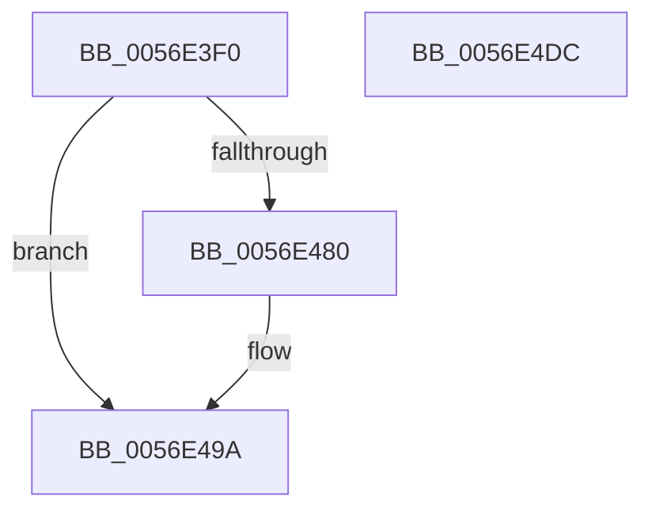

# HalpBlkPoReadPerfMsr

- RVA: `0x0056E3F0`–`0x0056E4DD` (길이 `237` bytes)
- VA: `0x000000014056E3F0`
- 실행 섹션: `.text`
- PDB 이름 있음: `예`; PDB Function 태그: `아니요`
- unwind 정보 RVA: `0x0008C20C`
- 디코드: `63`개 명령, `237/237` bytes 표시
- 미해석 바이트: `0` (있으면 어셈블리에 `.byte`로 보존)

> 이 문서는 커널 이미지의 기계어와 PDB 기호를 분석해 생성했습니다. 4번과 5번은 함수 원형과 자료형을 바이너리 사용 방식에서 추정한 C 해석이며 원본 소스 복구 결과는 아닙니다.

## 1. Dependencies

- 직접 호출 지점: **6**; 고유 호출 대상: **5**
- 직접 호출자로 확인된 함수: **0**
- RIP 상대 이미지 참조: **1**

### Outgoing calls
- `0x0056E429` → [KeAcquireSpinLockRaiseToDpc](../20/KeAcquireSpinLockRaiseToDpc_function_00208470.md) (function, `0x00208470`)
- `0x0056E440` → [HalpBlkPoBusyWait](HalpBlkPoBusyWait_function_0056E128.md) (function, `0x0056E128`)
- `0x0056E475` → [HalpInterruptSendIpiToPhysicalTarget](../54/HalpInterruptSendIpiToPhysicalTarget_function_005464B0.md) (function, `0x005464B0`)
- `0x0056E494` → [KeBugCheckEx](../4F/KeBugCheckEx_function_004FD660.md) (function, `0x004FD660`)
- `0x0056E4A3` → [HalpBlkPoBusyWait](HalpBlkPoBusyWait_function_0056E128.md) (function, `0x0056E128`)
- `0x0056E4B8` → [KeReleaseSpinLock](../39/KeReleaseSpinLock_function_00392BA0.md) (function, `0x00392BA0`)

### Direct callers
- 이 함수 시작 RVA로 연결되는 직접 call은 확인되지 않았습니다. 간접 호출은 완전히 역산할 수 없습니다.

### Static image references
- `0x0056E40C` → RVA `0x00F90550` (`.data`; read)

## 2. Other-region calls and transfers

- 다른 실행 섹션으로 향하는 call: **0**
- 별도 외부 분기/꼬리 이동을 확인하지 못했습니다.

## 3. Assembly (complete function range)

```asm
0056E3F0  48 89 5C 24 08                  mov qword ptr [rsp + 8], rbx
0056E3F5  48 89 6C 24 10                  mov qword ptr [rsp + 0x10], rbp
0056E3FA  48 89 74 24 18                  mov qword ptr [rsp + 0x18], rsi
0056E3FF  57                              push rdi
0056E400  41 54                           push r12
0056E402  41 55                           push r13
0056E404  41 56                           push r14
0056E406  41 57                           push r15
0056E408  48 83 EC 30                     sub rsp, 0x30
0056E40C  48 8B 05 3D 21 A2 00            mov rax, qword ptr [rip + 0xa2213d]
0056E413  4D 8B F8                        mov r15, r8
0056E416  44 8B F1                        mov r14d, ecx
0056E419  8B DA                           mov ebx, edx
0056E41B  4A 8B 34 F0                     mov rsi, qword ptr [rax + r14*8]
0056E41F  48 8D BE A8 08 00 00            lea rdi, [rsi + 0x8a8]
0056E426  48 8B CF                        mov rcx, rdi
0056E429  E8 42 A0 C9 FF                  call 0x140208470
0056E42E  41 BD 01 00 00 00               mov r13d, 1
0056E434  4C 8B C7                        mov r8, rdi
0056E437  41 8B CD                        mov ecx, r13d
0056E43A  41 8B D6                        mov edx, r14d
0056E43D  44 8A E0                        mov r12b, al
0056E440  E8 E3 FC FF FF                  call 0x14056e128
0056E445  48 83 A6 C0 08 00 00 00         and qword ptr [rsi + 0x8c0], 0
0056E44D  41 8B CD                        mov ecx, r13d
0056E450  48 83 A6 C8 08 00 00 00         and qword ptr [rsi + 0x8c8], 0
0056E458  44 89 AE B4 08 00 00            mov dword ptr [rsi + 0x8b4], r13d
0056E45F  44 89 AE B8 08 00 00            mov dword ptr [rsi + 0x8b8], r13d
0056E466  89 9E BC 08 00 00               mov dword ptr [rsi + 0x8bc], ebx
0056E46C  87 8E B0 08 00 00               xchg dword ptr [rsi + 0x8b0], ecx
0056E472  8B 4E 14                        mov ecx, dword ptr [rsi + 0x14]
0056E475  E8 36 80 FD FF                  call 0x1405464b0
0056E47A  8B D8                           mov ebx, eax
0056E47C  85 C0                           test eax, eax
0056E47E  79 1A                           jns 0x14056e49a
0056E480  45 8B CE                        mov r9d, r14d
0056E483  48 89 7C 24 20                  mov qword ptr [rsp + 0x20], rdi
0056E488  45 8B C5                        mov r8d, r13d
0056E48B  41 8D 55 03                     lea edx, [r13 + 3]
0056E48F  B9 DA 01 00 00                  mov ecx, 0x1da
0056E494  E8 C7 F1 F8 FF                  call 0x1404fd660
0056E499  CC                              int3
0056E49A  4C 8B C7                        mov r8, rdi
0056E49D  41 8B D6                        mov edx, r14d
0056E4A0  41 8B CD                        mov ecx, r13d
0056E4A3  E8 80 FC FF FF                  call 0x14056e128
0056E4A8  48 8B 86 C0 08 00 00            mov rax, qword ptr [rsi + 0x8c0]
0056E4AF  41 8A D4                        mov dl, r12b
0056E4B2  48 8B CF                        mov rcx, rdi
0056E4B5  49 89 07                        mov qword ptr [r15], rax
0056E4B8  E8 E3 46 E2 FF                  call 0x140392ba0
0056E4BD  48 8B 6C 24 68                  mov rbp, qword ptr [rsp + 0x68]
0056E4C2  8B C3                           mov eax, ebx
0056E4C4  48 8B 5C 24 60                  mov rbx, qword ptr [rsp + 0x60]
0056E4C9  48 8B 74 24 70                  mov rsi, qword ptr [rsp + 0x70]
0056E4CE  48 83 C4 30                     add rsp, 0x30
0056E4D2  41 5F                           pop r15
0056E4D4  41 5E                           pop r14
0056E4D6  41 5D                           pop r13
0056E4D8  41 5C                           pop r12
0056E4DA  5F                              pop rdi
0056E4DB  C3                              ret
0056E4DC  CC                              int3
```

## 4. C-style interpretation (structured pseudocode)

```c
__int64 __fastcall HalpBlkPoReadPerfMsr(int a1, int a2, __int64 a3)
{
    __int64 result;
    __int64 v_rsp;
    unsigned __int64 v_stack_m38;
    unsigned __int64 v_stack_p10;
    unsigned __int64 v_stack_p18;
    unsigned __int64 v_stack_p8;

    v_stack_p8 = v_rbx;
    v_stack_p10 = v_rbp;
    v_stack_p18 = v_rsi;
    v_rsp = (v_rsp) - (48);
    result = KeAcquireSpinLockRaiseToDpc(*(unsigned __int64 *)(*(unsigned __int64 *)(v_rip + 10625341) + (unsigned int)(a1) * 8) + 2216, a2, a3, a4);
    result = HalpBlkPoBusyWait(1, (unsigned int)((unsigned int)((unsigned int)(a1))), *(unsigned __int64 *)(*(unsigned __int64 *)(v_rip + 10625341) + (unsigned int)(a1) * 8) + 2216, a4);
    *(unsigned int *)(*(unsigned __int64 *)(*(unsigned __int64 *)(v_rip + 10625341) + (unsigned int)(a1) * 8) + 2228) = 1;
    *(unsigned int *)(*(unsigned __int64 *)(*(unsigned __int64 *)(v_rip + 10625341) + (unsigned int)(a1) * 8) + 2232) = 1;
    *(unsigned int *)(*(unsigned __int64 *)(*(unsigned __int64 *)(v_rip + 10625341) + (unsigned int)(a1) * 8) + 2236) = (unsigned int)((unsigned int)(a2));
    result = HalpInterruptSendIpiToPhysicalTarget((unsigned int)(*(unsigned int *)(*(unsigned __int64 *)(*(unsigned __int64 *)(v_rip + 10625341) + (unsigned int)(a1) * 8) + 20)), (unsigned int)((unsigned int)((unsigned int)(a1))), *(unsigned __int64 *)(*(unsigned __int64 *)(v_rip + 10625341) + (unsigned int)(a1) * 8) + 2216, a4);
    if (sign_flag) {
        a4 = (unsigned int)((unsigned int)(a1));
        v_stack_m38 = *(unsigned __int64 *)(*(unsigned __int64 *)(v_rip + 10625341) + (unsigned int)(a1) * 8) + 2216;
        a3 = 1;
        a2 = 1 + 3;
        a1 = 474;
        result = KeBugCheckEx(a1, a2, a3, a4);
    }
    result = HalpBlkPoBusyWait(1, (unsigned int)((unsigned int)((unsigned int)(a1))), *(unsigned __int64 *)(*(unsigned __int64 *)(v_rip + 10625341) + (unsigned int)(a1) * 8) + 2216, a4);
    *(unsigned __int64 *)(a3) = *(unsigned __int64 *)(*(unsigned __int64 *)(*(unsigned __int64 *)(v_rip + 10625341) + (unsigned int)(a1) * 8) + 2240);
    result = KeReleaseSpinLock(*(unsigned __int64 *)(*(unsigned __int64 *)(v_rip + 10625341) + (unsigned int)(a1) * 8) + 2216, (unsigned __int8)((unsigned __int8)(result)), *(unsigned __int64 *)(*(unsigned __int64 *)(v_rip + 10625341) + (unsigned int)(a1) * 8) + 2216, a4);
    v_rsp = (v_rsp) + (48);
    return (unsigned int)((unsigned int)((unsigned int)((unsigned int)(result))));
}
```

## 5. (Beta) C Style

```c
int64_t HalpBlkPoReadPerfMsr(int32_t Arg1, int32_t Arg2, void *Arg3)
{
    uint8_t *arg3 = (uint8_t *)Arg3;

    int64_t result;
    int64_t local_rsp;
    uint64_t v_stack_m38;
    uint64_t v_stack_p10;
    uint64_t v_stack_p18;
    uint64_t v_stack_p8;

    v_stack_p8 = local_rbx;
    v_stack_p10 = local_rbp;
    v_stack_p18 = local_rsi;
    local_rsp = (local_rsp) - (48);
    result = KeAcquireSpinLockRaiseToDpc(*(uint64_t *)(*(uint64_t *)(v_rip + 0xA2213D) + (uint32_t)(Arg1) * 8) + 2216, Arg2, Arg3, a4);
    result = HalpBlkPoBusyWait(1, (uint32_t)((uint32_t)((uint32_t)(Arg1))), *(uint64_t *)(*(uint64_t *)(v_rip + 0xA2213D) + (uint32_t)(Arg1) * 8) + 2216, a4);
    *(uint32_t *)(*(uint64_t *)(*(uint64_t *)(v_rip + 0xA2213D) + (uint32_t)(Arg1) * 8) + 0x8B4) = 1;
    *(uint32_t *)(*(uint64_t *)(*(uint64_t *)(v_rip + 0xA2213D) + (uint32_t)(Arg1) * 8) + 0x8B8) = 1;
    *(uint32_t *)(*(uint64_t *)(*(uint64_t *)(v_rip + 0xA2213D) + (uint32_t)(Arg1) * 8) + 0x8BC) = (uint32_t)((uint32_t)(Arg2));
    result = HalpInterruptSendIpiToPhysicalTarget((uint32_t)(*(uint32_t *)(*(uint64_t *)(*(uint64_t *)(v_rip + 0xA2213D) + (uint32_t)(Arg1) * 8) + 0x14)), (uint32_t)((uint32_t)((uint32_t)(Arg1))), *(uint64_t *)(*(uint64_t *)(v_rip + 0xA2213D) + (uint32_t)(Arg1) * 8) + 2216, a4);
    if (sign_flag) {
        a4 = (uint32_t)((uint32_t)(Arg1));
        v_stack_m38 = *(uint64_t *)(*(uint64_t *)(v_rip + 0xA2213D) + (uint32_t)(Arg1) * 8) + 2216;
        Arg3 = 1;
        Arg2 = 1 + 3;
        Arg1 = 474;
        result = KeBugCheckEx(Arg1, Arg2, Arg3, a4);
    }
    result = HalpBlkPoBusyWait(1, (uint32_t)((uint32_t)((uint32_t)(Arg1))), *(uint64_t *)(*(uint64_t *)(v_rip + 0xA2213D) + (uint32_t)(Arg1) * 8) + 2216, a4);
    *(uint64_t *)(arg3) = *(uint64_t *)(*(uint64_t *)(*(uint64_t *)(v_rip + 0xA2213D) + (uint32_t)(Arg1) * 8) + 0x8C0);
    result = KeReleaseSpinLock(*(uint64_t *)(*(uint64_t *)(v_rip + 0xA2213D) + (uint32_t)(Arg1) * 8) + 2216, (uint8_t)((uint8_t)(result)), *(uint64_t *)(*(uint64_t *)(v_rip + 0xA2213D) + (uint32_t)(Arg1) * 8) + 2216, a4);
    local_rsp = (local_rsp) + (48);
    return (uint32_t)((uint32_t)((uint32_t)((uint32_t)(result))));
}
```

### 관측된 메모리 오프셋

구조체 형식이 확인되지 않은 접근은 인자 기준의 오프셋으로만 기록했습니다.

| 기준 인자 | 오프셋 표현 | 폭 (bit) | 접근 |
|---|---:|---:|---|
| `Arg3` | `+ 0x0` | `64` | `W` |

## 6. Execution-region graph

[열기: 2D/3D 그래프와 함수 탐색 컨트롤 패널](../../../control-panel.html?section=text&rva=0x0056E3F0&view=graph)

- 2D 그래프는 위에서 아래로 흐르고, 3D 그래프는 빈 공간을 드래그해 회전합니다. Shift+드래그는 이동, 휠은 확대·축소, 함수 노드 선택은 대상 보고서 이동입니다.

### Static fallback


