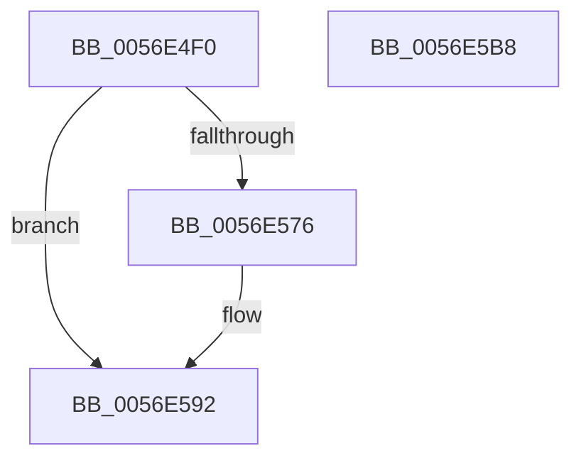

# HalpBlkPoRegisterIdleState

- RVA: `0x0056E4F0`–`0x0056E5B9` (길이 `201` bytes)
- VA: `0x000000014056E4F0`
- 실행 섹션: `.text`
- PDB 이름 있음: `예`; PDB Function 태그: `아니요`
- unwind 정보 RVA: `0x00084C9C`
- 디코드: `51`개 명령, `201/201` bytes 표시
- 미해석 바이트: `0` (있으면 어셈블리에 `.byte`로 보존)

> 이 문서는 커널 이미지의 기계어와 PDB 기호를 분석해 생성했습니다. 4번과 5번은 함수 원형과 자료형을 바이너리 사용 방식에서 추정한 C 해석이며 원본 소스 복구 결과는 아닙니다.

## 1. Dependencies

- 직접 호출 지점: **5**; 고유 호출 대상: **5**
- 직접 호출자로 확인된 함수: **0**
- RIP 상대 이미지 참조: **1**

### Outgoing calls
- `0x0056E525` → [KeAcquireSpinLockRaiseToDpc](../20/KeAcquireSpinLockRaiseToDpc_function_00208470.md) (function, `0x00208470`)
- `0x0056E537` → [HalpBlkPoBusyWait](HalpBlkPoBusyWait_function_0056E128.md) (function, `0x0056E128`)
- `0x0056E56B` → [HalpInterruptSendIpiToPhysicalTarget](../54/HalpInterruptSendIpiToPhysicalTarget_function_005464B0.md) (function, `0x005464B0`)
- `0x0056E58C` → [KeBugCheckEx](../4F/KeBugCheckEx_function_004FD660.md) (function, `0x004FD660`)
- `0x0056E598` → [KeReleaseSpinLock](../39/KeReleaseSpinLock_function_00392BA0.md) (function, `0x00392BA0`)

### Direct callers
- 이 함수 시작 RVA로 연결되는 직접 call은 확인되지 않았습니다. 간접 호출은 완전히 역산할 수 없습니다.

### Static image references
- `0x0056E508` → RVA `0x00F90550` (`.data`; read)

## 2. Other-region calls and transfers

- 다른 실행 섹션으로 향하는 call: **0**
- 별도 외부 분기/꼬리 이동을 확인하지 못했습니다.

## 3. Assembly (complete function range)

```asm
0056E4F0  48 89 5C 24 08                  mov qword ptr [rsp + 8], rbx
0056E4F5  48 89 6C 24 10                  mov qword ptr [rsp + 0x10], rbp
0056E4FA  48 89 74 24 18                  mov qword ptr [rsp + 0x18], rsi
0056E4FF  57                              push rdi
0056E500  41 56                           push r14
0056E502  41 57                           push r15
0056E504  48 83 EC 30                     sub rsp, 0x30
0056E508  48 8B 05 41 20 A2 00            mov rax, qword ptr [rip + 0xa22041]
0056E50F  48 8B F2                        mov rsi, rdx
0056E512  8B D9                           mov ebx, ecx
0056E514  44 8B F1                        mov r14d, ecx
0056E517  48 8B 3C D8                     mov rdi, qword ptr [rax + rbx*8]
0056E51B  48 8D AF A8 08 00 00            lea rbp, [rdi + 0x8a8]
0056E522  48 8B CD                        mov rcx, rbp
0056E525  E8 46 9F C9 FF                  call 0x140208470
0056E52A  4C 8B C5                        mov r8, rbp
0056E52D  8B D3                           mov edx, ebx
0056E52F  B9 05 00 00 00                  mov ecx, 5
0056E534  44 8A F8                        mov r15b, al
0056E537  E8 EC FB FF FF                  call 0x14056e128
0056E53C  48 83 A7 B8 08 00 00 00         and qword ptr [rdi + 0x8b8], 0
0056E544  B9 01 00 00 00                  mov ecx, 1
0056E549  48 83 A7 C8 08 00 00 00         and qword ptr [rdi + 0x8c8], 0
0056E551  C7 87 B4 08 00 00 03 00 00 00   mov dword ptr [rdi + 0x8b4], 3
0056E55B  48 89 B7 C0 08 00 00            mov qword ptr [rdi + 0x8c0], rsi
0056E562  87 8F B0 08 00 00               xchg dword ptr [rdi + 0x8b0], ecx
0056E568  8B 4F 14                        mov ecx, dword ptr [rdi + 0x14]
0056E56B  E8 40 7F FD FF                  call 0x1405464b0
0056E570  8B D8                           mov ebx, eax
0056E572  85 C0                           test eax, eax
0056E574  79 1C                           jns 0x14056e592
0056E576  BA 04 00 00 00                  mov edx, 4
0056E57B  48 89 6C 24 20                  mov qword ptr [rsp + 0x20], rbp
0056E580  45 8B CE                        mov r9d, r14d
0056E583  B9 DA 01 00 00                  mov ecx, 0x1da
0056E588  44 8D 42 01                     lea r8d, [rdx + 1]
0056E58C  E8 CF F0 F8 FF                  call 0x1404fd660
0056E591  CC                              int3
0056E592  41 8A D7                        mov dl, r15b
0056E595  48 8B CD                        mov rcx, rbp
0056E598  E8 03 46 E2 FF                  call 0x140392ba0
0056E59D  48 8B 6C 24 58                  mov rbp, qword ptr [rsp + 0x58]
0056E5A2  8B C3                           mov eax, ebx
0056E5A4  48 8B 5C 24 50                  mov rbx, qword ptr [rsp + 0x50]
0056E5A9  48 8B 74 24 60                  mov rsi, qword ptr [rsp + 0x60]
0056E5AE  48 83 C4 30                     add rsp, 0x30
0056E5B2  41 5F                           pop r15
0056E5B4  41 5E                           pop r14
0056E5B6  5F                              pop rdi
0056E5B7  C3                              ret
0056E5B8  CC                              int3
```

## 4. C-style interpretation (structured pseudocode)

```c
__int64 __fastcall HalpBlkPoRegisterIdleState(int a1, __int64 a2)
{
    __int64 result;
    __int64 v_rsp;
    unsigned __int64 v_stack_m28;
    unsigned __int64 v_stack_p10;
    unsigned __int64 v_stack_p18;
    unsigned __int64 v_stack_p8;

    v_stack_p8 = v_rbx;
    v_stack_p10 = v_rbp;
    v_stack_p18 = v_rsi;
    v_rsp = (v_rsp) - (48);
    result = KeAcquireSpinLockRaiseToDpc(*(unsigned __int64 *)(*(unsigned __int64 *)(v_rip + 10625089) + (unsigned int)(a1) * 8) + 2216, a2, a3, a4);
    result = HalpBlkPoBusyWait(5, (unsigned int)((unsigned int)((unsigned int)(a1))), *(unsigned __int64 *)(*(unsigned __int64 *)(v_rip + 10625089) + (unsigned int)(a1) * 8) + 2216, a4);
    *(unsigned int *)(*(unsigned __int64 *)(*(unsigned __int64 *)(v_rip + 10625089) + (unsigned int)(a1) * 8) + 2228) = 3;
    *(unsigned __int64 *)(*(unsigned __int64 *)(*(unsigned __int64 *)(v_rip + 10625089) + (unsigned int)(a1) * 8) + 2240) = a2;
    result = HalpInterruptSendIpiToPhysicalTarget((unsigned int)(*(unsigned int *)(*(unsigned __int64 *)(*(unsigned __int64 *)(v_rip + 10625089) + (unsigned int)(a1) * 8) + 20)), (unsigned int)((unsigned int)((unsigned int)(a1))), *(unsigned __int64 *)(*(unsigned __int64 *)(v_rip + 10625089) + (unsigned int)(a1) * 8) + 2216, a4);
    if (sign_flag) {
        a2 = 4;
        v_stack_m28 = *(unsigned __int64 *)(*(unsigned __int64 *)(v_rip + 10625089) + (unsigned int)(a1) * 8) + 2216;
        a4 = (unsigned int)((unsigned int)(a1));
        a1 = 474;
        a3 = a2 + 1;
        result = KeBugCheckEx(a1, a2, a3, a4);
    }
    result = KeReleaseSpinLock(*(unsigned __int64 *)(*(unsigned __int64 *)(v_rip + 10625089) + (unsigned int)(a1) * 8) + 2216, (unsigned __int8)((unsigned __int8)(result)), a3, a4);
    v_rsp = (v_rsp) + (48);
    return (unsigned int)((unsigned int)((unsigned int)((unsigned int)(result))));
}
```

## 5. (Beta) C Style

```c
int64_t HalpBlkPoRegisterIdleState(int32_t Arg1, int64_t Arg2)
{
    int64_t result;
    int64_t local_rsp;
    uint64_t v_stack_m28;
    uint64_t v_stack_p10;
    uint64_t v_stack_p18;
    uint64_t v_stack_p8;

    v_stack_p8 = local_rbx;
    v_stack_p10 = local_rbp;
    v_stack_p18 = local_rsi;
    local_rsp = (local_rsp) - (48);
    result = KeAcquireSpinLockRaiseToDpc(*(uint64_t *)(*(uint64_t *)(v_rip + 0xA22041) + (uint32_t)(Arg1) * 8) + 2216, Arg2, a3, a4);
    result = HalpBlkPoBusyWait(5, (uint32_t)((uint32_t)((uint32_t)(Arg1))), *(uint64_t *)(*(uint64_t *)(v_rip + 0xA22041) + (uint32_t)(Arg1) * 8) + 2216, a4);
    *(uint32_t *)(*(uint64_t *)(*(uint64_t *)(v_rip + 0xA22041) + (uint32_t)(Arg1) * 8) + 0x8B4) = 3;
    *(uint64_t *)(*(uint64_t *)(*(uint64_t *)(v_rip + 0xA22041) + (uint32_t)(Arg1) * 8) + 0x8C0) = Arg2;
    result = HalpInterruptSendIpiToPhysicalTarget((uint32_t)(*(uint32_t *)(*(uint64_t *)(*(uint64_t *)(v_rip + 0xA22041) + (uint32_t)(Arg1) * 8) + 0x14)), (uint32_t)((uint32_t)((uint32_t)(Arg1))), *(uint64_t *)(*(uint64_t *)(v_rip + 0xA22041) + (uint32_t)(Arg1) * 8) + 2216, a4);
    if (sign_flag) {
        Arg2 = 4;
        v_stack_m28 = *(uint64_t *)(*(uint64_t *)(v_rip + 0xA22041) + (uint32_t)(Arg1) * 8) + 2216;
        a4 = (uint32_t)((uint32_t)(Arg1));
        Arg1 = 474;
        a3 = Arg2 + 1;
        result = KeBugCheckEx(Arg1, Arg2, a3, a4);
    }
    result = KeReleaseSpinLock(*(uint64_t *)(*(uint64_t *)(v_rip + 0xA22041) + (uint32_t)(Arg1) * 8) + 2216, (uint8_t)((uint8_t)(result)), a3, a4);
    local_rsp = (local_rsp) + (48);
    return (uint32_t)((uint32_t)((uint32_t)((uint32_t)(result))));
}
```

## 6. Execution-region graph

[열기: 2D/3D 그래프와 함수 탐색 컨트롤 패널](../../../control-panel.html?section=text&rva=0x0056E4F0&view=graph)

- 2D 그래프는 위에서 아래로 흐르고, 3D 그래프는 빈 공간을 드래그해 회전합니다. Shift+드래그는 이동, 휠은 확대·축소, 함수 노드 선택은 대상 보고서 이동입니다.

### Static fallback


