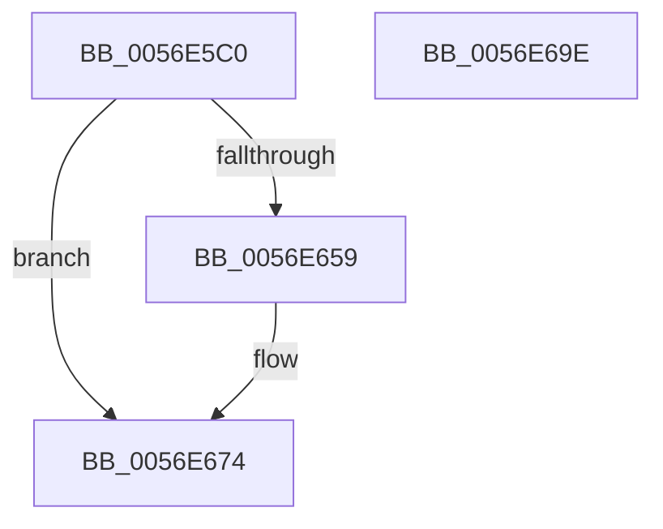

# HalpBlkPoWritePerfIoPort

- RVA: `0x0056E5C0`–`0x0056E69F` (길이 `223` bytes)
- VA: `0x000000014056E5C0`
- 실행 섹션: `.text`
- PDB 이름 있음: `예`; PDB Function 태그: `아니요`
- unwind 정보 RVA: `0x0008C20C`
- 디코드: `62`개 명령, `223/223` bytes 표시
- 미해석 바이트: `0` (있으면 어셈블리에 `.byte`로 보존)

> 이 문서는 커널 이미지의 기계어와 PDB 기호를 분석해 생성했습니다. 4번과 5번은 함수 원형과 자료형을 바이너리 사용 방식에서 추정한 C 해석이며 원본 소스 복구 결과는 아닙니다.

## 1. Dependencies

- 직접 호출 지점: **5**; 고유 호출 대상: **5**
- 직접 호출자로 확인된 함수: **0**
- RIP 상대 이미지 참조: **1**

### Outgoing calls
- `0x0056E600` → [KeAcquireSpinLockRaiseToDpc](../20/KeAcquireSpinLockRaiseToDpc_function_00208470.md) (function, `0x00208470`)
- `0x0056E612` → [HalpBlkPoBusyWait](HalpBlkPoBusyWait_function_0056E128.md) (function, `0x0056E128`)
- `0x0056E64E` → [HalpInterruptSendIpiToPhysicalTarget](../54/HalpInterruptSendIpiToPhysicalTarget_function_005464B0.md) (function, `0x005464B0`)
- `0x0056E66E` → [KeBugCheckEx](../4F/KeBugCheckEx_function_004FD660.md) (function, `0x004FD660`)
- `0x0056E67A` → [KeReleaseSpinLock](../39/KeReleaseSpinLock_function_00392BA0.md) (function, `0x00392BA0`)

### Direct callers
- 이 함수 시작 RVA로 연결되는 직접 call은 확인되지 않았습니다. 간접 호출은 완전히 역산할 수 없습니다.

### Static image references
- `0x0056E5DC` → RVA `0x00F90550` (`.data`; read)

## 2. Other-region calls and transfers

- 다른 실행 섹션으로 향하는 call: **0**
- 별도 외부 분기/꼬리 이동을 확인하지 못했습니다.

## 3. Assembly (complete function range)

```asm
0056E5C0  48 89 5C 24 08                  mov qword ptr [rsp + 8], rbx
0056E5C5  48 89 6C 24 10                  mov qword ptr [rsp + 0x10], rbp
0056E5CA  48 89 74 24 18                  mov qword ptr [rsp + 0x18], rsi
0056E5CF  57                              push rdi
0056E5D0  41 54                           push r12
0056E5D2  41 55                           push r13
0056E5D4  41 56                           push r14
0056E5D6  41 57                           push r15
0056E5D8  48 83 EC 30                     sub rsp, 0x30
0056E5DC  48 8B 05 6D 1F A2 00            mov rax, qword ptr [rip + 0xa21f6d]
0056E5E3  45 8B F1                        mov r14d, r9d
0056E5E6  8B D9                           mov ebx, ecx
0056E5E8  41 0F B7 F0                     movzx esi, r8w
0056E5EC  44 8B E1                        mov r12d, ecx
0056E5EF  0F B7 FA                        movzx edi, dx
0056E5F2  48 8B 2C D8                     mov rbp, qword ptr [rax + rbx*8]
0056E5F6  4C 8D BD A8 08 00 00            lea r15, [rbp + 0x8a8]
0056E5FD  49 8B CF                        mov rcx, r15
0056E600  E8 6B 9E C9 FF                  call 0x140208470
0056E605  4D 8B C7                        mov r8, r15
0056E608  8B D3                           mov edx, ebx
0056E60A  B9 04 00 00 00                  mov ecx, 4
0056E60F  44 8A E8                        mov r13b, al
0056E612  E8 11 FB FF FF                  call 0x14056e128
0056E617  49 83 67 20 00                  and qword ptr [r15 + 0x20], 0
0056E61C  B8 02 00 00 00                  mov eax, 2
0056E621  8B 8C 24 80 00 00 00            mov ecx, dword ptr [rsp + 0x80]
0056E628  41 89 47 0C                     mov dword ptr [r15 + 0xc], eax
0056E62C  41 89 47 10                     mov dword ptr [r15 + 0x10], eax
0056E630  B8 01 00 00 00                  mov eax, 1
0056E635  66 41 89 7F 14                  mov word ptr [r15 + 0x14], di
0056E63A  66 41 89 77 16                  mov word ptr [r15 + 0x16], si
0056E63F  45 89 77 18                     mov dword ptr [r15 + 0x18], r14d
0056E643  41 89 4F 1C                     mov dword ptr [r15 + 0x1c], ecx
0056E647  41 87 47 08                     xchg dword ptr [r15 + 8], eax
0056E64B  8B 4D 14                        mov ecx, dword ptr [rbp + 0x14]
0056E64E  E8 5D 7E FD FF                  call 0x1405464b0
0056E653  8B D8                           mov ebx, eax
0056E655  85 C0                           test eax, eax
0056E657  79 1B                           jns 0x14056e674
0056E659  BA 04 00 00 00                  mov edx, 4
0056E65E  4C 89 7C 24 20                  mov qword ptr [rsp + 0x20], r15
0056E663  44 8B C2                        mov r8d, edx
0056E666  45 8B CC                        mov r9d, r12d
0056E669  B9 DA 01 00 00                  mov ecx, 0x1da
0056E66E  E8 ED EF F8 FF                  call 0x1404fd660
0056E673  CC                              int3
0056E674  41 8A D5                        mov dl, r13b
0056E677  49 8B CF                        mov rcx, r15
0056E67A  E8 21 45 E2 FF                  call 0x140392ba0
0056E67F  48 8B 6C 24 68                  mov rbp, qword ptr [rsp + 0x68]
0056E684  8B C3                           mov eax, ebx
0056E686  48 8B 5C 24 60                  mov rbx, qword ptr [rsp + 0x60]
0056E68B  48 8B 74 24 70                  mov rsi, qword ptr [rsp + 0x70]
0056E690  48 83 C4 30                     add rsp, 0x30
0056E694  41 5F                           pop r15
0056E696  41 5E                           pop r14
0056E698  41 5D                           pop r13
0056E69A  41 5C                           pop r12
0056E69C  5F                              pop rdi
0056E69D  C3                              ret
0056E69E  CC                              int3
```

## 4. C-style interpretation (structured pseudocode)

```c
__int64 __fastcall HalpBlkPoWritePerfIoPort(int a1, unsigned __int16 a2, unsigned __int16 a3, int a4, unsigned int a5)
{
    __int64 result;
    __int64 v_rsp;
    unsigned __int64 v_stack_m38;
    unsigned __int64 v_stack_p10;
    unsigned __int64 v_stack_p18;
    unsigned __int64 v_stack_p8;

    v_stack_p8 = v_rbx;
    v_stack_p10 = v_rbp;
    v_stack_p18 = v_rsi;
    v_rsp = (v_rsp) - (48);
    result = KeAcquireSpinLockRaiseToDpc(*(unsigned __int64 *)(*(unsigned __int64 *)(v_rip + 10624877) + (unsigned int)(a1) * 8) + 2216, a2, a3, a4);
    result = HalpBlkPoBusyWait(4, (unsigned int)((unsigned int)((unsigned int)(a1))), *(unsigned __int64 *)(*(unsigned __int64 *)(v_rip + 10624877) + (unsigned int)(a1) * 8) + 2216, a4);
    *(unsigned int *)(*(unsigned __int64 *)(*(unsigned __int64 *)(v_rip + 10624877) + (unsigned int)(a1) * 8) + 2216 + 12) = 2;
    *(unsigned int *)(*(unsigned __int64 *)(*(unsigned __int64 *)(v_rip + 10624877) + (unsigned int)(a1) * 8) + 2216 + 16) = 2;
    *(unsigned __int16 *)(*(unsigned __int64 *)(*(unsigned __int64 *)(v_rip + 10624877) + (unsigned int)(a1) * 8) + 2216 + 20) = a2;
    *(unsigned __int16 *)(*(unsigned __int64 *)(*(unsigned __int64 *)(v_rip + 10624877) + (unsigned int)(a1) * 8) + 2216 + 22) = a3;
    *(unsigned int *)(*(unsigned __int64 *)(*(unsigned __int64 *)(v_rip + 10624877) + (unsigned int)(a1) * 8) + 2216 + 24) = (unsigned int)((unsigned int)(a4));
    *(unsigned int *)(*(unsigned __int64 *)(*(unsigned __int64 *)(v_rip + 10624877) + (unsigned int)(a1) * 8) + 2216 + 28) = (unsigned int)((unsigned int)(a5));
    result = HalpInterruptSendIpiToPhysicalTarget((unsigned int)(*(unsigned int *)(*(unsigned __int64 *)(*(unsigned __int64 *)(v_rip + 10624877) + (unsigned int)(a1) * 8) + 20)), (unsigned int)((unsigned int)((unsigned int)(a1))), *(unsigned __int64 *)(*(unsigned __int64 *)(v_rip + 10624877) + (unsigned int)(a1) * 8) + 2216, a4);
    if (sign_flag) {
        a2 = 4;
        v_stack_m38 = *(unsigned __int64 *)(*(unsigned __int64 *)(v_rip + 10624877) + (unsigned int)(a1) * 8) + 2216;
        a3 = a2;
        a4 = (unsigned int)((unsigned int)(a1));
        a1 = 474;
        result = KeBugCheckEx(a1, a2, a3, a4);
    }
    result = KeReleaseSpinLock(*(unsigned __int64 *)(*(unsigned __int64 *)(v_rip + 10624877) + (unsigned int)(a1) * 8) + 2216, (unsigned __int8)((unsigned __int8)(result)), a3, a4);
    v_rsp = (v_rsp) + (48);
    return (unsigned int)((unsigned int)((unsigned int)((unsigned int)(result))));
}
```

## 5. (Beta) C Style

```c
int64_t HalpBlkPoWritePerfIoPort(int32_t Arg1, uint16_t Arg2, uint16_t Arg3, int32_t Arg4, uint32_t Arg5)
{
    int64_t result;
    int64_t local_rsp;
    uint64_t v_stack_m38;
    uint64_t v_stack_p10;
    uint64_t v_stack_p18;
    uint64_t v_stack_p8;

    v_stack_p8 = local_rbx;
    v_stack_p10 = local_rbp;
    v_stack_p18 = local_rsi;
    local_rsp = (local_rsp) - (48);
    result = KeAcquireSpinLockRaiseToDpc(*(uint64_t *)(*(uint64_t *)(v_rip + 0xA21F6D) + (uint32_t)(Arg1) * 8) + 2216, Arg2, Arg3, Arg4);
    result = HalpBlkPoBusyWait(4, (uint32_t)((uint32_t)((uint32_t)(Arg1))), *(uint64_t *)(*(uint64_t *)(v_rip + 0xA21F6D) + (uint32_t)(Arg1) * 8) + 2216, Arg4);
    *(uint32_t *)(*(uint64_t *)(*(uint64_t *)(v_rip + 0xA21F6D) + (uint32_t)(Arg1) * 8) + 0x8A8 + 0xC) = 2;
    *(uint32_t *)(*(uint64_t *)(*(uint64_t *)(v_rip + 0xA21F6D) + (uint32_t)(Arg1) * 8) + 0x8A8 + 0x10) = 2;
    *(uint16_t *)(*(uint64_t *)(*(uint64_t *)(v_rip + 0xA21F6D) + (uint32_t)(Arg1) * 8) + 0x8A8 + 0x14) = Arg2;
    *(uint16_t *)(*(uint64_t *)(*(uint64_t *)(v_rip + 0xA21F6D) + (uint32_t)(Arg1) * 8) + 0x8A8 + 0x16) = Arg3;
    *(uint32_t *)(*(uint64_t *)(*(uint64_t *)(v_rip + 0xA21F6D) + (uint32_t)(Arg1) * 8) + 0x8A8 + 0x18) = (uint32_t)((uint32_t)(Arg4));
    *(uint32_t *)(*(uint64_t *)(*(uint64_t *)(v_rip + 0xA21F6D) + (uint32_t)(Arg1) * 8) + 0x8A8 + 0x1C) = (uint32_t)((uint32_t)(Arg5));
    result = HalpInterruptSendIpiToPhysicalTarget((uint32_t)(*(uint32_t *)(*(uint64_t *)(*(uint64_t *)(v_rip + 0xA21F6D) + (uint32_t)(Arg1) * 8) + 0x14)), (uint32_t)((uint32_t)((uint32_t)(Arg1))), *(uint64_t *)(*(uint64_t *)(v_rip + 0xA21F6D) + (uint32_t)(Arg1) * 8) + 2216, Arg4);
    if (sign_flag) {
        Arg2 = 4;
        v_stack_m38 = *(uint64_t *)(*(uint64_t *)(v_rip + 0xA21F6D) + (uint32_t)(Arg1) * 8) + 2216;
        Arg3 = Arg2;
        Arg4 = (uint32_t)((uint32_t)(Arg1));
        Arg1 = 474;
        result = KeBugCheckEx(Arg1, Arg2, Arg3, Arg4);
    }
    result = KeReleaseSpinLock(*(uint64_t *)(*(uint64_t *)(v_rip + 0xA21F6D) + (uint32_t)(Arg1) * 8) + 2216, (uint8_t)((uint8_t)(result)), Arg3, Arg4);
    local_rsp = (local_rsp) + (48);
    return (uint32_t)((uint32_t)((uint32_t)((uint32_t)(result))));
}
```

## 6. Execution-region graph

[열기: 2D/3D 그래프와 함수 탐색 컨트롤 패널](../../../control-panel.html?section=text&rva=0x0056E5C0&view=graph)

- 2D 그래프는 위에서 아래로 흐르고, 3D 그래프는 빈 공간을 드래그해 회전합니다. Shift+드래그는 이동, 휠은 확대·축소, 함수 노드 선택은 대상 보고서 이동입니다.

### Static fallback


