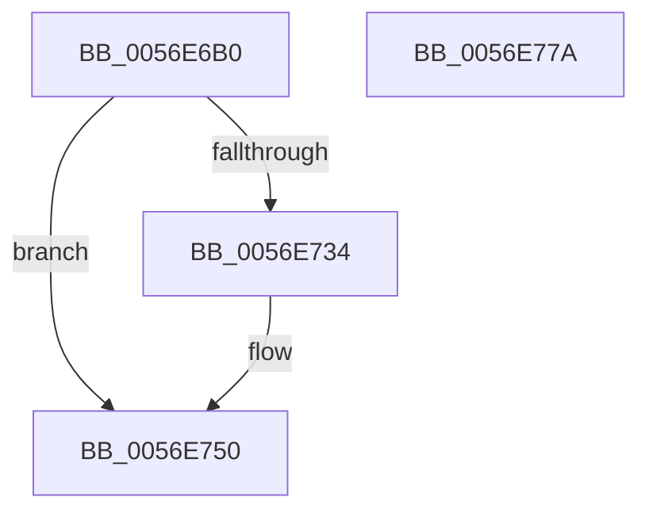

# HalpBlkPoWritePerfMsr

- RVA: `0x0056E6B0`–`0x0056E77B` (길이 `203` bytes)
- VA: `0x000000014056E6B0`
- 실행 섹션: `.text`
- PDB 이름 있음: `예`; PDB Function 태그: `아니요`
- unwind 정보 RVA: `0x0008C20C`
- 디코드: `58`개 명령, `203/203` bytes 표시
- 미해석 바이트: `0` (있으면 어셈블리에 `.byte`로 보존)

> 이 문서는 커널 이미지의 기계어와 PDB 기호를 분석해 생성했습니다. 4번과 5번은 함수 원형과 자료형을 바이너리 사용 방식에서 추정한 C 해석이며 원본 소스 복구 결과는 아닙니다.

## 1. Dependencies

- 직접 호출 지점: **5**; 고유 호출 대상: **5**
- 직접 호출자로 확인된 함수: **0**
- RIP 상대 이미지 참조: **1**

### Outgoing calls
- `0x0056E6EE` → [KeAcquireSpinLockRaiseToDpc](../20/KeAcquireSpinLockRaiseToDpc_function_00208470.md) (function, `0x00208470`)
- `0x0056E700` → [HalpBlkPoBusyWait](HalpBlkPoBusyWait_function_0056E128.md) (function, `0x0056E128`)
- `0x0056E729` → [HalpInterruptSendIpiToPhysicalTarget](../54/HalpInterruptSendIpiToPhysicalTarget_function_005464B0.md) (function, `0x005464B0`)
- `0x0056E74A` → [KeBugCheckEx](../4F/KeBugCheckEx_function_004FD660.md) (function, `0x004FD660`)
- `0x0056E756` → [KeReleaseSpinLock](../39/KeReleaseSpinLock_function_00392BA0.md) (function, `0x00392BA0`)

### Direct callers
- 이 함수 시작 RVA로 연결되는 직접 call은 확인되지 않았습니다. 간접 호출은 완전히 역산할 수 없습니다.

### Static image references
- `0x0056E6CC` → RVA `0x00F90550` (`.data`; read)

## 2. Other-region calls and transfers

- 다른 실행 섹션으로 향하는 call: **0**
- 별도 외부 분기/꼬리 이동을 확인하지 못했습니다.

## 3. Assembly (complete function range)

```asm
0056E6B0  48 89 5C 24 08                  mov qword ptr [rsp + 8], rbx
0056E6B5  48 89 6C 24 10                  mov qword ptr [rsp + 0x10], rbp
0056E6BA  48 89 74 24 18                  mov qword ptr [rsp + 0x18], rsi
0056E6BF  57                              push rdi
0056E6C0  41 54                           push r12
0056E6C2  41 55                           push r13
0056E6C4  41 56                           push r14
0056E6C6  41 57                           push r15
0056E6C8  48 83 EC 30                     sub rsp, 0x30
0056E6CC  48 8B 05 7D 1E A2 00            mov rax, qword ptr [rip + 0xa21e7d]
0056E6D3  4D 8B F1                        mov r14, r9
0056E6D6  8B D9                           mov ebx, ecx
0056E6D8  49 8B E8                        mov rbp, r8
0056E6DB  44 8B E1                        mov r12d, ecx
0056E6DE  8B FA                           mov edi, edx
0056E6E0  48 8B 34 D8                     mov rsi, qword ptr [rax + rbx*8]
0056E6E4  4C 8D BE A8 08 00 00            lea r15, [rsi + 0x8a8]
0056E6EB  49 8B CF                        mov rcx, r15
0056E6EE  E8 7D 9D C9 FF                  call 0x140208470
0056E6F3  4D 8B C7                        mov r8, r15
0056E6F6  8B D3                           mov edx, ebx
0056E6F8  B9 02 00 00 00                  mov ecx, 2
0056E6FD  44 8A E8                        mov r13b, al
0056E700  E8 23 FA FF FF                  call 0x14056e128
0056E705  B9 01 00 00 00                  mov ecx, 1
0056E70A  41 C7 47 0C 02 00 00 00         mov dword ptr [r15 + 0xc], 2
0056E712  41 89 4F 10                     mov dword ptr [r15 + 0x10], ecx
0056E716  41 89 7F 14                     mov dword ptr [r15 + 0x14], edi
0056E71A  49 89 6F 18                     mov qword ptr [r15 + 0x18], rbp
0056E71E  4D 89 77 20                     mov qword ptr [r15 + 0x20], r14
0056E722  41 87 4F 08                     xchg dword ptr [r15 + 8], ecx
0056E726  8B 4E 14                        mov ecx, dword ptr [rsi + 0x14]
0056E729  E8 82 7D FD FF                  call 0x1405464b0
0056E72E  8B D8                           mov ebx, eax
0056E730  85 C0                           test eax, eax
0056E732  79 1C                           jns 0x14056e750
0056E734  BA 04 00 00 00                  mov edx, 4
0056E739  4C 89 7C 24 20                  mov qword ptr [rsp + 0x20], r15
0056E73E  45 8B CC                        mov r9d, r12d
0056E741  B9 DA 01 00 00                  mov ecx, 0x1da
0056E746  44 8D 42 FE                     lea r8d, [rdx - 2]
0056E74A  E8 11 EF F8 FF                  call 0x1404fd660
0056E74F  CC                              int3
0056E750  41 8A D5                        mov dl, r13b
0056E753  49 8B CF                        mov rcx, r15
0056E756  E8 45 44 E2 FF                  call 0x140392ba0
0056E75B  48 8B 6C 24 68                  mov rbp, qword ptr [rsp + 0x68]
0056E760  8B C3                           mov eax, ebx
0056E762  48 8B 5C 24 60                  mov rbx, qword ptr [rsp + 0x60]
0056E767  48 8B 74 24 70                  mov rsi, qword ptr [rsp + 0x70]
0056E76C  48 83 C4 30                     add rsp, 0x30
0056E770  41 5F                           pop r15
0056E772  41 5E                           pop r14
0056E774  41 5D                           pop r13
0056E776  41 5C                           pop r12
0056E778  5F                              pop rdi
0056E779  C3                              ret
0056E77A  CC                              int3
```

## 4. C-style interpretation (structured pseudocode)

```c
__int64 __fastcall HalpBlkPoWritePerfMsr(int a1, int a2, __int64 a3, __int64 a4)
{
    __int64 result;
    __int64 v_rsp;
    unsigned __int64 v_stack_m38;
    unsigned __int64 v_stack_p10;
    unsigned __int64 v_stack_p18;
    unsigned __int64 v_stack_p8;

    v_stack_p8 = v_rbx;
    v_stack_p10 = v_rbp;
    v_stack_p18 = v_rsi;
    v_rsp = (v_rsp) - (48);
    result = KeAcquireSpinLockRaiseToDpc(*(unsigned __int64 *)(*(unsigned __int64 *)(v_rip + 10624637) + (unsigned int)(a1) * 8) + 2216, a2, a3, a4);
    result = HalpBlkPoBusyWait(2, (unsigned int)((unsigned int)((unsigned int)(a1))), *(unsigned __int64 *)(*(unsigned __int64 *)(v_rip + 10624637) + (unsigned int)(a1) * 8) + 2216, a4);
    *(unsigned int *)(*(unsigned __int64 *)(*(unsigned __int64 *)(v_rip + 10624637) + (unsigned int)(a1) * 8) + 2216 + 12) = 2;
    *(unsigned int *)(*(unsigned __int64 *)(*(unsigned __int64 *)(v_rip + 10624637) + (unsigned int)(a1) * 8) + 2216 + 16) = 1;
    *(unsigned int *)(*(unsigned __int64 *)(*(unsigned __int64 *)(v_rip + 10624637) + (unsigned int)(a1) * 8) + 2216 + 20) = (unsigned int)((unsigned int)(a2));
    *(unsigned __int64 *)(*(unsigned __int64 *)(*(unsigned __int64 *)(v_rip + 10624637) + (unsigned int)(a1) * 8) + 2216 + 24) = a3;
    *(unsigned __int64 *)(*(unsigned __int64 *)(*(unsigned __int64 *)(v_rip + 10624637) + (unsigned int)(a1) * 8) + 2216 + 32) = a4;
    result = HalpInterruptSendIpiToPhysicalTarget((unsigned int)(*(unsigned int *)(*(unsigned __int64 *)(*(unsigned __int64 *)(v_rip + 10624637) + (unsigned int)(a1) * 8) + 20)), (unsigned int)((unsigned int)((unsigned int)(a1))), *(unsigned __int64 *)(*(unsigned __int64 *)(v_rip + 10624637) + (unsigned int)(a1) * 8) + 2216, a4);
    if (sign_flag) {
        a2 = 4;
        v_stack_m38 = *(unsigned __int64 *)(*(unsigned __int64 *)(v_rip + 10624637) + (unsigned int)(a1) * 8) + 2216;
        a4 = (unsigned int)((unsigned int)(a1));
        a1 = 474;
        a3 = a2 - 2;
        result = KeBugCheckEx(a1, a2, a3, a4);
    }
    result = KeReleaseSpinLock(*(unsigned __int64 *)(*(unsigned __int64 *)(v_rip + 10624637) + (unsigned int)(a1) * 8) + 2216, (unsigned __int8)((unsigned __int8)(result)), a3, a4);
    v_rsp = (v_rsp) + (48);
    return (unsigned int)((unsigned int)((unsigned int)((unsigned int)(result))));
}
```

## 5. (Beta) C Style

```c
int64_t HalpBlkPoWritePerfMsr(int32_t Arg1, int32_t Arg2, int64_t Arg3, int64_t Arg4)
{
    int64_t result;
    int64_t local_rsp;
    uint64_t v_stack_m38;
    uint64_t v_stack_p10;
    uint64_t v_stack_p18;
    uint64_t v_stack_p8;

    v_stack_p8 = local_rbx;
    v_stack_p10 = local_rbp;
    v_stack_p18 = local_rsi;
    local_rsp = (local_rsp) - (48);
    result = KeAcquireSpinLockRaiseToDpc(*(uint64_t *)(*(uint64_t *)(v_rip + 0xA21E7D) + (uint32_t)(Arg1) * 8) + 2216, Arg2, Arg3, Arg4);
    result = HalpBlkPoBusyWait(2, (uint32_t)((uint32_t)((uint32_t)(Arg1))), *(uint64_t *)(*(uint64_t *)(v_rip + 0xA21E7D) + (uint32_t)(Arg1) * 8) + 2216, Arg4);
    *(uint32_t *)(*(uint64_t *)(*(uint64_t *)(v_rip + 0xA21E7D) + (uint32_t)(Arg1) * 8) + 0x8A8 + 0xC) = 2;
    *(uint32_t *)(*(uint64_t *)(*(uint64_t *)(v_rip + 0xA21E7D) + (uint32_t)(Arg1) * 8) + 0x8A8 + 0x10) = 1;
    *(uint32_t *)(*(uint64_t *)(*(uint64_t *)(v_rip + 0xA21E7D) + (uint32_t)(Arg1) * 8) + 0x8A8 + 0x14) = (uint32_t)((uint32_t)(Arg2));
    *(uint64_t *)(*(uint64_t *)(*(uint64_t *)(v_rip + 0xA21E7D) + (uint32_t)(Arg1) * 8) + 0x8A8 + 0x18) = Arg3;
    *(uint64_t *)(*(uint64_t *)(*(uint64_t *)(v_rip + 0xA21E7D) + (uint32_t)(Arg1) * 8) + 0x8A8 + 0x20) = Arg4;
    result = HalpInterruptSendIpiToPhysicalTarget((uint32_t)(*(uint32_t *)(*(uint64_t *)(*(uint64_t *)(v_rip + 0xA21E7D) + (uint32_t)(Arg1) * 8) + 0x14)), (uint32_t)((uint32_t)((uint32_t)(Arg1))), *(uint64_t *)(*(uint64_t *)(v_rip + 0xA21E7D) + (uint32_t)(Arg1) * 8) + 2216, Arg4);
    if (sign_flag) {
        Arg2 = 4;
        v_stack_m38 = *(uint64_t *)(*(uint64_t *)(v_rip + 0xA21E7D) + (uint32_t)(Arg1) * 8) + 2216;
        Arg4 = (uint32_t)((uint32_t)(Arg1));
        Arg1 = 474;
        Arg3 = Arg2 - 2;
        result = KeBugCheckEx(Arg1, Arg2, Arg3, Arg4);
    }
    result = KeReleaseSpinLock(*(uint64_t *)(*(uint64_t *)(v_rip + 0xA21E7D) + (uint32_t)(Arg1) * 8) + 2216, (uint8_t)((uint8_t)(result)), Arg3, Arg4);
    local_rsp = (local_rsp) + (48);
    return (uint32_t)((uint32_t)((uint32_t)((uint32_t)(result))));
}
```

## 6. Execution-region graph

[열기: 2D/3D 그래프와 함수 탐색 컨트롤 패널](../../../control-panel.html?section=text&rva=0x0056E6B0&view=graph)

- 2D 그래프는 위에서 아래로 흐르고, 3D 그래프는 빈 공간을 드래그해 회전합니다. Shift+드래그는 이동, 휠은 확대·축소, 함수 노드 선택은 대상 보고서 이동입니다.

### Static fallback


