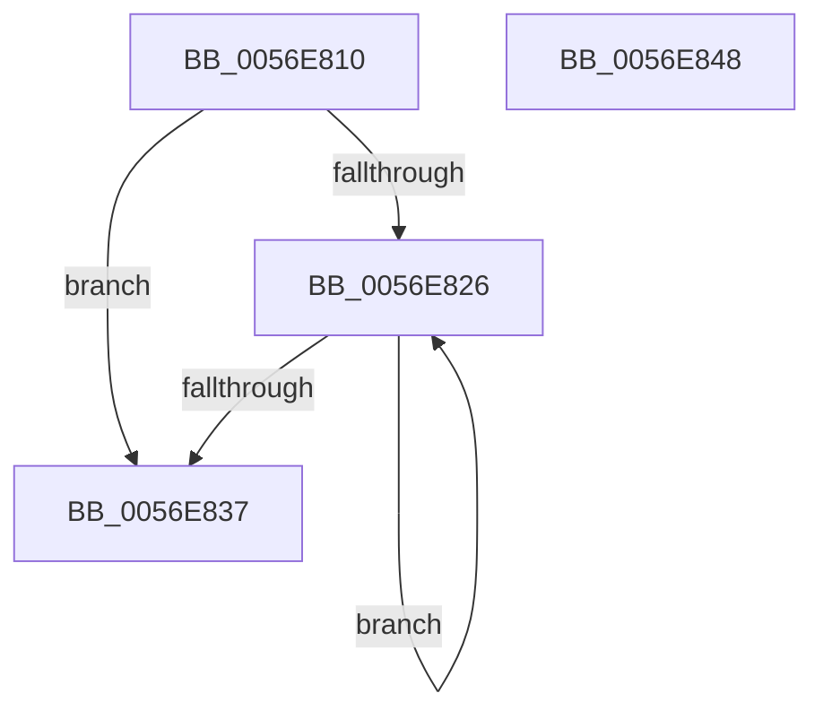

# HalpBlkWdWorkerRoutine

- RVA: `0x0056E810`–`0x0056E849` (길이 `57` bytes)
- VA: `0x000000014056E810`
- 실행 섹션: `.text`
- PDB 이름 있음: `예`; PDB Function 태그: `아니요`
- unwind 정보 RVA: `0x0005CAAC`
- 디코드: `18`개 명령, `57/57` bytes 표시
- 미해석 바이트: `0` (있으면 어셈블리에 `.byte`로 보존)

> 이 문서는 커널 이미지의 기계어와 PDB 기호를 분석해 생성했습니다. 4번과 5번은 함수 원형과 자료형을 바이너리 사용 방식에서 추정한 C 해석이며 원본 소스 복구 결과는 아닙니다.

## 1. Dependencies

- 직접 호출 지점: **1**; 고유 호출 대상: **1**
- 직접 호출자로 확인된 함수: **0**
- RIP 상대 이미지 참조: **2**

### Outgoing calls
- `0x0056E828` → [HalpBlkWdFatalExceptionCheck](HalpBlkWdFatalExceptionCheck_function_0056E784.md) (function, `0x0056E784`)

### Direct callers
- 이 함수 시작 RVA로 연결되는 직접 call은 확인되지 않았습니다. 간접 호출은 완전히 역산할 수 없습니다.

### Static image references
- `0x0056E81C` → RVA `0x00F8FA90` (`.data`; read)
- `0x0056E837` → RVA `0x00F8F888` (`.data`; read/write)

## 2. Other-region calls and transfers

- 다른 실행 섹션으로 향하는 call: **0**
- 별도 외부 분기/꼬리 이동을 확인하지 못했습니다.

## 3. Assembly (complete function range)

```asm
0056E810  48 89 5C 24 08                  mov qword ptr [rsp + 8], rbx
0056E815  57                              push rdi
0056E816  48 83 EC 20                     sub rsp, 0x20
0056E81A  33 DB                           xor ebx, ebx
0056E81C  39 1D 6E 12 A2 00               cmp dword ptr [rip + 0xa2126e], ebx
0056E822  8B FB                           mov edi, ebx
0056E824  76 11                           jbe 0x14056e837
0056E826  8B CF                           mov ecx, edi
0056E828  E8 57 FF FF FF                  call 0x14056e784
0056E82D  FF C7                           inc edi
0056E82F  3B 3D 5B 12 A2 00               cmp edi, dword ptr [rip + 0xa2125b]
0056E835  72 EF                           jb 0x14056e826
0056E837  87 1D 4B 10 A2 00               xchg dword ptr [rip + 0xa2104b], ebx
0056E83D  48 8B 5C 24 30                  mov rbx, qword ptr [rsp + 0x30]
0056E842  48 83 C4 20                     add rsp, 0x20
0056E846  5F                              pop rdi
0056E847  C3                              ret
0056E848  CC                              int3
```

## 4. C-style interpretation (structured pseudocode)

```c
__int64 __fastcall HalpBlkWdWorkerRoutine(void)
{
    __int64 result;
    __int64 v_rbx;
    __int64 v_rdi;
    __int64 v_rsp;
    unsigned __int64 v_stack_p8;

    v_stack_p8 = v_rbx;
    v_rsp = (v_rsp) - (32);
    v_rbx = 0;
    if ((*(unsigned int *)(v_rip + 10621550)) <= 0) goto loc_0056E837;
loc_0056E826:
    result = HalpBlkWdFatalExceptionCheck(0, a2, a3, a4);
    v_rdi = (unsigned int)((0) + 1);
    if (((unsigned int)(v_rdi)) < (*(unsigned int *)(v_rip + 10621531))) goto loc_0056E826;
loc_0056E837:
    v_rsp = (v_rsp) + (32);
    return result;
}
```

## 5. (Beta) C Style

```c
void HalpBlkWdWorkerRoutine(void)
{
    int64_t result;
    int64_t local_rbx;
    int64_t local_rdi;
    int64_t local_rsp;
    uint64_t v_stack_p8;

    v_stack_p8 = local_rbx;
    local_rsp = (local_rsp) - (32);
    local_rbx = 0;
    if ((*(uint32_t *)(v_rip + 0xA2126E)) <= 0) goto loc_0056E837;
loc_0056E826:
    result = HalpBlkWdFatalExceptionCheck(0, a2, a3, a4);
    local_rdi = (uint32_t)((0) + 1);
    if (((uint32_t)(local_rdi)) < (*(uint32_t *)(v_rip + 0xA2125B))) goto loc_0056E826;
loc_0056E837:
    local_rsp = (local_rsp) + (32);
    return result;
}
```

## 6. Execution-region graph

[열기: 2D/3D 그래프와 함수 탐색 컨트롤 패널](../../../control-panel.html?section=text&rva=0x0056E810&view=graph)

- 2D 그래프는 위에서 아래로 흐르고, 3D 그래프는 빈 공간을 드래그해 회전합니다. Shift+드래그는 이동, 휠은 확대·축소, 함수 노드 선택은 대상 보고서 이동입니다.

### Static fallback


