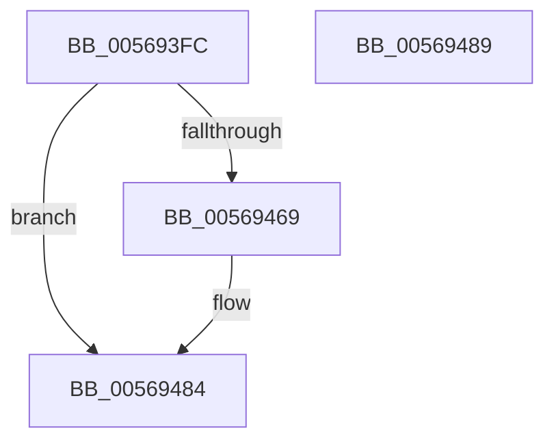

# HalpDmaConfigureInterrupt

- RVA: `0x005693FC`–`0x0056948A` (길이 `142` bytes)
- VA: `0x00000001405693FC`
- 실행 섹션: `.text`
- PDB 이름 있음: `예`; PDB Function 태그: `아니요`
- unwind 정보 RVA: `0x0007A034`
- 디코드: `34`개 명령, `142/142` bytes 표시
- 미해석 바이트: `0` (있으면 어셈블리에 `.byte`로 보존)

> 이 문서는 커널 이미지의 기계어와 PDB 기호를 분석해 생성했습니다. 4번과 5번은 함수 원형과 자료형을 바이너리 사용 방식에서 추정한 C 해석이며 원본 소스 복구 결과는 아닙니다.

## 1. Dependencies

- 직접 호출 지점: **2**; 고유 호출 대상: **2**
- 직접 호출자로 확인된 함수: **1**
- RIP 상대 이미지 참조: **1**

### Outgoing calls
- `0x00569460` → [HalpInterruptConnect](../54/HalpInterruptConnect_function_005426F8.md) (function, `0x005426F8`)
- `0x0056947E` → [KeBugCheckEx](../4F/KeBugCheckEx_function_004FD660.md) (function, `0x004FD660`)

### Direct callers
- [HalpDmaInitializeControllers](../55/HalpDmaInitializeControllers_function_005531E8.md) at `0x0055323F`

### Static image references
- `0x0056943A` → RVA `0x004BE3D0` (`HalpDmaControllerInterruptRoutine`; read)

## 2. Other-region calls and transfers

- 다른 실행 섹션으로 향하는 call: **0**
- 별도 외부 분기/꼬리 이동을 확인하지 못했습니다.

## 3. Assembly (complete function range)

```asm
005693FC  4C 8B DC                        mov r11, rsp
005693FF  48 83 EC 68                     sub rsp, 0x68
00569403  49 83 63 08 00                  and qword ptr [r11 + 8], 0
00569408  48 8D 81 A8 00 00 00            lea rax, [rcx + 0xa8]
0056940F  4C 8B D2                        mov r10, rdx
00569412  41 B1 0C                        mov r9b, 0xc
00569415  49 8D 53 08                     lea rdx, [r11 + 8]
00569419  41 B8 CF 00 00 00               mov r8d, 0xcf
0056941F  49 89 53 F0                     mov qword ptr [r11 - 0x10], rdx
00569423  8B 91 B4 00 00 00               mov edx, dword ptr [rcx + 0xb4]
00569429  C7 44 24 50 03 00 00 00         mov dword ptr [rsp + 0x50], 3
00569431  C6 44 24 48 0C                  mov byte ptr [rsp + 0x48], 0xc
00569436  49 89 43 D8                     mov qword ptr [r11 - 0x28], rax
0056943A  48 8D 05 8F 4F F5 FF            lea rax, [rip - 0xab071]
00569441  49 89 4B D0                     mov qword ptr [r11 - 0x30], rcx
00569445  49 89 43 C8                     mov qword ptr [r11 - 0x38], rax
00569449  8B 81 BC 00 00 00               mov eax, dword ptr [rcx + 0xbc]
0056944F  89 44 24 28                     mov dword ptr [rsp + 0x28], eax
00569453  8B 81 B8 00 00 00               mov eax, dword ptr [rcx + 0xb8]
00569459  49 8B CA                        mov rcx, r10
0056945C  89 44 24 20                     mov dword ptr [rsp + 0x20], eax
00569460  E8 93 92 FD FF                  call 0x1405426f8
00569465  85 C0                           test eax, eax
00569467  79 1B                           jns 0x140569484
00569469  48 83 64 24 20 00               and qword ptr [rsp + 0x20], 0
0056946F  45 33 C9                        xor r9d, r9d
00569472  4C 63 C0                        movsxd r8, eax
00569475  BA 00 04 00 00                  mov edx, 0x400
0056947A  41 8D 49 5C                     lea ecx, [r9 + 0x5c]
0056947E  E8 DD 41 F9 FF                  call 0x1404fd660
00569483  CC                              int3
00569484  48 83 C4 68                     add rsp, 0x68
00569488  C3                              ret
00569489  CC                              int3
```

## 4. C-style interpretation (structured pseudocode)

```c
__int64 __fastcall HalpDmaConfigureInterrupt(__int64 a1, __int64 a2)
{
    __int64 result;
    __int64 v_rsp;
    unsigned int v_stack_m18;
    unsigned __int8 v_stack_m20;
    unsigned int v_stack_m40;
    unsigned int v_stack_m48;

    v_rsp = (v_rsp) - (104);
    *(unsigned __int64 *)(v_rsp - 16) = v_rsp + 8;
    v_stack_m18 = 3;
    v_stack_m20 = 12;
    *(unsigned __int64 *)(v_rsp - 40) = a1 + 168;
    *(unsigned __int64 *)(v_rsp - 48) = a1;
    *(unsigned __int64 *)(v_rsp - 56) = v_rip - 700529;
    v_stack_m40 = (unsigned int)((unsigned int)(*(unsigned int *)(a1 + 188)));
    v_stack_m48 = (unsigned int)((unsigned int)(*(unsigned int *)(a1 + 184)));
    result = HalpInterruptConnect(a2, (unsigned int)(*(unsigned int *)(a1 + 180)), 207, 12);
    if (sign_flag) {
        a4 = 0;
        a3 = (int)((unsigned int)(result));
        a2 = 0x400ULL;
        a1 = a4 + 92;
        result = KeBugCheckEx(a1, a2, a3, a4);
    }
    v_rsp = (v_rsp) + (104);
    return result;
}
```

## 5. (Beta) C Style

```c
int64_t HalpDmaConfigureInterrupt(void *Arg1, int64_t Arg2)
{
    uint8_t *arg1 = (uint8_t *)Arg1;

    int64_t result;
    int64_t local_rsp;
    uint32_t v_stack_m18;
    uint8_t v_stack_m20;
    uint32_t v_stack_m40;
    uint32_t v_stack_m48;

    local_rsp = (local_rsp) - (104);
    *(uint64_t *)(local_rsp - 0x10) = local_rsp + 8;
    v_stack_m18 = 3;
    v_stack_m20 = 12;
    *(void **)(local_rsp - 0x28) = Arg1 + 168;
    *(void **)(local_rsp - 0x30) = Arg1;
    *(uint64_t *)(local_rsp - 0x38) = v_rip - 700529;
    v_stack_m40 = (uint32_t)((uint32_t)(*(uint32_t *)(arg1 + 0xBC)));
    v_stack_m48 = (uint32_t)((uint32_t)(*(uint32_t *)(arg1 + 0xB8)));
    result = HalpInterruptConnect(Arg2, (uint32_t)(*(uint32_t *)(arg1 + 0xB4)), 207, 12);
    if (sign_flag) {
        a4 = 0;
        a3 = (int32_t)((uint32_t)(result));
        Arg2 = 0x400ULL;
        Arg1 = a4 + 92;
        result = KeBugCheckEx(Arg1, Arg2, a3, a4);
    }
    local_rsp = (local_rsp) + (104);
    return result;
}
```

### 관측된 메모리 오프셋

구조체 형식이 확인되지 않은 접근은 인자 기준의 오프셋으로만 기록했습니다.

| 기준 인자 | 오프셋 표현 | 폭 (bit) | 접근 |
|---|---:|---:|---|
| `Arg1` | `+ 0xA8` | `64` | `R` |
| `Arg1` | `+ 0xB4` | `32` | `R` |
| `Arg1` | `+ 0xB8` | `32` | `R` |
| `Arg1` | `+ 0xBC` | `32` | `R` |

## 6. Execution-region graph

[열기: 2D/3D 그래프와 함수 탐색 컨트롤 패널](../../../control-panel.html?section=text&rva=0x005693FC&view=graph)

- 2D 그래프는 위에서 아래로 흐르고, 3D 그래프는 빈 공간을 드래그해 회전합니다. Shift+드래그는 이동, 휠은 확대·축소, 함수 노드 선택은 대상 보고서 이동입니다.

### Static fallback


